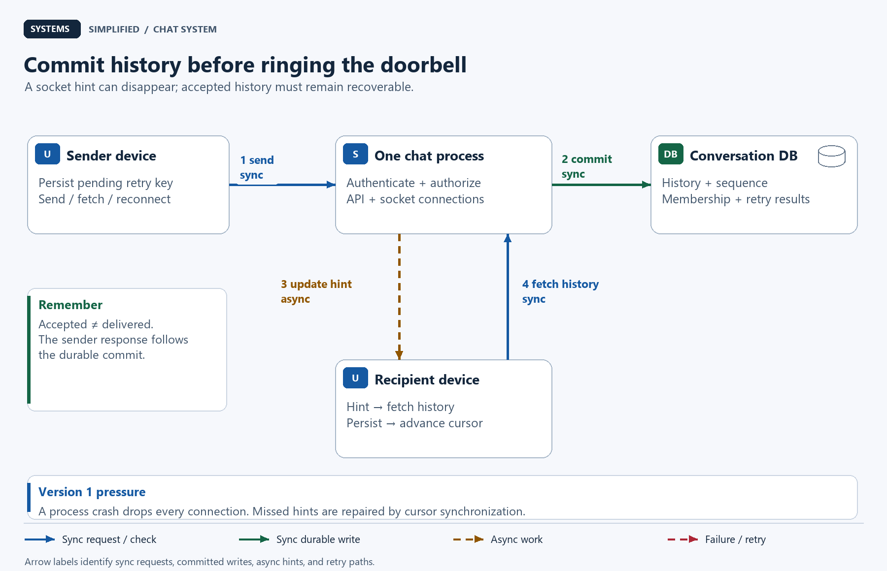
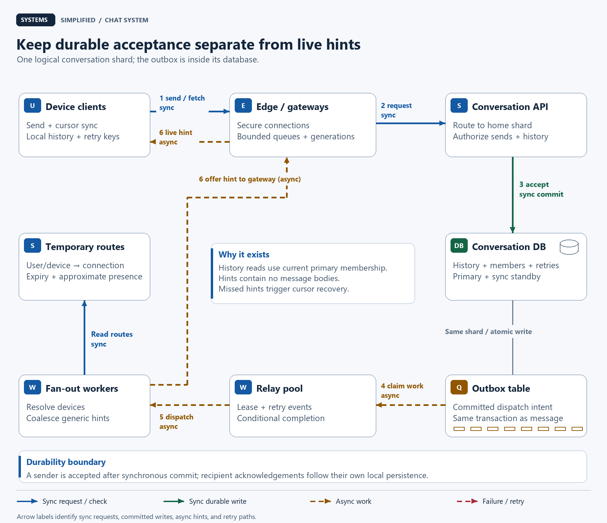
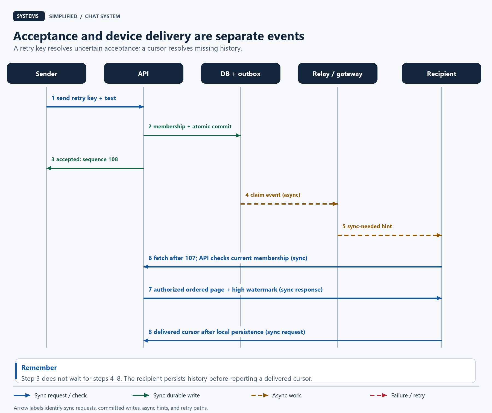
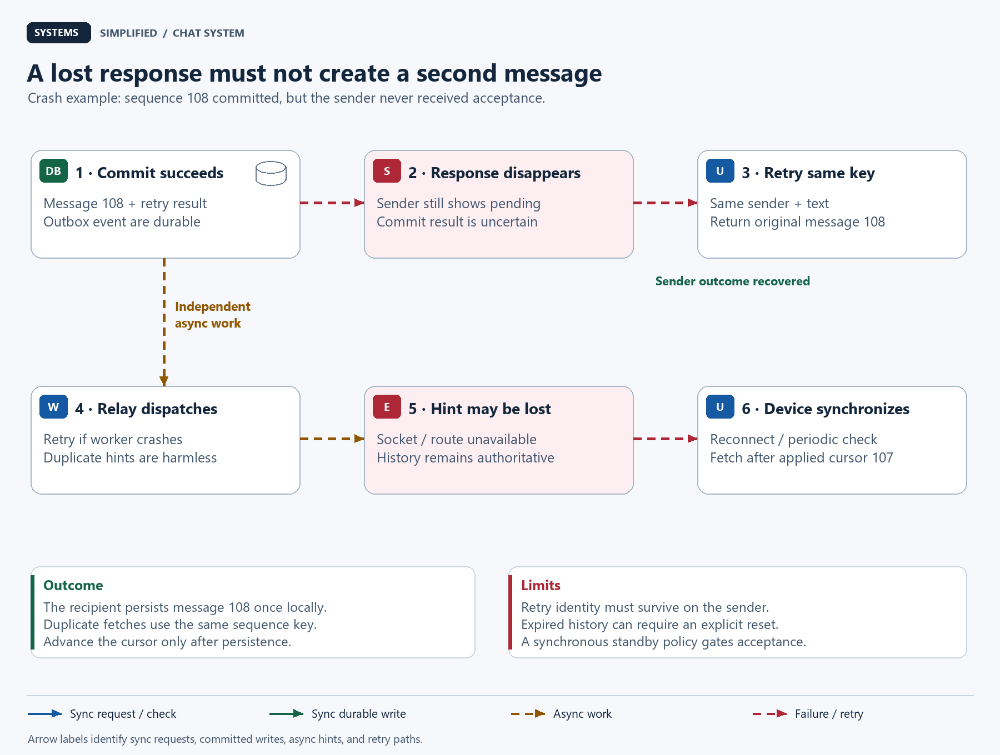

# Design a Chat System

> **In one sentence:** Help people exchange messages across devices while making a disconnected phone, a repeated send, and a failed server recoverable events.

Maya sends “Meet at platform 4” as her train enters a tunnel. The spinner disappears, but her friend has not seen the message. Maya taps retry. When both phones reconnect, they should agree on one message and its place in the conversation.

Design a chat system around a durable, ordered conversation history. Accept each send in a database transaction with a retry key and an outbox event. Use WebSockets to signal available updates, then fetch authorized history by sequence number. Recover from lost hints and disconnected devices by synchronizing from persisted cursors; distinguish server acceptance from device delivery and human reading.

**Level:** Intermediate  
**Patterns:** [Idempotent sends](#how-do-retries-become-one-message), [conversation ordering](#data-model-and-partitioning), [transactional outbox](#end-to-end-flow), [cursor synchronization](#how-does-a-device-recover-missed-messages), [bounded backpressure](#reliability-correctness-and-recovery)  
**Read time:** About 27 minutes  
**Prerequisites:** Basic web requests and database rows; connection, ordering, and delivery terms are explained below.  
**Article facts:** Prepared and published October 17, 2026; human review pending. This is an illustrative private chat service, not a description of WhatsApp, Slack, or another company's internal architecture. Traffic, limits, retention, and service targets are hypothetical.

## Why this system matters

Chat looks like moving text between two sockets. The harder job is preserving shared history when people and servers disappear independently. A socket can close immediately after the database commits. A device can display a message and crash before saving it. A worker can deliver the same update twice.

A **WebSocket** is a persistent, two-way connection between a client and a server. It makes live updates convenient, but it does not itself store offline history or define application acknowledgements. The [WebSocket protocol](https://www.rfc-editor.org/rfc/rfc6455.html) provides the connection and framing; the service still needs its own recovery contract.

We will build that contract first, then add connection servers and background fan-out. **Fan-out** means sending an update toward multiple recipients or devices.

## The problem in plain English

Maya opens a private conversation, types a message, and sends through an authenticated **application programming interface (API)**. Her app saves its pending send locally before attempting the network request.

```http
POST /v1/conversations/c-42/messages
Content-Type: application/json

{"client_message_id":"9e9465c7-6503-46f6-a544-46203eb05ca1","text":"Meet at platform 4"}
```

```json
{"message_id":"m-81","conversation_id":"c-42","sequence":108,"state":"accepted"}
```

The **client message ID** is a randomly generated retry key created once per deliberate send. The server derives the sender from authentication. On a timeout, the app retries the same key and text instead of inventing another send. A second tap intended to send a second identical message gets a new key.

Define status words precisely:

| Status | Evidence | What it does not prove |
| --- | --- | --- |
| Pending | The sending device has a local queued send | The server has received it |
| Accepted | The message transaction met the configured commit durability policy | Any recipient device received it |
| Delivered to device | A specific recipient device reports persisting a contiguous history prefix | A human opened or read it |
| Read | A client reports advancing its visible read position | Attention, comprehension, or proof that a person saw every word |

> **Mental model:** Conversation history is the notebook. A WebSocket notification is a doorbell telling a device to look at the notebook. Losing the doorbell must not erase a page.

## What success looks like

### Functional requirements

- Send immutable text in one-to-one conversations and private groups of at most 100 members.
- Show retained history in a stable order shared by all devices.
- Retry uncertain sends without creating a second accepted message within the retry contract.
- Catch up after disconnects and synchronize multiple devices independently.
- Add or remove members; require current membership for sends and history reads. New members may read all retained history in this example.
- Record optional delivered and read positions, and show approximate presence or typing indicators.

### Non-functional requirements

These are proposed goals to validate with load and fault testing, not benchmarks or unconditional guarantees. **p95** is the latency boundary below which 95% of observations fall.

| Goal | Illustrative target or contract | Why it matters |
| --- | --- | --- |
| Send acceptance | p95 under 200 ms within the conversation's home region; 99.9% monthly availability | Give fast, meaningful sender feedback |
| Online visibility | p95 under 1 second in healthy conditions, including hint and history fetch | Measure what the recipient sees, not socket write time |
| Ordering | One committed sequence per conversation; no global order across conversations | Two devices should agree on conversation order |
| Retry support | Automatic retries for up to 24 hours; retry mappings retained 31 days | Bound client retry and deduplication storage |
| History | 30-day server retention; maximum 4 KiB UTF-8 text per message | Bound storage and processing |
| Removal | New authorized operations after removal commits must fail | Stop future server-authorized reads and writes |
| Recovery | Reconcile a connected, active device within a 30-second periodic sync interval, plus scheduling and fetch time | Recover even if the last hint was lost |

A **region** is a geographic deployment area; a **zone** is a failure domain inside it. Acknowledged messages are designed to survive one primary/zone failure using a synchronous standby and controlled failover, as qualified in [recovery](#reliability-correctness-and-recovery). Whole-region recovery may lose recent messages if its backup is asynchronous.

### Out of scope

- Voice/video calls, very large public channels, full-text search, bots, and attachments.
- End-to-end encryption: this example permits the service to inspect message text. Transport and storage encryption do not provide that stronger property.
- Message editing, message-specific deletion, legal holds, and user-controlled disappearing-message timers. A real product needing these requires an ordered mutation/deletion protocol.
- Active writes to the same conversation in multiple regions. Offline sending means a local pending queue, not server acceptance while disconnected.

## Assumptions and scale

Every number below is an invented planning input. KB, GB, and TB are decimal; KiB is 1,024 bytes. Stored size includes estimated message metadata, not only visible text.

| Input | Assumption | Derivation / note |
| --- | --- | --- |
| Daily active people | 1 million | Planning estimate, not registered accounts |
| Sends | 40/person/day: 40 million/day | 1,000,000 × 40 |
| Peak send factor | 5 times daily average | Burst assumption to load-test |
| Accepted sends | About 463/second average; 2,315/second peak | 40,000,000 ÷ 86,400, then × 5 |
| Average stored message | 1 KB | Maximum body is 4 KiB; distribution matters |
| Logical history storage | 40 GB/day; 1.2 TB for 30 days | 40 million × 1,000 bytes × 30; before indexes and copies |
| Three full history copies | 3.6 TB before indexes, outbox, backups, and cursors | 1.2 TB × 3; primary, synchronous standby, additional copy |
| Concurrent connections | 200,000 device connections | A person may have several devices |
| Illustrative connection budget | 20,000/gateway; 16 gateways across four zones | 320,000 slots; after one zone loses four gateways, 240,000 slots remain |
| Average fan-out | 4 recipient-device hints per accepted message | Includes the sender's other devices; weighted workload assumption |
| Hint rate | About 1,852/second average; 9,259/second peak | Accepted sends × 4 |
| Heartbeats | About 6,667/second | 200,000 connections ÷ 30 seconds; jitter their timing |
| Active recovery checks | About 6,667/second | If all 200,000 devices check one open conversation every 30 seconds |
| Retry mapping floor | About 119 GB logical over 31 days at 96 bytes/entry | 40 million × 31 × 96; indexes and row overhead add more |

The connection budget is an arithmetic illustration, not a claim that a particular machine can serve 20,000 sockets. Measure memory per connection, file-descriptor limits, encryption overhead, slow-client buffers, and reconnect throughput. The system also needs API and database capacity for receipts, history pagination, membership lookups, and retries.

One message to 99 other group members, each with two devices, produces 198 potential hints. At a hypothetical burst of 100 such sends/second, that conversation alone creates 19,800 hints/second. Average fan-out therefore cannot size the busiest room.

> **At scale:** Connections, message writes, and recipient work are separate load dimensions. A quiet million-socket fleet and a busy hundred-member conversation fail in different ways.

## Version 1 — the simplest credible design



The first version has one chat process and one database (DB). It already treats history as authoritative; a server restart merely makes clients reconnect and fetch what they missed.

1. A device authenticates, opens a WebSocket, and sends through the API in the same process.
2. The process checks membership, allocates a conversation sequence, and commits the message and retry mapping in one transaction.
3. It returns the accepted message identity and sends a best-effort “updates available” hint to other connected devices.
4. Devices fetch authorized history after their locally saved sequence, and periodically check for missed updates.

| Component | Why it exists | What it does not solve yet |
| --- | --- | --- |
| Device local store | Persist pending sends and applied history before advancing a cursor | Survive device loss unless another copy exists |
| One chat process | Handle authentication, sockets, writes, and reads simply | Independent scaling or process availability |
| Database | Hold messages, membership, sequences, and retry results | Automatic safe failover or unlimited writes to one conversation |

> **Why it exists:** The retry mapping belongs in the same transaction as the message. If a server remembers retries only in its memory, restarting it makes an uncertain send look new.

## Where Version 1 breaks

| Pressure | What fails | Observable symptom | Direction of the fix |
| --- | --- | --- | --- |
| Process restart | All sockets disconnect together | Reconnect surge and delayed live updates | Spread gateways across zones; stagger reconnects |
| Crash after message commit, before live hint | History advances without a notification | Online recipient sees the message only at recovery sync | Commit an outbox event with the message |
| Many sockets | Connection buffers compete with database request handling | Send latency rises even without more writes | Separate connection gateways from conversation API |
| Busy group | One lock and many recipients consume disproportionate capacity | Lock waits and fan-out backlog | Per-conversation limits, coalesced hints, isolated workers |
| Slow device | Outbound updates accumulate faster than it reads | Gateway memory grows without bound | Cap buffers, close slow sockets, recover through history |
| Single database or zone loss | No safe writer or history source | Sends fail or risky promotion loses accepted data | Replicate durably and fence the failed writer |

## Version 2 — production-scale architecture



The database path decides whether a message exists. The asynchronous path reduces the delay before devices discover it. Gateways hold sockets, while conversation services hold no irreplaceable in-memory message state. The diagram shows one logical conversation shard; each shard has its own primary, synchronous standby, and outbox.

### End-to-end flow

1. The edge balances authenticated device connections across gateways. A gateway registers an expiring route from `(user_id, device_id)` to its connection generation. A **generation** distinguishes a replacement connection from an old one.
2. The gateway forwards a send to the conversation API, routing by conversation ID to its home database shard. History fetches follow the same authorization path.
3. The API executes the short acceptance transaction described below. Message, sequence advancement, retry result, and **outbox event** commit together. An outbox is a database table of work that must happen after a successful transaction.
4. The API returns `accepted` only after the chosen synchronous commit policy succeeds. Recipient delivery is not part of this response.
5. A relay claims committed outbox rows using a short renewable work lease, reads them, and invokes fan-out workers. Fan-out resolves candidate recipient devices from current membership and temporary routes, then offers generic `sync_needed` hints to their gateways. Mark an outbox row dispatched only after those attempts finish; uncertain attempts are retried.
6. A gateway puts the hint on its bounded socket queue. The device fetches authorized history, saves it locally, and advances its cursor. Periodic reconciliation repairs hints lost after dispatch or while disconnected.

The relay does not hold a database transaction open during network calls. Workers condition completion on the current claim token so an expired claimant cannot overwrite a newer worker's state. A stale claimant can still send a duplicate hint; that is harmless. Retry fan-out failures with backoff and isolate poisoned events for inspection; never silently treat them as delivered messages.

The [Debezium outbox documentation](https://debezium.io/documentation/reference/stable/transformations/outbox-event-router.html) describes a change-capture implementation and event keys. This design starts with a polling relay; a separate event broker is optional once multiple independent consumers or sustained backlog justify it.

### Component decisions

| Component | Responsibility | Why this choice | Main trade-off |
| --- | --- | --- | --- |
| Device local store | Pending retry keys, messages, applied cursor per conversation | A reconnect can resume from known persisted state | Local corruption or reinstall requires a fresh sync |
| Edge / connection gateways | Secure sockets, connection identity, routing, bounded buffers | Scale connections separately from writes | Reconnect and route cleanup complexity |
| Conversation API | Current authorization, accept transaction, paginated history, receipts | One business boundary for sockets and ordinary requests | Home-region round trips; primary read load |
| Conversation DB shard | Ordered history, membership, deduplication, outbox; replicated durability | Put atomic acceptance on one shard | Busy-conversation serialization and shard operations |
| Outbox table | Durable post-commit dispatch intent | Close the commit-versus-notify crash window | Additional writes, retention, and backlog monitoring |
| Relay pool | Claim events, retry dispatch, finish conditional claims | Recover a crashed worker without losing intent | Duplicate dispatch; leases do not prevent every external effect |
| Fan-out workers | Find candidate devices, coalesce hints, isolate hot conversations | Keep recipient work off the send transaction | Hints may repeat, reorder, or disappear |
| Temporary route store | Expiring device routes and approximate presence | Fast discovery without making routes durable history | Stale routes; failure delays hints but not history |

The outbox is physically inside the same database shard as the message, drawn separately to explain its role. Relays carry event IDs and conversation references, not a second authoritative message body. Retain undispatched rows for recovery, alert on their age, and delete completed rows after a chosen operational window such as 24 hours. That window is an assumption, not an extra history guarantee.

> **Trade-off:** This lesson sends hints, then fetches bodies. That adds a request but keeps message authorization at one explicit boundary. Pushing full bodies can reduce latency, but requires its own revocation and queued-payload policy.

## Data model and partitioning

| Data | Source of truth and key | Access pattern / invariant | Partition / retention |
| --- | --- | --- | --- |
| Conversation | Database: `conversation_id`, `last_sequence`, membership revision | Lock before changing history or membership | Hash of conversation ID to virtual shard; one active home writer |
| Membership | Database: `(conversation_id, user_id)`, role, active flag | Send, fetch, receipt, and membership checks use primary state | Same shard as conversation; inactive rows retained as policy requires |
| Message | Database: `(conversation_id, sequence)`, server ID, sender, text, created time | Range reads by sequence; unique server message identity | Same shard; retain bodies 30 days |
| Retry mapping | Database: `(conversation_id, sender_id, client_message_id)`; body digest, sequence, message ID | Unique, non-null key; conflicting reuse is rejected | Same shard; 31-day mapping retention, including after body expiry |
| Outbox event | Database: unique event ID, conversation ID, sequence, dispatch state, claim token | Insert with accepted message; conditional worker completion | Same shard; pending work retained, completed work expires |
| Device position | Database: `(conversation_id, user_id, device_id)`; delivered interval start, delivered/read sequence | Monotonic end positions from authenticated reports; preserve reset boundaries | Same shard; expire inactive devices by explicit policy |
| Device route | Temporary store: `(user_id, device_id)` to gateway and generation | Lookup and compare-generation removal; renewable expiry | Partition by user/device; short time to live |

A **shard** holds a subset of the database's rows. Keep a conversation's acceptance data together so one local transaction can enforce its invariants. A routing map translates conversation IDs to virtual shards. Moving a shard requires pausing or fencing its previous writer, copying/catching up state, and changing the route; hashing alone does not implement a safe migration.

List a user's memberships through an index on `user_id` on each shard. For a modest, bounded shard count, the conversation-list API can query those primary indexes and merge paginated results. Reconnect and active periodic list refresh discover newly added conversations. At a larger shard count, a per-user materialized directory earns its place; stale candidates still require primary membership checks, and missed directory events need reconciliation.

### How do retries become one message?

All send and membership-change transactions acquire the conversation row lock first. The send then checks active membership, searches the unique retry key, and compares a digest of the immutable request text. An existing matching key recovers its original identity. Before returning `accepted`, the retry performs a small confirmation write and commits with the same synchronous durability policy, covering the original message in the replicated log. A read-only lookup alone cannot establish that a previously uncertain commit reached the synchronous standby. A mismatched body returns a conflict instead of silently changing the earlier message.

For a new key, the transaction advances `last_sequence`, inserts the message, inserts the retry result, and inserts the outbox event, then commits. A rollback also rolls back the counter advancement. [PostgreSQL row locks](https://www.postgresql.org/docs/current/explicit-locking.html#LOCKING-ROWS) and [unique constraints](https://www.postgresql.org/docs/current/ddl-constraints.html#DDL-CONSTRAINTS-UNIQUE-CONSTRAINTS) provide the underlying primitives; application lock order and transaction boundaries provide this protocol.

```text
begin transaction
  lock conversation c-42 for update
  require authenticated sender is an active member
  if retry key exists:
    require stored digest matches this request
    update retry confirmation time
    commit with configured synchronous durability
    return recorded outcome
  sequence = last_sequence + 1
  update conversation counter
  insert message + retry mapping + outbox event
commit with configured synchronous durability
return accepted(message_id, sequence)
```

Use a small transaction deadline and retry aborted transactions with bounded jitter. Do not perform fan-out or wait for recipients while holding the lock. If the network fails during commit, the result is uncertain: retry the same key. Do not translate a timeout into proof of rollback.

The supported client retry window is 24 hours; mappings remain for 31 days to cover delayed requests and body expiry. Once a body expires but its mapping remains, return `expired` with the recorded identity rather than recreating its text. After mapping removal, deduplication is no longer promised: clients must not replay ancient pending sends automatically. A reinstall that loses the key also loses this retry identity. There is no universal exactly-once network delivery guarantee.

### What does conversation order mean?

Sequences describe the order in which the home database accepts messages. Two people sending simultaneously may see either accepted first, but everyone eventually sees the same order. Device timestamps are display metadata, not the sorting authority. There is no meaningful total order between unrelated conversations.

Because the counter is transactional and every new message takes the same lock, accepted message sequences are contiguous before retention removes a prefix. A hot conversation is therefore a serial resource. Adding shards distributes different conversations; it does not parallelize one conversation's counter. If measured lock occupancy were 5 ms per send, its theoretical serialization ceiling would be roughly 200 sends/second before queueing and overhead—not a production throughput claim.

## Reliability, correctness, and recovery



The request diagram separates the acceptance response from recipient synchronization. A recipient reports delivery only after its local transaction has persisted every message through the reported cursor. That acknowledgement can itself be retried.

### How does a device recover missed messages?

Each device stores a **cursor**, the highest contiguous sequence it has applied for one conversation. “Applied” means the message is persisted locally, not merely received on the network. The client calls `GET /v1/conversations/c-42/messages?after_sequence=107&limit=100`.

1. The API locks the conversation row, checks current primary membership, and reads a bounded page from the same transaction. It returns messages sorted by sequence, `next_after_sequence`, a committed `high_watermark`, and `first_available_sequence`. The lock and page limit bound the authorization/read operation; never hold this lock while transmitting the response.
2. The client stores each message keyed by `(conversation_id, sequence)` and advances its applied cursor in the same local transaction. Repeated pages replace the same records. Learning that the high watermark is 110 does not authorize setting the cursor to 110 while 108 and 109 are absent.
3. Fetch additional pages until caught up to the observed high watermark. A new hint or periodic sync checks again for later commits. Serialize fetch-and-apply per conversation or coordinate overlapping requests so an older response cannot move the cursor backward.
4. On reconnect, register the new route before the initial history read. Buffer/coalesce hints during sync, and check again afterward. This closes the read-versus-subscribe race; the periodic check still repairs an independently lost final hint.

When retention has removed history that the device never obtained, return `reset_required` and the first available sequence. The client explicitly shows “Earlier messages are no longer available,” rebuilds the retained window, and establishes a new starting cursor. Retention removes only a contiguous eligible prefix under the conversation lock and updates `first_available_sequence` atomically; timestamp anomalies can delay pruning rather than create holes. Preserve monotonic sequence allocation after pruning: do not reset `last_sequence` to the retained row count.

After a reset, a delivered receipt must include its new starting boundary; the server records the retained interval actually persisted rather than asserting delivery across the missing prefix. A scalar delivered maximum alone cannot express that distinction. User-facing receipts for expired messages become unavailable; never infer that a reset device obtained them.

The 30-second reconciliation target applies to a connected, scheduled, active client in healthy conditions. A suspended mobile app may not run timers. It catches up on wake or reconnect. An optional mobile push notification can wake a device, but cannot replace retained history or become evidence of delivery.



The failure visual follows a commit whose response disappears. Retrying recovers the existing acceptance result. A lost live hint changes when the recipient looks at history; it does not change whether message 108 exists.

| Scenario | Design response | Remaining risk |
| --- | --- | --- |
| Crash before acceptance commit | Transaction rolls back; retry original key | The client may temporarily show an uncertain pending state |
| Commit succeeds, response is lost | Retry key returns original message and sequence | After key loss or retention expiry, the guarantee ends |
| Relay crashes after dispatch but before marking completion | Lease expires; dispatch repeats | Devices may receive duplicate or reordered hints |
| Hint bus, gateway, or route fails | Keep history; reconnect and periodically reconcile | Live visibility slows; recovery reads surge |
| Slow client | Coalesce hints; bound buffered bytes and age; close connection above budget | User must catch up; repeatedly slow devices may remain behind |
| Primary or zone fails | Stop writes, fence old primary, promote a confirmed durable synchronous standby | Uncertain commits need retry; promotion takes time; simultaneous copy loss remains possible |
| Synchronous standby unavailable | Pause acceptance or return temporary unavailability | Availability falls; silently downgrading to asynchronous acceptance changes the contract |
| Whole home region unavailable | Pause writes or execute a tested fenced disaster-recovery procedure | Asynchronous remote recovery may lose recent accepted messages |
| History retention outruns an offline device | Explicit reset to retained history | The device cannot recover expired content from this service |

For the selected failure policy, configure a cross-zone synchronous standby with `synchronous_commit=on` and a nonempty `synchronous_standby_names`. A successful commit waits for the configured standby to flush the commit record; failover must promote a copy known to contain that durable history. This is not the same as allowing arbitrary asynchronous replicas to take over. [PostgreSQL's synchronous replication documentation](https://www.postgresql.org/docs/current/warm-standby.html#SYNCHRONOUS-REPLICATION) explains the waiting and availability cost. Keep read-after-write history fetches on the primary; a flushed standby need not yet have replayed the transaction.

Temporary route storage can be Redis or another expiring key store. If using [Redis Pub/Sub](https://redis.io/docs/latest/develop/pubsub/) between workers and gateways, its at-most-once delivery means a disconnected subscriber can miss an event permanently. Therefore only hints use that path; the database plus cursor protocol repairs missing application data.

> **Failure mode:** A broker acknowledgement, a successful socket write, and a recipient's persisted cursor are three different observations. Label metrics and user-visible checkmarks according to the observation actually collected.

### How are receipts and presence represented?

Store a delivered interval start and delivered/read sequence maxima per authenticated device. Before any retention reset, the interval begins at the conversation's initial sequence; afterward it begins at the explicit reset boundary. A device reports only a contiguous persisted interval, and a read position no greater than its delivered position. The server checks membership and bounds positions by the conversation high watermark. Treat these as client claims, not cryptographic proof; a malicious client can lie about reading.

A user-level delivered indicator can mean “at least one of this user's devices reported persistence of an interval containing this message.” State that choice in the product. Do not require every old laptop to acknowledge before advancing it. For retained messages, derive a user's read position from the reported intervals and end positions, with monotonic conditional updates to withstand delayed reports. Reject a late pre-reset receipt that would erase a newer reset boundary.

Presence uses renewable route expiry and is approximate. A lost heartbeat can make an online person appear offline; an expired socket can leave a stale online indicator until timeout. Typing signals may be dropped and expire after a few seconds. Neither deserves the durability or write amplification of message history.

### Operability and cost

Measure acceptance latency, lock wait by conversation, duplicate-key hits, uncertain commits, oldest pending outbox age, hint lag, recovery pages, cursor lag, route misses, reconnect rate, and gateway buffered bytes. Track healthy delivered-to-device delay separately from accepted latency.

Limit worker concurrency by shard and by conversation. Coalesce many hints for one device into a single “sync needed” signal. Batch history pages and receipt updates to reduce database round trips. A five-minute outbox outage at 2,315 peak sends/second creates about 694,500 events. If workers can process 5,000 events/second while 2,315 new ones continue, the ideal catch-up time is about 259 seconds: `694,500 ÷ (5,000 − 2,315)`. Fan-out skew, read load, and retries can make recovery slower.

Exercise gateway loss, response loss after commit, standby unavailability, duplicate outbox dispatch, missed final hints, slow readers, and history resets. Restore backups into an isolated environment and verify membership, message, counter, and retry invariants together. Keep pending-send queues bounded locally; show a useful retry state instead of generating an unbounded retry storm.

## Security and abuse resistance

- Use encrypted HTTPS and secure WebSockets (`wss://`). Validate the browser Origin against an allowlist, authenticate the handshake, expire sessions, and reauthorize actions. Follow the [OWASP WebSocket security guidance](https://cheatsheetseries.owasp.org/cheatsheets/WebSocket_Security_Cheat_Sheet.html); an open connection is not perpetual permission.
- Check current membership for each send, history page, membership change, and receipt. Membership mutations acquire the same conversation lock as sends and reads, making their order explicit. Only authorized administrators may change members.
- Hints carry a generic sync signal, not message bodies or conversation titles. They can be delayed or queued after removal; the subsequent fetch checks current authorization. A history operation authorized before removal may finish sending its bounded response afterward. Revocation cannot recall bytes already authorized, cached locally, or screenshotted.
- Apply per-account, per-device, per-conversation, and connection-creation limits. Bound frames before parsing, validate schema and text size, cap group membership, and reject spoofed sender/device IDs. Use separate budgets for typing and receipts so they cannot crowd out accepted messages.
- Render text as text, not executable HTML. Treat links as untrusted and make link preview fetching a separately sandboxed, network-restricted feature if introduced later. Avoid logging bodies, authentication tokens, and sensitive conversation identifiers in routine telemetry.
- Encrypt stored data and backups, restrict staff access, audit privileged reads, and explain the retention policy. Prune bodies after 30 days; primary storage, replicas, backups, and device copies have different deletion timelines. Retry mappings should retain only identity and a keyed body digest, not expired text.

> **Remember:** Private chat is an access-control promise. It is not automatically end-to-end encrypted, and removing membership cannot erase another person's local copy.

## The trade-offs that matter

| Decision | We optimize for | We give up | Prefer an alternative when… |
| --- | --- | --- | --- |
| Commit history before acceptance | Recoverable sender outcome | Database dependency on send latency | Ephemeral chat intentionally permits message loss |
| One writer and sequence per conversation | Stable ordering and simple retry semantics | A hot conversation's serial bottleneck | Very large channels justify specialized ordered append services or weaker ordering |
| Hints followed by authorized fetch | One clear body-access boundary | Extra fetch and primary read load | Full-body push has a defined authorization and queued-data revocation policy |
| Conversation-local message storage | One copy per accepted message per replica | Recipients do read-time synchronization work | Massive reads justify per-user inbox projections while retaining a source history |
| Synchronous cross-zone commit | Survive the selected primary/zone failure | Higher latency and blocked sends during standby loss | Product requirements permit a clearly stated data-loss window |
| Home-region writes | Unambiguous acceptance order | Distant senders pay network latency | A specified multi-region consistency protocol is worth its cost |
| Periodic cursor reconciliation | Correctness despite missing hints | Background reads and battery use | A durable device change feed can provide equivalent reconciliation efficiently |

## How the design evolves next

| Trigger | Next change | Why not add it on day one? |
| --- | --- | --- |
| Measured shard storage/write limits | Add virtual shards, repartition with fenced ownership | Migration and routing complexity need evidence |
| One conversation dominates lock waits | Apply admission control; dedicate its shard or adopt a sequenced append service | A dedicated shard removes neighbors, not the serial ordering requirement |
| Membership-list scatter becomes costly | Build replayable per-user conversation directories | Another eventually consistent view needs repair and authorization checks |
| Many independent event consumers | Publish outbox changes into a retained event log | Broker replication, lag, offsets, and operations add cost |
| Attachments become necessary | Store private objects and reference verified immutable versions | Upload, scanning, authorization, and retention become separate workflows |
| End-to-end encryption becomes required | Redesign device keys, membership rekeying, backups, and multi-device recovery | It changes moderation, search, recovery, and group trust boundaries |
| Regional latency becomes unacceptable | Assign conversation homes closer to participants, then evaluate explicit cross-region ordering | Geographical replication alone does not resolve concurrent acceptance |

## Key takeaways

- Acceptance, device delivery, and reading are different events; give each an explicit mechanism and label.
- Put the message, retry result, sequence, and outbox intent in one transaction.
- Use conversation sequences to order retained history, and persisted device cursors to recover it.
- Treat live hints and presence as disposable. A disconnected device must have another path to discover history.
- State durability, retry-retention, authorization, and pruning limits beside the promise they qualify.

## Quick check

1. The database commits sequence 108, then the sender times out. What key must the retry reuse, and why must it be stored with the message?
2. A device learns that the high watermark is 110 while its applied cursor is 107. Why must it fetch 108 onward instead of setting the cursor to 110?
3. Why can adding ten database shards leave one busy conversation's acceptance rate almost unchanged?

Suggested answers: reuse the same client message ID so the committed retry mapping returns 108 after confirming durability; a high watermark is not evidence of a persisted contiguous prefix; a conversation's single counter and lock remain on one authoritative writer.

## Related lessons

- [Rate limiter: protect send, receipt, and connection budgets](../rate-limiter/README.md).
- [Pastebin: separate private content from the right to read it](../pastebin/README.md).
- [File storage: add attachments with immutable, verified versions](../file-storage/README.md).

## Frequently asked questions

### Should a chat system use WebSockets or polling?

Use WebSockets for low-delay hints when clients can keep connections open. Keep an authorized history API for initial load, reconnects, and missed-hint recovery. Polling alone is a credible small-service option; tune its interval against freshness, request volume, and mobile scheduling limits.

### Can a chat service guarantee exactly-once message delivery?

This design guarantees one accepted message for a matching retry identity while its mapping is retained, and deduplicates repeated history pages on the client. It does not guarantee one network delivery attempt or prove a human read a message. State the retention, device-persistence, and database-failover conditions.

### How are messages ordered across multiple devices?

The conversation's home database allocates a sequence inside each acceptance transaction. Devices render this sequence order and recover missing ranges from history. Timestamps from different phones do not determine acceptance order, and unrelated conversations have no shared ordering guarantee.

### What happens if a recipient is offline?

The accepted message stays in retained conversation history. When the device wakes or reconnects, it fetches after its persisted cursor. An expired history prefix requires an explicit reset, not a false claim that all old messages were delivered. Optional mobile push improves discovery but does not replace synchronization.

### Does removing someone from a group remove their messages?

No. Here removal stops newly authorized reads, sends, and receipts after the membership change commits. It cannot recall an earlier authorized response or a device's existing copy. Deleting messages or changing cryptographic access requires additional, explicitly designed semantics.

## Glossary

| Term | Meaning here |
| --- | --- |
| Idempotency | Repeating a supported operation with the same identity has the recorded effect once |
| Sequence | Database-assigned position in one conversation's accepted history |
| Cursor | Highest contiguous sequence a device has persisted and applied within its current retained interval |
| High watermark | Latest committed conversation sequence observed by a history read |
| Transactional outbox | Durable dispatch intent inserted in the same transaction as a business change |
| Fan-out | Work to notify several recipient devices about an update |
| Backpressure | Bounding queued work and slowing or refusing producers when consumers lag |
| Fencing | Preventing an obsolete owner from continuing authoritative writes after takeover |
| Synchronous standby | A database copy whose configured durability acknowledgement gates acceptance |
| TTL | Time to live: an expiry interval for temporary route or presence data |

## Sources and further reading

The architecture and calculations are original illustrative choices. These primary sources support the specific mechanisms and cautions linked above; they do not claim this design is a deployed commercial chat platform.

1. [RFC 6455: WebSocket connection, framing, and control protocol](https://www.rfc-editor.org/rfc/rfc6455.html).
2. [PostgreSQL: row-level locks and concurrent modifications](https://www.postgresql.org/docs/current/explicit-locking.html#LOCKING-ROWS).
3. [PostgreSQL: unique constraints on multi-column identities](https://www.postgresql.org/docs/current/ddl-constraints.html#DDL-CONSTRAINTS-UNIQUE-CONSTRAINTS).
4. [PostgreSQL: synchronous replication and its availability trade-off](https://www.postgresql.org/docs/current/warm-standby.html#SYNCHRONOUS-REPLICATION).
5. [Debezium: outbox event routing and event keys](https://debezium.io/documentation/reference/stable/transformations/outbox-event-router.html).
6. [Redis: Pub/Sub delivery semantics and missed events](https://redis.io/docs/latest/develop/pubsub/).
7. [OWASP: WebSocket authentication, authorization, validation, and resource limits](https://cheatsheetseries.owasp.org/cheatsheets/WebSocket_Security_Cheat_Sheet.html).
