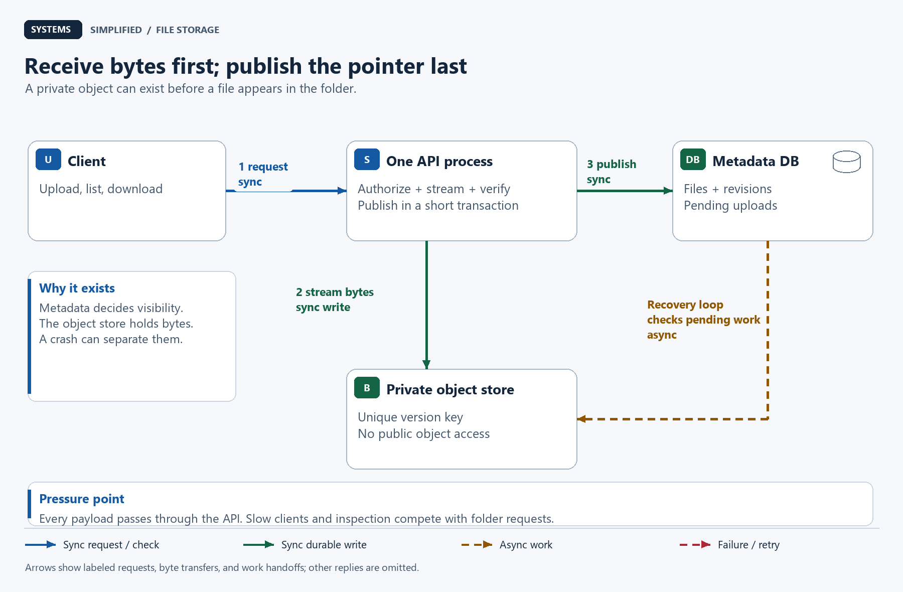
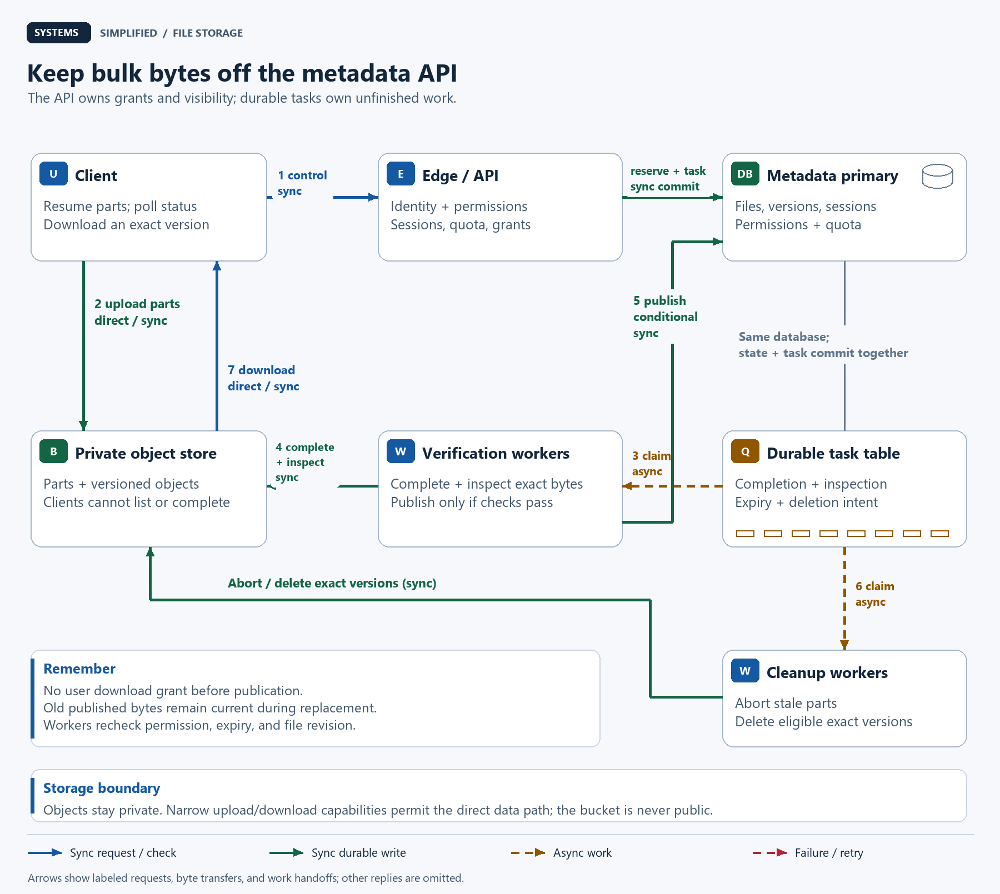
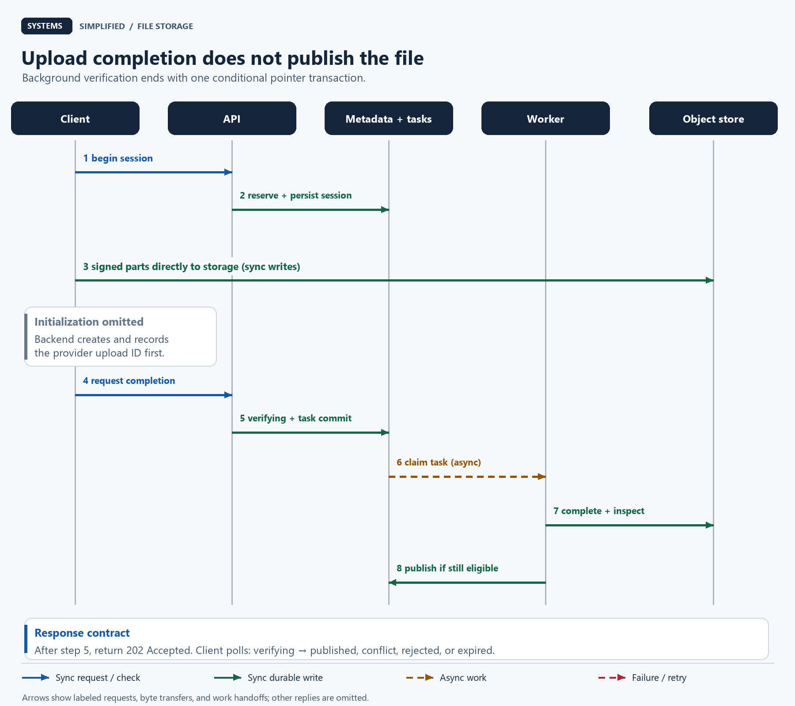
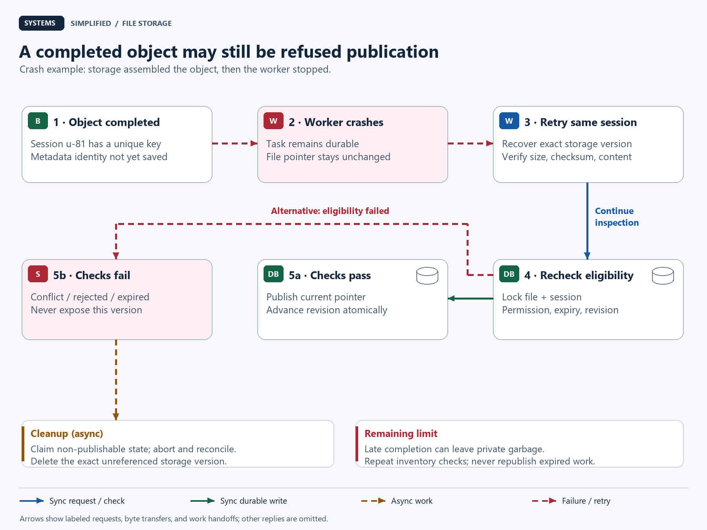

# Design a File Storage Service

> **In one sentence:** Let people upload, organize, replace, and privately download files without turning an interrupted transfer into a lost or half-visible document.

Maya shares design documents with her team. Her train enters a tunnel halfway through a large upload. Later, two teammates replace the same document at once. The service must let her resume the transfer, preserve the previous file until a replacement is ready, and explain whose change won.

Design a file storage service by separating file metadata and permissions from immutable file bytes. Upload parts directly to private object storage, verify the completed version, then atomically publish its metadata pointer. Use conditional replacement to prevent lost updates, durable tasks to recover interrupted work, and short-lived download grants whose revocation limits are explicit.

**Level:** Intermediate  
**Patterns:** [Direct uploads](#end-to-end-flow), [immutable versions](#data-model-and-partitioning), [conditional replacement](#how-do-two-replacements-avoid-overwriting-each-other), [durable tasks](#reliability-correctness-and-recovery), [bounded access grants](#what-does-revocation-actually-stop)  
**Read time:** About 28 minutes  
**Prerequisites:** Basic web requests and database rows; storage and concurrency terms are explained below.  
**Article facts:** Prepared and published October 16, 2026; human review pending. This is an illustrative team file service, not an account of a commercial provider's private architecture. Workloads, retention policies, and service targets are hypothetical.

## Why this system matters

A **file storage service** presents names, folders, permissions, and versions to people. An **object store** holds byte sequences under keys. The object store can persist a PDF, but it does not decide whether Maya may replace her team's current PDF.

That distinction drives the design: moving bytes and publishing a file are different operations. A slow upload should not occupy a database transaction, and a completed upload should not become downloadable before validation and permission checks finish.

This lesson works through three boundaries: receiving bytes versus publishing them, replacing a version versus overwriting another user's change, and revoking permission versus invalidating a previously issued download grant.

## The problem in plain English

Maya creates an upload session through an authenticated **application programming interface (API)**. The session is a durable record of one attempted new version. The service returns temporary permission to upload parts, not permission to read arbitrary objects.

```http
POST /v1/files/f-42/uploads
Idempotency-Key: trip-2026-10-16
Content-Type: application/json

{"name":"proposal.pdf","size_bytes":10485760,"expected_revision":7}
```

```json
{"upload_id":"u-81","version_id":"v-8a","state":"uploading","part_size_bytes":16777216}
```

The client requests signed part URLs from this session, sends the bytes, then asks the service to complete it. A status endpoint reports `uploading`, `verifying`, `published`, `conflict`, `rejected`, or `expired`. “Uploaded” in the transfer progress bar does not mean “published” in the folder listing.

> **Mental model:** A file name is a library catalog entry. Uploading places a new book in the receiving room; publishing changes the catalog to point at an inspected copy.

## What success looks like

### Functional requirements

- Create files, list a folder, rename a file, and download an authorized current version.
- Resume interrupted uploads by retrying missing parts within a session's lifetime.
- Replace a file only if its metadata revision still matches the revision the writer saw.
- Keep the previous published version available during upload and verification.
- Share within a tenant, revoke access, and logically delete a file. A **tenant** is one organization's isolated workspace.
- Report asynchronous verification and recovery status; retain old versions for seven days in this example.

### Non-functional requirements

These are proposed targets to load-test, not measured service guarantees.

| Goal | Illustrative target | Why it matters |
| --- | --- | --- |
| Metadata API | 99.9% monthly availability; p95 under 200 ms excluding transfer and verification | A folder should open without waiting for a large file |
| File size | Up to 5 GiB; uploads expire after 24 hours | Bound resource use and abandoned work |
| Publication correctness | Only a verified, authorized version can become current; conditional replacement has one winner | Avoid half-visible files and lost updates |
| Authorization | Current primary metadata is checked before each download grant | Avoid stale permissions from read replicas |
| Revocation contract | Stop authorizing new grants after revocation commits; prior grants have a 60-second nominal lifetime | Make the remaining exposure visible |
| Recovery | Survive a process or zone failure; exercise restores and reconcile both stores | “The object exists” is insufficient evidence of recoverability |

Use **p95**, the 95th-percentile latency, to describe the slowest 5% boundary, not an average. A **zone** is an isolated infrastructure failure domain within a region. Database recovery and object durability depend on the selected provider, configuration, and failure scenario; this lesson does not promise zero loss across regions.

### Out of scope

- Operating-system file mounts, arbitrary in-place writes, real-time co-editing, and automatic desktop synchronization.
- Cross-tenant deduplication, public anonymous links, global search, and media transcoding.
- A worldwide content delivery network (CDN) and active writes in multiple regions. Those belong to later designs; direct storage delivery is sufficient here.

## Assumptions and scale

All inputs below are invented planning estimates. MiB and GiB are binary units: 2²⁰ and 2³⁰ bytes. TB and GB/s are decimal units: 10¹² bytes and 10⁹ bytes/second.

| Input | Assumption | Derivation / note |
| --- | --- | --- |
| Completed uploads | 1 million/day, averaging 10 MiB | Includes new files and replacements |
| Downloads | 5 million/day, averaging 10 MiB actually transferred | Includes resumed transfers in the byte average |
| Peak factor | 4 times daily average | Provision and test requests and bandwidth separately |
| Upload sessions | 11.6/second average; 46.3/second peak | 1,000,000 ÷ 86,400, then × 4 |
| Download grants | 57.9/second average; 231.5/second peak | 5,000,000 ÷ 86,400, then × 4; assume one grant per download |
| Incoming payload | 10.49 TB/day; 0.121 GB/s average; 0.485 GB/s peak | 1,000,000 × 10 × 2²⁰ bytes; divide by 86,400, then × 4 |
| Outgoing payload | 52.43 TB/day; 0.607 GB/s average; 2.427 GB/s peak | 5,000,000 × 10 × 2²⁰ bytes; divide by 86,400, then × 4 |
| Retained upload bytes | 314.6 TB over a hypothetical 30-day byte-retention window | 10.49 TB/day × 30; excludes replicas, staging, and extra versions outside this window |
| Version metadata | About 1 GB/day before indexes and replication | 1 million × estimated 1 KB/version; not an estimate of all folder traffic |
| Largest multipart upload | 320 parts at 16 MiB | 5 × 2³⁰ ÷ (16 × 2²⁰); small files use one final part |

The 30-day byte window is a sizing scenario, not a promise to delete live files after 30 days. Actual retained capacity is current live data plus retained old/deleted versions, staging, backups, and storage overhead. Seven-day old-version retention does not bound how long a current file can live.

**Multipart upload** sends separately retryable numbered parts and later assembles one object. The provider has its own part-size and part-count limits; our 16 MiB choice and 5 GiB product cap fit the documented [Amazon S3 multipart model](https://docs.aws.amazon.com/AmazonS3/latest/userguide/mpuoverview.html). Amazon Simple Storage Service (S3) is a concrete implementation option, not a requirement for every component.

> **At scale:** Downloads move five times the uploaded bytes in this workload. Passing every byte through the metadata API makes its network capacity and failure surface grow with the data path.

For a 5 GiB file interrupted after 19 of 320 parts, resuming transfers 301 remaining parts: 4,816 MiB rather than 5,120 MiB, before retries and protocol overhead. Resume saves the confirmed 304 MiB; it does not magically resume an unconfirmed part at an arbitrary byte offset.

## Version 1 — the simplest credible design



The baseline has one service, a relational database, and a private object store. Blue arrows are synchronous requests, green arrows are durable writes, and dashed amber arrows are background work. Numbered arrows show the upload order; reply arrows are omitted.

1. Authenticate the caller and create a pending upload record with a unique object key.
2. Stream the bounded request body through the API into private object storage. Never load the whole file into application memory.
3. Verify the bytes and allowed file type. For a small deployment, verification can run in the same process, with durable pending records for restart recovery.
4. In a short database transaction, publish the version and current pointer. Download requests check permissions before the API streams bytes back.

The object write and database transaction are separate. A crash can leave an object without a published file; pending records and a periodic reconciler are necessary even on day one. A **reconciler** compares durable intended state with actual storage and repairs unfinished work.

| Component | Why it exists | What it does not solve yet |
| --- | --- | --- |
| One API process | Centralizes identity, permissions, and file operations | Slow client connections consume its network and connection budget |
| Relational database | Holds file names, ownership, revisions, and pending work | Does not commit the external object write atomically |
| Private object store | Persists bytes independently of the application process | Does not know which file version is visible |
| Periodic recovery loop | Finds pending operations after a restart | One process still couples recovery, verification, and user requests |

## Where Version 1 breaks

| Pressure | What fails | Observable symptom | Direction of the fix |
| --- | --- | --- | --- |
| Large or unreliable uploads | Entire request must restart; API owns each slow connection | Repeated bytes, timeouts, expensive API bandwidth | Direct multipart transfer with durable sessions |
| Expensive verification | Request workers spend time inspecting documents | Growing tail latency and stalled publication | Isolated verification workers and durable tasks |
| Two simultaneous replacements | Unconditional pointer update overwrites a newer change | A teammate's successful edit disappears | Compare the expected revision atomically |
| Completion response is lost | Client cannot tell whether storage assembled the object | Duplicate uploads or permanently pending files | Reconcile the same upload identity before retrying |
| Abandoned sessions | Parts and reserved quota accumulate | Storage bills rise while listings look unchanged | Expiry, provider abort, reconciliation, and staging budgets |

## Version 2 — production-scale architecture



Control requests go through the API; bulk upload and download bytes travel directly between the client and private storage using narrowly scoped grants. Green paths write durable state. Dashed amber paths dispatch persisted work to background workers. The task table lives in the same database as file metadata so a state change and its next task can commit together.

### End-to-end flow

1. **Reserve a session.** The API authenticates the user, checks tenant permissions, and locks the tenant quota row long enough to reserve the declared bytes. It creates a unique version/key and a session with the expected file revision. An idempotency key, scoped to tenant and caller, maps repeated identical requests to this session; a different request body with the same key is rejected. Keep this mapping for seven days and document that retries beyond that window need status reconciliation.
2. **Initialize multipart storage.** The backend creates the provider upload and persists its provider upload identifier. If it crashes between those steps, reconciliation and provider lifecycle cleanup remove the unrecorded upload. Clients receive no broad storage credentials. Only recorded active sessions can get signed part URLs.
3. **Transfer parts directly.** A signed URL is temporary authorization for an exact operation, object key, upload identifier, and part number. Require the chosen integrity headers; bound part issuance and concurrency. A client retries a failed numbered part and asks for fresh URLs if its grants expire. Treat its part list as untrusted input and reconcile it against provider state.
4. **Complete on the server.** After another permission and session check, the API commits `verifying` with a durable completion task and returns `202 Accepted`. The worker, never the client, assembles the object using the recorded multipart identity and validated manifest. Retries reconcile first. A timeout is an unknown outcome, not proof of failure.
5. **Inspect the exact object.** Record the returned storage version identifier, actual size, and integrity result. Scan that exact object version in an isolated worker, computing a whole-file digest if needed. The bytes remain unavailable for user downloads during verification.
6. **Publish conditionally.** A short transaction locks the file/session and relevant permission/quota rows in a consistent order, checks current authorization, session expiry, verification outcome, and expected revision, then sets the current version, advances the revision, settles quota, and records success. A revoked writer, tombstone, or changed revision prevents publication. Retries return the stored terminal outcome.
7. **Download by grant.** For each download, check authoritative permissions and the current version under the same relevant locks used by revocation. If allowed, mint a 60-second signed download URL pinned to that storage version before releasing those locks; signing is a local bounded operation. This serializes grant authorization with revocation, although the reply may arrive later. The client gets bytes directly; byte-range requests can fetch a portion of the immutable version for resume. Use the same version when requesting a fresh grant, subject to current authorization and retention.
8. **Recover and clean up.** Durable tasks retry unfinished completion, inspection, expiry, and deletion. Workers lease tasks, meaning they temporarily claim them; an expired lease permits another worker to retry. Repeated side effects are expected and guarded by session state and exact object identity.

S3 is one object-store choice with [strong consistency for supported object operations](https://docs.aws.amazon.com/AmazonS3/latest/userguide/Welcome.html#ConsistencyModel). That guarantee does not make a database transaction and an object operation atomic. The task table and reconciler bridge that application-level gap.

### Component decisions

| Component | Responsibility | Why this choice | Main trade-off |
| --- | --- | --- | --- |
| Client | Track session/part acknowledgments and transfer bytes | Retry only missing work | Client logic and durable local progress become more involved |
| Edge / API | Authenticate, authorize, reserve quota, sign scoped grants, manage namespace | Keep business decisions in one control path | Metadata availability gates new operations |
| Primary metadata database | Files, permissions, revisions, quotas, sessions, version references | Transactions enforce publication rules together | A large tenant can concentrate load |
| Durable task table | Completion, inspection, and cleanup intent alongside metadata | Avoid losing work between a commit and a queue send | Polling, indexes, and task retention need capacity management |
| Verification workers | Reconcile completion, inspect bytes, conditionally publish | Isolate slow and unsafe processing | Publication becomes asynchronous |
| Private object store | Parts and versioned completed objects; direct delivery | Move bulk bytes outside the API | Provider limits, requests, storage, and egress cost |
| Cleanup workers | Expire sessions, abort parts, and delete eligible exact versions | Make abandoned work bounded and observable | Destructive work needs careful state checks and retries |

> **Why it exists:** The task table is a promise to finish work. A database commit containing both `verifying` and a completion task cannot leave a successful state transition with no recorded next step. It still permits duplicate execution.

### How do two replacements avoid overwriting each other?

Suppose Alice and Bob both read file revision 7. They upload different immutable objects. Alice finishes inspection first, locks the file, sees revision 7, and publishes her pointer as revision 8. Bob's transaction then sees 8 and records `conflict`; his object never becomes current automatically.

Bob can download the new file and deliberately create another replacement against revision 8. Do not silently retry his pointer swap using the new revision: that would defeat his original precondition. A conflicted version remains private and is reclaimed under policy.

Use a database row lock plus a revision comparison; [PostgreSQL row-level locking](https://www.postgresql.org/docs/current/explicit-locking.html#LOCKING-ROWS) supplies one implementation. Permission changes and deletion must serialize through the same relevant rows; locking only the upload session would leave a race with revocation. An HTTP `If-Match` precondition can expose the same version intent at the API boundary; define its validator as the metadata revision, distinct from a storage object's tag. [RFC 9110 defines conditional requests and range requests](https://www.rfc-editor.org/rfc/rfc9110.html#section-13.1.1).

### What does revocation actually stop?

Revocation stops **new grant authorizations** after its metadata transaction commits. A grant authorized just before that commit may reach the client afterward. A signed URL already minted is a bearer capability: anyone holding it may use it until its effective expiry unless storage-side policy or credentials invalidate it earlier. Do not imply the next database permission check can revoke a request that goes directly to storage.

With a nominal 60-second grant lifetime and an assumed maximum 2-second clock difference, plan for roughly 62 seconds of possible new request starts after an immediately following revocation. This is a design budget requiring monitored clocks and correct signer configuration, not a provider service guarantee. A transfer accepted before expiry may continue beyond it; already downloaded bytes cannot be recalled. [S3's presigned URL documentation explains expiry and in-progress transfers](https://docs.aws.amazon.com/AmazonS3/latest/userguide/using-presigned-url.html#PresignedUrl-Expiration).

> **Trade-off:** If the product requires each new request to observe immediate revocation, route downloads through an authorization gateway that checks primary state on every request. Define separately whether active streams must be interrupted; achieving that requires tracking and terminating them.

## Data model and partitioning

A **logical file** has a stable identifier and mutable metadata. A **version** points at one immutable byte sequence. Our example uses an S3 version-enabled bucket and pins reads/scans/deletes to the returned storage `VersionId`; this storage identifier is different from the application's version ID and metadata revision.

| Data | Source of truth | Access pattern | Partition / replication strategy |
| --- | --- | --- | --- |
| `files(tenant_id, file_id, parent_id, name, revision, current_version, deleted_at)` | Metadata primary | Lookup by tenant/file; folder listing | Start with one primary and zone standby; later route by tenant |
| `permissions(tenant_id, resource_id, principal_id, role)` | Metadata primary | Authorization before mutation/grant | Co-locate with tenant metadata; no stale replica decisions |
| `versions(tenant_id, version_id, object_key, storage_version_id, actual_size, digest, state)` | Metadata primary for visibility; object store for bytes | Resolve exact object from current pointer | Unique application version and unique session key; provider replication is separate |
| `uploads(tenant_id, session_id, expected_revision, reserved_bytes, provider_upload_id, state, expires_at)` | Metadata primary | Resume, complete, reconcile, expire | Index active sessions by expiry; retain terminal identities through cleanup |
| `quotas(tenant_id, used_bytes, reserved_bytes, limit_bytes)` | Metadata primary | Reserve or settle in a transaction | Tenant-level row initially; admission contention is an explicit limit |
| `tasks(task_id, session_id, kind, due_at, lease_until, attempts)` | Same owning database | Claim due work and retry | Index due tasks; unique logical task identity; archive completed tasks |
| File payload | Private object store | Upload parts; read exact version; delete eligible versions | Service-managed object placement; never infer an application's shard from a filename |

Use `(tenant_id, parent_id, name, file_id)` for ordered, cursor-based folder listing. Enforce the chosen uniqueness rule for names of non-deleted children. A rename updates metadata only; storage keys do not contain mutable paths. Every child lookup includes the tenant boundary, and cross-tenant moves are explicit copies, not arbitrary foreign-key edits.

Start with one database; these metadata request estimates do not justify sharding immediately. Measure folder traffic and lock contention. Later partition by tenant to keep permission checks, file revisions, and quotas local. A huge tenant may need its own partition or quota sub-budgets; hashing file IDs indiscriminately would split transactions across machines.

### Quota is more than the current file size

For this example, user quota counts current bytes, retained historical/deleted bytes, and admitted upload reservations. Before starting a replacement, require `used + reserved + declared_size <= limit`. On successful publication, convert that reservation to actual stored size; retain the old version's charge until its bytes are physically reclaimed. Reject an oversized completed object rather than publishing beyond its reservation.

This deliberately requires temporary headroom for replacements. A tenant with 100 MiB used, a 20 MiB file being replaced, and a 110 MiB quota cannot reserve another 20 MiB. Keeping the previous version has a real capacity cost.

Signed upload grants are not a perfect hard cap on malicious storage consumption. Even with constrained parts, there can be in-flight requests, rejected oversized objects, and orphan uploads. Maintain a separate staging budget, issuance/concurrency limits, anomaly alerts, and provider cleanup. Release staging accounting only after reconciliation, rather than claiming that declared sizes bound every physical byte.

## Reliability, correctness, and recovery



The sequence distinguishes a synchronous transfer from asynchronous publication. The client gets a durable `verifying` outcome before background completion and inspection; it polls until publication or another terminal outcome. Blue and green solid arrows are synchronous checks/writes, amber dashed arrows are asynchronous work, and the numbered steps establish ordering. The older current pointer remains unchanged until the final transaction.

> **Remember:** A task's lease controls who should work, while the final transaction controls what may become visible. A stalled worker can resume after its lease expires, so lease ownership alone cannot protect publication.

### An object can exist without a published file

Suppose the worker completes storage upload `u-81`, then crashes before saving the storage version identity. A retry must inspect that session's unique object key and provider state, verify the size and checksum, recover the exact storage version, and continue inspection. It must not allocate a new key merely because the previous response was lost. Only the backend may complete this one multipart upload; clients cannot create another completed object at that key.

> **Failure mode:** Interpreting a completion timeout as failure can create a second file attempt while the first object already exists. Preserve the original identity and reconcile before deciding whether another upload is necessary.

If the object is absent but the recorded provider upload still exists, retry completion with the validated manifest. If neither exists, mark a failed/expired outcome after reconciliation and tell the client to begin a new session. Ambiguous or contradictory observations stay pending for bounded investigation; they do not become success by guesswork. Completion handlers must inspect the full result: [S3 can embed an error in an initial HTTP 200 response](https://docs.aws.amazon.com/AmazonS3/latest/API/API_CompleteMultipartUpload.html). A supported software development kit (SDK) handles that response format, but application status still needs reconciliation.



Dashed red arrows mark the crash/retry boundary. Green arrows represent a conditional durable publication, while dashed amber arrows lead rejected or expired work toward cleanup. Recovery can find usable bytes and still refuse publication because the user deleted the file, revoked the writer, or published another version meanwhile.

| Scenario | Design response | Remaining risk |
| --- | --- | --- |
| Lost part acknowledgment | Reconcile recorded part numbers/checksums and retry missing parts | A retried part can transfer bytes again; resume is not exactly-once transmission |
| Lost completion response | Recover the same unique key/storage version and verify before continuing | Inconsistent identity evidence requires investigation |
| Duplicate workers or scan result | Pin inspection to exact object identity; lock session/file at publication; terminal outcome is idempotent | Duplicate scans and storage requests still cost resources |
| File changed or permission revoked during inspection | Recheck authoritative revision, tombstone, and permission in the publish transaction | Bytes may have been uploaded without ever becoming visible |
| Verification backlog or scanner outage | Keep versions private, cap admitted staging, retry with backoff, alert on oldest task age | Availability of new publication falls; current safe versions remain usable |
| Database unavailable | Deny new mutations and grants; preserve durable tasks for recovery | Existing signed grants can still work until expiry |
| Zone / primary failure | Fence the former writer; promote only an eligible standby under an exercised failover procedure | Synchronous replication trades latency/availability for a defined acknowledgment boundary; asynchronous replication may lose recent commits |
| Region loss or operator deletion | Restore metadata and retained object versions; reconcile references before reopening | Recovery point and time depend on independently tested backup/replication policies |

[PostgreSQL's standby documentation](https://www.postgresql.org/docs/current/warm-standby.html#SYNCHRONOUS-REPLICATION) explains synchronous versus asynchronous replication. Choose and test the actual acknowledgment and failover configuration; a label saying “replicated” is not a recovery guarantee. For this design, target durable metadata acknowledgment on a zone-separated standby and fail closed if that boundary cannot be met.

### Checksums, scanning, and visibility are different gates

A **checksum** detects a mismatch between expected and received bytes. It does not prove a document is safe. Record the algorithm and checksum type; a multipart object's storage `ETag` is not universally a whole-file cryptographic digest. A worker can compute its own SHA-256 digest (a cryptographic hash) while reading the exact storage version. [S3 documents multipart and full-object checksum distinctions](https://docs.aws.amazon.com/AmazonS3/latest/userguide/checking-object-integrity-upload.html).

Scanning checks content against product rules, with time, memory, and expansion limits. Publication checks current business authorization and revision. None substitutes for the other two. Scanner results name the application version, exact storage version, digest, and scanner policy version; a result for an older object cannot bless a different one.

### Deletion and cleanup need their own state machine

Deleting a file first commits a **tombstone**, a metadata marker that blocks new grants and prevents pending uploads from publishing. Retained bytes remain private for the seven-day example retention period. Existing grants and in-progress transfers retain the limits described above; logical deletion is not immediate physical erasure.

Cleanup transactionally claims an eligible session/version as `reclaiming` only if it is unreferenced and not publishable. Publication cannot leave that terminal state. Do not delete an object merely because one listing or scan temporarily fails to find a pointer. For failed/expired sessions, stop new grants, abort multipart work, reconcile in-flight completion, and repeat orphan checks after a safety grace period. Late completion can still create private garbage; the terminal session state prevents it from becoming visible, and later inventory reconciliation catches it.

Delete the **specific storage version**, not just its key; versioned buckets can otherwise retain noncurrent bytes behind a deletion marker. Use [version-aware S3 deletion](https://docs.aws.amazon.com/AmazonS3/latest/userguide/delete-objects.html). Provider lifecycle rules for incomplete multipart uploads are an additional backstop. Keep terminal session/key identities until grants expire and provider operations settle; avoid inventing a finite cleanup deadline without a bound on in-flight operations. Backup and legal-retention policies must state their own erasure timeline.

Track oldest verifying session, task lease expirations, completion ambiguity, inspection failures, orphan bytes, reserved quota age, conflicts, storage errors, and grant-denial rates. Trace session IDs across API, task, and object operations; never log signed URLs. Test killing a worker after completion but before metadata persistence, restoring a database backup with newer storage objects present, and simultaneous replacement/revocation/deletion.

## Security and abuse resistance

- Require authenticated tenant membership, then authorize the exact file operation. Random IDs do not replace permission checks. Scope idempotency keys and all queries to tenant and caller.
- Keep storage private and encrypt transport with Transport Layer Security (TLS). Encrypt stored bytes and backups, restrict key-management access, and audit privileged recovery and download operations.
- Separate part-upload, completion, scanning, download-signing, and deletion privileges. Do not give clients complete, list, or arbitrary write capabilities. Sign the exact storage version for downloads and avoid exposing object listings.
- Treat signed URLs as secrets: redact logs, keep lifetimes short, and avoid leaking them through analytics or referrers. Recheck permission when renewing a grant.
- Inspect allowed file signatures and types; never trust only a filename or client-provided content type. Isolate parsers/scanners, cap decompression and nested archives, and default to download attachments on a separate untrusted-content origin. A clean scan does not guarantee harmless content. These controls follow the [OWASP File Upload Cheat Sheet](https://cheatsheetseries.owasp.org/cheatsheets/File_Upload_Cheat_Sheet.html).
- Apply per-tenant upload concurrency, byte, storage, and download budgets. A metadata request limiter alone cannot bound the storage traffic of already issued capabilities. Provide abuse reporting and operator suspension.
- Avoid cross-tenant content deduplication by default. It complicates deletion, reference ownership, and privacy because probing whether a digest exists can reveal another tenant's content.

## The trade-offs that matter

| Decision | We optimize for | We give up | Prefer an alternative when… |
| --- | --- | --- | --- |
| Direct multipart transfer | Resumability and API network isolation | More client and grant lifecycle logic | Tiny files and low volume make API-proxied uploads simpler |
| Immutable objects plus metadata pointer | Safe replacement, inspection identity, and rollback | Temporary double storage and cleanup work | The product needs a different abstraction such as block-level random writes |
| Primary authorization before grants | Current permissions at issuance | Database dependency on the control path | A documented staleness budget permits carefully bounded authorization caching |
| Short-lived direct downloads | Storage-native throughput | Previously issued grants briefly outlive revocation | New requests must observe immediate revocation through a gateway |
| Seven-day old-version retention | Recovery from accidental replacement/deletion | Retained-byte cost and slower erasure | A verified legal/product requirement calls for shorter or longer retention |
| Tenant-local metadata transactions | Simple publication, permission, and quota rules | Hot tenants and tenant-level quota locking | Measured concentration justifies dedicated partitions or bounded sub-budgets |

## How the design evolves next

| Trigger | Next change | Why not add it on day one? |
| --- | --- | --- |
| Far-away downloads dominate latency and egress | Add a private CDN with versioned cache keys and explicit authorization/expiry semantics | Cached bytes create another revocation boundary |
| One tenant dominates quota/metadata locks | Isolate that tenant; allocate bounded reservation sub-budgets | Distributed quota accounting complicates exact admission |
| Small files dominate request cost | Add a tightly bounded single-request upload path with the same verification/publication gates | Another path increases the recovery cases to test |
| Regional recovery requirements tighten | Replicate bytes and metadata under a tested regional recovery contract | Replication cost and cross-store recovery coordination |
| Namespace needs recycle bin or version restore | Restore by a fresh revision-checked pointer transaction to a still-retained inspected version | More retention, authorization, and quota rules |

## Key takeaways

- A file name, a published version, and stored bytes are separate entities.
- Upload completion is not publication. Inspection, permission, revision, and expiry checks must still pass.
- Immutable version keys plus conditional pointer updates prevent a slow replacement from silently erasing a newer one.
- Durable tasks make unfinished work recoverable; they do not make external requests execute exactly once.
- Direct download grants trade throughput for a defined revocation window, and active transfers can outlive expiry.
- Charge and observe staging, retained versions, and orphan bytes as well as the current file listing.

## Quick check

1. Storage completion succeeds, then a worker crashes before recording the result. Which identity must recovery reuse, and why is a new upload dangerous?
2. Two users upload replacements against revision 7. Why should the second successful scan still result in a conflict?
3. A user is removed one second after receiving a download URL. What can the service immediately stop, and what can it not recall?
4. A tenant replaces a 20 MiB file. Why can its physical storage and quota usage temporarily exceed the size shown beside the current file?

**Answer guide:** Reconcile the same session/key and exact storage version; only one revision-checked pointer swap can win; stop new grants while honoring the previously issued capability's limits; old versions, staging, and reservations remain real resources until reclaimed.

## Related lessons

- [Design Pastebin: separate body storage from current access eligibility](../pastebin/README.md) — a smaller object/metadata design with a fresh permission gate on each read.
- [Design a Rate Limiter: control admission and choose an outage policy](../rate-limiter/README.md) — useful for upload-session and grant issuance, alongside separate byte budgets.
- [Design a Web Crawler: recover between an object write and a metadata commit](../web-crawler/README.md) — the same cross-store gap in a different workload.

## Frequently asked questions

### Should files live in a database or object storage?

For this workload, store names, permissions, revisions, and references in a relational database, and store bulk bytes in private object storage. A small application can use database blobs, but backup size, byte throughput, and connection use then grow with file payloads. The separation adds reconciliation work that the design must own.

### Does a successful upload mean the file is visible?

No. The service must finish assembly, verify the exact bytes, inspect content, and pass the current authorization and revision checks. The previous published version stays current until that transaction succeeds; new files remain pending.

### Can an interrupted upload resume without sending everything again?

Yes, within the session lifetime: reconcile confirmed parts and retry missing ones. A missing acknowledgment may still cause a repeated part transfer. After expiry or irrecoverable provider state, the service reports failure and the client starts a new session.

### Does deleting a file immediately invalidate every download URL?

No. A tombstone blocks new grants, but already issued direct-storage capabilities can remain valid until their effective expiry, and accepted streams may continue. The example also retains private bytes for seven days. Immediate authorization of every new request requires a gateway; physical erasure has a separate policy.

### How do we prevent one user's replacement from losing another user's change?

Require the expected metadata revision and compare it while holding the file lock in the publication transaction. Only one replacement against revision 7 can publish. The loser receives a conflict and must deliberately reconcile; successful byte transfer does not confer overwrite rights.

## Glossary

| Term | Meaning here |
| --- | --- |
| Control path / data path | Metadata and authorization operations / bulk byte transfer |
| Immutable version | A specific byte sequence that is never edited in place |
| Multipart upload | Numbered, separately retryable parts assembled into an object |
| Signed URL / bearer capability | A time-limited operation grant usable by whoever possesses it |
| Metadata revision | An application counter used to detect intervening file changes |
| Idempotency | Repeating a logical operation returns its recorded outcome rather than applying it again |
| Reconciliation | Comparing durable intended state with provider state and finishing or rejecting incomplete work |
| Tombstone | A durable logical-deletion marker that blocks new visibility |
| Task lease | A temporary worker claim that permits retry after expiry |

## Sources and further reading

These primary sources document implementation mechanisms, not this fictional workload or unmeasured performance targets. The architecture, state transitions, and worked estimates are this lesson's design choices.

- [Amazon S3: multipart upload overview](https://docs.aws.amazon.com/AmazonS3/latest/userguide/mpuoverview.html) — part assembly, retries, and abandoned-upload cleanup.
- [Amazon S3: consistency model](https://docs.aws.amazon.com/AmazonS3/latest/userguide/Welcome.html#ConsistencyModel) — object-store guarantees, distinct from cross-store transactions.
- [Amazon S3: CompleteMultipartUpload API](https://docs.aws.amazon.com/AmazonS3/latest/API/API_CompleteMultipartUpload.html) — completion results and embedded errors.
- [Amazon S3: checking upload integrity](https://docs.aws.amazon.com/AmazonS3/latest/userguide/checking-object-integrity-upload.html) — checksum types and multipart integrity.
- [Amazon S3: presigned URLs and expiration](https://docs.aws.amazon.com/AmazonS3/latest/userguide/using-presigned-url.html#PresignedUrl-Expiration) — bearer access and transfer behavior at expiry.
- [Amazon S3: deleting objects and versions](https://docs.aws.amazon.com/AmazonS3/latest/userguide/delete-objects.html) — deletion behavior for version-enabled storage.
- [PostgreSQL: row-level locks](https://www.postgresql.org/docs/current/explicit-locking.html#LOCKING-ROWS) — serializing conflicting metadata operations.
- [PostgreSQL: standby replication](https://www.postgresql.org/docs/current/warm-standby.html#SYNCHRONOUS-REPLICATION) — acknowledgment and recovery trade-offs.
- [RFC 9110: HTTP semantics](https://www.rfc-editor.org/rfc/rfc9110.html#section-13.1.1) — conditional requests; see section 14 for byte ranges.
- [OWASP: File Upload Cheat Sheet](https://cheatsheetseries.owasp.org/cheatsheets/File_Upload_Cheat_Sheet.html) — validation, isolation, and upload abuse controls.
