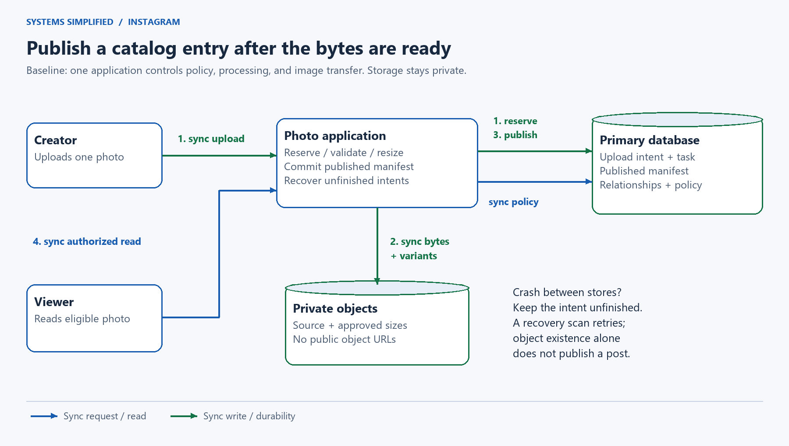
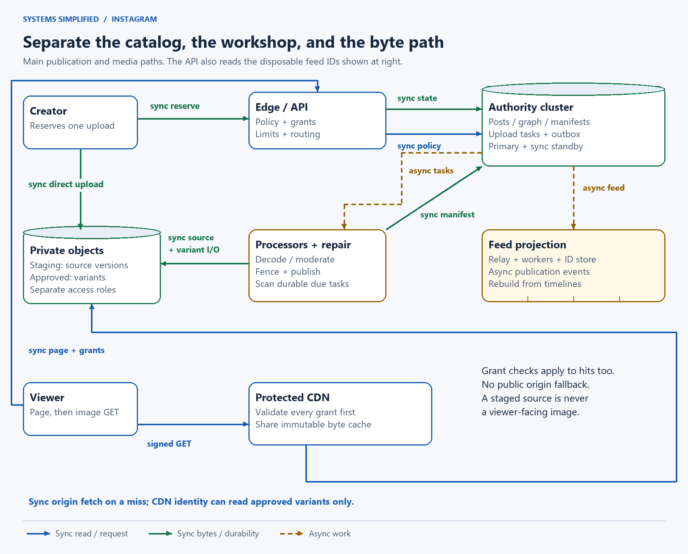
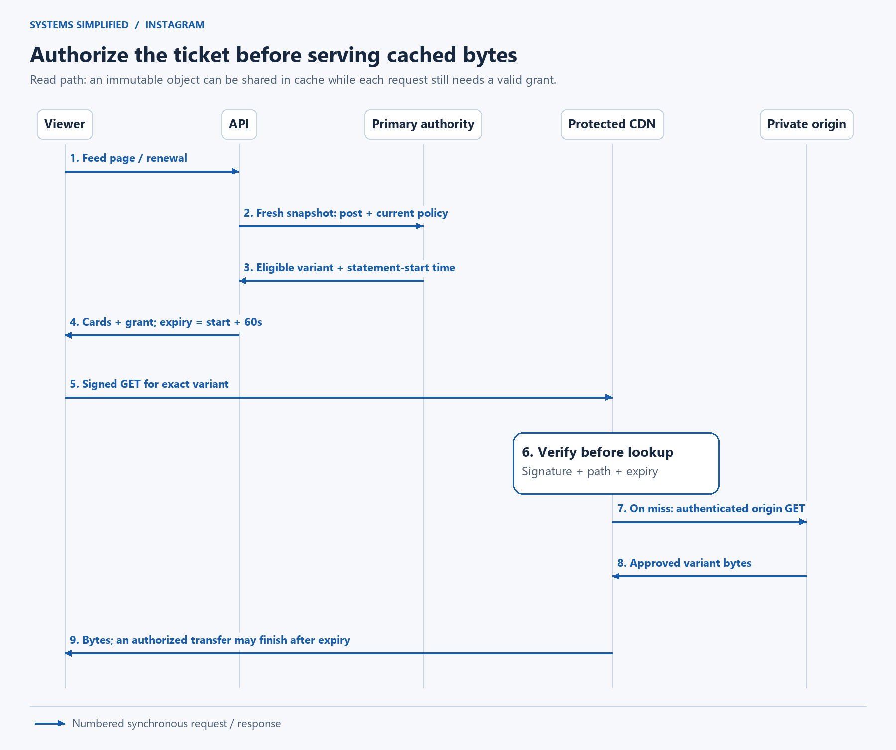
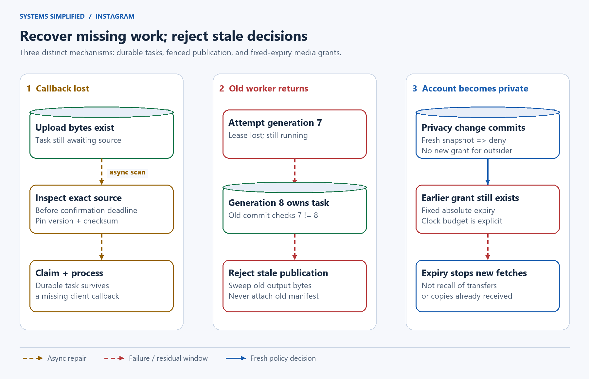

# Design Instagram

> **In one sentence:** Let people publish photos and browse people they follow, while making large image transfers cheap and keeping publication and privacy decisions authoritative.

Maya uploads a photo on a weak connection. Her app closes before it receives a response. Later, she makes her account private. The system must answer three different questions: did the photo arrive, did a post become visible, and can somebody with an old image link still fetch it?

Design an Instagram-like photo app by separating durable post metadata from private image objects. Process uploads into immutable display variants, publish only a validated manifest, and build feeds asynchronously. Check current permissions before issuing short-lived media grants; the content delivery network validates grants even on cache hits. Existing grants create a bounded privacy window, not instant recall.

**Level:** Intermediate  
**Patterns:** [Recoverable publication](#end-to-end-flow), [immutable variants](#data-model-and-partitioning), [hybrid feeds](#how-does-the-home-feed-find-photos), [protected media delivery](#how-do-photos-stay-private-on-a-cdn), [fenced workers](#reliability-correctness-and-recovery)  
**Read time:** About 23 minutes  
**Prerequisites:** Basic web requests and database rows; media manifests, grants, and fan-out are defined below.  
**Article facts:** Prepared and published October 21, 2026; human review pending. This is a fictional photo-sharing product inspired by Instagram's user experience, not a claim about Meta's private architecture. All workloads, limits, retention periods, and service targets are illustrative assumptions. Initial revision: photo publication and bounded media-access revocation.

## Why this system matters

A photo app carries two kinds of traffic. Small requests decide who owns a post and who may see it. Large requests carry image bytes. Sending both through the same servers makes a popular photo compete with login, publication, and privacy changes.

A **content delivery network (CDN)** caches bytes near viewers. It reduces the distance and origin work needed to serve images. It cannot infer that Maya just blocked a viewer. That decision belongs to the application's current policy, even when the same image is already cached around the world.

This design keeps the image path fast without treating a cached object as permanently public.

## The problem in plain English

An authenticated creator reserves an upload through an **application programming interface (API)**. The server chooses a unique object key and records a durable processing task before giving the app upload permission.

```http
POST /v1/uploads
Idempotency-Key: phone-7-draft-19
Content-Type: application/json

{"bytes":2097152,"sha256":"<digest>","caption":"Morning light","alt_text":"Sunlight crossing a wooden table"}
```

```json
{"upload_id":"u-19","post_id":"p-82","state":"awaiting_upload","upload_url":"<private scoped upload URL>","upload_expires_at":"2026-10-21T06:10:00Z"}
```

After uploading, the client calls `POST /v1/uploads/u-19/complete`. This is a wakeup hint, not proof of valid media. The response is `202 Accepted`; `GET /v1/uploads/u-19` reports processing, rejection, cancellation, or publication. A status read requires ownership and never publishes anything by itself.

An **idempotency key** identifies retries of one logical request. Reusing it with different input returns a conflict. A **manifest** is the durable list of approved image variants and their exact object versions. A **media grant** is a signed URL permitting a fetch of one approved variant until an absolute expiry time.

> **Mental model:** The upload is a delivery to a private workshop. Publication puts an approved item in the catalog. A media grant is a short-lived collection ticket; changing the catalog does not recall tickets already handed out.

## What success looks like

### Functional requirements

- Publish one photo per post, with a caption and creator-supplied alternative text; retry safely after lost responses.
- Browse published profile photos and a chronological home feed; follow public accounts or request approval for private accounts.
- Like a post, add a short comment, block accounts, cancel an unpublished upload, and delete a published post.
- Generate three display sizes after decoding, validation, and a moderation decision; never serve the original upload to viewers.
- Enforce current account, follow, block, post, and moderation state before returning protected metadata or issuing media grants.

### Non-functional requirements

These are proposed contracts, not measured product performance. **p95** means 95% of measured operations meet the given latency.

| Goal | Illustrative target or contract | Why it matters |
| --- | --- | --- |
| Control latency | Healthy p95 below 250 ms for upload reservation or a feed page | Large byte transfers should not occupy control servers |
| Publication delay | Healthy p95 below 10 seconds after upload confirmation | Users distinguish processing from publication |
| Availability | 99.9% monthly control API availability | A target to test, with separate media and processing metrics |
| Input bounds | JPEG or PNG; at most 10 MiB and 25 million decoded pixels | Bound bandwidth, decoder memory, and abuse |
| Retry window | Client creation retries for 24 hours; mappings retained at least 48 hours | A finite duplicate-prevention contract |
| Upload deadline | Upload credential valid at most 10 minutes; first source confirmation within 15 minutes | Give a scanner time to find bytes after a lost callback |
| Processing deadline | Confirmed uploads resolve or fail within 24 hours | Bound stuck work without pretending an outage has no effect |
| Privacy | Fresh primary-state snapshot per page/grant batch; at most 60-second grants | Separate new authorization from previously issued access |
| Failure policy | Stop unsafe publication and new grants during authority failover | Preserve policy correctness when replicas may be stale |

An upload reservation is acknowledged only after its metadata meets the commit policy. A successful publication acknowledgment means the manifest and publication event met that policy. Database visibility and confirmed acknowledgment are distinct, as the retry flow explains below. Neither response promises that every follower has refreshed their feed.

### Out of scope

- Reels, video encoding, Stories expiry, live streaming, direct messages, advertisements, global search, and machine-learning ranking.
- Multi-photo posts, editing image bytes in place, unrestricted following counts, and automatic cross-region active writes.
- Instant recall of already fetched images, screenshots, or downloads; a guarantee that every follower sees every post.
- A universal moderation classifier. The pipeline supports automated checks and human escalation; uncertain cases remain unpublished or restricted according to a documented product policy.

## Assumptions and scale

All values below are hypothetical. A **MiB** is 1,048,576 bytes; GB and TB below are decimal. A six-times-average peak is a planning assumption, not a prediction.

| Input | Assumption | Derivation / implication |
| --- | --- | --- |
| Active audience | 1 million daily viewers | Scope of the fictional product |
| New photos | 200,000/day | Average 2.31 uploads/second; **13.89/second** at 6× peak |
| Original size | Mean 2 MiB | About **419.43 GB/day** ingress; the 10 MiB limit is not the mean |
| Variants | Three sizes averaging 0.05, 0.15, and 0.40 MiB per photo | 0.60 MiB total; **125.83 GB/day** additional objects |
| Storage window | Illustrative 30-day byte window | 200,000 × 2.60 MiB × 30 = **16.36 TB**, before replication, backups, or failed attempts; not a deletion promise |
| Object count | One source plus three variants | 800,000 new objects/day; 24 million in that byte window |
| Feed requests | 15 pages/viewer/day, up to 20 photos/page | 15 million pages/day; **1,042 pages/second** at peak |
| Media requests | One selected 0.15 MiB variant per displayed photo; no extra zoom/prefetch | 300 million/day; **20,833 fetches/second** at peak |
| Media egress | 300 million × 0.15 MiB | **47.19 TB/day**; about **26.21 Gbit/second** at peak |
| Warm CDN | Assume 95% request hit rate for this selected variant | About **1,042 origin reads/second** at peak; a cold cache can demand **20×** that |
| Worker pool | Assumed sustained capacity target of 60 photos/second | Includes three variants and moderation; validate with the full input distribution, not only mean-size photos |

The CDN reduces origin traffic, not viewer egress charges or the permission checks needed to obtain fresh grants. On full, unfiltered pages, the API evaluates roughly 20,833 post-viewer decisions/second at peak, using batched database queries rather than one network call per photo. With the 200-ID scan cap below, heavy filtering can require about **208,333 candidate checks/second** at the same page rate while returning fewer photos.

> **At scale:** A 15-minute processor outage at peak leaves about 12,500 photos waiting. With 60/second capacity and 13.89/second continuing arrivals, ideal catch-up takes 12,500 ÷ (60 − 13.89) ≈ **271 seconds**, or **4.5 minutes**. Retries, human moderation, and skew make real recovery slower.

> **Key implication:** Image delivery is the dominant byte cost. Keeping photo bytes off the control API earns its complexity before splitting every feature into a separate service.

## Version 1 — the simplest credible design



**Legend:** Blue solid arrows are synchronous reads; green solid arrows are synchronous writes. Numbered green steps describe creation. All object storage is private.

Start with one application, one relational database, and private object storage. The API streams the bounded upload to storage, validates and generates variants, then commits the post and manifest. An indexed database query joins published posts with current follow and block state for each page. The same application checks permissions and proxies the chosen variant to the viewer.

1. Reserve the upload ID and retry mapping in the database.
2. Stream the source into a private object; validate and create display variants.
3. Commit a published post referencing the verified variants. Only then acknowledge publication.
4. On a read, check current policy and serve the selected image through the API.

Object storage and the database do not share one transaction. Even this baseline needs a durable intent and a periodic recovery scan: a crash between writing bytes and committing publication leaves unfinished work, not a reason to expose the staging object. [S3's consistency model](https://docs.aws.amazon.com/AmazonS3/latest/userguide/Welcome.html#ConsistencyModel) gives per-key behavior, not a transaction spanning objects and database rows.

| Component | Why it exists | What it does not solve yet |
| --- | --- | --- |
| Single API application | Authentication, input bounds, policy checks, and a simple request path | Processing and image transfer consume shared capacity |
| Relational database | Upload state, post metadata, relationships, and uniqueness | Repeated joins and a large hot social graph |
| Private object store | Durable large bytes outside database rows | Cross-store publication and world-wide delivery |
| Recovery scan | Revisit durable unfinished uploads after a crash | Does not provide unlimited processing capacity |

## Where Version 1 breaks

| Pressure | What fails | Observable symptom | Direction of the fix |
| --- | --- | --- | --- |
| Slow phone or large image | Request handlers stay occupied | Upload timeouts and overloaded API servers | Direct, scoped uploads |
| Expensive decoding or moderation | Publication waits inside a web request | Long tail latency and repeated client requests | Durable tasks and isolated workers |
| Popular image | API repeatedly proxies identical bytes | High network cost and poor distant-viewer latency | Protected CDN delivery |
| Crash after variant writes | No atomic object/database commit | Orphans or uploads stuck in progress | Immutable attempts and conditional publication |
| Private-account change | Cached links remain usable | New feed is correct but an old link still works | Define grant expiry and stronger alternatives explicitly |
| Celebrity author | Copying to every follower explodes | Feed projection lag despite fast publication | Hybrid push/pull candidates |

## Version 2 — production-scale architecture



**Legend:** Green solid arrows write durable state or bytes; blue solid arrows are synchronous control/media reads; amber dashed arrows are asynchronous task or feed work. The edge/API block includes request routing, authentication, and limits. Storage contains separate staging and approved namespaces.

Control traffic travels through the edge/API. Upload bytes go directly into staging. Processors turn a confirmed source version into an approved manifest. Viewers obtain metadata and grants from the API, then fetch approved bytes through the CDN. The asynchronous feed projection contains IDs, never public storage credentials.

### End-to-end flow

1. **Reserve before receiving bytes.** Authenticate the creator, check quotas, and transactionally insert an upload, its unique `(creator_id, retry_key)` mapping, a durable processing task, and a wakeup outbox row. Store a hash of the request so conflicting retries are rejected. A retry returns the same IDs and deadline; it does not silently extend access.
2. **Upload directly.** Issue a short-lived credential for exactly one server-selected staging key and expected checksum. Require create-only writes, such as S3 `If-None-Match: *`, and enforce the signed request's method and headers. Apply upload admission limits and verify actual length/checksum before processing; browser-declared type or size is untrusted. If the storage interface cannot enforce a hard byte ceiling, use a bounded upload gateway for that path.
3. **Confirm a source version.** The completion API or scanner inspects storage; neither trusts a client success message. Under an upload-row lock, first confirmation pins the exact source version and checksum before the 15-minute deadline. Absent bytes cause a scheduled recheck. Cancellation, expiry, and confirmation use the same row lock, so one state transition wins.
4. **Process recoverably.** A worker claims the task with a lease and increasing generation number and registers a building manifest candidate in the same transaction. Decode only supported formats inside a sandbox; bound pixels, memory, CPU time, and output bytes. Normalize orientation, remove unnecessary location/device metadata, re-encode three variants, and obtain a moderation decision. Write them to private, create-only keys containing upload ID, source version, pipeline version, and task generation; record the resulting versions against that candidate.
5. **Publish one manifest.** Verify every selected output version is readable and record checksums, sizes, dimensions, and alternative text. In one short transaction, lock the relevant account, upload/task, and manifest-candidate rows in documented order. Verify the current lease generation, processing deadline, creator status, moderation decision, absence of cancellation, and that the candidate is not retiring; then insert the post/manifest, author-timeline entry, and outbox event. Mark the task done. A unique upload-to-post constraint prevents two posts from one upload. All applicable creator-status writers take the same account gate lock.
6. **Acknowledge durable publication.** Acknowledge after the database commit meets the durability policy. If a commit response is lost, return an unknown outcome and retry with the same key. Before reporting success from an uncertain duplicate lookup, perform a small write to the mapping/task row and wait for the same synchronous commit policy. A merely visible row is not proof its original writer finished waiting for replication: a primary read may observe publication before that wait ends. Such unacknowledged state is not covered by the successful-acknowledgment durability promise.
7. **Project, then authorize.** Relay committed publication events to feed workers. A separate durable scanner repairs unfinished tasks; broker wakeups improve latency but do not own the work. Readers merge feed IDs, query authoritative current policy, and receive captions, alt text, and grants only for eligible posts. The CDN validates each grant before serving a cached or origin-fetched variant.

Create-only object behavior is documented in [S3 conditional writes](https://docs.aws.amazon.com/AmazonS3/latest/userguide/conditional-writes.html). The database lock provides publication coordination; it does not lock object storage. [PostgreSQL row locks](https://www.postgresql.org/docs/current/explicit-locking.html#LOCKING-ROWS) describe the locking primitive. A transactional outbox records an event with its associated state; [Debezium's outbox documentation](https://debezium.io/documentation/reference/stable/transformations/outbox-event-router.html) illustrates that pattern. Consumers must tolerate repeated events.

### Component decisions

| Component | Responsibility | Why this choice | Main trade-off |
| --- | --- | --- | --- |
| Edge/API | Route requests, authenticate, reserve uploads, return eligible metadata and grants | Keep control operations independent of byte transfer | Signing and fresh policy checks remain real CPU/database work |
| Authority cluster | Uploads, tasks, manifests, posts, graph, retry keys, outbox; primary plus synchronous standby | Transactions define publication and current policy | A healthy standby is required for acknowledged writes |
| Private object storage | Versioned sources and immutable approved variants | Large bytes need independent throughput and lifecycle | Cleanup and metadata commits need coordination |
| Relay/broker | Wake task consumers and transport publication events | Isolate bursts and slow consumers | Duplicates and lag remain possible |
| Processor/recovery workers | Validate, moderate, render, publish, scan due work, and clean orphans | Isolate expensive or hostile inputs; recover from missed wakeups | Capacity and stale attempts need explicit limits |
| Feed projection workers/store | Build bounded candidate ID sets | Avoid repeating the full social join on every refresh | Candidate state is disposable and may lag |
| Protected CDN | Validate a grant on every request, cache approved immutable bytes | Offload repeated image transfer | Old grants remain valid until expiry; origin needs cold-cache protection |

> **Why it exists:** The manifest is the bridge between the workshop and the catalog. It names a complete, validated set of outputs. A partially finished worker cannot publish three image filenames and hope they all exist.

### How does the home feed find photos?

Use a bounded version of the [News Feed lesson](../news-feed/README.md): push ordinary authors' published post IDs into active followers' candidates; pull recent author timelines for high-fan-out accounts. Merge and deduplicate before applying current permissions. Feed consumers upsert by `(viewer_id, post_id)` and can rebuild from published timelines. A late publication event never restores a deleted post.

For this example, cap follows at 500, including at most 50 pull-routed authors. Freeze at most 500 candidate IDs for a ten-minute scrolling session. Return at most 20 eligible cards after scanning at most 200 IDs, using a cursor that advances past consumed IDs. New posts appear on refresh; lost sessions return a restart response. Sparse pages are preferable to bypassing eligibility. Like counts are eventually updated projections, not permission facts.

The authority query returns captions and comments only when the viewer is currently eligible. Do not put private captions or pre-signed media links into a shared unprotected feed cache. This lesson reuses feed mechanics; its new boundary is the image request after the card leaves the API.

### How do photos stay private on a CDN?



**Legend:** Blue solid arrows are numbered synchronous requests/responses; the final CDN-to-origin arrow is conditional on a cache miss. A successful cache lookup never skips grant validation.

1. The viewer requests a feed page or a grant renewal for one specific approved variant.
2. In a fresh, short **Read Committed** statement on the primary, join post state, manifest, account visibility, approved follow relation, and blocks in both directions. Return only eligible metadata and the database statement-start time. An ordinary query sees its statement snapshot, as described in [PostgreSQL isolation documentation](https://www.postgresql.org/docs/current/transaction-iso.html#XACT-READ-COMMITTED); it does not see future changes.
3. Sign an exact immutable object path with expiry fixed to that statement-start time plus 60 seconds. Never restart the clock when a response is delayed or a signer retries. Drop grants already expired before responding. A zoomed variant needs another authorization check and grant.
4. The viewer fetches the image. The CDN checks signature, exact resource, and absolute expiry before cache lookup. It can share byte-cache entries for the same immutable object after validating different viewer grants. Test cache-key normalization so signature parameters do not fragment the byte cache or accidentally bypass validation.
5. On a miss, the CDN authenticates to the private approved origin. Deny direct public origin reads; allow only the delivery identity and narrowly scoped internal roles. Staging is not a CDN origin. [CloudFront origin access control](https://docs.aws.amazon.com/AmazonCloudFront/latest/DeveloperGuide/private-content-restricting-access-to-s3.html) is one concrete implementation of that origin boundary.

**What happens when Maya becomes private?** A grant query whose snapshot starts after the privacy change commits denies an unapproved viewer. An earlier snapshot can still yield a grant, but its original expiry does not move. For a durably acknowledged policy change and safe failover, with a measured total database-to-edge clock error of at most two seconds including timestamp rounding, a 60-second grant stops authorizing new requests within at most about **62 seconds after that change commits**. This conditional bound requires correct clocks, fresh primary snapshots, no wildcard grants, no alternative public path, and expiry checks on every hit. Monitor those prerequisites; suspend issuance on an untrusted clock.

That is a bound on **starting a new network fetch**, not on retaining or displaying pixels. A transfer begun before expiry may finish later; [CloudFront documents this behavior](https://docs.aws.amazon.com/AmazonCloudFront/latest/DeveloperGuide/private-content-signed-urls.html#private-content-check-expiration). Browser copies, screenshots, and downloaded images cannot be recalled. Use restrictive downstream cache headers for sensitive content and avoid logging bearer URLs, but never promise remote deletion of a viewer's copy.

> **Trade-off:** Short-lived bearer grants avoid an authority call on every byte request, but anyone holding a grant can use it during its lifetime. If the product requires a fresh policy decision at every network request, use an edge authorization gate backed by current authority, fail closed on uncertainty, and accept the latency and availability cost. Device-bound sessions can further reduce link sharing; they still cannot recall fetched pixels.

## Data model and partitioning

**Source of truth** means the durable authority used to decide correctness. A **projection** is a derived view that can be rebuilt. Start with one relational cluster; these rates justify measurement and indexes before mandatory database sharding.

| Data | Source of truth and key | Access pattern / retention | Partition or replication strategy |
| --- | --- | --- | --- |
| Upload and retry mapping | Database; upload ID and unique `(creator_id, retry_key)`; request hash | Owner status and retry lookup; retry mapping at least 48 hours; IDs never reused | Index due states/deadlines and owner; synchronous zone standby |
| Processing task | Database; upload ID, source version, lease expiry, generation, next attempt | Due-task scanner; conditional claims and completion | Claim small batches; index due time; retain terminal evidence through retry/cleanup horizons |
| Source object | Private staging; server key plus exact storage version/checksum | Processor reads pinned version; no viewer access | Spread unique keys; encryption; explicit version cleanup |
| Manifest and post | Database; candidate ID/generation/state, unique upload ID, post ID, creator, variant versions | Building/retiring candidates; published timeline and batch policy checks | Index `(creator_id, published_at, post_id)`; keep tombstones through replay/cleanup horizons |
| Approved variants | Private approved store; attempt-specific immutable keys and exact versions | CDN origin fetches; no mutation in place | Never reuse keys; regenerate under new pipeline/attempt version |
| Social graph | Database; account gate, visibility, approved follows, blocks | Current eligibility; unique relationship pairs | Primary queries; later partitioning must preserve or redefine the cross-owner policy boundary |
| Likes and comments | Database; unique `(post_id, viewer_id)` like; comment ID and retry key | Authorize writes and reads against current post policy | Index by post; asynchronous counts; no guarantee counts reflect an exact snapshot |
| Outbox and candidates | Database events; disposable feed ID sets keyed by viewer | Replay unfinished events; bounded recent candidate windows | At-least-once work; upsert IDs; rebuild from published timelines |

An **attempt generation** is a monotonically increasing task number. It fences an old worker: the final transaction succeeds only if its generation still owns the task. Lease expiry alone does not stop a process from running. Old workers may waste bytes or CPU, but they cannot attach a stale manifest after losing ownership.

For likes and comments, acquire the affected account gates and post gate in deterministic order, then authorize using a fresh statement. Relationship, block, visibility, and deletion writers acquire the corresponding gates too. This is a simple, potentially contentious baseline for serialized mutations; ordinary page/grant reads use snapshots instead. Require retry keys for comment creation; atomically commit each mutation with its counter outbox event. A delete that wins the gate makes later writes fail; a comment that wins first can commit before deletion and then disappear with the post. Counter events carry unique event IDs; repair counters from authoritative rows rather than assuming an increment is delivered once.

## Reliability, correctness, and recovery



**Legend:** Amber dashed arrows are asynchronous repair; red dashed arrows mark failures, rejected stale work, or the residual grant window; blue solid arrows show a fresh permission decision. Each panel is a separate scenario.

The durable task answers “what work is still owed?” The lease generation answers “who may publish its result?” The media grant answers “how long may this already authorized fetch credential remain useful?” None substitutes for another.

| Scenario | Design response | Remaining risk |
| --- | --- | --- |
| Upload succeeded; client lost the response or callback | Retry against the same reservation; scanner inspects storage and pins a valid source before confirmation deadline | An object first discovered too late is rejected and later cleaned; user must create a new upload |
| Worker crashes after writing two variants | Task becomes claimable after lease expiry; new generation rewrites all required outputs under its own keys | Temporary duplicate storage/CPU; stale outputs require cleanup |
| Old worker returns after a new claim | Conditional publication verifies generation, live lease, deadline, and nonterminal state under locks | Old bytes can still arrive; fencing protects metadata, not physical writes |
| Cancellation or deletion races publication | Serialize on upload/post gates; terminal canceled/deleted state never transitions back to published | If publication won first, cancellation becomes deletion; earlier authorized bytes may already be in flight |
| Moderation reverses a decision | Commit a denied/tombstoned post state; stop new grants; enqueue removal from projections and object cleanup | Existing grants and local copies have the same stated limits |
| Broker loses a wakeup or delivers twice | Database scanner reissues due work; row/generation checks and unique post constraint govern publication | Repair interval adds latency; no exactly-once execution claim |
| CDN cache becomes cold | Origin shield/request coalescing, bounded origin concurrency, rate limits, and load shedding | Origin demand can rise 20×; serve an explicit retry state instead of unprotected fallback URLs |
| Primary or zone fails | Fence the old primary, promote an eligible synchronous standby, replay before routing policy reads, then resume | Writes/grants pause; correlated failures and asynchronous regional recovery can lose data |
| Privacy authority unavailable | Deny new grants and private metadata reads | Already issued grants can still work until expiry |

Use a named standby in a separate failure zone and `synchronous_commit=on` for acceptance, publication, and policy changes. This waits for durable standby log flush; failover must promote an appropriate standby and fence the old primary. Read-only lookups do not provide that commit wait. [PostgreSQL synchronous replication](https://www.postgresql.org/docs/current/warm-standby.html#SYNCHRONOUS-REPLICATION) explains the mechanism and trade-off. Never silently fall back to asynchronous acknowledgment while retaining the same promise. Regional disaster recovery has a separately tested loss and restoration budget.

### How are abandoned bytes removed safely?

First expire or cancel the upload/task in the authority so it can no longer publish. For an unreferenced attempt, transactionally mark its manifest candidate as retiring; publication is forbidden from attaching retiring candidates. Wait beyond the allowed in-flight write/grant windows, then remove the recorded object versions. Late output writes are swept again. Active manifests and their versions are excluded; never delete solely because an object is old.

For a deleted post, record a tombstone and cleanup task before removing projections or bytes. Wait out applicable grants before planned origin deletion to avoid unnecessary broken transfers; emergency abuse action can delete sooner with reduced availability. Versioned stores require deleting retained versions, not only creating a delete marker. Keep a reconciliation sweep for late staging writes: a previously issued upload credential or in-flight transfer can outlive a cancellation. Never reuse its key for a new upload.

Logical deletion, physical cleanup, and backup expiry are separate milestones. Retention and legal holds need their own documented policy; the 30-day sizing window is not an erasure deadline.

### What should operators measure?

Track reservation error/latency, time from source confirmation to publication, age of the oldest due task, lease churn, decoder failures, moderation backlog, stale-generation rejections, and orphan byte age. Measure fresh policy-query latency and denial rates separately from CDN cache hit rate, origin throughput, grant-expiry failures, and viewer image-load success.

Alert on clock error, public-origin policy drift, missing object versions in active manifests, and any grant issued after a fresh denying snapshot. Trace by upload/post/task generation; redact credentials. Rehearse lost callbacks, worker death between writes, deletion races, cold-cache demand, failover, and restore from backup. A good cache-hit graph does not prove publication or privacy correctness.

> **Failure mode:** A public staging bucket or a CDN behavior that serves hits before checking signatures defeats the entire grant design. Test the raw origin URL, unsigned cache hits, expired grants, and cross-object signature reuse during release checks.

## Security and abuse resistance

- Authenticate every control operation; derive creator/viewer identity on the server. Check ownership of upload status and completion. Use encrypted transport and least-privilege storage roles. Escape captions, comments, and alt text as text when rendering; none is trusted markup.
- Reserve per-account upload count and byte budget before issuance. Bound concurrent reservations, actual source size, decoded pixels, total variant bytes, and daily delivery traffic. Reconcile reserved versus actual usage and charge temporary attempts against headroom.
- Treat image decoders as hostile-input parsers. Restrict formats, patch libraries, sandbox processors without arbitrary network access, and strip unnecessary metadata. Re-encoding reduces attack surface but is not a safety proof; see [OWASP file upload guidance](https://cheatsheetseries.owasp.org/cheatsheets/File_Upload_Cheat_Sheet.html).
- Do not fetch arbitrary user-supplied image URLs in the processing network. That would introduce a separate server-side request forgery boundary. Accept bytes through the scoped upload path instead.
- Scope each grant to one immutable variant, keep signing keys in controlled key storage, rotate them with a documented overlap, and redact bearer URLs from logs/referrers. Wide cookie or path grants can authorize more than one post; they are outside this contract.
- Apply rate limits to upload reservation, feed/grant renewal, follows, comments, and likes. Combine account/device/network signals; a popular legitimate creator needs different treatment from an upload flood.
- Provide reporting and appeal paths. Audit moderation and privacy changes without retaining unnecessary image copies. Creator-supplied alt text travels with eligible cards; clients must render it semantically, support keyboard navigation, and respect reduced-motion preferences.

## The trade-offs that matter

| Decision | We optimize for | We give up | Prefer an alternative when… |
| --- | --- | --- | --- |
| Direct bounded upload | Independent byte-transfer capacity | More cross-store recovery and credential controls | Small traffic and strict gateway enforcement make proxied upload simpler |
| Precompute three variants | Predictable first-view latency and finite cache keys | Extra storage and processing for rarely seen photos | A tightly bounded on-demand renderer with admission controls is cheaper for sparse content |
| Immutable attempt keys | Safe retries and traceable manifests | Orphan cleanup and extra writes after failures | In-place mutation is acceptable only with a separately designed version/cache contract |
| Short bearer grants | Shared CDN bytes and fewer authority calls | Residual access window and link sharing | Per-request authorization is required despite its latency and failure coupling |
| One primary policy boundary | Understandable current permissions and transactions | Write-region latency and failover pauses | Measured scale justifies a distributed authority with an explicit consistency model |
| Hybrid feed projection | Cheap ordinary reads without celebrity write explosions | Lag, reconstruction, and routing complexity | A small graph can use direct indexed joins |

## How the design evolves next

| Trigger | Next change | Why not add it on day one? |
| --- | --- | --- |
| Decoder or moderation backlog dominates | Separate worker pools by resource demand and moderation class; maintain deadlines | One pool is simpler until measurements reveal isolation needs |
| Graph/policy queries exceed the primary budget | Partition carefully or introduce a policy service with versioned authority semantics | Replicated policy caches can weaken the stated current-snapshot boundary |
| A viral photo overwhelms origin after eviction | Add regional shields and measured coalescing/concurrency budgets | Extra layers cost money and can concentrate load themselves |
| Much stronger takedown requirement | Per-request edge authorization plus emergency revocation controls | Adds authority traffic and reduced availability; still no recall of received pixels |
| Videos or multi-photo posts enter scope | New bounded transcoding pipeline or all-required-items manifest | Processing cost and partial-publication rules change materially |
| Distant creators need local writes | Regional ownership and explicit transfer/recovery protocol | A global database label alone does not solve ownership or current privacy |

## Key takeaways

- Upload completion, publication, feed discovery, and media delivery are different states with different authorities.
- Durable tasks and immutable attempts turn crashes into recoverable work; generation checks prevent stale publication.
- A manifest publishes a verified set of outputs. Object existence alone never makes a post visible.
- A protected CDN must validate authorization before every hit, with no public origin bypass.
- Grant expiry bounds new network access under explicit conditions. It cannot recall transfers, screenshots, or downloaded pixels.
- Size for cold caches, processing catch-up, and abandoned bytes as well as healthy averages.

## Quick check

1. The upload callback never arrives, but bytes exist. What durable record lets the system recover?
2. A worker's lease expires after it wrote all variants. Why must its final database update still check the generation?
3. Maya makes her account private. Why can an old signed link still work even though the next feed refresh hides the photo?
4. A 95% cache hit rate falls to zero. What happens to origin requests, and which API work is unchanged?

**Answer guide:** The task was committed at reservation and a scanner verifies the source before its deadline. A newer generation may own the work, or cancellation may have won. The old link is a bearer grant until its fixed expiry; pixels already received persist. Origin requests rise about twentyfold, while fresh grant authorization remains necessary at its existing rate.

## Related lessons

- [Design a News Feed](../news-feed/README.md) explains hybrid candidates, stable scrolling, current eligibility, and replay/rebuild mechanics.
- [Design File Storage](../file-storage/README.md) explores upload completion, inspection, publication, and cleanup across stores.
- [Design a Rate Limiter](../rate-limiter/README.md) explains admission budgets and explicit failure policies.
- [Design a Notification System](../notification-system/README.md) separates accepted events from external delivery outcomes.

## Frequently asked questions

### Should photos be stored in the relational database?

Keep metadata and approved object references in the relational database; keep large source and variant bytes in private object storage. This makes transactional decisions small and scales byte transfer independently. Small deployments can make other choices, but they must still define the publication boundary and recovery behavior.

### Is an unguessable image URL private?

No. It is at best a difficult-to-guess bearer secret. This design requires a signed, expiring grant for each exact variant and denies public origin reads. Anyone who receives a valid bearer grant may use it during its lifetime; stronger identity binding needs an additional mechanism.

### Does deleting a post immediately invalidate CDN copies?

No. Deletion stops new grants whose fresh policy snapshot follows the commit, while previously issued grants can remain valid for their fixed lifetime. A CDN purge can help operationally but is not the correctness boundary. Previously downloaded copies and transfers already authorized are outside the new-request expiry guarantee.

### Can the processing queue guarantee exactly one publication?

The queue can repeat work. One post per upload comes from a database uniqueness constraint and a final transaction checking current task generation and terminal state. Workers may execute more than once and create unused output objects; recovery and cleanup handle those side effects.

### Why build a CDN if every viewer still needs authorization?

Authorization is a small metadata decision. Delivering hundreds of millions of images moves vastly more bytes. Batched grant issuance keeps current permissions in the control path, while the CDN shares immutable byte-cache entries across independently validated grants. The remaining authorization load must still be measured and provisioned.

## Small glossary

| Term | Meaning here |
| --- | --- |
| Manifest | Durable list of validated variant objects, versions, checksums, and dimensions |
| Variant | A precomputed display size/format derived from the source photo |
| Grant | Short-lived signed permission to fetch one immutable variant |
| Fencing generation | Task number checked transactionally to reject a stale worker's publication |
| Outbox | Event record committed in the same database transaction as its related state |
| Fan-out | Distributing one author's post ID to many follower candidate sets |
| Tombstone | Retained deleted state that prevents stale work from restoring visibility |
| Origin shield | Intermediate cache layer that reduces repeated requests to object storage |

## Sources and further reading

The sources below support primitives and limits, not the fictional workload or a claim about Instagram's implementation. Checked October 21, 2026. Revisit this lesson when privacy/retention contracts, input distributions, storage/CDN behavior, or failover policy change.

1. [Amazon S3 data consistency model](https://docs.aws.amazon.com/AmazonS3/latest/userguide/Welcome.html#ConsistencyModel) — per-key read/write behavior and the absence of atomic updates across keys.
2. [Amazon S3 conditional writes](https://docs.aws.amazon.com/AmazonS3/latest/userguide/conditional-writes.html) — create-only conditions, conflicts, and version/delete-marker caveats; conditional writes alone are not an application lifecycle.
3. [PostgreSQL row-level locks](https://www.postgresql.org/docs/current/explicit-locking.html#LOCKING-ROWS) — the primitive for competing lifecycle transitions.
4. [PostgreSQL synchronous replication](https://www.postgresql.org/docs/current/warm-standby.html#SYNCHRONOUS-REPLICATION) — acknowledgment conditions, standby configuration, and availability costs.
5. [PostgreSQL Read Committed isolation](https://www.postgresql.org/docs/current/transaction-iso.html#XACT-READ-COMMITTED) — statement snapshots and concurrent-change semantics.
6. [Debezium Outbox Event Router](https://debezium.io/documentation/reference/stable/transformations/outbox-event-router.html) — a concrete outbox implementation and event identity/routing.
7. [CloudFront signed URLs and expiration](https://docs.aws.amazon.com/AmazonCloudFront/latest/DeveloperGuide/private-content-signed-urls.html#private-content-check-expiration) — request-time expiry and already-started downloads.
8. [CloudFront private S3 origins](https://docs.aws.amazon.com/AmazonCloudFront/latest/DeveloperGuide/private-content-restricting-access-to-s3.html) — authenticated origin access; viewer authorization remains a separate boundary.
9. [OWASP File Upload Cheat Sheet](https://cheatsheetseries.owasp.org/cheatsheets/File_Upload_Cheat_Sheet.html) — layered validation, image rewriting, storage isolation, and resource limits.

> **Remember:** Make the catalog authoritative, the processing resumable, and the bytes cacheable. Then state exactly how long an already issued ticket still works.
