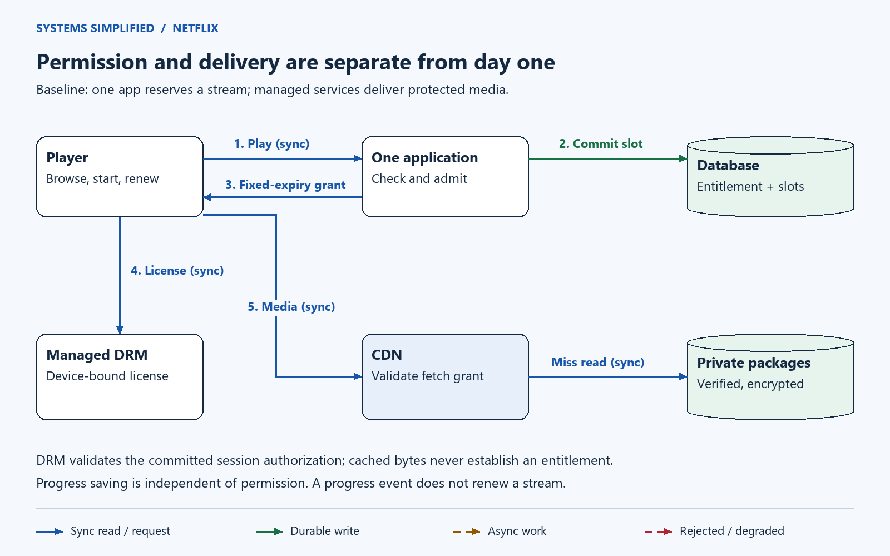
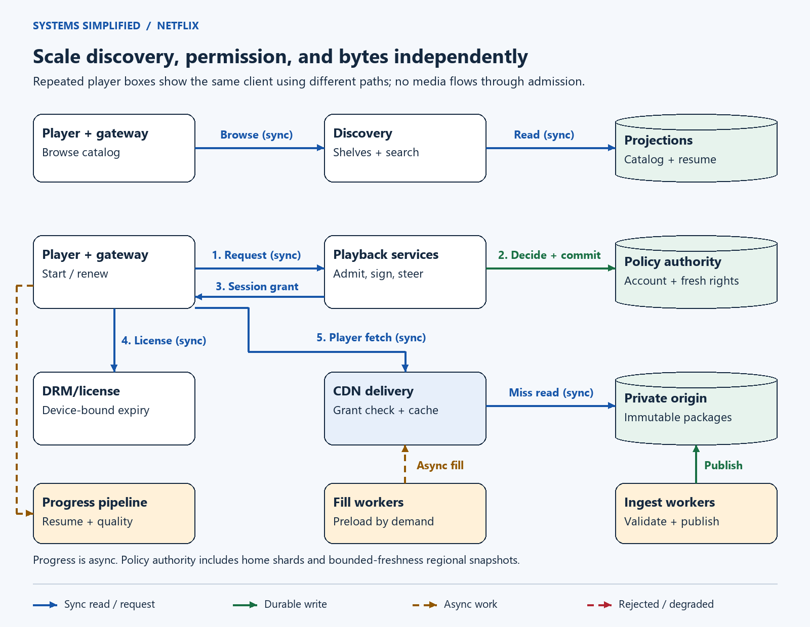
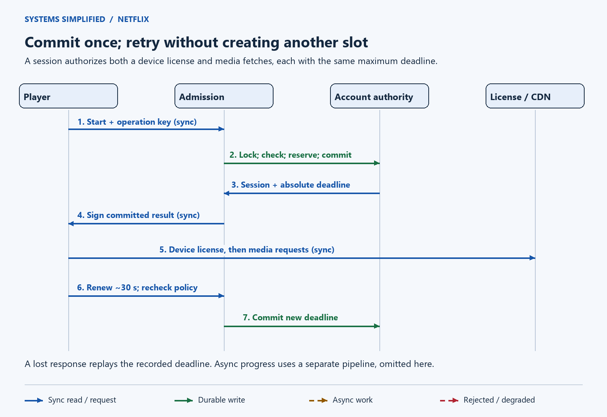
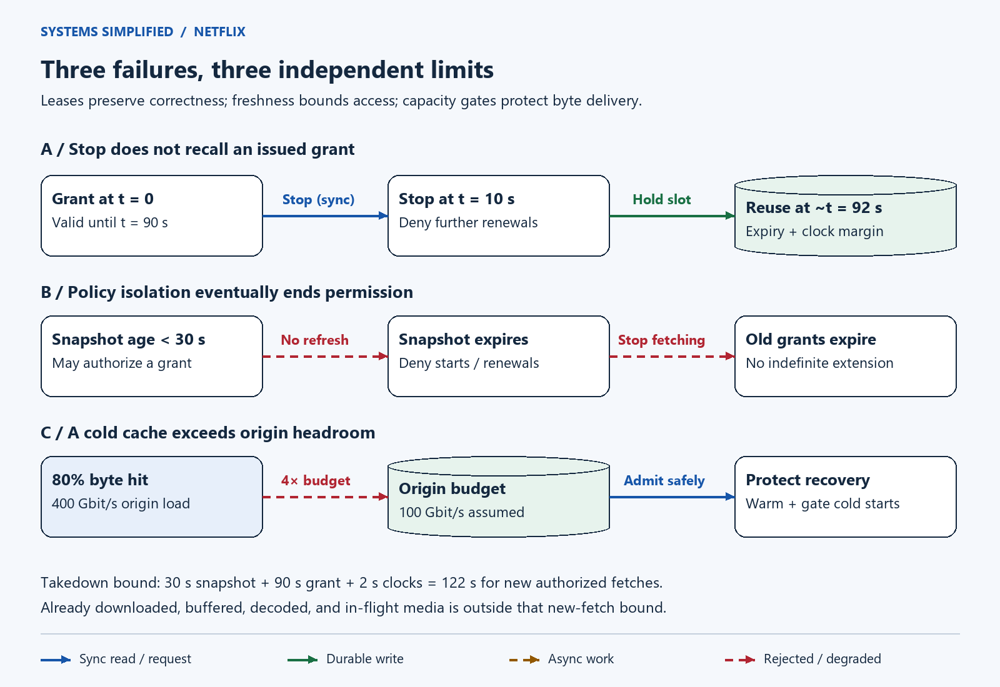

# Design Netflix

> **In one sentence:** Help a subscriber find something they can watch, then deliver it smoothly while enforcing the service's access rules.

Asha chooses a film on her television. Her subscription is active, but that film is licensed only in certain countries, her plan permits two concurrent streams, and another device is already watching. A fast video download solves only one part of her experience: the service must also decide whether this particular playback is allowed.

Design a Netflix-style service by separating discovery, playback permission, and video delivery. Cache catalog suggestions, serialize stream admission per account, and issue short-lived grants after subscription and regional-rights checks. Deliver encrypted, immutable media through a content delivery network. Renew permission independently of segment downloads; outages and revocation follow explicit lease limits rather than promises of instant recall.

**Level:** Advanced  
**Patterns:** [Serialized admission](#how-do-we-enforce-concurrent-stream-limits), [bounded access grants](#what-does-revocation-actually-guarantee), [proactive placement](#where-should-video-bytes-live), [degraded discovery](#reliability-correctness-and-recovery), [single-owner recovery](#data-model-and-partitioning)  
**Read time:** About 23 minutes  
**Prerequisites:** Web requests, database transactions, and the [Video Streaming lesson](../video-streaming/README.md), which explains encoding, playlists, and adaptive quality.  
**Article facts:** Prepared and published October 27, 2026; human review pending. This is an original, fictional subscription-video design, not a reconstruction of Netflix's private systems. Workloads, service targets, lease rules, and product policies below are illustrative. The separately labeled Open Connect facts come from Netflix's public documentation. Initial revision: admission correctness and delivery capacity under failure.

## Why this system matters

A movie service moves huge files, but its hardest correctness decisions concern small records: who paid, where a title may play, and how many streams an account already holds. Putting all three jobs behind one cache makes outages confusing and access rules unreliable.

An **entitlement** is an account's right to use a paid feature. A **lease** is permission valid only until a specified time. A **control plane** decides what may happen; the **data plane** moves the video bytes. The player connects to both, for different reasons.

## The problem in plain English

The home screen may suggest a film from slightly old catalog data. Pressing Play must make a new decision using the account, the server's regional assessment, the selected title, and the device's supported playback capabilities.

```http
POST /v1/playback-sessions
Idempotency-Key: op42.signed-expiry-ticket
Content-Type: application/json

{"profile_id":"p7","title_id":"film19","device_id":"tv4","capabilities":["supported-drm","codec-a"]}
```

```json
{"session_id":"s42","package_id":"pkg19v3","grant_expires_at":"2026-10-27T06:01:30Z","renew_after_seconds":30,"manifest_url":"https://media.example.invalid/pkg19v3/master.m3u8","license_url":"https://license.example.invalid/v1/licenses/s42"}
```

The domains and timestamps are examples. Transport credentials are returned separately over an authenticated connection. The server derives account identity from login and evaluates region itself; client-supplied capability names do not prove that the device meets a protection requirement. Operation IDs are server-issued, account-bound tickets with signed expiry, so an old retry remains rejectable after its stored result is cleaned up.

> **Mental model:** The catalog is a shop window, admission is the ticket desk, and the delivery network is the road carrying the film. A title in the window is not a valid ticket.

## What success looks like

### Functional requirements

- Browse a localized catalog, search titles, and receive recommendations with a curated fallback.
- Start, pause, seek, renew, and stop playback; support captions and compatible audio tracks.
- Apply subscription status, plan quality limits, profile restrictions, regional rights, and an illustrative two-stream account limit.
- Resume on another device using saved progress, with a defined policy for conflicting sessions.
- Ingest studio media, publish verified encrypted packages, and prepare popular titles near likely viewers.

### Non-functional requirements

These are targets for named device/network test cohorts and load tests, not measured Netflix performance.

| Goal | Target | Why it matters |
| --- | --- | --- |
| Discovery latency | Home-screen response under 300 ms at p95 | Cached suggestions can tolerate some staleness |
| Playback admission | Under 400 ms at p95, excluding device license exchange | Permission must be fast without losing the stream limit |
| Watching experience | First decoded frame under 3 seconds; rebuffer time below 1% on a defined broadband cohort | Measure the player, not just API responses |
| Permission availability | 99.95% monthly successful eligible admissions and renewals | Report separately from discovery and CDN availability |
| Admission correctness | At most the configured number of unexpired slot reservations | This is not a guarantee about the number of physical people or screens |
| Revocation | Defined new-fetch bound under stated freshness and clock assumptions | Avoid an impossible instant-recall promise |
| Recovery | Tested zone failover and regional disaster recovery | Data-loss exposure depends on replication and promotion policy |

### Out of scope

Live events, advertising, offline licenses, payment processing, household detection, and exact Netflix recommendation models. A billing system supplies authoritative subscription changes; this lesson handles their application, not card charging. We require supported online digital rights management and do not design a new encryption scheme.

## Assumptions and scale

All numbers are hypothetical. Use decimal units, and divide bits by eight for bytes. Audio/video bandwidth is an aggregate estimate; protocol overhead, retries, replicas, extra languages, and alternate codec packages require additional budget.

| Input | Assumption | Derivation / note |
| --- | --- | --- |
| Accounts and starts | 10 million accounts; 4 million playback starts/day | Not claimed Netflix traffic |
| Mean session | 45 minutes | 2,700 seconds |
| Concurrency | 125,000 average; 500,000 peak | 4 million × 2,700 / 86,400; peak is an assumed 4× |
| Starts | About 46/second average; 185/second peak | 4 million / 86,400, then 4× |
| Renewals | About 16,667/second at peak | 500,000 / 30-second renewal interval; exclude retries |
| Permission transactions | About 16,852/second peak | Starts plus renewals; releases, ticket issuance, and billing add work |
| Delivery | 4 Mbit/s mean playback; 2 Tbit/s peak | 500,000 × 4 million bits/second |
| Daily delivery | 5.4 PB | 4 million × 2,700 × 4 million / 8 |
| Segment requests | About 125,000/second peak | One muxed four-second segment per player; separate tracks add requests |
| Packaged library | 10,000 two-hour titles; 12 Mbit/s aggregate rendition ladder | 10,000 × 7,200 × 12 million / 8 = 108 TB logical bytes |
| Progress events | 25,000/second peak at one per 20 seconds | Independent of permission renewal |
| Progress-event storage | 86.4 GB/day; 2.592 TB for 30 days | 4 million × 2,700 / 20 × 160 bytes; logical event floor only |

> **Key implication:** Renewing existing streams dominates new starts, while video bandwidth dominates both. Scaling only the Play endpoint misses the main control-plane load.

The 160-byte progress event is a minimal payload estimate; indexes, envelopes, replication, compaction, and privacy-driven retention change its cost. Retain a compact latest resume record separately rather than scanning an event history on every request.

## Version 1 — the simplest credible design



The baseline already separates permission from bytes. One application and one relational database can serve a small subscriber base while managed delivery and license services handle video-specific responsibilities.

1. The app reads catalog metadata and a verified package reference.
2. A transaction checks eligibility and reserves a stream slot; only after commit does the app return a grant.
3. The player obtains a device-bound license from a managed DRM integration and downloads encrypted media through the CDN, a **content delivery network** that caches files near viewers.
4. The player renews permission periodically; progress updates do not extend permission.

| Component | Why it exists | What it does not solve yet |
| --- | --- | --- |
| Single application | Keeps catalog, account, and admission code simple | One deployment can interrupt every control-plane feature |
| Relational database | Transactions serialize account decisions | A single writer has a throughput and failure limit |
| Managed DRM integration | Issues licenses to supported device protection systems | Device compatibility and provider failures still need handling |
| Private package storage and CDN | Store once and deliver without proxying through the app | A cold cache can overwhelm origin capacity |

Use the [Video Streaming package-publication design](../video-streaming/README.md#how-does-a-video-become-playable) for ingestion: workers produce private attempts, a coordinator validates an immutable package, and a transaction publishes its pointer. Add encryption and supported DRM packaging before that validation. Do not expose partly encoded titles.

## Where Version 1 breaks

| Pressure | What fails | Observable symptom | Direction of the fix |
| --- | --- | --- | --- |
| Recommendation dependency slows | Shared request pool fills | Home and Play both time out | Separate budgets, cached shelves, curated fallback |
| Hundreds of thousands of active players | Renewals saturate one writer | Existing viewers stall despite a healthy CDN | Partition account authority and spread renewal times |
| Two devices race for the last slot | Non-transactional count-then-insert admits both | Stream limit is exceeded | Serialize every slot mutation on the account row |
| Title expires or subscription changes | Cached discovery still advertises it | Play disagrees with home screen | Recheck admission; explain unavailable titles |
| New season launches on cold edges | Misses exceed origin bandwidth | Segment latency and rebuffering rise | Preload, steer by capacity, limit cold starts |
| Stop immediately frees a reservation | Old grants remain usable | Rapid stop/start creates overlapping valid grants | Hold the slot through its latest grant expiry |

## Version 2 — production-scale architecture



The top lane is tolerant discovery. The middle lane owns permission. The bottom lane carries encrypted bytes. The ingestion/fill lane publishes verified packages and warms edges asynchronously; those jobs never decide whether an account may watch.

### End-to-end flow

1. A gateway authenticates the account, applies request limits, and routes discovery or playback calls. It passes trusted identity and server-derived regional evidence.
2. Discovery combines localized catalog projections, cached recommendation shelves, and saved progress. If personalization fails, return editorial shelves instead of blocking Play.
3. Admission routes to the account's single home shard. It obtains a valid regional-rights snapshot, checks package readiness and device support, then commits the account transaction described below.
4. A committed session authorizes two separately scoped artifacts: a media-fetch grant and a device-bound DRM license. Neither may extend beyond the committed absolute deadline. Failed signing or a lost response is recovered by retrying that same session operation.
5. A steering function within playback services selects healthy CDN locations with the required package and spare capacity. The player fetches playlists and segments directly, adapting quality as explained in [adaptive playback](../video-streaming/README.md#how-does-the-player-change-quality).
6. Renewals repeat policy checks and update the reservation deadline. Progress and quality telemetry enter a separate bounded asynchronous pipeline; they are not renewal acknowledgments.
7. Studio ingestion, validation, and preloading run independently. Reconcile durable jobs after missed notifications and publish only verified package revisions.

### Component decisions

| Component | Responsibility | Why this choice | Main trade-off |
| --- | --- | --- | --- |
| Player and gateway | Authenticate, route, collect capability evidence, isolate request budgets | One trusted entry point with device-aware playback | Gateway failure needs multi-zone replicas |
| Discovery and projections | Catalog, shelves, search, latest progress | Disposable views keep browsing available | Stale listings never establish permission |
| Playback services and steering | Coordinate policy, committed grants, renewals, delivery targets | One explicit admission boundary | Multiple dependencies affect startup |
| Account authority shards | Subscription projection, slot leases, idempotency records | Account-local transactions protect the stream limit | Home routing and hot accounts require care |
| Regional-rights authority | Signed snapshots with version, territory, availability window, freshness deadline | Bounded caching without a global request per segment | Rights changes propagate within a stated window |
| DRM/license service | Validate committed session and issue supported device-bound licenses | Reuse vetted protection systems and protected key storage | Per-device integration and provider dependency |
| Private media origin and CDN | Serve immutable encrypted packages with fetch authorization | Expensive bytes bypass business services | Cache misses and egress dominate capacity planning |
| Ingest and fill workers | Verify packages, publish pointers, preload popular files | Separate slow preparation from interactive watching | Extra copies and prediction mistakes cost money |
| Progress and telemetry pipeline | Durable resume updates and sampled quality measurements | Slow consumers do not consume admission resources | Duplicates and lag need explicit handling |

> **Why it exists:** The regional snapshot has an absolute freshness deadline. An isolated service cannot keep treating an old rights document as current merely because it is still in memory.

### How do we enforce concurrent-stream limits?

Reserve a lease in the account's home database before issuing usable credentials. PostgreSQL row locks block conflicting writers and lockers until the transaction ends; they do not make unrelated plain reads authoritative. The following protocol is our design choice, using that documented mechanism. See [PostgreSQL row-level locks](https://www.postgresql.org/docs/current/explicit-locking.html#LOCKING-ROWS).

For starts, renewals, stops, and subscription changes, **every writer first locks the same account row**. Use short Read Committed transactions, a fixed lock order, and a fresh database time after acquiring the lock. Never call a network dependency while holding it.

1. Obtain the regional snapshot before the transaction; after locking, reject it if its absolute freshness deadline has passed. Validate account/profile ownership, title/package compatibility, subscription, region, and scheduled rights window.
2. Validate the operation ticket's signature, account binding, and expiry; look up its idempotency key, bound to the full request payload. A matching completed retry reuses its recorded result and deadline; mismatched payloads conflict. An expired result requires a new operation, never an automatic extension.
3. For a new start, count reservations whose `hold_until` is later than database time. Reject if the plan limit is reached. For renewal, verify the same session/device and require its reservation still to be live; an expired session must start again.
4. Set `grant_not_after = min(decision_time + 90 seconds, paid_until, rights_end)`. Reject an already-ended window. Store the policy version, package, device binding, and operation result. Reserve the slot until `hold_until = grant_not_after + 2 seconds`.
5. Commit durably, then sign the recorded grant or retrieve its license authorization. Even a replay performs a confirming write, such as incrementing an operation confirmation counter, and waits for the configured synchronous standby acknowledgment. Merely seeing a row after an uncertain commit does not establish that acknowledgment. The signer must verify this confirmed result and use exactly its deadline. A delayed signer discards an expired result; it cannot restart the 90-second clock.

The two-second margin assumes the total relevant clock error is bounded by two seconds. Monitor that bound and stop issuing grants if it cannot be maintained. The database clock must not jump forward unsafely; clock discipline is part of the reservation invariant. Keep signing and device/license lifetimes consistent with this model.

For example, with one occupied slot on a two-stream plan, two simultaneous starts serialize on the account row. The first adds a reservation; the second sees two live reservations and is rejected. Counting slots from a replica or a disposable cache breaks this reasoning.

**Stopping does not immediately free a slot.** Mark it stopped and deny further renewals, but preserve its existing `hold_until`. A signed grant already handed to a client cannot be taken back by deleting a row. Plan reductions can temporarily leave more reservations than the new limit; allow no additional admissions. In this product, only the oldest non-stopped, live sessions up to the new limit may renew, ordered by start time then session ID. The others expire without extension.

> **Trade-off:** A crashed player can occupy a slot for roughly 92 seconds after its last permission decision. Reclaiming sooner improves convenience but permits overlap with credentials still valid elsewhere.

### What does revocation actually guarantee?

A rights snapshot may be used for at most 30 seconds after its authoritative validation time. Only a current read at the single title/territory authority may establish that time; caches and lagging replicas cannot refresh it by re-signing old data. Playback grants last at most 90 seconds from their recorded decision, and the total clock-error budget is two seconds. Under these conditions, an unscheduled regional takedown stops **new authorized media fetches within 122 seconds of its authoritative commit**: at worst, an old snapshot is accepted just before 30 seconds elapse, followed by a 90-second grant and the clock margin.

Scheduled expirations are tighter because `rights_end` caps every grant. A subscription revocation stops new decisions after the update is committed in the home account authority, but old grants retain their deadline. Billing-to-authority ingestion delay is additional; measure and alert on it instead of hiding it inside the 122-second rights bound.

Require signature and deadline validation on **every media request, including cache hits**, and keep origin storage private. CloudFront, as one implementation example, checks signed-cookie expiry at request time; an already-started download can finish after expiry. Its behavior does not imply instant cancellation of an in-flight response. See [signed-cookie expiration](https://docs.aws.amazon.com/AmazonCloudFront/latest/DeveloperGuide/private-content-signed-cookies.html).

**Digital rights management (DRM)** adds a separate license controlling decryption on a supported device. A **content decryption module (CDM)** is the device/browser component that handles the selected protection system. Require device-bound, nonpersistent online licenses whose enforced absolute expiry does not exceed the recorded grant deadline. If a device/provider cannot implement that contract, reject it or publish a different, explicitly weaker policy; a heartbeat by itself cannot revoke a previously delivered key.

For browsers, W3C **Encrypted Media Extensions (EME)** defines interaction with content-protection systems; it does not define a DRM system or supply the application's authentication and authorization policy. See the [stable EME Recommendation](https://www.w3.org/TR/2017/REC-encrypted-media-20170918/).

Downloaded data, already decoded frames, buffers, and in-flight transfers remain outside the new-fetch bound. Slot reservations limit admitted sessions, not proof of distinct human viewers. DRM also does not make piracy impossible.

### Primary playback and renewal flow



The numbered arrows distinguish a durable permission decision from later artifact delivery. If the commit succeeds but the response disappears, retrying the same key returns the same session and expiry. There is no second reservation and no fresh lifetime. A license-service outage may still prevent startup after admission; the reservation eventually expires safely.

Renew around every 30 seconds with jitter to spread load. A delayed renewal is not proof of a successful extension: continue only within the last confirmed grant. Keep per-request deadlines, bound retries, and avoid synchronized client retry storms.

### Where should video bytes live?

Start with a commercial CDN and immutable packages. Preload selected popular packages into delivery locations before a release; reserve origin headroom for unexpected misses. Steering must consider file availability, observed throughput, error rate, and capacity, not geography alone. A fallback location is useful only if it actually has capacity and the right package.

Netflix's public **Open Connect** overview describes its own specialized delivery network: appliances cache encoded files, report health/routes/file availability, and serve files to clients. Control-plane services select delivery locations, while proactive fills use off-peak capacity. The overview separates those appliances from membership and viewing-history data. These documented ideas motivate our separation of concerns; they do **not** establish that Netflix uses this lesson's database, lease protocol, or grant lifetimes. See [Netflix's Open Connect overview](https://openconnect.netflix.com/Open-Connect-Overview.pdf).

Our illustrative fill budget: 200 two-hour packages at 12 Mbit/s total ladder need `200 × 7,200 × 12 million / 8 = 2.16 TB` per location. Across 50 locations, that is 108 TB of transfers. Completing the fill in eight hours requires 30 Gbit/s aggregate useful throughput, or 600 Mbit/s per location. This excludes retries and extra formats; a partially filled location must not advertise missing objects as locally available.

> **At scale:** At 2 Tbit/s delivery, a 98% byte-cache hit rate leaves 40 Gbit/s of origin demand. Falling to 80% produces 400 Gbit/s: ten times as much, even with unchanged viewers.

With an assumed 100 Gbit/s origin budget, the sustained byte-hit rate must be at least 95%, before safety margin. Use a shield cache, collapsed concurrent misses, prewarming, quality caps, and controlled admission. Reducing quality alone is insufficient for every cold-cache failure: 500,000 viewers at even 0.8 Mbit/s still need 400 Gbit/s if all bytes miss. Avoid a fallback that merely directs every viewer to one overwhelmed origin.

## Data model and partitioning

| Data | Source of truth | Access pattern | Partition / replication strategy |
| --- | --- | --- | --- |
| Account entitlement | Home-shard database projection of authoritative billing revisions | Read under account lock; apply revisions monotonically | Hash by account; one writable owner; multi-zone synchronous standby |
| Session and reservation | Same account shard | Start/renew/stop by account and session; count live holds | Index `(account_id, hold_until)`; keep stopped rows until holds expire |
| Operation result | Same transaction as reservation | Unique `(account_id, idempotency_key)` with payload hash | Tickets expire within 24 hours; keep results through ticket expiry plus clock margin, then reject expired tickets |
| Regional rights | Rights authority; signed, bounded-freshness snapshots | Title/territory/window lookup | Version by title and territory; replicas for reads, absolute freshness deadline |
| Package catalog | Durable verified package pointer and immutable object inventory | Resolve title revision to compatible package | Versioned packages; retain while grants may reference them |
| Discovery views | Derived catalog/search/shelves | Locale/profile queries | Replicate/cache freely; rebuild from durable inputs |
| Latest progress | Durable profile/title record | Conditional update and point read | Partition by profile; session generation plus sequence |
| Quality events | Bounded event log | Aggregation by device, region, and delivery location | Batch and sample; separate quotas from durable progress |

Billing events may duplicate or arrive out of order. Apply only a newer authoritative revision while holding the account lock; if the event is incomplete, retrieve current billing state before that transaction. Reconcile periodically to repair missed events. A payment being accepted elsewhere is not the same as the entitlement projection having been updated here.

For progress, assign an account-monotonic **resume generation** in the successful start transaction and include it in each progress event. This is an increasing session-order number, not a media timestamp. The profile/title resume record atomically accepts a higher generation, or the same generation with an increasing per-session sequence; reject lower generations. Once newer-session progress arrives, a late older event cannot overwrite it; intentionally seeking backwards is allowed. The most recently started session controls cross-device resume after its progress reaches this eventual view. Permission commit and progress delivery are separate, so the view can lag.

Start with one account shard and measure. At the assumed peak, 32 evenly loaded shards would average roughly 527 start/renew transactions per second each. That is a sizing hypothesis, not a PostgreSQL benchmark: test transaction duration, indexes, synchronous-commit latency, hot-account attacks, and skew.

Each account has one home owner across regions. Route to it rather than allowing two asynchronous regional databases to count independently. A shard move freezes mutations, fences the old owner and signers, transfers durable state, then switches routing under a new ownership epoch. An **epoch** is a monotonically increasing ownership generation used to reject stale owners. Epochs alone do not prevent split brain: enforcement must actually disable old writes and signing access.

## Reliability, correctness, and recovery



The visual shows three independent limits. Releasing a database row cannot revoke a delivered grant, a healthy CDN cannot renew permission, and correct policy cannot manufacture missing bandwidth.

| Scenario | Design response | Remaining risk |
| --- | --- | --- |
| Response lost after admission commit | Same operation key returns the same session/deadline | An abandoned reservation occupies capacity until expiry |
| Stale renewal or stop retry | Check session, device, operation key, and recorded deadline under account lock | Delayed clients may need a new start |
| Recommendations/search fail | Serve cached or curated shelves; preserve direct title playback | Less relevant discovery; stale availability messaging |
| Regional-rights service isolated | Accept snapshots only before their absolute freshness deadline; then deny new starts/renewals | Existing grants remain valid; prolonged outages stop watching |
| License/signing dependency fails | Bound retries and isolate connection pools; recover the same committed operation | Startup may fail after reserving a slot; do not invent a successful license |
| Account primary loses a zone | Fence old writer; promote an eligible synchronous standby | Correctness depends on acknowledgments, fencing, and chosen failure domain |
| Entire home region lost | Fence old authority and signers before promotion; restore and reconcile policy | Asynchronous disaster replicas can lose acknowledged changes |
| CDN location fails or cache cools | Steer only to viable capacity; protect origin and limit new cold starts | Some viewers stall or are rejected rather than collapsing recovery |
| Progress/telemetry backlog grows | Prioritize latest durable progress; sample/drop optional quality events | Progress can lag; analytics is incomplete |
| Ingestion/fill worker repeats | Idempotent versioned attempts, verified publication, inventory reconciliation | Orphaned bytes need delayed cleanup |

Synchronous replication adds a commit wait for the configured standby acknowledgment; asynchronous replicas can miss recent commits on failover. Promote only a standby that satisfies the chosen acknowledgment policy, and test fencing. Neither replication nor backups imply zero data loss across all disasters. See [PostgreSQL replication guarantees and limits](https://www.postgresql.org/docs/current/warm-standby.html#SYNCHRONOUS-REPLICATION).

If a disaster replica might lack recent reservations, do not immediately reuse apparently empty slots. After demonstrably stopping old grants and renewals, quarantine new admissions for at least the maximum old grant lifetime plus clock margin, then rebuild current entitlements and require policy fresh enough for the chosen recovery contract. If the old owner cannot be fenced, keep admissions unavailable; a timer cannot repair an owner that is still signing. Missing billing/rights changes can still require reconciliation beyond the lease wait.

> **Failure mode:** A cache may deliver encrypted segments perfectly while the license service is down. Track admission, license issuance, segment delivery, and decoded playback as separate health signals.

Measure eligible start/renewal success, lock wait, duplicate-key rate, live reservations, rejected expired grants, entitlement lag, snapshot age, license latency, byte-hit rate, origin throughput, time to first frame, and rebuffer ratio. Break down by region, device, title release, and delivery location. Alert before renewal latency consumes the remaining lease window.

Exercise races and failures: two starts for one remaining slot; commit followed by dropped response; stop followed by immediate restart; delayed signer; expired policy snapshot; old progress event after a new device starts; zone promotion; and a sudden cache-hit drop. Load-test renewals and fallback capacity together. A test passing at mean traffic is insufficient for a synchronized release spike.

## Security and abuse resistance

- Authenticate every control request; verify account/profile ownership. Sign region, package, session/device binding, maximum permitted quality, audience, and absolute expiry into the appropriate authorization artifacts. Enforce the quality restriction through authorized package paths and license policy, not a client preference.
- Keep media origins private and require grant validation on cache hits. Cache shared encrypted bytes by immutable object identity after authorization; never cache personalized license responses or account grants as public content.
- Use supported DRM systems, protected key management, limited signing privileges, key rotation, and audited license issuance. Do not expose content keys in application logs or invent cryptography.
- Apply per-account/device/source request limits to starts and renewals, with separate budgets that preserve legitimate renewal capacity. Bound live sessions and queued work per account to contain hot-key attacks.
- Treat network-derived country as an imperfect policy signal. Define travel and region-change behavior; reassess region on renewal and do not claim an unforgeable physical location from an IP address.
- Encrypt transport and stored sensitive data; minimize viewing history, pseudonymize analytics, restrict staff access, and honor deletion/retention policies. Rights/version identifiers and operational metrics rarely need a subscriber's raw identity.
- Validate studio inputs in isolated workers, authorize package publication, and restrict cleanup permissions. A compromised worker must not overwrite a package still being served.

## The trade-offs that matter

| Decision | We optimize for | We give up | Prefer an alternative when… |
| --- | --- | --- | --- |
| Account-local serialized leases | Predictable reservation limits and retry recovery | Home-region latency; brief slot retention after stop | A softer device limit is acceptable and availability matters more |
| 30-second rights freshness and 90-second grants | Moderate policy load with bounded new-fetch staleness | Up to the stated revocation window | Stricter rights need shorter grants or online checks, at greater dependency cost |
| Online, device-bound DRM licenses | Enforce supported protection and expiry contracts | Device coverage and offline viewing | Rights permit simpler delivery or a separate offline product is funded |
| Cached discovery with fresh admission checks | Useful browsing during partial failure | Home screen may list a currently unavailable title | Product requires authoritative availability on every listing and accepts the cost |
| Managed CDN plus selective preload | Low initial operations cost and predictable launches | Fill traffic and unused cache space | Sustained traffic justifies specialized ISP partnerships and delivery infrastructure |
| Fail closed after policy freshness ends | No indefinite extension from stale authority | Policy outages eventually stop playback | A documented contractual grace period explicitly permits a weaker guarantee |

## How the design evolves next

| Trigger | Next change | Why not add it on day one? |
| --- | --- | --- |
| Renewal writer headroom shrinks | Partition account authority and move shards with tested fencing | Cross-owner recovery is harder than adding stateless replicas |
| Launch traffic repeatedly exceeds cold-origin budget | Demand-aware preloading, shield hierarchy, release admission budgets | Forecasting errors create transfer and storage waste |
| Multiple codecs/languages dominate storage | Device-aware packaging and measured per-title encoding choices | More variants multiply validation and device testing |
| Home-region latency harms startup | Place account homes near users or evaluate a consensus-backed global admission store | Global consistency adds latency, cost, and operational constraints |
| Progress conflicts confuse users | Explicit session handoff or user-selected resume source | More state and interface choices need product evidence |
| Offline viewing becomes required | Separate download entitlements and persistent-license lifecycle | Revocation, device storage, expiry, and rights contracts change materially |

## Key takeaways

- Catalog visibility, subscription entitlement, DRM licenses, and video delivery solve different problems.
- A stream limit needs a serialized reservation decision and consistent retry semantics.
- Do not reuse a stopped slot while its previously issued credentials remain valid.
- Cached policy needs an absolute freshness deadline; issued grants need a fixed absolute expiry.
- A byte-cache hit does not authorize a viewer, and a healthy CDN does not prove playback is working.
- Plan for renewals, cold-cache bandwidth, and fenced recovery before promising availability.

> **Remember:** Every fast path needs a clear answer to two questions: what authority can it bypass, and how long can its old decision remain usable?

## Quick check

1. One stream slot remains and two devices press Play together. Which shared lock makes only one admission succeed?
2. Why does retrying a successful start with a lost response return the original deadline rather than a new 90 seconds?
3. A player stops at second 10. Why can its reservation remain occupied until about second 92?
4. A regional takedown happens just after snapshot validation. How do the 30-second freshness, 90-second grant, and clock margin combine?
5. Why does dropping a byte-hit rate from 98% to 80% create ten times as much origin traffic?

**Answer guide:** Lock the account row for every reservation mutation; replay the committed operation; preserve the lifetime of old credentials; the conditional new-fetch bound is 122 seconds; misses rise from 2% to 20% of unchanged byte traffic. Downloaded or in-flight media remains outside that bound.

## Related lessons

- [Design Video Streaming](../video-streaming/README.md) — safe package publication, quality adaptation, and private media delivery.
- [Design a Rate Limiter](../rate-limiter/README.md) — admission budgets and explicit failure policies.
- [Design a Notification System](../notification-system/README.md) — duplicates, delayed external events, and uncertain outcomes.
- [Design a News Feed](../news-feed/README.md) — disposable discovery candidates versus current access decisions.

## Frequently asked questions

### How is designing Netflix different from basic video streaming?

A subscription service adds catalog discovery, paid entitlements, regional rights, supported DRM, concurrent-stream policies, and cross-device progress. Encoding and segment delivery remain the foundation; they do not establish whether a particular account may play a title.

### Does a CDN cache hit bypass subscription checks?

It bypasses the origin byte read, not the fetch-authorization check. Admission checks subscription and rights before issuing a short-lived grant; every CDN request validates that grant, including hits. License issuance separately validates the recorded session and device policy.

### Can stopping a stream immediately make another slot available?

Only if the system can reliably invalidate all prior usable credentials first. This design instead keeps the reservation through the previous grant's expiry plus clock margin. Immediate row deletion would allow old and new grants to overlap.

### Does DRM guarantee instant revocation or prevent all piracy?

No. License policy, device enforcement, previously issued keys, buffers, and downloaded data limit revocation. This design requires compatible online license expiry and states a bound for new authorized fetches; it cannot recall decoded content or guarantee that copying is impossible.

### Can viewers keep watching if the control plane fails?

They may use already issued, unexpired permissions while the data plane is healthy. The service cannot promise indefinite watching: when grants or enforced licenses expire, unavailable renewal stops playback. An explicit grace policy would change the access contract and its guarantees.

## Glossary

| Term | Meaning here |
| --- | --- |
| Entitlement | A paid account's right to a feature, represented locally from billing authority |
| Lease / grant | Time-bounded permission; a grant is the signed artifact presented to another service |
| Reservation | Durable slot held through the last issued grant's lifetime and clock margin |
| CDN / origin | Nearby delivery caches / private authoritative media storage |
| DRM / CDM | Content protection system / device component that enforces that system's license |
| EME | Browser API for interacting with encrypted-media protection systems |
| Rendition ladder | Versions of the same video at different qualities or bitrates |
| Byte-hit rate | Fraction of delivered bytes served without an upstream miss |
| Idempotency | Retrying one named operation returns its existing outcome rather than repeating its effect |
| Fencing / epoch | Disabling a stale owner / a generation number used to identify ownership |

## Sources and further reading

Primary sources checked October 27, 2026. They support the mechanisms and explicitly labeled public facts; the product rules, calculations, and architecture above are original assumptions rather than documented Netflix internals.

1. [Netflix Open Connect overview](https://openconnect.netflix.com/Open-Connect-Overview.pdf) — public account of delivery appliances, steering, proactive fills, and the boundary between media delivery and member data. It does not document this lesson's admission algorithm.
2. [W3C Encrypted Media Extensions Recommendation, September 2017](https://www.w3.org/TR/2017/REC-encrypted-media-20170918/) — stable description of the browser API and the application's responsibility for authorization; specific DRM policy and device support must be validated separately.
3. [PostgreSQL explicit locking](https://www.postgresql.org/docs/current/explicit-locking.html#LOCKING-ROWS) — conflicting row locks and their lifetime. Application protocols still have to ensure all relevant writers use the lock.
4. [PostgreSQL standby and synchronous replication](https://www.postgresql.org/docs/current/warm-standby.html#SYNCHRONOUS-REPLICATION) — acknowledgment, latency, and asynchronous failover limits; safe promotion also requires fencing.
5. [Amazon CloudFront signed cookies](https://docs.aws.amazon.com/AmazonCloudFront/latest/DeveloperGuide/private-content-signed-cookies.html) — an implementation example of request-time expiry, including behavior for downloads already in progress; not a claim about Netflix's delivery authorization.
