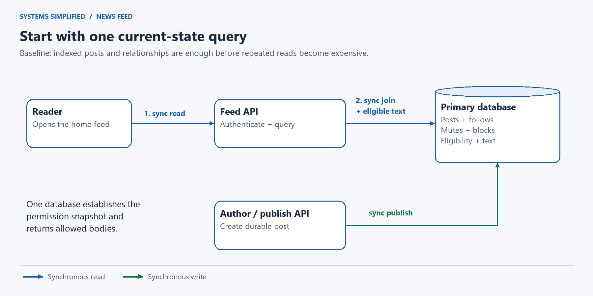
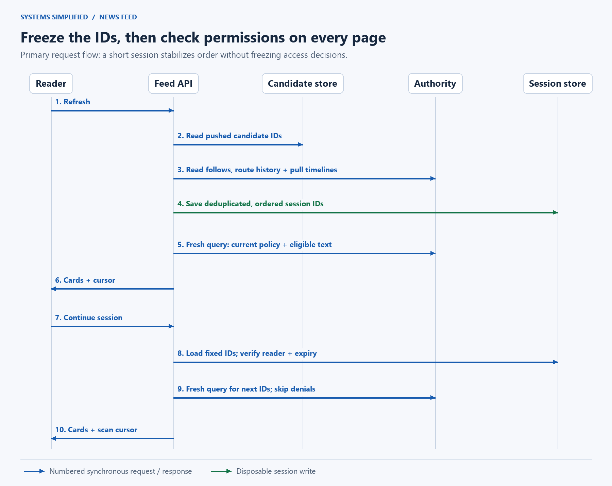
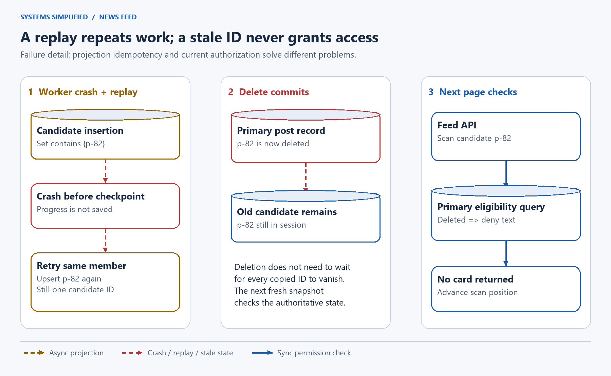

# Design a News Feed

> **In one sentence:** Show recent posts from people a reader follows, without making every author wait for every follower or letting yesterday's cache decide today's permissions.

Maya follows her friends and a musician with two million followers. She wants their recent posts in one place. The musician wants to publish once. If Maya unfollows someone while scrolling, the next page should stop including that person's posts even if a background worker already copied their IDs into her feed.

Design a news feed with durable posts and a disposable candidate index. Push ordinary authors' post IDs into active followers' feeds; pull high-fan-out authors' recent posts when a reader refreshes. Merge and deduplicate candidates, then check current permissions before returning content. Freeze candidate order for a short scrolling session, while treating freshness and completeness as separate, bounded goals.

**Level:** Intermediate  
**Patterns:** [Hybrid fan-out](#choosing-push-or-pull), [transactional outbox](#end-to-end-flow), [materialized views](#data-model-and-partitioning), [fresh authorization](#when-does-a-delete-or-unfollow-take-effect), [session pagination](#how-does-scrolling-avoid-duplicates)  
**Read time:** About 26 minutes  
**Prerequisites:** Basic web requests and database rows; fan-out, candidates, and cursors are explained below.  
**Article facts:** Prepared and published October 20, 2026; human review pending. This is a fictional chronological social feed, not a description of any company's private implementation. Traffic, limits, retention periods, and service targets are illustrative assumptions.

## Why this system matters

A feed moves work between two moments: when someone publishes and when someone reads. Doing everything at publication makes reading cheap but can create millions of writes for one post. Doing everything at reading avoids those copies but makes each refresh search many authors' histories.

**Fan-out** means distributing one item to many destinations. **Fan-out on write**, or push, prepares follower feeds after publication. **Fan-out on read**, or pull, gathers authors' posts when someone opens a feed. A **candidate** is a post ID considered for display, before eligibility checks. It is neither a copy of the post's authority nor proof that the reader may see it.

The central design decision is which work to precompute. The central correctness decision is which facts must still be checked when the reader asks.

## The problem in plain English

An authenticated author creates a text post through an **application programming interface (API)**. An authenticated reader requests up to 20 items. We order eligible candidates by a server-assigned publication timestamp and a unique post ID as a tie-breaker, newest first. This is a deterministic display order, not a globally synchronized commit order.

```http
POST /v1/posts
Idempotency-Key: device-7-draft-41
Content-Type: application/json

{"text":"The new song is out!","audience":"followers"}
```

```json
{"post_id":"p-82","state":"accepted","feed_visibility":"pending"}
```

```http
GET /v1/feed?limit=20
```

```json
{"items":[{"post_id":"p-82","text":"The new song is out!"}],"next_cursor":"opaque-token","partial":false,"refresh_after_seconds":30}
```

The server derives the author or reader from authentication. `accepted` means the post, retry mapping, and outgoing event met the commit policy; it does not mean every follower feed has been updated. A **cursor** is an opaque continuation token. `partial: true` reports known source degradation or reconstruction, not a mathematical completeness verdict; `false` does not promise every eligible post was discovered.

> **Mental model:** A feed is a tray of pointers to possible reading material. The library still checks whether each book exists and whether you may borrow it.

## What success looks like

### Functional requirements

- Create and delete short text posts; retry creation safely within a documented window.
- Follow, unfollow, mute, and block accounts. Followers-only accounts require an approved follow relation.
- Show recent posts from currently followed authors in reverse chronological candidate order.
- Refresh, scroll through a bounded session, and recover from an expired cursor explicitly.
- Rebuild disposable feed state and repair missed background work from durable records.

### Non-functional requirements

These are proposed contracts and test targets. **p95** means 95% of measured observations fall below the stated latency; no target is a benchmark.

| Goal | Illustrative target or contract | Why it matters |
| --- | --- | --- |
| Feed latency | Healthy p95 under 300 ms; 99.9% monthly read availability | Fast enough to open repeatedly |
| Publish latency | Healthy p95 under 200 ms for durable acceptance | A popular author must not wait for follower copies |
| Freshness | Healthy p95 under 5 seconds to an ordinary active follower's next refresh | Measure projection lag separately from API latency |
| Eligibility | Each page checks authoritative current state as defined below | Cached candidates must not bypass deletion or privacy |
| Feed window | Up to 500 candidates from the last 7 days per refresh | Bound memory and reconstruction work |
| Scroll session | Fixed candidate order for 10 minutes; at most 20 returned items and 200 scanned IDs per page | Bound work even when many posts are filtered |
| Account bounds | At most 500 followed authors, including at most 50 authors routed through pull | Put a real bound on read amplification |
| Publish retries | Client retries for 24 hours; dedupe mappings retained at least 48 hours | Avoid an unbounded uniqueness ledger |
| Recovery | Pause unsafe reads or writes during authority failover | Preserve the permission boundary before optimizing availability |

A post newly discovered after session creation appears on refresh, not halfway through the current scroll. The feed is a bounded discovery view, not a complete archive or a guaranteed-delivery inbox. An author's profile provides separately paginated history.

### Out of scope

- Personalized machine-learning ranking, advertisements, recommendations, trending topics, and global search.
- Reactions, comments, reposts, post editing, media uploads, and media delivery. Media authorization would need its own protected byte path.
- Guaranteed observation of every post, a global real-time order, immediate recall of content already received, and unrestricted following counts.
- Active writes in several regions. This lesson uses one authoritative region with multiple failure zones inside it.

## Assumptions and scale

All inputs are estimates for this fictional product. Decimal units are used: 1 GB = 10⁹ bytes. An **active follower** is a follower active within the last 7 days; activity is a fan-out cost optimization, never an authorization rule.

| Input | Assumption | Derivation / implication |
| --- | --- | --- |
| Daily active readers | 2 million | Working set for warm feed projections |
| Page requests | 10 per reader per day | 20 million/day; at 6× average, **1,389 pages/second** |
| Posts | 2 million/day; 6× peak | About **139 publishes/second** at peak |
| Ordinary authors' posts | 99.9% of posts; mean 200 active followers | 1,998,000 × 200 = **399.6 million candidate insert attempts/day** |
| Ordinary peak projection load | Same 6× peak assumption | 399,600,000 / 86,400 × 6 = **27,750 insert attempts/second**, before retries |
| High-fan-out posts | Remaining 2,000/day; mean 2 million active followers | Pushing these would add **4 billion insert attempts/day** |
| Warm feed ID storage | 2 million readers × 500 entries × 32 bytes | **32 GB logical floor**; 96 GB with three copies, before store overhead |
| Post storage | 1,000 bytes per post; 30-day body window | 2,000,000 × 1,000 × 30 = **60 GB logical**, excluding indexes, replication, and backups |
| Worst page filtering work | 200 candidate checks × peak page rate | About **277,800 candidate checks/second**; batching does not remove this row work |

The 32-byte feed entry allowance covers compact IDs and ordering data, not the actual memory footprint of a Redis sorted-set member. Measure encoding, allocator overhead, replication buffers, and spare capacity before buying memory. The **time to live (TTL)** is the expiration time for disposable keys; also trim each feed by age and count on every write and read.

These estimates do not prove one database can meet the targets. Benchmark primary-side permission joins, skewed author queries, and fan-out inserts with the real schema. If they fail the latency budget, reduce admission, add capacity, or revisit partitioning before claiming the target is met.

> **At scale:** A tiny fraction of posts can dominate distribution cost. Partitioning by reader spreads ordinary fan-out writes, but it does not make copying one celebrity post to two million readers free.

## Version 1 — the simplest credible design



**Legend:** Blue arrows are synchronous reads; green arrows are synchronous writes. The primary database owns posts and relationship state. At small scale, one indexed query can establish eligibility and fetch content together.

1. Store accounts, posts, follows, mutes, and blocks in PostgreSQL, a relational database.
2. Accept a post and its client retry identity in one transaction. A **transaction** groups changes so they commit together or none takes effect.
3. On a feed request, join the reader's approved follows to recent live posts, exclude muted or blocked authors, order, and return 20.
4. Use a `(publication_time, post_id)` keyset cursor to continue below the last returned key. **Keyset pagination** seeks by values instead of skipping a changing number of rows.

| Component | Why it exists | What it does not solve yet |
| --- | --- | --- |
| API service | Authenticate, validate, and enforce account limits | Repeated heavy joins still reach the database |
| Primary database | Atomically store posts and current relationship state | One hot read path can consume write capacity |
| Compound indexes | Find recent posts by author and relations by reader | Hundreds of followed authors still mean substantial work |

Start here for a small product. Query plans and realistic load measurements, rather than the word “social,” decide when the next version earns its complexity. Even a keyset cursor can miss a late-committing post whose sort key is above the cursor; do not advertise a complete snapshot.

## Where Version 1 breaks

| Pressure | What fails | Observable symptom | Direction of the fix |
| --- | --- | --- | --- |
| Many repeat reads | The same author histories are joined repeatedly | Primary CPU and page latency rise together | Precompute bounded candidate lists |
| One author has millions of followers | Naive push floods the write path | Worker backlog jumps after one publish | Pull this class of author at refresh |
| Reader follows many active authors | Pull requires many source lookups | Tail latency follows author count | Enforce bounds, batch requests, and use push for the ordinary case |
| Candidate caches survive a delete or unfollow | Copies retain stale IDs | Forbidden or irrelevant content could escape | Recheck current eligibility at every page |
| Background work repeats or arrives late | Candidate lists drift | Duplicate cards or missing fresh posts | Unique members, durable task progress, and rebuilds |
| New posts arrive during scrolling | Recomputed pages keep shifting | Repeated or skipped cards | Freeze a bounded candidate session |

## Version 2 — production-scale architecture


**Legend:** Blue means synchronous read, green synchronous durability, amber dashed asynchronous work. The authority is one regional database cluster; its post index is also the authoritative author timeline. Candidate and session stores are disposable. The final permission query remains on the primary.

### End-to-end flow

1. **Accept:** Authenticate the author and validate text size, audience, quota, and a client retry key. Commit the post, its fixed routing mode, the retry mapping, and an **outbox** row in one database transaction. An outbox is outgoing work saved beside the business change, preventing a crash between a database commit and a separate message send from silently losing the handoff.
2. **Distribute:** A relay reads durable outbox rows and sends wakeups to a broker. The broker is a queueing service, not the source of post truth. Workers create durable, uniquely keyed fan-out tasks and enumerate followers in bounded pages. Each page upserts IDs into active readers' candidate lists, then advances durable progress only after the store acknowledges the batch. A scanner rediscovers unfinished work if a wakeup is lost.
3. **Refresh:** The feed API reads the current followed-author list, bounded pushed candidates, and recent timelines for pull-routed authors. It deduplicates by post ID, applies the seven-day window, sorts by `(publication_time, post_id)`, and keeps at most 500 IDs. It saves this ordered list under a random, reader-bound session ID with a ten-minute TTL.
4. **Authorize and render:** For each page, evaluate at most 200 successive IDs in one primary-side batch query that joins current post state, current account eligibility, approved follow edges, mutes, and both directions of blocks. Consume the ordered results only through the twentieth eligible item, or the batch end if fewer qualify. Advance the cursor through those consumed positions, including rejected ones. Later prefetched results are not consumed; recheck them on the next page. The session stores IDs, not authorization decisions or bodies.
5. **Recover:** An absent or incomplete candidate key schedules one deduplicated rebuild per reader. A capped foreground reconstruction may return a partial session. New candidates arriving later wait for refresh. If the authority cannot safely evaluate a candidate, omit it with a degraded response or fail the page; never authorize from a stale candidate copy.

The [Debezium outbox reference](https://debezium.io/documentation/reference/stable/transformations/outbox-event-router.html) illustrates a real implementation of the database/event boundary. This design can use a polling relay instead; either choice still needs replay, task recovery, and duplicate handling. Likewise, [Amazon SQS documents possible repeated delivery](https://docs.aws.amazon.com/AWSSimpleQueueService/latest/SQSDeveloperGuide/standard-queues-at-least-once-delivery.html); that is one concrete reason workers must tolerate duplicate wakeups.



**Legend:** Numbered blue arrows are synchronous reads or responses; the green arrow saves disposable session state. Each page has a new primary permission query. Source collection and session storage do not themselves authorize a card, and arrows crossing lifelines indicate sequence messages, not shared data stores.

### Component decisions

| Component | Responsibility | Why this choice | Main trade-off |
| --- | --- | --- | --- |
| Authenticated API | Publish, follow, refresh, paginate; enforce admission | One policy boundary for all client paths | Adds critical synchronous work |
| Authority cluster | Posts, relationships, route history, retry keys, outbox, task progress | Transactions and current primary-side joins | Primary permission capacity must be measured |
| Relay, broker, and workers | Durable task discovery and bounded fan-out | Remove follower copying from publish latency | Lag, retries, and more operational state |
| Candidate store | Reader-keyed, unique, ordered post IDs; warm author-ID caches | Cheap repeated reads and rebuildable copies | Eviction and lost updates are recoverable, not invisible |
| Session store | Immutable ordered candidate IDs with expiry | Stable traversal without recomputing each page | Extra state; sessions can expire or be evicted |
| Rebuild scanner and workers | Restore cold feeds and audit projection progress | Durable sources survive cache failure | Unbounded reconstruction would overload the authority |

These are responsibilities, not a requirement for six separately deployed services. A small team can run the relay, scanner, and workers as a few processes. A PostgreSQL primary and a synchronous standby in different zones are the starting authority layout; sharding that authority is a later design change, not a hidden assumption.

> **Why it exists:** The session store buys stable candidate order. It deliberately does not freeze permissions. A block committed before the next page's permission query can remove an item from that same session.

### Choosing push or pull

For an author, compare `posts × active followers × cost per insertion` with `reader refreshes involving that author × cost per timeline lookup`. Costs include storage, network, batching, cache hit rate, and tail latency. Follower count alone is a convenient signal, not the complete decision rule.

For one popular post, suppose pushing needs two million insertions while only 100,000 interested readers refresh during its useful lifetime. Pull avoids up to 20 candidate insertions per interested refresh. It still pays timeline lookup, merge, and permission costs; this ratio is not a latency benchmark or a universal break-even threshold.

Ordinary posts use push. High-fan-out posts use pull. Inactive readers are skipped by push and rebuilt on return. Bound fan-out chunks, schedule fairly across authors and readers, and isolate rebuild capacity from fresh-post capacity so a cold-cache storm cannot starve new work.

**Routing transitions must overlap.** Store a routing epoch, meaning a version of the routing policy, on each post. Never reinterpret an old post merely because the author's current mode changed. For seven days after an author changes mode, readers also pull that author's retained timeline, regardless of current mode; duplicate pushed IDs collapse during merge. This covers older pull posts after a switch to push and older push posts while copies catch up. Read authoritative routing history during refresh; keep it for at least the feed window plus the maximum session lifetime.

The 50-author pull budget includes transition authors. If a proposed switch would exceed it for a reader, put that reader into bounded partial reconstruction and require refresh until a supported plan is available; do not silently fan out unbounded work. With larger following limits or frequent routing changes, redesign admission and candidate retrieval before promising the same latency.

### How does scrolling avoid duplicates?

Create a session once per refresh. Save a deduplicated, fixed array of at most 500 IDs and its ordering policy version. The cursor contains an authenticated session reference, reader binding, expiry, and the next array offset. It cannot choose arbitrary reader IDs or inject candidate IDs.

At each page, scan forward until 20 items qualify, 200 IDs were inspected, or the array ends. A short or empty page can still have a continuation cursor. Advancing by **scanned position** prevents a run of deleted posts from trapping the reader on the same page.

For example, the list `[p9, p8, p7, p6]` is fixed. If `p8` is deleted before page two, it is skipped; `p7` does not move into an earlier page. A delayed `p10` appears only after a new refresh. Within a forward traversal, each candidate position is visited once. Retrying the same cursor may return the same cards, and permission changes may shorten that retry; this is not exactly-once delivery to a device.

An expired or missing session returns an explicit `cursor_expired` response. Start a new refresh instead of reusing the old offset against a different list. This session is a snapshot of gathered candidate IDs, not a transactionally complete snapshot of all posts: gathering spans changing sources, bounded windows, and asynchronous projections.

## Data model and partitioning

A **materialized view** is a stored result derived from authoritative data. The home-feed candidate list is such a view. Losing it should cost reconstruction time, not destroy posts or grant access.

| Data | Source of truth | Access pattern | Partition / replication strategy |
| --- | --- | --- | --- |
| `post(post_id, author_id, publication_time, audience, state, body, route_epoch)` | Authority database | ID batches and recent posts by author | Primary key by ID; compound author/time/ID index; time partitions as volume warrants |
| `follow(reader_id, author_id, state)`, mutes, blocks | Authority database | Reader's follows; author's followers; page eligibility | Index both directions; primary query evaluates block in either direction |
| Author routing history | Authority database | Current and recent epochs per followed author | Retain at least 7 days + 10 minutes after a switch |
| Publish retry mapping | Authority database | Unique `(author_id, client_key)` to request hash and post ID | Retain at least 48 hours; reject reuse with different input |
| Outbox and fan-out tasks | Authority database | Discover unfinished events; resume follower page | Unique event/task identities, persisted leases and progress |
| Home-feed candidates | Derived Redis-compatible store | Top IDs per reader, unique by post ID | Hash reader ID across shards; cap at 500 and 7 days; expire idle keys |
| Cached author timelines | Derived candidate store | Recent IDs per pull author | Hash author ID; bound lists; coalesce cache fills for hot authors |
| Scrolling sessions | Derived session store | Read fixed ID array by random session ID | Hash session ID; ten-minute TTL; reader binding |

The compound ordering key must keep the timestamp and full post ID distinct; do not squeeze both into a floating-point cache score and assume collisions are impossible. One implementation stores time as the score and a fixed-width ID as the tie-break member, then uses the same comparator when merging. Post IDs are unique, opaque identifiers, not proof of permission.

Use a database uniqueness constraint for publish retry identity, with a canonical request hash to distinguish an actual retry from a different request reusing the key. [PostgreSQL unique constraints](https://www.postgresql.org/docs/current/ddl-constraints.html#DDL-CONSTRAINTS-UNIQUE-CONSTRAINTS) enforce the composite identity under concurrency. A lookup followed by an unprotected insert is insufficient. On a retry after an uncertain commit, update a confirmation stamp on the existing mapping and wait for that transaction's synchronous commit before returning `accepted`; a visible mapping alone may precede the original transaction's replication acknowledgment. After the retry window, a client must reconcile by returned post ID rather than replaying an old create key.

Keep deleted-post tombstones, meaning records that an ID was deleted, through the remaining feed window and permitted replay period. The final query returns content only for an existing live post, so absence is also denial. Old fan-out tasks recheck age and live state, and IDs are never reused. Body purge, relationship erasure, logs, and backup expiration need explicit retention policies; “not returned by the feed” is not complete physical erasure.

## Reliability, correctness, and recovery

### When does a delete or unfollow take effect?

Use one primary-side statement per checked batch to evaluate current live post state, reader and author account state, approved following, mute, and either-direction blocks, and fetch the allowed text bodies together. It must start a fresh **Read Committed** statement, not reuse an older transaction snapshot or read a lagging replica. [PostgreSQL documents that this statement sees data committed before the query began](https://www.postgresql.org/docs/current/transaction-iso.html#XACT-READ-COMMITTED).

The contract is precise: a delete, unfollow, mute, privacy change, or block committed before that statement's snapshot affects that batch. A change committed after the snapshot may race with the in-flight response. Policy-change success responses use the same synchronous commit policy as posts; a timeout leaves the outcome unknown and requires reconciliation after failover. Content already returned can remain on a device. There is no promise of instantaneous recall. Fetching the body in the same query avoids authorizing one revision and then accidentally hydrating a different one from a stale body cache.

If the authority fails over, fence the old primary, meaning prevent it from serving as authority, and serve fresh permission queries only on the promoted, caught-up primary. Do not use cached policy during this pause. Synchronous replication with `synchronous_commit=on` and a configured synchronous standby improves acknowledged-commit durability, but costs latency and can block writes when the required standby is unavailable; [PostgreSQL explains those limits](https://www.postgresql.org/docs/current/warm-standby.html#SYNCHRONOUS-REPLICATION). Promote only a standby that satisfies the supported durability policy. Cross-region disaster recovery from asynchronous copies can lose recent commits; halt permission-bearing reads until policy state is reconciled rather than claiming zero loss.

### Repeated work and missing candidates



**Legend:** Amber dashed arrows mean asynchronous projection, red dashed arrows mean failure or replay, and blue arrows mean synchronous permission evaluation. A repeated ID is harmless to the candidate set; an old ID never authorizes content.

Fan-out task leases expire so another worker can recover abandoned work. A **lease** grants temporary ownership; it does not guarantee only one worker can ever run. Persist a lease generation and condition progress updates on it, so an old worker cannot overwrite a successor's cursor. Candidate insertion remains idempotent even if both workers briefly write: the same post ID updates the same member.

Checkpoint follower pages only after insertion acknowledgment. A crash before the checkpoint repeats the page. A lost cache shard after the checkpoint is different: that task may look complete even though its outputs vanished. Replication reduces outages but cannot make a disposable projection authoritative. Mark a new cache generation incomplete, rebuild affected readers on demand, and reconcile warm readers periodically. Detect absent keys and incomplete generations explicitly; an empty-but-complete key is different from a missing one.

Follower enumeration is not a frozen audience snapshot. A new follow schedules a bounded seven-day backfill; an unfollow can leave stale candidates that the final query rejects. Concurrent follow changes and delayed jobs may leave temporary omissions. Newly followed accounts and resumed inactive accounts have a visible rebuilding state. Reconciliation and refresh repair candidate discovery; the product does not guarantee every historical post will appear in a capped feed.

### Recovery has a capacity budget

Suppose fan-out pauses for ten minutes at the assumed peak. `27,750 × 600 = 16.65 million` insertion attempts accumulate, excluding retries. If tested worker capacity is 40,000 insertions/second while 27,750 new attempts/second continue arriving, spare capacity is 12,250/second. Ideal drain time is `16,650,000 / 12,250 ≈ 1,359 seconds`, or **22.7 minutes**. Real recovery is longer with skew, retries, rebuilds, and expired work filtering.

For a total candidate-cache outage, never let all peak readers query all 500 authors at once. That could create `1,389 × 500 ≈ 694,500` author-history lookups/second before permission work. Coalesce simultaneous rebuilds per reader, reserve separate worker capacity, admit only a measured number of foreground source queries, and use deadlines. Return an explicitly partial feed or a retryable error when the budget runs out. Never manufacture “no new posts” from a failed source.

| Scenario | Design response | Remaining risk |
| --- | --- | --- |
| Publish commits but reply is lost | Retry same client key; resolve unique mapping and request hash | Client may remain uncertain during failover; do not invent a new key automatically |
| Relay or broker loses a wakeup | Scanner finds unfinished durable outbox/task state | Freshness degrades until recovery |
| Worker repeats a follower page | Unique candidate members and generation-checked checkpoint | Extra load; no exactly-once processing claim |
| Candidate key or shard is lost | Detect missing/incomplete state; bounded rebuild from posts and follows | Partial or temporarily unavailable feeds |
| Session is evicted | Return `cursor_expired`; create a fresh session | New refresh can repeat previously seen posts |
| Delete races with delayed fan-out | Gate bodies against current authority; filter old tasks | Stale IDs may remain until trimming; in-flight responses can race |
| Author becomes hot | Coalesce author-timeline cache fills; adjust routing with overlap | Cold author reads and current eligibility remain bottlenecks |
| Authority is unavailable | Fail permission-bearing reads closed; pause unsafe writes | Lower availability in exchange for correctness |

> **Failure mode:** A queue can deliver every event and the feed can still be incomplete after cache loss. Task completion is evidence that a write once succeeded, not evidence that every disposable copy still exists.

### What operators measure

Track publish acceptance latency, primary permission-query latency and failures, feed page latency, candidate scans per returned card, known-partial response rate, cursor expiry, and author-cache coalescing. Split freshness into outbox age, oldest fan-out task age, and time from publish to observation in sampled healthy follower refreshes.

Alert on rising oldest-task age, cache-generation changes, repeated rebuild admission failures, and permission-source errors. Count attempts as well as unique candidate insertions so retries cannot hide load. Audit with sampled comparisons to an authoritative bounded pull, recording omissions without logging private text. Exercise a lost-response retry, worker crash, deleted-post page, expired session, primary failover, and cache-loss reconstruction before trusting the targets.

## Security and abuse resistance

- Authenticate every request and enforce authorization server-side. Never trust reader IDs, client timestamps, audience claims, candidate lists, or cursor offsets supplied without authentication and integrity protection. [OWASP recommends checking permissions on every request and denying by default](https://cheatsheetseries.owasp.org/cheatsheets/Authorization_Cheat_Sheet.html#validate-the-permissions-on-every-request).
- Check permissions on individual post endpoints too. A blocked post must not become readable by guessing its ID or bypassing the feed API. This lesson's text-only responses contain no unprotected media URL that escapes the gate.
- Use encrypted transport and storage, least-privilege service credentials, and per-reader cache namespaces. Candidate IDs and the follow graph can themselves reveal sensitive interests; restrict access and erase them according to policy.
- Keep personalized responses out of shared public caches; set `Cache-Control: private, no-store` on feed responses. Do not put private text, signed cursors, or full relationship lists into ordinary logs.
- Apply per-account and network rate limits to publish, follow churn, refresh, cursor creation, and rebuild requests. Bound text size, follow counts, fan-out chunk size, session creation, and total candidates scanned per request. See the [rate limiter lesson](../rate-limiter/README.md) for overload policies.
- Treat text as text when rendering, with output escaping, rather than executing author-supplied markup. Add abuse reporting and moderation state to the same final eligibility query. Moderation removal obeys the same snapshot boundary as deletion.

## The trade-offs that matter

| Decision | We optimize for | We give up | Prefer an alternative when… |
| --- | --- | --- | --- |
| Hybrid push/pull | Cheap ordinary reads without celebrity write explosions | Two retrieval paths and route-transition bookkeeping | Pure pull is affordable at small scale, or almost all authors are high-fan-out |
| IDs in candidate stores | Cheap copies and centralized permission/body authority | A synchronous primary-side query for every page | A measured bounded-staleness policy is acceptable and explicitly specified |
| Primary current-state gate | A clear post-change permission boundary | Availability during authority failure; read capacity | Public immutable content can safely use a different cache policy |
| Fixed short session | Stable traversal and bounded duplicate control | New candidates wait for refresh; sessions can expire | Stateless keyset pagination's shifting view is acceptable |
| Capped seven-day feed | Predictable storage and rebuild work | No completeness guarantee or deep feed history | The product needs an archival inbox with durable per-recipient delivery state |
| Chronological candidates | Explainable ordering without a model pipeline | Less relevance optimization | Product evidence justifies ranking, evaluation, and additional policy controls |

> **Trade-off:** Fresh permission checks and eventual candidate discovery can coexist. A feed may omit a new post temporarily while still refusing a deleted post at its next fresh permission snapshot.

## How the design evolves next

| Trigger | Next change | Why not add it on day one? |
| --- | --- | --- |
| Primary permission joins exceed the measured budget | Partition authority by an explicit ownership model; define cross-shard policy snapshots or version/fencing rules | Independent shards remove the single-statement policy boundary; stale positive authorization is dangerous |
| Larger follow counts or pull-author budgets | Hierarchical candidate retrieval, per-author quotas, and a new partial-result contract | Unbounded scatter-gather increases tail latency and cost |
| Useful personalization evidence | Versioned ranking over a bounded candidate set, fixed per session; retain final policy gate | Features, training, evaluation, and feedback loops add operational and privacy work |
| Cache reconstruction dominates | Durable derived candidate storage or tiered projections with repair watermarks | More write cost and additional recovery invariants |
| Requirement to observe every important post | Separate durable subscription inbox and per-recipient progress | A capped social feed is the wrong delivery contract |
| Global latency becomes unacceptable | Regional candidate copies with home-authority permission routing and an explicit disaster policy | Asynchronous regional copies cannot silently inherit fresh permission guarantees |

## Key takeaways

> **Remember:** Stable scrolling, fresh permissions, and complete discovery are three separate properties. This design provides bounded candidate traversal and a current-state permission boundary, with eventual and intentionally capped discovery.

- A feed candidate is a pointer to consider, not permission to return content.
- Push moves work to publication; pull moves it to reading. Author and reader skew decide the balance.
- An outbox protects the business-change/event boundary. Idempotent projections, scanners, and rebuilds solve different later failures.
- Freeze candidate order for scrolling while rechecking permissions on each page. Stability and freshness are separate contracts.
- State the visibility snapshot and failure policy precisely. A cache purge is useful cleanup, not the authorization mechanism.
- Budget recovery with spare capacity. A backlog cannot drain while incoming work consumes the entire worker budget.

## Quick check

1. A worker inserts a post ID, crashes before checkpointing, then retries. Which key prevents duplicate candidates? What changes if the cache loses that ID after the task is complete?
2. An author with two million followers posts once, but only 100,000 interested readers refresh. Which measurements besides follower count determine push versus pull?
3. A reader blocks an author after session creation but before the next page's permission query. Why is freezing IDs safe while freezing permission results is not?
4. Why can a cursor advance after an empty page? What should happen when its session disappears?
5. Workers process 40,000 inserts/second and new demand is 27,750/second. Why is a 16.65-million-insert backlog not cleared in seven minutes?

## Related lessons

- [Chat System: durable messages, live hints, and reconnect recovery](../chat-system/README.md) contrasts a feed's discovery view with conversation history.
- [Notification System: accepted work, channel delivery, and unknown outcomes](../notification-system/README.md) shows why event acceptance and user observation differ.
- [Rate Limiter: admission, overload, and failure policy](../rate-limiter/README.md) helps bound refresh storms and reconstruction load.
- [File Storage: publication and current authorization](../file-storage/README.md) extends the permission discussion to protected bytes and temporary grants.

## Frequently asked questions

### What is the difference between fan-out on write and fan-out on read?

Fan-out on write copies post IDs to follower feeds after publication. Fan-out on read gathers followed authors' posts at refresh. Push makes repeated reads cheaper but amplifies writes; pull avoids unused copies but increases per-refresh work. A hybrid chooses per author and overlaps reads during routing changes.

### Is Redis the source of truth for a news feed?

Not in this design. Redis holds reconstructible candidate IDs and short-lived sessions. Posts, current relationships, policy state, and unfinished work remain durable in the authority database. Eviction can cause missing candidates or expired sessions, so the service detects it and rebuilds within a budget.

### Can a deleted or blocked post still appear from a cached feed?

A stale candidate ID can remain, but a fresh primary-side query checks eligibility before returning text. Changes committed before that query's snapshot are reflected. A concurrent change can race with an in-flight response, and content already received cannot be recalled reliably. Cache removal alone is insufficient.

### Does a fixed cursor mean the feed is strongly consistent?

No. The cursor traverses a fixed list of discovered candidate IDs, not a complete transactional snapshot of posts and relationships. Delayed candidates wait for refresh; each page evaluates permissions anew. A session can produce short pages, expire, or be evicted.

### Why not push every post to every follower?

Popular authors create enormous write amplification, including copies no one reads. Under the stated estimates, just 2,000 high-fan-out posts would add four billion insertion attempts each day. Pulling these timelines trades those writes for bounded refresh-time work; it still needs caching, permission checks, and overload controls.

## Small glossary

| Term | Meaning here |
| --- | --- |
| Candidate | A post ID considered for display before current eligibility checks |
| Projection / materialized view | A stored, reconstructible result derived from authoritative records |
| Fan-out | Distributing one post reference to many reader destinations |
| Outbox | Outgoing work committed in the same transaction as a business change |
| Idempotent | Repeating an operation has the same intended state effect as doing it once |
| Cursor | An integrity-protected continuation reference bound to one reader and session |
| Snapshot | The committed database state visible to a particular statement or transaction |
| Tombstone | A retained marker that an existing identity has been deleted |
| Backpressure | Limiting admitted work when downstream capacity cannot keep up |
| Fencing | Preventing an old primary or expired task owner from acting as current authority |

## Sources and further reading

Primary sources checked October 20, 2026. They support individual mechanisms; the workload, component choices, hybrid routing policy, and targets above are this lesson's illustrative design, not vendor claims.

1. [PostgreSQL: unique constraints](https://www.postgresql.org/docs/current/ddl-constraints.html#DDL-CONSTRAINTS-UNIQUE-CONSTRAINTS) — composite identities and concurrency-safe uniqueness.
2. [PostgreSQL: Read Committed isolation](https://www.postgresql.org/docs/current/transaction-iso.html#XACT-READ-COMMITTED) — the statement-start snapshot used for the page eligibility contract.
3. [PostgreSQL: synchronous replication](https://www.postgresql.org/docs/current/warm-standby.html#SYNCHRONOUS-REPLICATION) — commit waiting, durability configuration, and availability costs.
4. [Debezium: outbox event router](https://debezium.io/documentation/reference/stable/transformations/outbox-event-router.html) — transactionally recorded events and duplicate-aware consumers.
5. [Amazon SQS: at-least-once delivery](https://docs.aws.amazon.com/AWSSimpleQueueService/latest/SQSDeveloperGuide/standard-queues-at-least-once-delivery.html) — a documented queue example requiring idempotent handling.
6. [Redis: key eviction](https://redis.io/docs/latest/develop/reference/eviction/) — keys can be removed under memory pressure; configure and monitor the policy. This supports treating caches as disposable rather than assuming a TTL guarantees survival.
7. [OWASP: authorization guidance](https://cheatsheetseries.owasp.org/cheatsheets/Authorization_Cheat_Sheet.html#validate-the-permissions-on-every-request) — request-level checks, default denial, and protected resources.

**Revision note:** Initial lesson. Revisit the design if follow limits, traffic skew, policy boundaries, routing transitions, retention, database semantics, or recovery requirements change. A future documentation site should render this text and its image alternatives in accessible HTML, expose matching title/description/canonical and social metadata, add truthful article and breadcrumb structured data, maintain discovery files, and recheck current crawler policies before deployment. This repository lesson does not change site or crawler configuration or promise search ranking.
