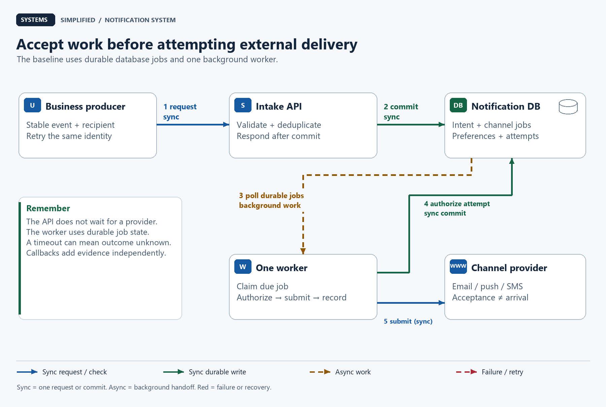
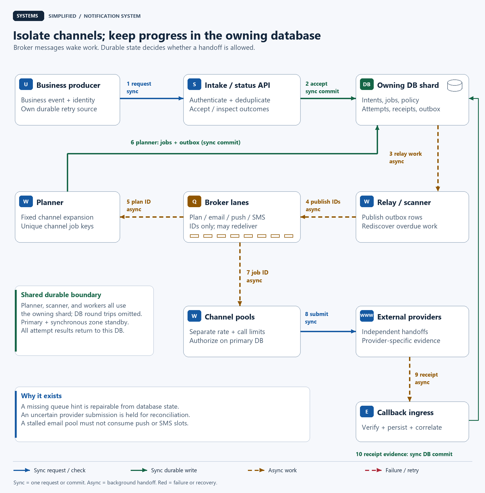
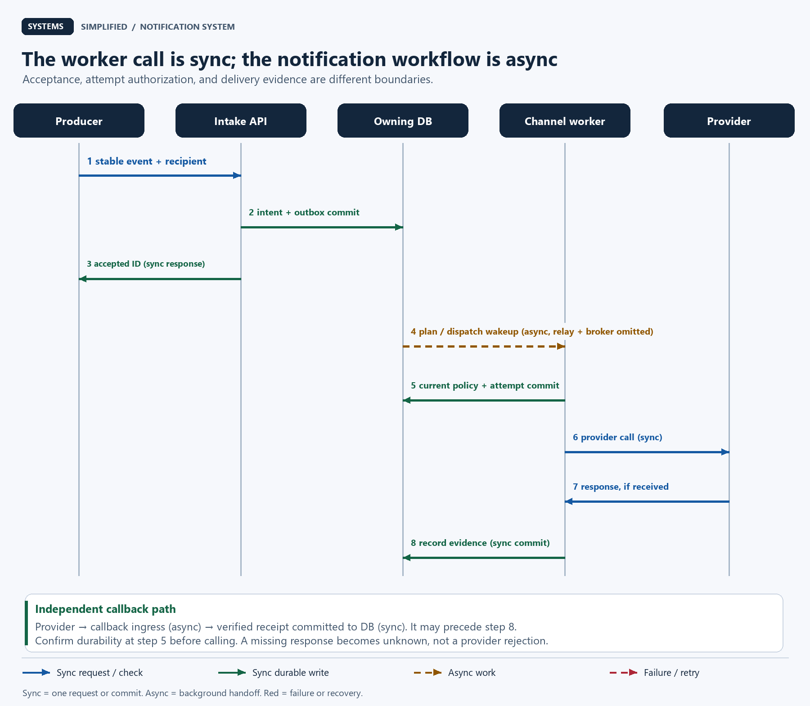
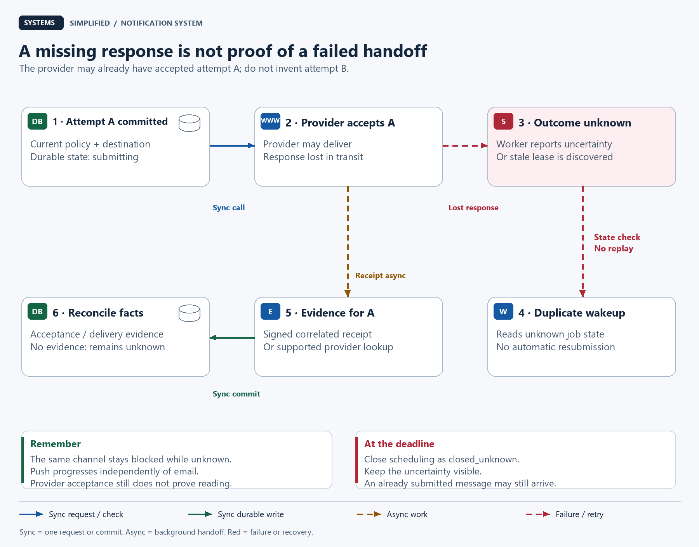

# Design a Notification System

> **In one sentence:** Turn a business event into a useful alert without letting a slow provider, a repeated event, or a changed preference silently break the delivery contract.

Maya's order ships while her phone is offline. She expects an email and, if enabled, a push alert. The order service must keep working if email is slow. When a worker loses its connection after submitting the email, sending it again could give Maya two copies.

Design a notification system around durable notification intents and independent channel deliveries. Commit each intent with an outbox event, then use background workers to check current preferences and submit bounded attempts to providers. Deduplicate internal work, preserve uncertain external outcomes, and reconcile receipts. Provider acceptance is not device delivery or proof that a person read the alert.

**Level:** Intermediate  
**Patterns:** [Transactional outbox](#end-to-end-flow), [idempotent planning](#how-do-repeated-events-avoid-duplicate-work), [channel isolation](#component-decisions), [bounded retries](#when-is-a-provider-retry-safe), [backpressure](#backlog-recovery-is-a-capacity-problem)  
**Read time:** About 28 minutes  
**Prerequisites:** Basic web requests and database rows; queues, receipts, and retry terms are explained below.  
**Article facts:** Prepared and published October 18, 2026; human review pending. This is an illustrative application notification service, not a claim about any provider's private architecture. All workload figures, limits, retention periods, and service targets are hypothetical.

## Why this system matters

Notifications connect an application to a person's attention. They also cross a boundary the application cannot fully control: another company's email service, mobile push network, or telephone network.

A **notification intent** is the durable instruction to notify one recipient about one event. A **channel delivery** is the work for one route, such as email. An **attempt** is one particular submission to a channel provider. Separating them prevents “retry the notification” from accidentally repeating every channel that already succeeded.

The useful question is not just how many messages a queue can hold. It is what the service knows after each failure, and what it is allowed to do next.

## The problem in plain English

The order service submits one recipient's shipping update through an authenticated **application programming interface (API)**. The producer records the business change and its own outgoing event in the same database transaction; a relay retries this request. Otherwise, a crash between “order shipped” and “notify” could lose the alert before our system even sees it.

```http
POST /v1/notification-intents
Content-Type: application/json

{"event_id":"order-82-shipped-v3","recipient_id":"u-17","type":"order_shipped","template_version":4,"data":{"order_id":"82"},"expires_at":"2026-10-19T06:00:00Z"}
```

```json
{"notification_id":"n-91","state":"accepted"}
```

The server derives the tenant and producer identity from authentication. A **tenant** is a customer organization whose data and permissions are isolated from other customers. The server chooses allowed templates, urgency, and channels from trusted policy; the caller cannot send arbitrary text to arbitrary phone numbers. This example requests email and push when enabled. SMS means **Short Message Service**, the carrier text channel, and is offered only for explicitly enabled notification types.

| Status | Evidence | What it does not prove |
| --- | --- | --- |
| Accepted | The intent, retry identity, and outbox row met the database commit policy | Any provider has seen it |
| Suppressed / expired | Policy or deadline stopped a new submission | A previously authorized or submitted attempt was recalled |
| Provider accepted | A documented successful provider response or correlated receipt exists | Device arrival, inbox placement, or human attention |
| Outcome unknown | Submission may have happened, but there is insufficient evidence | Either success or failure |
| Delivery evidence | A provider-specific receipt reports an outcome | A uniform cross-channel guarantee; email mail-server acceptance is not an inbox or read receipt |
| Opened / read reported | An app or tracking signal reports interaction | Proof that a person read or understood the content |

For example, [Amazon Simple Email Service (SES) defines a delivery event as delivery to the recipient's mail server](https://docs.aws.amazon.com/ses/latest/dg/monitor-using-event-publishing.html). [Firebase Cloud Messaging (FCM) distinguishes accepting a message from delivering it to a device](https://firebase.google.com/docs/cloud-messaging/customize-messages/setting-message-lifespan). Our status model preserves those meanings rather than flattening them into “delivered.”

> **Mental model:** The intent is a work order, each channel has its own job sheet, and a provider receipt is evidence about a handoff. A missing receipt is an unanswered question, not permission to repeat the handoff.

## What success looks like

### Functional requirements

- Accept single-recipient application events and expose authenticated status by notification ID.
- Plan email, push, and optional SMS independently, with immutable template versions and localized rendering.
- Support scheduled submission, per-channel preferences, quiet hours for deferrable alerts, and expiration.
- Retry duplicate producer requests and internal work safely within documented retention windows.
- Process provider callbacks, suppress unusable destinations, and expose unknown outcomes honestly.
- Provide operators with bounded replay, audit records, and channel-specific failure visibility.

### Non-functional requirements

These are proposed contracts and test targets. **p95** means 95% of measured observations fall below that latency; no target below is a benchmark.

| Goal | Illustrative target or contract | Why it matters |
| --- | --- | --- |
| Acceptance | p95 under 200 ms in the recipient's home region; 99.9% monthly availability | Do not make order processing wait for an external provider |
| Healthy dispatch | p95 under 5 seconds from an immediately due accepted intent to first submission, for each healthy channel | Measure queueing delay separately from external delivery |
| Producer retries | Automatic replay for up to 7 days; retry identities retained at least 8 days from acceptance | Keep bounded deduplication state |
| Deadline | Shipping alerts expire 24 hours after the event; no new attempt authorization after expiry | Avoid starting stale work |
| Preference change | A disable committed before an attempt's authorization prevents that authorization | Define the race precisely |
| Durability | Synchronous standby across zones; controlled failover as described below | Preserve acknowledged work through the supported primary failure |
| Visibility | Alert on channel oldest-due age over 30 seconds and unknown-outcome rate above its established baseline | Detect user impact hidden by average throughput |

A **zone** is a failure domain within a geographic **region**. This service accepts writes in one home region per recipient. The deadline governs new attempts; it cannot guarantee when a carrier, mail server, or device will display a submission already handed off.

### Out of scope

- Bulk marketing campaigns, recipient-list discovery, emergency alerts, authentication codes, and financial authorization. Their priority, abuse, and duplicate-versus-loss policies need separate designs.
- A durable in-app inbox, real-time chat, and arbitrary user-authored messages. The product's authenticated order page remains the authoritative business record.
- Exactly-once human-visible delivery, guaranteed reading, global ordering, and automatic SMS fallback after a push or email timeout.
- Sending push to every registered device. This example selects one current primary push endpoint at attempt authorization; device fan-out would multiply jobs and change the delivery key.

## Assumptions and scale

Every figure here is an estimate for the fictional service. Decimal units are used: 1 GB = 10⁹ bytes. A channel job is one destination's planned delivery, before retries.

| Input | Assumption | Derivation / implication |
| --- | --- | --- |
| Daily intents | 10 million | After producer duplicates are removed |
| Peak factor | 6× the daily average | 10,000,000 / 86,400 × 6 ≈ **694 intents/second** |
| Channel mix | 100% email, 70% push, 10% SMS | Average **1.8 jobs/intent**, or 18 million jobs/day before suppressions |
| Peak first submissions | All eligible; no quiet-hour concentration | 18,000,000 / 86,400 × 6 = **1,250/second** |
| Retry planning allowance | 10% extra submissions | 1,250 × 1.10 = **1,375 attempts/second**; budget, not measured behavior |
| Mean provider call time | 250 ms | 1,375 × 0.25 ≈ **344 calls in flight** at that rate |
| Intent and job rows | 1,000 bytes/intent; 600 bytes/job | 10M × 1,000 + 18M × 600 = **20.8 GB/day** logical row data |
| Operational history | 30 days | 20.8 × 30 = **624 GB**; 3 copies ≈ **1.872 TB**, before indexes, attempts, receipts, and backups |
| Minimal retry identity | 96 bytes × 10M/day × 8 days | **7.68 GB** logical floor; not total index or database size |
| Disruption example | Email blocked 10 minutes at 694 jobs/second | **416,400 waiting email jobs** before expiry or suppression |

**Little's law** relates average concurrency to arrival rate × average time in the system. The 344-call estimate is a starting point for load tests, not a safe thread-pool size: latency tails, provider limits, connections, and local overhead still matter. With a ten-second timeout, an unbounded outage could consume thousands of slots; bounded channel pools must stop that growth.

> **Key implication:** Email, push, and SMS have different limits and failure patterns. A shared unbounded worker pool lets one slow provider consume the resources every other channel needs.

## Version 1 — the simplest credible design



The baseline keeps durable jobs in one relational database. Blue arrows show synchronous requests or checks; green arrows show committed writes; dashed amber arrows show background work. The API response follows the database commit, while external submission happens independently. These arrow meanings apply to all four diagrams; red dashed arrows mark failures or recovery.

1. Authenticate the producer, validate the event and template, and assign a stable notification ID.
2. In one transaction, insert the retry identity, intent, and small fixed set of channel jobs. Commit, then acknowledge acceptance.
3. A background worker polls due jobs, reserves a job, and checks current preferences and destination validity.
4. Persist an attempt authorization before calling the provider. Record its response or the fact that the outcome is uncertain.
5. Accept authenticated callbacks and reconcile them with the stored attempt.

| Component | Why it exists | What it does not solve yet |
| --- | --- | --- |
| One API process | Validation, deduplication, authenticated status | Process or zone availability |
| Relational database | Atomic intent and job creation; durable progress | Unlimited write throughput or external delivery atomicity |
| One worker with a polling loop | Retryable background processing | Channel isolation, precise throughput budgets, large backlogs |
| Provider adapter | Translate requests and interpret provider-specific responses | Prove arrival from acceptance, or retract a submitted alert |

No broker is required to make this small version correct. Database polling can be the queue. “Save a row, then send an in-memory task” is weaker: the process can crash between the two.

## Where Version 1 breaks

| Pressure | What fails | Observable symptom | Direction of the fix |
| --- | --- | --- | --- |
| Email calls hang | One pool's slots are exhausted | Push waits behind email | Separate channel pools and budgets |
| Polling every job repeatedly | Database scans and lock contention grow | High database load with little useful work | Due-time indexes, bounded claims, broker wakeups |
| Crash after a provider accepts | Worker cannot tell whether submission succeeded | Duplicate alert if replayed blindly | Explicit unknown outcome; evidence-based retry policy |
| Quiet hours end for many people | Scheduled demand exceeds steady-state estimates | Morning backlog; stale alerts | Spread deferrable work within allowed windows, reserve headroom |
| Duplicate events or queue redelivery | Same logical work executes again | Duplicate jobs or extra attempts | Stable keys, uniqueness, state checks |
| Preferences change while queued | Old plan is treated as permission | Alert sent after disable | Current authorization immediately before handoff |
| A noisy tenant floods intake | Shared resources are consumed | Other tenants miss their latency goals | Tenant limits and fair channel scheduling |

## Version 2 — production-scale architecture



The database is still the source of truth. A **transactional outbox** is a table of outgoing work written in the same transaction as the state it describes. Its relay publishes lightweight IDs to a broker, which wakes the planner or the right channel pool. An overdue-work scanner independently rediscovers unfinished database rows, so losing a wakeup does not erase a job.

The diagram shows one logical recipient shard. The database includes a synchronous standby; its internal replication and worker database round trips are summarized to keep the topology readable. Channel workers read and write that shard before and after each external call. Providers and callbacks are outside the service's atomic transaction boundary.

### End-to-end flow

1. The producer retries its durable business event to intake using the same identity. Intake validates trusted policy and commits the intent, payload hash, and `plan` outbox row together. It returns `accepted` only after the configured durability confirmation.
2. The relay publishes the ID to a planning lane and marks its outbox row complete after broker acknowledgement. If it crashes between those operations, publication can repeat. The planner treats duplicate wakeups as normal.
3. The planner deterministically creates at most one channel job per `(notification_id, channel)` and matching dispatch outbox rows in a transaction. It pins template version and locale. It records `planned_at` only with those inserts; a crash leaves either no plan or the complete fixed-size plan.
4. The relay publishes channel job IDs. Workers claim only due jobs from the owning database. A scanner searches indexed unfinished intents and due jobs, with an illustrative ten-second scan interval plus scan duration; it repairs missing broker hints and schedules future retries. Broker retention is not the retention contract for notification intent.
5. A worker renders and validates the pinned template, acquires channel capacity, and performs the short authorization transaction described below. It submits to the selected provider without holding a database transaction open.
6. A documented success records provider acceptance. A definite retryable rejection schedules a bounded retry; a timeout or worker death creates an unknown outcome. A signed callback or provider lookup, where supported, can add evidence later.
7. Status reads return the intent and separate channel outcomes. They do not promote an email acceptance into success for push or overwrite an unknown SMS result with a convenient guess.

### Component decisions

| Component | Responsibility | Why this choice | Main trade-off |
| --- | --- | --- | --- |
| Intake / status API | Authenticate producers, validate requests, deduplicate, read status | Fast durable boundary for callers | Acceptance says nothing about external delivery |
| Owning database shard | Intents, jobs, attempts, preferences, endpoints, receipt evidence, outbox | Atomic local transitions and recipient policy checks | Primary availability and write/lock capacity matter |
| Relay / overdue scanner | Publish outbox IDs; rediscover unfinished work | Recover both duplicate and missing wakeups | Extra reads; must bound scans and monitor lag |
| Broker lanes | Wake planning and channel consumers | Reduce polling latency and isolate demand | Redelivery is expected; IDs need database validation |
| Planner | Expand one intent into a fixed small set of jobs | Replayable work distinct from submission | An extra stage at this scale |
| Channel worker pools | Render, authorize attempts, apply rate/concurrency limits, call adapters | Isolate email, push, and SMS failures and costs | Separate tuning and operations |
| External providers | Email, push, or SMS handoff | Use established transport networks | Different receipts, limits, and uncertainty windows |
| Callback ingress | Verify, persist, correlate, and deduplicate receipt evidence | Keep callbacks fast and replayable | Callbacks can be absent, duplicated, or reordered |

> **Why it exists:** The scanner is the repair path. The broker says “look at this job”; the database says whether it exists, is due, is authorized, and has already been attempted.

The outbox pattern is documented by [Debezium's outbox event router](https://debezium.io/documentation/reference/stable/transformations/outbox-event-router.html). This design can begin with a polling relay; adopting change-data capture is an operational choice, not a requirement. Likewise, [Amazon SQS standard queues can deliver a message more than once](https://docs.aws.amazon.com/AWSSimpleQueueService/latest/SQSDeveloperGuide/standard-queues-at-least-once-delivery.html); queue deduplication alone would not make a provider call atomic with our database.

## Data model and partitioning

Route all of a recipient's notification state, policy, and endpoint records to one home shard using a stable hash of `(tenant_id, recipient_id)`. A shard is a horizontal subset of the data. IDs carry routing information without exposing a raw email address or phone number. Provider callbacks correlate through a non-sensitive attempt reference or a durable provider-message-ID mapping; ambiguous callbacks are stored for reconciliation, not matched by guessing from an address.

| Data | Source of truth | Important keys / access | Retention and partitioning |
| --- | --- | --- | --- |
| Intent / producer retry result | Relational primary | Unique `(tenant, producer, recipient, event_id)`; notification ID, canonical request hash, deadline, plan marker | 30-day operational history; minimal dedupe state at least 8 days |
| Channel job | Same primary | Unique `(notification_id, channel)`; `due_at`, deadline, state, current attempt reference | Co-located with intent; partial due index for eligible states |
| Attempt | Same primary | Unique attempt ID and generation; endpoint ID/version, policy version, provider, request hash, lease, outcome | Append evidence; 30-day operational retention |
| Recipient gate / endpoint | Same primary | Recipient policy version; channel consent; verified destination and endpoint generation | Current state plus minimal audit; deletion policy below |
| Outbox | Same primary | Event ID, kind, entity ID, relay lease and completion | Clean completed rows after a recovery window; never discard unfinished work just because it is old |
| Receipt inbox | Same primary | Unique provider/account/event ID where supplied; attempt correlation; provider-specific facts | Persist before acknowledging callback; 30 days with minimized data |
| Templates and policy | Versioned configuration | Immutable template version, allowed variables, locale, urgency and channel rules | Pin content version for a job; retain while referenced |

The attempt limit is enforced by locking the channel job and checking its current state before inserting an attempt, with a uniqueness constraint on `(job_id, generation)`. Every code path uses a fixed lock order: recipient gate, then channel job. Consistent ordering reduces deadlocks; any aborted transaction is retried before external submission. [PostgreSQL row locks](https://www.postgresql.org/docs/current/explicit-locking.html#LOCKING-ROWS) provide the local serialization mechanism.

### How do repeated events avoid duplicate work?

Intake returns the existing notification ID only if the retry identity and canonical request hash match. A changed payload under the same key returns a conflict. A distinct business transition gets a new event identity; “order shipped” and “order delivered” are different notifications even if they share a recipient and order.

Producers stop automatic retries seven days after their first send and persist the original event time. After checking for an existing retry identity, intake rejects new shipping intents already past their 24-hour deadline; a matching retry can still retrieve an accepted ID without scheduling new work. Minimal identity state outlives the seven-day replay horizon; clients must not expect deduplication after that contract. A malicious producer using new IDs is controlled by authorization and quotas, not dedupe.

Planner retries hit the unique channel-job key. Broker retries hit existing job state. Callback retries hit receipt identity. These are separate boundaries: a unique database key cannot stop a provider that already accepted an uncertain network request from delivering it.

> **Remember:** A retry repeats an identity as well as an action. Internal deduplication and provider-side deduplication protect different boundaries.

### When do preference changes take effect?

At attempt authorization, lock the existing recipient gate and channel job on the primary. Read current consent, destination generation, suppression flags, due time, deadline, and attempt state. If eligible, persist the selected endpoint, policy version, attempt ID, short lease, and state `submitting` in one transaction. Preference updates, endpoint changes, and cancellation acquire the same gate; no cross-provider call happens under that lock.

This defines an ordering point: a disable that commits first blocks new authorizations. If authorization commits first, the attempt may still be submitted after the disable. Cancellation is therefore **best effort for already authorized work**, and no submitted external message can be reliably recalled. An additional check may reduce the race but cannot remove the final gap before a remote call.

Workers must not start a new network call after their authorization lease or deadline, and set a bounded request timeout. A paused process or in-flight network can still outlive those checks. Leases protect database ownership; they do not fence a third-party provider. Never reassign an uncertain submission as if the lease alone proved that no external effect occurred.

For quiet hours, store the recipient's time-zone identifier, not a fixed UTC offset. Compute and persist the next permitted instant with a time-zone library, then recheck current policy on wakeup. A daylight-saving transition or preference update may move it again. Expire a job whose next permitted time exceeds its deadline; this product does not silently bypass consent or quiet hours for a shipping update.

## Reliability, correctness, and recovery



The primary request path has two separate durable moments: accepting responsibility and authorizing an external attempt. The provider request runs synchronously inside an asynchronous worker. A callback is asynchronous relative to the original submission and can arrive before the worker records its response. Numbered arrows show this distinction; callback and response facts merge by attempt identity.

### When is a provider retry safe?

There is no atomic transaction spanning our database and an arbitrary email or SMS provider. Persisting `submitting` before the network call means a crash immediately afterward is uncertain even if the worker had not sent a byte. That conservatism sacrifices some alerts to avoid automatically duplicating submissions.

| Observation | Next action in this design | Why |
| --- | --- | --- |
| Failure before attempt authorization | Requeue the due job | No submission was authorized |
| Documented rejection proving no acceptance, transient cause | Schedule another attempt within limits | Evidence allows retry; classify per provider contract |
| Permanent invalid destination or template error | Stop; suppress only the affected destination generation or quarantine the template | Repeating the same input will not fix it |
| Successful provider response | Record provider ID and acceptance; await optional receipt | Acceptance is useful evidence, not proof of display |
| Timeout, connection reset after possible submission, ambiguous server error, or expired submitting lease | Record unknown; reconcile; do not automatically resubmit or switch providers | The first submission might still succeed |
| Provider with documented idempotency support | Retry the same logical submission only within its scope and validity window | The provider must enforce dedupe, not merely accept a custom header |

Our default adapters assume **no provider idempotency guarantee**. Disable hidden retries in the provider's **software development kit (SDK)** that can repeat an uncertain call. A client library's general retry feature is not evidence that email submission is safe to repeat. If an adapter can conclusively prove the request never left the process, it may classify that separately; a generic timeout cannot.

For definite retryable rejections, allow at most five authorized attempts total and respect the original deadline. Before the next authorization, wait a random delay from zero up to `min(60 seconds, 2^k seconds)` for retry index `k = 0, 1, 2, 3`. Honor a provider-specified retry delay when applicable; if it exceeds the remaining deadline, expire the job. Every attempt, including a retry, needs a fresh policy check and shared provider-budget token. Randomized delay, called **jitter**, spreads synchronized retries; it creates no new capacity.

An unknown attempt blocks automatic retries for that channel even after its worker lease expires. A reconciliation task can use a supported lookup or correlated callback; lack of a callback is not negative evidence. At the deadline, close scheduling as `closed_unknown`, preserving that the provider may still deliver. Operators may deliberately replay only after seeing the duplicate risk, with an audit reason and current authorization. That is a product decision, not transparent recovery.

> **Trade-off:** This shipping-alert design favors avoiding an extra submission after uncertainty. A safety-critical service might instead accept duplicate alerts to reduce missed notifications, but it must state that policy and its consequences explicitly.

### A worked lost-response recovery



1. Email attempt A is durably authorized and submitted. The provider accepts it; the response disappears.
2. The worker records unknown, or the scanner marks a stale `submitting` attempt unknown after its lease. Another queue wakeup finds that state and does not issue attempt B.
3. A verified receipt correlated to A can establish provider acceptance or provider-specific delivery evidence. If no evidence arrives, the outcome stays unknown. The push job progresses independently.
4. A late worker response also adds evidence to A. Its expired ownership cannot authorize new work, and its result cannot overwrite a newer attempt's pointer or erase a complaint.

> **Failure mode:** A provider accepted the alert, but the database write recording that fact failed. Repeating the external call repairs the log only by risking a second alert. Repair knowledge first.

### Receipts are facts, not one ascending status number

Callback ingress verifies the provider's documented authentication method, limits payload size, and durably inserts receipt evidence before returning success. Persist unresolved correlation for later; a callback may beat the worker's provider-ID update. A duplicate receipt returns success after checking the stored identity. Malformed or unauthenticated requests are rejected.

Store acceptance, delivery evidence, bounce, complaint, and interaction as separate provider facts. Do not implement `max(status)` or let the last arrival win: a complaint can follow successful mail-server delivery, and a delayed acceptance event must not clear a suppression. Permanent address failure or complaint updates the matching endpoint generation through the recipient gate, so an old invalid-token receipt does not disable a newly registered device.

[Stripe's webhook guidance](https://docs.stripe.com/webhooks) documents duplicate events, unordered delivery, and signature verification for its own integration. It is an example of why callback handlers need these properties; email and SMS integrations must use their own provider's signature, replay, and correlation contracts. A provider without reliable receipt correlation leaves more unknown outcomes.

### Backlog recovery is a capacity problem

Consider the **416,400-job email backlog** from the scale table. Suppose the provider's measured safe capacity after recovery is 1,000 submissions/second and ongoing new email demand remains 694/second. Ignoring retry overhead, suppression, expiry, and variable latency:

`drain time = backlog / (service capacity − arriving work)`

`416,400 / (1,000 − 694) ≈ 1,361 seconds ≈ 22.7 minutes`

At only 600 submissions/second, the backlog grows by **94 jobs/second**. Adding workers cannot overcome the provider's cap. Retries also consume the 1,000-slot budget and make the ideal recovery slower. Autoscaling should follow oldest-due age and spare provider capacity, not queue length alone.

Use independent rate and concurrency budgets per provider account and channel, with tenant fairness inside them. A shared limiter must divide capacity across workers; each worker independently assuming the whole quota would multiply traffic. If the limiter is unavailable, pause new external attempts rather than guess capacity. Open a **circuit breaker**, a temporary pause after sustained provider failure, and allow only a bounded number of probe calls. Keep status reads and healthy channels available.

### Failure and durability boundaries

| Scenario | Design response | Remaining risk |
| --- | --- | --- |
| API response lost after commit | Producer retries the same key; return the stored ID after durability confirmation | Response stays uncertain while confirmation is unavailable |
| Relay or broker outage | Intent and jobs stay durable; scanner republishes unfinished work | Dispatch latency increases; scanner/database capacity is finite |
| Duplicate broker messages | Lock job; inspect state and generation before any authorization | Database dedupe cannot retract external duplicates |
| Worker crash before or after network call | Stale submitting attempt becomes unknown; reconcile without blind replay | A never-sent alert can remain unknown |
| Email provider outage | Pause its submissions, bound queue growth, keep push/SMS isolated | Email becomes late or expires; do not assume cross-provider dedupe |
| Poison template or malformed stored data | Quarantine affected jobs, alert, and repair deliberately | Blind bulk replay can amplify a defect |
| Primary or zone failure | Fence old writer; promote only the synchronous standby containing confirmed commits | Commit availability pauses; bad failover selection can lose state |
| Whole-region disaster | Restore from tested backups/remote replica and reconcile external attempts before resuming | Asynchronous remote copies can lose accepted intents and dedupe state |

Use [PostgreSQL synchronous replication](https://www.postgresql.org/docs/current/warm-standby.html#SYNCHRONOUS-REPLICATION) with `synchronous_commit=on` and a configured cross-zone synchronous standby: write commits wait for durable standby log confirmation. No silent switch to asynchronous acknowledgement is allowed under this contract. Promotion needs **writer fencing**, disabling the old primary's ability to write, and replay of the confirmed log before serving traffic. One synchronous copy is not protection against simultaneous loss of both copies.

A subtle case: a row can be locally visible while its original commit is still awaiting standby confirmation. On an uncertain intake retry, write a confirmation marker in a new synchronous transaction on the same primary before returning `accepted`; confirmation covers the earlier log prefix. On an uncertain attempt-authorization commit, **do not call the provider** until the same kind of durability confirmation succeeds. Otherwise a submission could escape while its attempt record is absent from the promoted standby. If confirmation fails, leave the outcome unresolved for recovery.

Protect callbacks and attempt-evidence writes with the same durable policy. Backups are tested by restoring and checking identities, due indexes, template references, and receipt correlation. After a restore that may have lost attempt records, pause dispatch for the affected interval and reconcile rather than replay every restored due row. This region-recovery policy favors duplicates avoidance over automatic availability; it does not promise zero loss.

## Security and abuse resistance

- Authenticate producers and restrict tenant, event type, template version, recipient scope, and per-tenant spend. Authorize status reads against the tenant and recipient; an unguessable ID is not permission.
- Permit only verified user-owned destinations; store email, phone numbers, and push tokens encrypted with restricted access. Logs and broker messages carry IDs instead of full destinations or rendered messages.
- Treat template variables as data: escape HTML email content, reject header injection, validate deep links against allowed application routes, and bound lengths before provider submission. Approved versions prevent a compromised caller from inventing phishing content.
- Keep sensitive order details out of lock-screen push and SMS. Link to an authenticated product page; that page checks current business authorization. Transport encryption cannot make a lock-screen preview private.
- Process unsubscribe and destination deletion through the same recipient gate used by authorization. Apply both application and provider suppression rules where available. Do not route around an opt-out by changing providers or silently enabling SMS.
- Verify callback signatures or the provider's equivalent before trusting an outcome. Keep raw-body requirements, key rotation, replay handling, and tenant/account binding specific to the integration. Persist before acknowledging so a crash does not discard accepted evidence.
- Bound event intake, per-recipient frequency, payload sizes, retry counts, and provider spend. Suppress repeated low-value updates by explicit product policy; never merge different shipping transitions solely because their text matches.
- Retain minimized operational history for 30 days and remove payloads and destination snapshots on the applicable deletion schedule. Minimal keyed dedupe tombstones may outlive content for their eight-day contract; they are still protected data. Provider-held messages, exports, and backups need their own retention and erasure policy. Deletion cannot retract an already delivered email.

## The trade-offs that matter

| Decision | We optimize for | We give up | Prefer an alternative when… |
| --- | --- | --- | --- |
| Durable database jobs plus broker wakeups | Repairable progress independent of hints | Extra storage, scans, and state transitions | Database-only polling meets latency and load goals |
| One job per channel | Independent policy, retry, and observability | More rows than one notification status | A genuinely single-channel product has no expansion need |
| Stop automatic retries on unknown outcomes | Avoid creating another possibly duplicate handoff | Some alerts never submitted remain unresolved | The product explicitly values extra delivery attempts over duplicate avoidance |
| Current primary policy check | Defined disable/authorization ordering | Primary reads and lock contention; an authorized attempt can still escape | A documented stale-consent window is acceptable and reduces load materially |
| Per-recipient home shard | Local policy and attempt transactions | Shard routing and recipient migration complexity | A single relational cluster still has measured headroom |
| No automatic timeout fallback | Preserve honest external uncertainty and channel consent | Missed alerts may need another product surface | A documented fallback policy accepts possible duplicate alerts and additional cost |
| Synchronous zone durability | Keep acknowledged state through the supported failover | Extra commit latency and reduced write availability during standby failure | Loss tolerance explicitly permits asynchronous acknowledgement |

> **At scale:** Provider charges, tenant skew, quiet-hour release peaks, and receipt write volume can dominate infrastructure cost. Estimate them separately from notification count; an 18-million-job day can create more than 18 million evidence writes.

## How the design evolves next

| Trigger | Next change | Why not add it on day one? |
| --- | --- | --- |
| Primary write or due-scan saturation | Add recipient shards and migrate with one fenced home owner | Routing, receipt correlation, and policy migration are substantial work |
| A single tenant dominates | Reserved capacity, fair scheduling, possibly dedicated provider accounts | Idle reservations cost money and fragment utilization |
| Quiet-hour releases breach goals | Forecast per-zone demand; spread deferrable jobs within their allowed windows | Scheduling changes product timing; do not spread urgent alerts arbitrarily |
| Provider outages exceed tolerance | Prevalidated secondary adapter for definite no-acceptance failures or new work | Sender reputation, credentials, consent, and unknown submissions complicate failover |
| Product needs all-device push | Per-endpoint child jobs with stable endpoint-generation keys | More fan-out, dedupe scope, storage, and multi-device status semantics |
| Product needs an in-app inbox | Durable recipient inbox with cursor-based synchronization | Another user-visible retention and read-state contract |
| Product adds bulk campaigns | Separate campaign intake, recipient expansion, consent and spend controls | Fixed small fan-out assumptions no longer hold |

## Key takeaways

- Accepting responsibility, provider acceptance, delivery evidence, and human reading are distinct claims.
- A transactional outbox closes a local database-to-work gap; it does not make an external provider call atomic.
- Use different identities for business events, channel jobs, submission attempts, and receipts.
- Unknown outcomes need a policy. Neither worker leases nor queue deduplication prove the provider did nothing.
- Recheck preferences before attempt authorization, and describe exactly what a later cancellation can still allow.
- A backlog drains only when safe service capacity exceeds arriving work, including retries.

## Quick check

1. A provider times out after possibly accepting an email. Why does a fresh attempt ID make the duplicate risk worse rather than solve it?
2. Email is blocked but push is healthy. Which resource boundaries stop the outage from spreading?
3. A user disables push after attempt authorization commits. What can the service honestly promise?
4. A queue delivers the same job three times. Which local state checks prevent three authorizations, and which external uncertainty remains?
5. Why does a 416,400-job backlog fail to shrink at 600 submissions/second when new demand is 694/second?

## Related lessons

- [Design a Chat System](../chat-system/README.md) — distinguish durable history from live delivery hints, and recover an authenticated in-app surface.
- [Design a Rate Limiter](../rate-limiter/README.md) — enforce a shared provider budget without multiplying it across workers.
- [Design a File Storage Service](../file-storage/README.md) — compare publication boundaries and recovery when two independent systems cannot share a transaction.

## Frequently asked questions

### Can a notification system guarantee exactly-once delivery?

Not across an arbitrary provider and a person's device or inbox. Internal unique keys can deduplicate events and jobs. A provider's documented idempotency contract can reduce duplicate submissions within its scope. Neither proves one human-visible alert or one reading, especially after uncertain network outcomes and downstream retries.

### Why use both an outbox and a queue?

The outbox makes the instruction durable with the database state. The queue wakes workers and separates channel demand. Relay crashes may publish twice; database state handles that. A scanner repairs lost wakeups. Small deployments can poll database jobs directly and add a broker only when its operational benefit earns the complexity.

### Should failed push automatically fall back to SMS?

Only under an explicit product policy with current SMS consent, destination verification, cost limits, and a clear uncertainty rule. A push timeout can still lead to delivery, so fallback may create two alerts. This design keeps enabled channel jobs independent and does not add a new channel because another outcome is unknown.

### Does unsubscribing stop every queued notification immediately?

It stops attempt authorizations that occur after the disable commits under the shared recipient gate. An already authorized or submitted attempt can still arrive. External providers and devices do not participate in that transaction, so instant recall would be a false promise.

### How long should notification retries continue?

Only while the failure is known to be retryable, the attempt budget remains, and the job is still useful and allowed. Here the limit is five total attempts before the original deadline. Unknown submissions are reconciled instead of blindly retried; quiet hours and provider delays may cause work to expire sooner.

## Glossary

| Term | Meaning in this lesson |
| --- | --- |
| Intent | Durable instruction to notify one recipient about one business event |
| Channel job | One planned delivery via email, push, or SMS |
| Attempt | One authorized external submission, with its own evidence and identity |
| Idempotency | Repeating an operation has the same intended logical effect within a defined scope and retention window |
| Outbox | Outgoing-work rows committed with the state they describe |
| Broker | A service that carries work notifications to consumers; redelivery may occur |
| Lease / generation | Bounded ownership and a version used to reject stale local state changes |
| Unknown outcome | Insufficient evidence to decide whether external acceptance occurred |
| Backpressure | Limiting or deferring incoming work when downstream capacity is insufficient |
| Suppression | Policy or destination state preventing new handoffs |
| Time to live (TTL) | Maximum permitted lifetime; push provider storage TTL is separate from our new-submission deadline |

For push, set provider TTL or expiry to the remaining useful lifetime, within that provider's documented limits. [FCM's lifespan controls](https://firebase.google.com/docs/cloud-messaging/customize-messages/setting-message-lifespan) reduce stale stored pushes; they do not make every downstream channel recallable. Recheck actual provider limits when implementing the adapter.

## Sources and further reading

These primary sources support the mechanisms and provider semantics, not the fictional workload or proposed architecture. Reviewed October 18, 2026. Revisit the lesson when traffic, consent requirements, deadlines, provider idempotency/receipt contracts, or database failover policy changes.

1. [Debezium — Outbox Event Router](https://debezium.io/documentation/reference/stable/transformations/outbox-event-router.html): transaction-associated event records, event IDs, and routing. A connector is one implementation option.
2. [Amazon SQS — at-least-once delivery](https://docs.aws.amazon.com/AWSSimpleQueueService/latest/SQSDeveloperGuide/standard-queues-at-least-once-delivery.html): why consumers of standard queues must tolerate repeated messages.
3. [PostgreSQL — row-level locks](https://www.postgresql.org/docs/current/explicit-locking.html#LOCKING-ROWS): the local serialization mechanism for policy updates and attempt authorization.
4. [PostgreSQL — synchronous replication](https://www.postgresql.org/docs/current/warm-standby.html#SYNCHRONOUS-REPLICATION): standby acknowledgement configuration and durability/latency trade-offs.
5. [Amazon SES — email event publishing and terminology](https://docs.aws.amazon.com/ses/latest/dg/monitor-using-event-publishing.html): distinct send, mail-server delivery, bounce, complaint, and delay facts.
6. [Firebase Cloud Messaging — message lifespan](https://firebase.google.com/docs/cloud-messaging/customize-messages/setting-message-lifespan): acceptance versus device delivery, storage lifetime, and expiration behavior.
7. [Stripe — webhook endpoint guidance](https://docs.stripe.com/webhooks): a concrete provider example covering signature verification, duplicate events, and unordered receipt processing; not a universal email/SMS interface.
