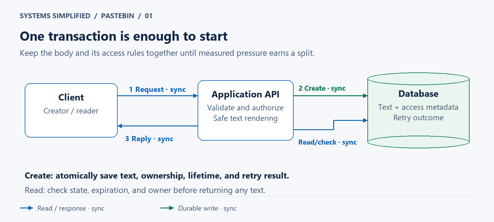
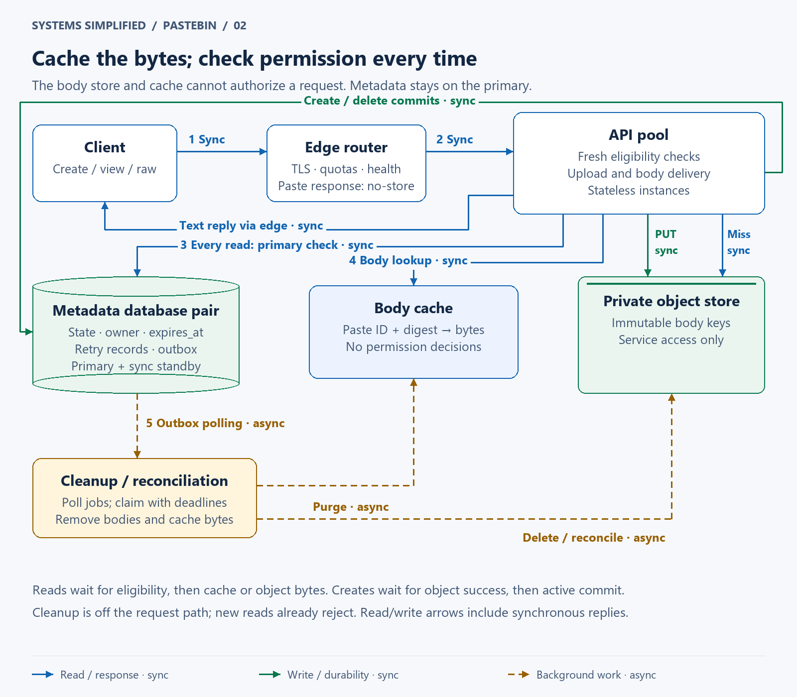
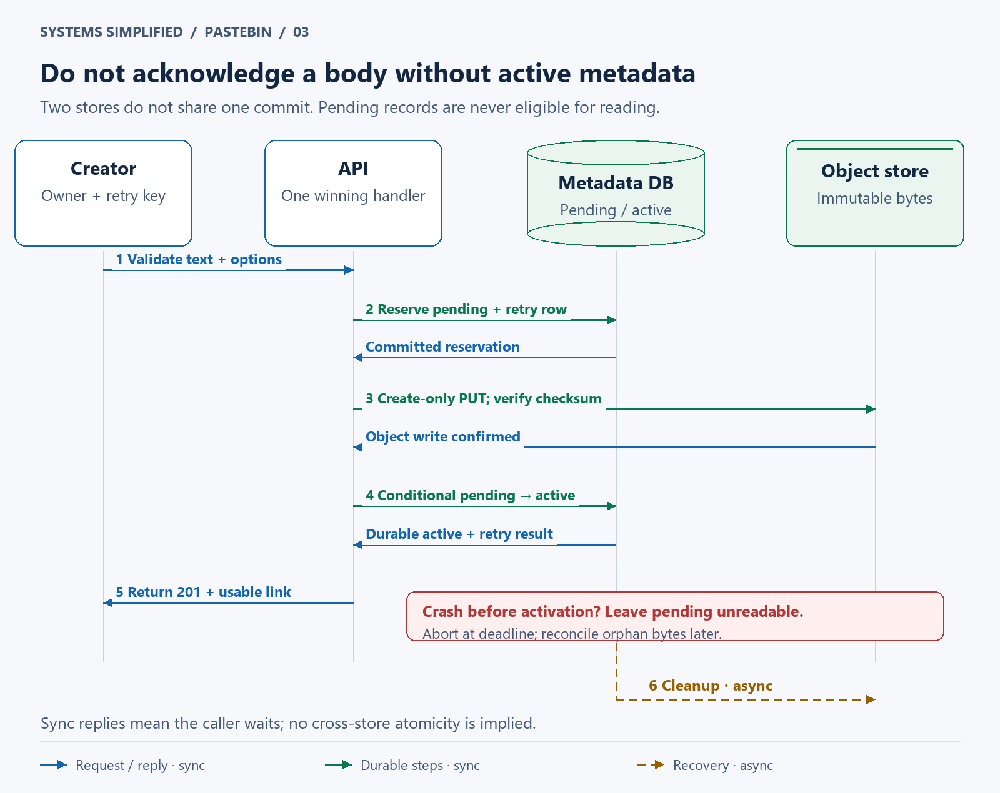
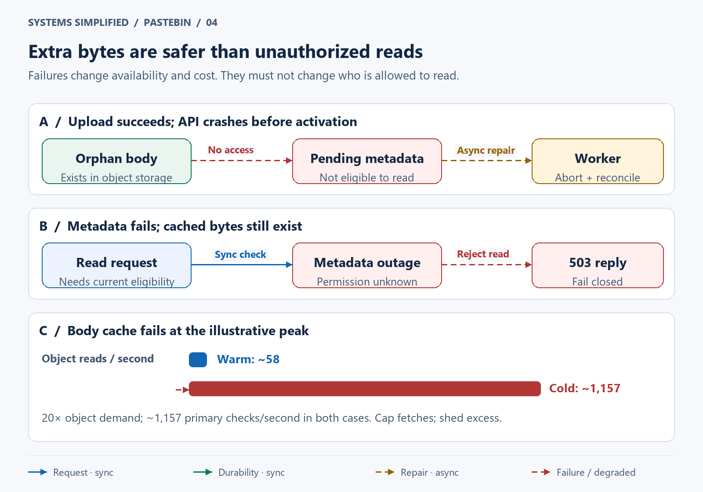

# Design Pastebin

> **In one sentence:** Save a piece of text once and share a link that returns the right bytes only while the reader is allowed to see them.

Maya needs help with a failing program. Instead of flooding a chat with a stack trace, she saves it as a paste and shares its link. Tomorrow she deletes it after noticing a secret in the log. The interesting engineering problem is keeping that promise even when the text sits in caches and storage systems recover at different speeds.

Design Pastebin with immutable text and a separate record controlling ownership, visibility, and expiration. Start with one database; move bodies to private object storage when their size burdens reads and backups. Authorize every read before using a body cache. Make creation retry-safe, and recover partial writes with explicit states rather than assuming two stores commit together.

**Level:** Intermediate  
**Patterns:** [Object storage](#component-decisions), [authorization](#reading-without-bypassing-access-control), [idempotency](#creation-without-a-cross-store-transaction), [caching](#reading-without-bypassing-access-control), [recovery](#reliability-correctness-and-recovery)  
**Read time:** About 25 minutes  
**Prerequisites:** Basic web requests and database tables; distributed-systems terms are explained below.  
**Article facts:** Prepared and published October 11, 2026; human review pending. The canonical address above identifies this lesson's public repository location. This is an illustrative design, not a claim about Pastebin.com's implementation.

## Why this system matters

A paste service turns a chunk of text into a persistent, addressable resource. Unlike a URL shortener, it stores the shared content itself. A 40 kB stack trace costs more to move and retain than a destination address, and the service becomes responsible for who can read those bytes.

The central tension is simple: the **body** (stored text) can stay unchanged while the **permission to serve it** changes. **Metadata** is the small record describing that text and its access rules. Treating those as the same cache entry makes deletion, privacy, and moderation surprisingly hard.

This lesson's worked example compares storage growth, warm and cold body-cache traffic, and three outcomes of a partial create. It deliberately keeps authorization on the authoritative database, so the cost of immediate access changes remains visible.

## The problem in plain English

Maya creates an unlisted paste that expires tomorrow. Anyone holding its link may read it; it does not appear in a public directory. A private paste, by contrast, is readable only by its signed-in owner. All domains and identifiers below are examples.

```http
POST /v1/pastes
Authorization: Bearer <owner-session>
Idempotency-Key: debug-session-42
Content-Type: application/json

{"text":"Traceback: connection timed out", "visibility":"unlisted", "ttl_seconds":86400}
```

```http
HTTP/1.1 201 Created
Cache-Control: no-store
Content-Type: application/json

{"id":"n6Qp9Vj2Fm7Ra4Ts8Wk3Bx", "url":"https://paste.example/p/n6Qp9Vj2Fm7Ra4Ts8Wk3Bx"}
```

The human view `/p/{id}` uses the same access check as the raw endpoint:

```http
GET /v1/pastes/n6Qp9Vj2Fm7Ra4Ts8Wk3Bx/raw

HTTP/1.1 200 OK
Content-Type: text/plain; charset=utf-8
X-Content-Type-Options: nosniff
Cache-Control: no-store
Referrer-Policy: no-referrer

Traceback: connection timed out
```

The API (application programming interface) accepts plain UTF-8 text, a standard Unicode encoding. An **idempotency key** labels one intended operation so a network retry can recover its recorded outcome. It returns `413` for an oversized body, `429` when a caller exceeds a quota, and `409` when an idempotency key is reused with different input. Use a generic `404` for absent, expired, blocked, deleted, or unauthorized pastes so callers cannot easily distinguish them. A dependency outage returns `503`, not a fabricated absence.

> **Mental model:** The text is a sealed envelope; metadata is the receptionist deciding whether to hand it out. Having an envelope in the cupboard does not prove that today's visitor may open it.

## What success looks like

The following is a proposed product contract for this hypothetical service; no traffic or product requirements were supplied by a real operator.

### Functional requirements

- Signed-in creators can save immutable text, choose unlisted or owner-private visibility, and set a lifetime from one hour to 30 days.
- Readers can open an eligible paste through a safe human view or raw-text endpoint.
- Owners can list their own pastes and delete them. Authorized moderators can block abusive content.
- Retrying a create with the same owner and idempotency key returns the same paste outcome for 24 hours.
- Expiration stops serving content even when physical cleanup is delayed.

Visibility is fixed at creation in this design; deletion and blocking still change eligibility. Editing means creating a new paste with a new link.

### Non-functional requirements

These are **illustrative design targets**, not benchmarks or service commitments.

The **primary** database accepts writes; a **standby** keeps a recovery copy. Synchronous replication makes a successful commit acknowledgment wait for the selected standby to durably record it.

| Goal | Target | Why it matters |
| --- | --- | --- |
| Read latency | Server processing p95 below 150 ms for an authorized warm-body-cache read | p95 means 95% finish within this time; network travel and rendering are excluded |
| Create latency | Server processing p95 below 1 second under normal dependencies | Object upload and durable database commits sit on this path |
| Availability | 99.9% successful eligible reads per month | Database dependency is an intentional availability cost; invalid requests are excluded |
| Access revocation | Every eligibility lookup begun after a committed deletion or block rejects the paste | Requires primary reads and correct failover; already authorized requests may finish |
| Expiration | Reject when database time reaches `expires_at` | A background deletion schedule must not define access |
| Acknowledged creation | Successful object write, then active metadata committed locally and to one synchronous standby | Protects against a primary-only database failure when that standby is promoted |
| Retention | Target live-store cleanup within 24 hours of deletion or expiration; backup horizon 30 days | Physical erasure and online inaccessibility are separate promises |

Cap total read handling at ten seconds. Check expiration again just before emitting the body. This limits server-side in-flight work; it cannot retract packets already sent or bound how long a remote reader retains them. Plaintext backups use a rolling 30-day retention horizon in this example; exceptional holds would require a different, disclosed policy.

### Out of scope

- Public discovery/search, comments, anonymous creation, executable previews, and arbitrary file uploads.
- Collaborative editing, password sharing, recipient access lists, and globally writable regions.
- End-to-end encryption: the service can read stored text, including for moderation.
- A runnable implementation or a guarantee that leaked text disappears from third-party copies.

## Assumptions and scale

The user supplied no workload. Assume a mature regional service with a tenfold peak multiplier, a 30-day maximum lifetime, and average uncompressed body size of **40,000 bytes**. Decimal kB/GB are used in the estimates; the hard upload limit is **256 KiB = 262,144 bytes**.

| Input | Assumption | Derivation / note |
| --- | --- | --- |
| New pastes | 200,000/day | About 2.3 creates/second; about 23/second at peak |
| Body reads | 10 million/day | About 116 reads/second; about 1,157/second at peak |
| Maximum live population | 6 million pastes | 200,000 × 30 days, ignoring early deletion |
| Live bodies | 240 GB logical | 6 million × 40,000 bytes; excludes storage-provider redundancy |
| Metadata | 6 GB logical; budget about 18 GB | 6 million × estimated 1,000 bytes; 3× allowance for indexes and overhead, before standby/backups |
| New body bytes | 8 GB/day | 200,000 × 40,000; metadata and retries extra |
| Body egress | 400 GB/day; about 46 MB/second at peak | 10 million × 40,000; before compression, protocol overhead, and repeated requests |
| Metadata reads at peak | About 1,157/second | Every body read requires a primary eligibility lookup |
| Object reads with 95% body-cache hits | About 58/second at peak | 1,157 × 0.05; a sizing assumption, not a promised hit rate |
| Object reads with no cache | About 1,157/second at peak | 20× the warm-cache demand; metadata lookup rate is unchanged |
| Illustrative hot body cache | 4 GB payload for 100,000 average pastes | 100,000 × 40,000; allow additional key, allocator, and eviction overhead |

Owner-list traffic, authentication lookups, failed scans, and cleanup are additional load to measure. A cache hit ratio by request does not necessarily equal the ratio by bytes: large cold pastes can dominate bandwidth. Track both.

> **At scale:** A body cache saves object fetches and backend bytes. It does **not** remove the roughly 1,157 primary permission checks per second, or the 400 GB/day sent to readers.

These numbers do not prove that a database needs sharding. First measure indexed lookups, connection contention, recovery time, and byte throughput. The body split earns its place if large-row traffic or backups interfere with metadata service; Version 1 may remain sufficient longer than expected.

## Version 1 — the simplest credible design



The baseline has one transaction boundary. It saves ownership, lifetime, text, and the retry result together; reads fetch the row and check access before returning text. Solid blue arrows are synchronous reads/responses; solid green arrows are synchronous durable writes.

1. Authenticate the creator, reject oversized text, enforce quotas, and generate a random identifier.
2. Insert the paste and its idempotency result in one database transaction. A unique constraint decides which competing request wins.
3. On a read, query by identifier, verify state, ownership if private, and expiration against database time, then return the text.
4. On delete, commit an inaccessible state first. A scheduled task later removes the body; the task is omitted from this focused request view.

| Component | Why it exists | What it does not solve yet |
| --- | --- | --- |
| Browser/client | Creates text and opens links | Cannot enforce server access policy |
| Application API | Validates input, authenticates, authorizes, and safely renders | One process has limited capacity and is a failure point |
| PostgreSQL database | Atomically stores body, metadata, and retry outcome | Large bodies increase database traffic and backup volume; one host can fail |

Start here. A relational database is a reasonable home for small text, especially when one transaction avoids cross-store failure cases. PostgreSQL's unique constraints provide the collision and concurrent-retry boundary; an application-side existence check alone is insufficient. [PostgreSQL constraints](https://www.postgresql.org/docs/current/ddl-constraints.html).

## Where Version 1 breaks

| Pressure | What fails | Observable symptom | Direction of the fix |
| --- | --- | --- | --- |
| Many large or popular bodies | Text transfer competes with metadata work | Read tail latency and database network utilization rise | Split immutable bodies; cache hot bodies |
| Application or database host failure | A single serving instance disappears | Connection failures and interrupted requests | Stateless API pool and tested database failover |
| Large backup/restore footprint | Recovery takes longer than acceptable | Restore drills miss recovery targets | Keep metadata compact; manage body recovery separately |
| Creation retried after timeout | Naive inserts create duplicate pastes | Several links for one user action | Owner-scoped idempotency records |
| Cache added without policy separation | Deleted/private text still gets served | Access checks disagree across paths | Gate every read before body-cache lookup |
| Expiration cleanup lags | A naive “object exists” check allows expired text | Old links remain usable | Enforce expiration during reads |

## Version 2 — production-scale architecture



The API still owns the access decision. The database stores metadata and durable jobs; private **object storage**, a store of byte sequences addressed by named keys, stores immutable bodies. The body cache can be discarded. Dashed amber arrows mean asynchronous cleanup, while solid arrows mean a request waits for the result. The standby is a failover copy, not an extra writable database.

### End-to-end flow

1. The edge terminates encrypted connections, limits abusive traffic, and routes to a healthy API instance. Paste responses pass through without edge caching.
2. Creation reserves a pending record, uploads the body, then commits active metadata and its retry outcome. Only then is a usable link acknowledged.
3. A read checks the metadata primary for eligibility, then consults the body cache. A miss fetches the exact private object and verifies its recorded digest before filling the cache.
4. Deletion commits an inaccessible state and a durable cleanup job together. Workers remove body bytes and cache entries asynchronously; authorization already rejects new reads.

### Component decisions

| Component | Responsibility | Why this choice | Main trade-off |
| --- | --- | --- | --- |
| Client | Submit text; display authorized text safely | Keeps the user workflow small | Client copies cannot be revoked |
| Edge router | Transport Layer Security (TLS), request/byte limits, health routing | Stops obvious overload before expensive work | Full paste responses cannot be served independently from edge cache |
| Stateless API pool | Input validation, session checks, eligibility checks, upload coordination | Add instances without moving user state | Depends on database and object-store health |
| Metadata database pair | Paste state, ownership, expiration, retry records, outbox jobs; one primary and synchronous standby | Transactions make policy transitions and work registration atomic | Every read reaches the primary; synchronous writes may stall if standby is unavailable |
| Body cache | Internal map from paste identifier plus digest to immutable bytes | Reuses popular content after authorization | Extra memory and operational surface; never stores permission decisions |
| Private object store | Durable immutable bodies, addressed only by service credentials | Separates text volume from metadata recovery | No atomic transaction shared with the database |
| Cleanup/reconciliation worker | Poll durable jobs, expire pending creates, remove orphaned bytes, and purge cached bodies | Turns partial failures into explicit repair work | Delayed physical cleanup and repeated job delivery |

An **outbox** is a job row written in the same database transaction as the state change it describes. Workers poll those rows directly at this scale, so a separate message broker would add a component without a demonstrated need. A crashed worker leaves its claim to expire; another worker retries the job.

> **Why it exists:** The pending state is the bridge between two stores. It means “we reserved this paste, but have not yet proved that it is ready to serve.”

### Creation without a cross-store transaction



The numbered sequence establishes the invariant: **an active row references a successfully written object**. The database and object store do not commit together. A crash can leave extra bytes, but those bytes do not grant access. Response arrows are included, and asynchronous cleanup is separate from the request.

1. Validate text and options before reserving anything. Generate 128 random bits with a cryptographically secure generator and encode them as 22 unpadded Base64url characters. This encoding uses URL-safe letters, digits, `-`, and `_`.
2. In a short transaction, insert `pending` metadata and a retry record unique on `(owner_id, idempotency_key)`. Record a digest of the exact text and normalized options, an immutable object key, and a database-time pending deadline 15 minutes away. Only the request that wins this reservation may upload.
3. Write the body with a create-only condition and a checksum. Bound upload attempts and stop initiating them after the deadline. For an ambiguous upload timeout, the winning handler can check the object's length and digest; it must not assume success or overwrite different bytes.
4. After confirming the body, conditionally change `pending` to `active` only if the deadline has not passed. Store the object locator, digest, and size, and finalize the retry result in that transaction. Start `expires_at` from activation time. Wait for the configured synchronous standby before returning `201`.
5. Concurrent retries with matching input return the committed result, or `202` with an owner-authenticated operation-status URL while pending. The status endpoint reads the primary. A changed request digest returns `409`. No duplicate uploader is started.

A **digest** is a computed fingerprint of bytes; use a cryptographic digest such as SHA-256 (Secure Hash Algorithm, 256-bit output) for body identity and integrity. A transmitted **checksum** lets storage validate upload integrity. Neither substitutes for ownership checks. Request digests include normalized options because the same text with different visibility is a different operation.

For this compact design, a crashed create is **not automatically resumed** by another API instance. The sweeper conditionally aborts a still-pending operation once its deadline passes. The same key then returns the same failed operation during the retry window; the client can deliberately start a new operation with a new key. This sacrifices some completion rate to keep recovery easy to reason about. Replaying a successful create returns its original identity; it never reactivates a paste that has since expired, been blocked, or been deleted.

If activation and the sweeper race, conditional state updates serialize on the row: only one terminal transition wins. An aborted record never becomes active. A very late object write can still leave an orphan, so inventory reconciliation revisits aborted keys after a one-hour grace period and on subsequent passes. The grace period alone is not a proof that all remote writes have stopped.

Amazon S3 is one possible object store: it documents read-after-write consistency for objects and create-only `If-None-Match: *` writes. Those properties help confirm an upload; they do not create a transaction with PostgreSQL. Another store must provide equivalent semantics or require a different readiness protocol. [S3 consistency model](https://docs.aws.amazon.com/AmazonS3/latest/userguide/Welcome.html#ConsistencyModel), [S3 conditional writes](https://docs.aws.amazon.com/AmazonS3/latest/userguide/conditional-writes.html).

### Reading without bypassing access control

For every human-view, raw-text, and owner-preview request:

1. Read current metadata from the primary in a fresh, short `READ COMMITTED` statement. Require `active`, unexpired state and, for private content, the current authenticated owner. Do not reuse a long-lived transaction snapshot or read a lagging standby.
2. Look up `(paste_id, body_digest)` in the internal body cache only after permission succeeds. Do not cache HTTP responses, owner credentials, or a previous “allowed” result.
3. On a miss, fetch the exact recorded object/version using service credentials. Coalesce simultaneous fetches for the same key within each API instance and cap aggregate object-fetch concurrency. Verify the digest and length; missing/corrupt active content is a `503` and repair alert.
4. Before emission, ensure the request deadline and expiration still permit serving. Use database time captured at the eligibility query plus monotonic elapsed time, with a conservative margin for query timing uncertainty. Abort if timing cannot be trusted. Return safely rendered text or the raw response above.

The permission lookup is the read's decision point. A delete committed before that lookup starts prevents the read. A delete committed afterwards may overlap an already authorized response; promising more would require coordinating deletion with in-flight streams. Expiration is checked again because a body fetch may cross its deadline. PostgreSQL's statement snapshots provide the stated read boundary. [PostgreSQL Read Committed isolation](https://www.postgresql.org/docs/current/transaction-iso.html#XACT-READ-COMMITTED).

`Cache-Control: no-store` directs compliant browser and intermediary HTTP caches not to retain paste responses. The internal body cache is a separate service-side store, deliberately accessed through the authorization gate and included in cleanup. The HTTP directive cannot erase downloads or defeat a malicious reader. [HTTP caching specification](https://www.rfc-editor.org/rfc/rfc9111.html#section-5.2.2.5).

## Data model and partitioning

| Data | Source of truth | Access pattern | Partition / replication strategy |
| --- | --- | --- | --- |
| `pastes` | Metadata database | `id` primary key; `owner_id`, `visibility`, `state`, `object_key`, optional `object_version`, `body_digest`, `byte_length`, `created_at`, `activated_at`, `expires_at`, `pending_deadline` | One regional primary plus synchronous standby initially; hash by `id` only after measured need |
| Owner listing | Metadata database index | `(owner_id, created_at DESC, id)` with cursor pagination | Same database initially; a separate owner index becomes necessary if sharded by paste ID |
| Pending/expiry scan | Metadata database index | `(state, pending_deadline)` and `(state, expires_at)`; bounded batches | Avoid full-table sweeps; row conditions arbitrate concurrent work |
| Retry record | Metadata database | Owner + idempotency key, request digest, paste ID, terminal outcome, `retain_until` | Retain at least 24 hours from reservation; removing it ends duplicate protection |
| Body | Private object store | Unique `bodies/{paste_id}/v1` locator; exact version if versioning is enabled | Provider-managed redundancy across failure zones; no user-accessible bucket |
| Cleanup outbox | Metadata database | Job ID, paste ID, target locator, action, claim deadline, attempts, completion | Written with state transition; delivered at least once through polling |
| Body-cache entry | Disposable cache | Paste ID + digest → bytes; one-hour maximum residence | Memory budget and eviction; independent of metadata lifetime |

An **index** is a structure that finds matching rows without scanning the whole table. A **partition** assigns a subset of records to a storage group. Replication copies records for recovery; it does not necessarily increase safe authorization-read capacity.

Cursor pagination asks for the next page after the last returned `(created_at, id)` rather than an ever-growing row offset. Hash partitioning chooses a storage group from a deterministic hash of the paste ID. Fencing means disabling an old writer's authority before a replacement is allowed to write.

The state machine is `pending → active` or `pending → aborted`; `active` may become `deleted`, `blocked`, or `expired`. All terminal states reject reads. Reaching `expires_at` is enough to reject an otherwise active row even before a worker records `expired`.

At six million live IDs, the approximate collision probability for uniformly random 128-bit identifiers is `n(n−1)/(2 × 2^128) ≈ 5.3 × 10^-26`. Still enforce uniqueness and retry on collision; probabilities are not correctness mechanisms. Keep minimal tombstone identifiers so deleted IDs are never intentionally reused. Their ongoing storage grows beyond the 30-day live-content estimate and needs a separate long-term budget.

Do not deduplicate bodies across owners initially. Saving space with shared objects introduces reference counting, deletion coupling, and possible existence leaks. A digest here verifies integrity, not sharing or permission.

## Reliability, correctness, and recovery



The visual separates extra stored bytes from visible content and shows why a warm-cache capacity plan is insufficient. Red dashed arrows indicate failure or degraded service; amber dashed arrows indicate later repair. Neither a body cache nor an orphan object can authorize a read.

| Scenario | Design response | Remaining risk |
| --- | --- | --- |
| API crash before upload or activation | Pending operation stays unreadable; abort after deadline; reconcile any orphan | Creator may need a new operation after timeout |
| Active commit succeeds; response is lost | Same owner/key reads terminal result from primary | After 24-hour retry retention, the same key may create a new paste |
| Metadata primary fails | Fence the old primary, promote an eligible acknowledged standby, reconnect APIs | Reads/writes pause during failover; promoting a stale copy can resurrect access or lose acknowledged creates |
| Synchronous standby unavailable | Stop acknowledging new state-changing commits until required durability is restored | Write latency/availability suffers; reads may continue on healthy primary |
| Metadata unavailable but body cached | Return `503`; do not reuse an old permission decision | Content availability depends on metadata availability |
| Body cache unavailable | Fetch within a bounded object-store budget; shed excess demand with `503` | Cold demand may be 20× normal; autoscaling cannot instantly remove that surge |
| Object store unavailable | Authorized cache hits can succeed; misses and new creates fail/retry | Hot content remains available, but not all eligible content |
| Active row references missing/corrupt object | Alert, stop serving that body, investigate/restore the exact digest | Cache can temporarily mask storage loss; run integrity sampling |
| Cleanup job repeats or worker crashes | Expiring claims, idempotent deletes, cache purge retries, bounded backoff; alert persistent failures | At-least-once work can run more than once; physical erasure may miss target |
| Region is lost | Restore metadata and bodies in a recovery region, replay deletions, then reopen reads | Asynchronous disaster copies can lose recent data; consistency of the restore matters |

**Recovery point objective (RPO)** is how much recent data a restore may lose; **recovery time objective (RTO)** is how long restoration takes. As planning targets, use regional-disaster RPO of 15 minutes and RTO of four hours, then prove or revise them through drills. The synchronous standby covers a database primary failure, not a regional disaster or application bug. PostgreSQL documents the durability/waiting behavior of synchronous replication. [PostgreSQL standby and replication documentation](https://www.postgresql.org/docs/current/warm-standby.html#SYNCHRONOUS-REPLICATION).

Deletion/expiration commits a terminal state plus cleanup job; bodies and caches are subsequently removed. Keep a minimal deletion ledger in disaster-recovery storage and reconcile it with restore checkpoints before reopening access. If a disaster backup may lack recent deletions and their ledger, fail closed for the uncertain records/window. A stale snapshot is not permission to resurrect text. Missing bodies are never made visible just to get a restore running faster.

Object-store lifecycle policies are a backstop, not the serving gate: expiration actions can lag. If versioning is enabled, a normal S3 delete can leave noncurrent bytes; cleanup must account for actual versions. Backup expiry also has its own horizon. [S3 lifecycle management](https://docs.aws.amazon.com/AmazonS3/latest/userguide/object-lifecycle-mgmt.html), [S3 version deletion](https://docs.aws.amazon.com/AmazonS3/latest/userguide/DeletingObjectVersions.html).

Monitor read/create latency and error rate, database connection and standby health, object-fetch concurrency, cache hit rates by requests and bytes, oldest pending operation, oldest cleanup job, orphan count, and live/backed-up bytes. Alerts should point to the affected promise: “oldest cleanup exceeds 24 hours” is more useful than an unexplained queue-length threshold. Restore drills must exercise private reads and deleted content as well as live-body checks.

> **Failure mode:** “The text is in cache, so serve it during a database outage” turns a resilience feature into an authorization bypass.

## Security and abuse resistance

- **Authorization on every route:** The raw endpoint is not a back door. Require the current owner for private content and deletion; separate moderator privileges, audit their use, and deny by default. Follow the same rule for status URLs and owner listings. [OWASP authorization guidance](https://cheatsheetseries.owasp.org/cheatsheets/Authorization_Cheat_Sheet.html).
- **Unlisted is link-accessible:** Random identifiers resist casual guessing; anyone receiving an unlisted link may forward it. Avoid logging full links, tokens, or text. Use no-referrer responses and no third-party scripts on paste views; request search exclusion for unlisted/private pages without treating it as access control.
- **Render text as text:** A paste containing `<script>` must remain visible characters. Use ordinary-element `textContent` or context-appropriate encoding, never interpret user text as HTML. If syntax highlighting is added, require a safe text-based renderer and a restrictive Content Security Policy, the browser's policy for allowed resource/script execution. [OWASP cross-site scripting prevention](https://cheatsheetseries.owasp.org/cheatsheets/Cross_Site_Scripting_Prevention_Cheat_Sheet.html).
- **Protect storage boundaries:** Encrypt transport and stored data, keep buckets nonpublic, restrict service identities to required operations, and isolate worker privileges. Never redirect users to a direct signed object URL in this design: it would retain its own access lifetime after metadata revocation.
- **Limit bytes as well as requests:** Enforce the 256 KiB decoded UTF-8 limit, bounded request parsing/decompression, owner storage budgets, create quotas, scan-resistant read limits, and global egress/object-fetch ceilings. Abort malformed or slow uploads. Database connection pools must also be bounded.
- **Moderate without breaking invariants:** Inline validation rejects known forbidden input; reports and authorized review can block an active paste. Scanning reduces risk but cannot guarantee safe content. A model requiring every paste to be reviewed before sharing would add a quarantined state before `active`.
- **Protect credentials and sessions:** Warn users against pasting secrets. Prevent cross-site request forgery for cookie-authenticated mutations, protect sessions, and exclude bodies from routine telemetry and exception logs. Deleting a leaked credential does not rotate it.

> **Remember:** A hard-to-guess link is a useful sharing handle. Private access still needs an authenticated, current permission check.

## The trade-offs that matter

| Decision | We optimize for | We give up | Prefer an alternative when… |
| --- | --- | --- | --- |
| Database-only baseline | Atomic create and low operational complexity | Large-body traffic and recovery footprint live in the database | Keep it when measured latency, cost, and recovery meet targets |
| Split immutable bodies into object storage | Independent body capacity and compact metadata recovery | Cross-store partial failures and more requests per create | Database-only storage remains simpler for modest bodies/workload |
| Primary permission check on every read | Access changes visible at the next fresh lookup | Metadata load and dependency availability | Cache eligibility only if the product explicitly accepts a bounded stale-access window |
| Internal body cache; no full-response CDN cache | Reuse bytes while retaining the serving gate | API egress and permission checks remain | A content delivery network (CDN) is justified when edge authorization and revocation semantics are designed and tested |
| Immutable text and unique objects | Simple cache keys and deletion ownership | Editing and cross-user deduplication | Add versions only when users need editing history and its retention policy |
| Abort abandoned creates | A small, understandable recovery state machine | Some uploaded pastes never become usable | Resume through leased, fenced attempts when completion rate justifies the extra coordination |
| Synchronous metadata standby | Protection for acknowledged state against primary-only failure | Higher commit latency and standby dependency | Asynchronous replication is acceptable only with an explicit loss/stale-state policy |

## How the design evolves next

| Trigger | Next change | Why not add it on day one? |
| --- | --- | --- |
| Primary permission checks saturate after tuning | Hash-partition paste metadata, co-locate per-paste jobs, and design owner/retry routing | Cross-shard uniqueness and owner lists complicate otherwise simple transactions |
| A single hot paste dominates byte throughput | Larger body-cache capacity, local copies, and a separately designed edge permission gate | Sharding metadata does not split one popular body; CDN revocation adds policy complexity |
| Creators need shared private workspaces | Recipient/group permissions with current membership checks | More authorization entities and revocation cases |
| Larger files become a requirement | Direct staged uploads, explicit finalize, content-type controls, and upload cleanup | Small capped text does not need multipart upload machinery |
| Recovery targets fail regional drills | Better coordinated body replication, deletion-ledger checkpoints, and region failover tooling | Additional replicas increase cost and still need restore consistency tests |
| Cleanup polling/claims become a bottleneck | Outbox relay and broker with replayable, idempotent workers | A broker does not make delivery exactly once or replace the durable state transition |

## Key takeaways

- Immutable bytes and mutable access policy belong to different parts of the mental model.
- Start with one transaction; splitting stores requires explicit readiness and recovery rules.
- Cache hits save body retrieval, not authorization work or final reader bandwidth.
- Logical deletion stops serving before physical erasure finishes; backups and object versions need separate accounting.
- A retry key has a scope, input binding, outcome, and retention window. It is not an unlimited exactly-once guarantee.

## Quick check

1. Why must an authorized body-cache hit still query metadata?
2. What should happen if the object upload succeeds but the API crashes before activation?
3. Which demand grows twentyfold during a body-cache outage, and which demand stays constant?

**Answers:** (1) Ownership, deletion, blocking, and expiry govern access independently of unchanged bytes. (2) Leave the paste pending and unreadable, then abort and reconcile its orphan unless a defined resumption protocol exists. (3) Object reads rise from about 58 to 1,157/second at the illustrative peak; the roughly 1,157 primary permission checks/second remain.

## Related lessons

- [Design a URL Shortener](../url-shortener/README.md): compare a cached redirect mapping's bounded freshness policy with Pastebin's fresh primary access check, and compare the retry/identifier patterns.
- [Creation recovery](#creation-without-a-cross-store-transaction), [data model and partitioning](#data-model-and-partitioning), and [access-controlled caching](#reading-without-bypassing-access-control) are this lesson's local foundations. Standalone foundation articles are not yet present in the repository.

## FAQ

### Should Pastebin store text in a database or object storage?

Start with a database for capped text and modest traffic. Split bodies into object storage when measured body transfer, backups, or recovery interfere with metadata operations. The split adds partial failures, so body size alone is not sufficient justification.

### Is an unlisted paste private?

No. Anyone holding its link can read it while eligible. A private paste here requires the authenticated owner on every read, even if the body is already cached. Random identifiers reduce guessing; they do not identify the reader.

### Can deleted text remain in a cache?

Temporarily, yes, until purge or eviction. It cannot authorize a new read: each read must first pass current metadata checks. Physical cleanup targets cover internal cache and storage bytes; downloaded copies and backup retention have different limits.

### Does object-storage consistency make a create atomic?

No. A successful object write and a database commit are independent operations. A pending state and conditional activation prevent an incomplete create from being served, while reconciliation removes bytes left behind by failures.

### Does sharding fix a viral paste?

Not by itself. Hash partitioning sends that paste's metadata to one partition. Body caches help repeated byte delivery; a separate edge authorization design may reduce origin traffic. Neither removes the need to define current access and deletion behavior.

## Glossary

| Term | Meaning in this lesson |
| --- | --- |
| Immutable | Once activated, a paste's text bytes never change |
| Metadata | The small record describing ownership, state, lifetime, and body location |
| Idempotency | Repeating an operation with the same bound key/input produces the same recorded outcome within a stated window |
| Tombstone | A retained terminal record or identifier preventing an old resource from silently returning |
| Fail closed | Reject a request when the system cannot establish permission |
| Reconciliation | Compare stores/states and repair leftovers after partial failures |
| At-least-once delivery | Work is retried and may be performed more than once |

## Sources and further reading

Primary sources checked October 11, 2026. They establish protocol and storage/security behavior, not this hypothetical workload, latency, pricing, or a real Pastebin architecture.

- [PostgreSQL constraints](https://www.postgresql.org/docs/current/ddl-constraints.html): database-enforced uniqueness for identifiers and retries.
- [PostgreSQL Read Committed isolation](https://www.postgresql.org/docs/current/transaction-iso.html#XACT-READ-COMMITTED): fresh statement snapshots and concurrent conditional updates.
- [PostgreSQL synchronous replication](https://www.postgresql.org/docs/current/warm-standby.html#SYNCHRONOUS-REPLICATION): acknowledgment behavior and availability costs.
- [Amazon S3 consistency model](https://docs.aws.amazon.com/AmazonS3/latest/userguide/Welcome.html#ConsistencyModel): object consistency and limits of atomic updates.
- [Amazon S3 conditional writes](https://docs.aws.amazon.com/AmazonS3/latest/userguide/conditional-writes.html): create-only upload preconditions and concurrent-write failures.
- [Amazon S3 lifecycle management](https://docs.aws.amazon.com/AmazonS3/latest/userguide/object-lifecycle-mgmt.html): lifecycle timing and delayed cleanup.
- [Amazon S3 deletion of object versions](https://docs.aws.amazon.com/AmazonS3/latest/userguide/DeletingObjectVersions.html): deleting versions versus adding a delete marker.
- [RFC 9111, HTTP caching](https://www.rfc-editor.org/rfc/rfc9111.html#section-5.2.2.5): `no-store` semantics and privacy limits.
- [OWASP authorization guidance](https://cheatsheetseries.owasp.org/cheatsheets/Authorization_Cheat_Sheet.html): deny-by-default decisions and checks on every route.
- [OWASP cross-site scripting prevention](https://cheatsheetseries.owasp.org/cheatsheets/Cross_Site_Scripting_Prevention_Cheat_Sheet.html): safe rendering of untrusted text.

Review this design when workload/body sizes, access-revocation promises, storage semantics, or retention requirements change. Publication dates and reviewer identity should reflect actual publication and review; none are invented here.
