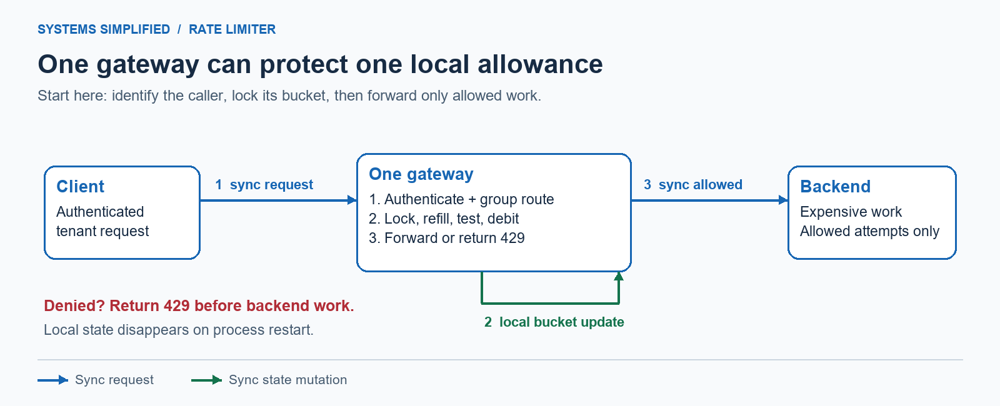
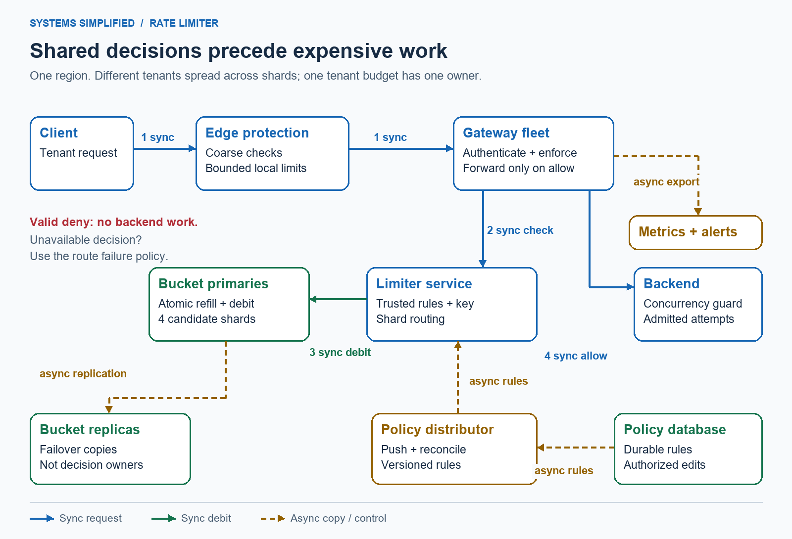
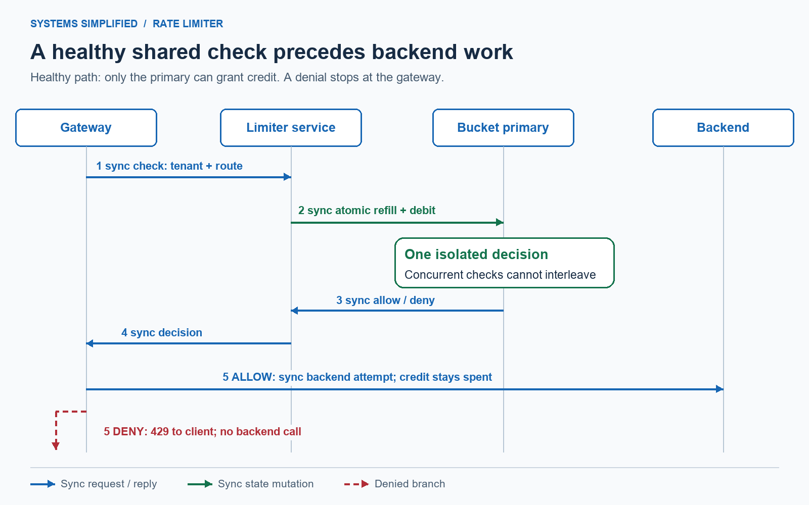
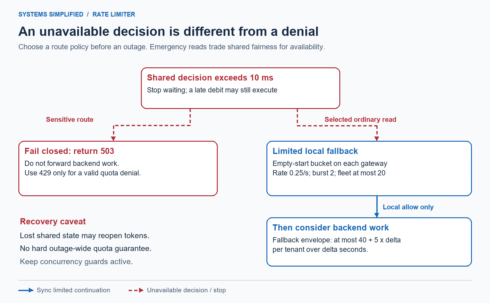

# Design a Rate Limiter

> **In one sentence:** Decide which requests may enter a service so one noisy caller cannot consume everyone else's capacity.

Maya's script retries a failed upload immediately, then retries every retry. Her traffic suddenly overwhelms a service used by thousands of other people. A rate limiter gives her a clear “slow down” response before expensive work begins. The hard part is making that decision agree across servers without turning the limiter into the next outage.

Design a rate limiter by identifying the caller, assigning a refill rate and burst budget, and making admission an atomic decision before expensive work. Start with an in-process token bucket; share state when traffic spans servers. Partition independent callers, define outage behavior explicitly, and distinguish approximate traffic protection from strict quotas that require durable coordination.

**Level:** Intermediate  
**Patterns:** [Token buckets](#how-does-a-token-bucket-work), [atomic operations](#the-atomic-decision), [partitioning](#data-model-and-partitioning), [overload protection](#security-and-abuse-resistance), [failure policies](#reliability-correctness-and-recovery)  
**Read time:** About 30 minutes  
**Prerequisites:** Basic web requests; concurrency and distributed-systems terms are explained below.  
**Article facts:** Prepared and published October 13, 2026; human review pending. This is an illustrative application programming interface (API) protection design, not a description of any company's private implementation. Workloads and targets are hypothetical; source links support protocol and storage semantics.

## Why this system matters

A **rate limiter** bounds admission over time. It protects shared capacity, makes tenant usage fairer, and reduces automated abuse. A **tenant** is a customer or account sharing infrastructure with others. Limiting a tenant rather than each of its API keys prevents it from multiplying its allowance by creating more keys.

The decision is cheap compared with the upload, database query, or password check it protects. But it is still on every request's critical path: the synchronous steps that must finish before a response can proceed. More accuracy usually requires more shared coordination, latency, and dependence on state availability.

This lesson works through a burst calculation, a safe expiry rule, a hot-tenant bottleneck, and the capacity bound of a degraded local fallback. The central recommendation is a shared token bucket for ordinary API traffic protection. Financial balances and contractual hard caps need stronger mechanisms.

## The problem in plain English

Maya's authenticated tenant may start up to 20 requests together and then sustain 10 requests per second for one route group, such as uploads. A **route group** combines endpoints with comparable cost; raw paths containing user-controlled IDs do not each get a new allowance. Every admitted attempt costs one token, even if the backend later fails. Rejected requests never reach the backend.

```http
POST /v1/uploads
Authorization: Bearer <tenant-session>
Content-Type: application/json

{"name":"debug-log.txt"}
```

If no token is available:

```http
HTTP/1.1 429 Too Many Requests
Retry-After: 1
Cache-Control: no-store
Content-Type: application/json

{"error":"rate_limited","scope":"tenant:uploads","retry_after_seconds":1}
```

HTTP (Hypertext Transfer Protocol) defines `429` for excessive requests and permits `Retry-After`; this design sends a whole-second wait rounded upward and prevents response caching. See [RFC 6585, section 4](https://www.rfc-editor.org/rfc/rfc6585.html#section-4) and [RFC 9110, Retry-After](https://www.rfc-editor.org/rfc/rfc9110.html#section-10.2.3). The wait is advice, not a reservation: another request may consume the next token. Clients should add random delay, called **jitter**, and bound retries.

> **Remember:** “10 per second, burst 20” is not “at most 10 in every rolling second.” The burst budget is part of the promise.

## What success looks like

### Functional requirements

- Enforce one shared allowance per authenticated tenant and route group within one region.
- Configure refill rate, burst capacity, and outage policy; use trusted server-side rules.
- Return allow, deny with retry advice, or unavailable; distinguish these outcomes operationally.
- Charge admitted attempts, including backend failures. Retries are new attempts; no automatic refund.
- Support controlled policy changes without silently creating fresh buckets.

### Non-functional requirements

All targets below are illustrative requirements, not measured performance.

| Goal | Target | Why it matters |
| --- | --- | --- |
| Decision latency | Added decision latency at the 99th percentile below 5 ms in normal regional operation | Slow checks delay every protected request |
| Limiter deadline | Stop waiting after 10 ms | An unhealthy limiter must not fill the gateway's waiting pool |
| Healthy-state correctness | Concurrent checks of one bucket serialize at its owning primary | Two gateways cannot both spend the last token |
| Availability | 99.9% monthly non-error decision availability; valid denies count as decisions | Separate limiter errors from intentional protection |
| Failure tolerance | Explicitly accept possible over-admission after shared-state loss for ordinary routes | Avoid promising a hard quota from disposable state |
| Policy freshness | Ordinary changes converge within 30 seconds; strict changes use a rollout barrier | Stale policy changes what clients may do |
| Observability | Measure allows, denies, errors, fallback admissions, and decision latency by bounded categories | Diagnose outages without logging every identity |

### Out of scope

- Billing, inventory, money movement, and exact daily consumption quotas.
- A globally exact limit across multiple active regions.
- Delaying requests in an unbounded queue until they qualify.
- Preventing a network flood solely with application-layer checks.

## Assumptions and scale

Assume a fictional service in one region. Traffic below means attempts reaching tenant admission after coarse edge checks, including eventual rejects.

| Input | Assumption | Derivation / note |
| --- | --- | --- |
| Requests per day | 100 million | Illustrative input |
| Average decision rate | About 1,157/second | `100,000,000 / 86,400` |
| Peak factor | 20 times average | Design assumption, not a forecast |
| Peak decision rate | About 23,148/second | `1,157.407 × 20` |
| Recently active tenants | 200,000 | Sized from product expectations, not inferred from requests |
| Active route groups per tenant | 3 | At most 600,000 retained bucket records in this sizing example |
| Per-bucket memory budget | 256 bytes including key and allocator overhead | Measure with representative keys and chosen encoding |
| Primary bucket memory | 153.6 MB, about 146.5 MiB | `600,000 × 256`; decimal MB versus binary MiB |
| One replica per shard | 307.2 MB across primaries and replicas | Excludes buffers, persistence, process overhead, and headroom |
| Hypothetical measured safe shard capacity | 8,000 checks/second | Planning input to replace with a load test of the actual atomic operation |
| Primaries to evaluate | 4 | `ceil(23,148 / 8,000) = 3`; choose 4 for headroom |
| Uniform load after losing one primary's capacity | About 7,716 checks/second across 3 | `23,148 / 3`; requires eventual redistribution, not instant failover |

A promoted replica restores a shard's capacity; it does not redistribute traffic by itself. The last row only sizes a later redistribution scenario. Skew, failover pauses, expensive rules, and reconnect storms can invalidate it. State memory looks modest here; operation rate and hot tenants are likelier first constraints.

> **Key implication:** Partitioning can spread different tenants, but every request for one shared tenant budget still competes at one owner.

## Version 1 — the simplest credible design



The baseline has one gateway process and one local bucket map. The numbered blue arrows are synchronous request steps; the green loop is the synchronous state update. No asynchronous path is required.

1. Authenticate the caller and normalize the route group.
2. Under a lock for that bucket, refill, test, and consume a token.
3. Forward allowed requests; return `429` for denials. A restart restores empty state as full buckets, so it can grant fresh bursts.

| Component | Why it exists | What it does not solve yet |
| --- | --- | --- |
| Gateway process | Stops excess traffic before backend work | A process crash loses local state |
| Local bucket map and lock | Keeps one process's concurrent requests from overspending | Separate processes do not share the allowance |
| Backend | Performs the user's upload or query | Limiting request starts does not cap in-flight work |

### How does a token bucket work?

A **token bucket** holds permission credits up to a capacity `B`; it refills at `r` tokens per second. Each request spends `c` tokens. Here `B = 20`, `r = 10`, and `c = 1`. A full bucket admits a short burst; a drained bucket admits sustained arrivals only as credits refill. Networking standards also use token-bucket meters, although their units and multi-bucket policies differ from this request-based example: [RFC 2697](https://www.rfc-editor.org/rfc/rfc2697.html).

At time `now`, with stored token count `T` and previous refill timestamp `last`:

```text
effective_now = max(now, last)
elapsed = effective_now - last
available = min(B, T + r * elapsed)
allow = available >= c
next_tokens = available - c if allow else available
retry_seconds = 0 if allow else (c - available) / r
store(next_tokens, effective_now)
```

Times above are in seconds. Validate `r > 0`, `B >= c > 0`, and bounded values before using the rule. Use a monotonic clock in one process: it measures elapsed duration without civil-time adjustments. Fractional tokens are retained even though requests spend whole tokens.

| Arrival | Available before spending | Outcome | Tokens afterward |
| --- | --- | --- | --- |
| 20 simultaneous requests at `t = 0` | Starts at 20 | All 20 allowed, serialized | 0 |
| A 21st request at `t = 0` | 0 | Denied; mathematical wait 0.1 s | 0 |
| One request at `t = 0.05 s` | 0.5 | Denied; mathematical wait 0.05 s | 0.5 |
| One request at `t = 0.10 s` | 1 | Allowed | 0 |
| No traffic until `t = 2.10 s` | 20 | Next request allowed | 19 |

Without resets or clock anomalies, the admitted cost in an interval of length `Δ` is bounded by `B + r × Δ`. That is a burst envelope, not a promise to evenly space requests. A **fixed window** counter instead resets at a wall-clock boundary: a rule of 100 requests per minute can admit 100 just before the boundary and another 100 just after it.

## Where Version 1 breaks

| Pressure | What fails | Observable symptom | Direction of the fix |
| --- | --- | --- | --- |
| Add 10 gateway processes | Each owns a separate full bucket | Tenant can receive 10 times the intended burst and rate | Shared state for the tenant decision |
| Read, test, and write without one lock | Requests observe the same remaining token | Two requests admitted when only one credit exists | Atomic read-modify-write |
| Gateway restart or local-map eviction | Bucket disappears and returns full | Attackers obtain repeated fresh bursts | Treat reset behavior as a correctness decision |
| Slow backend | Allowed starts accumulate | In-flight connections exhaust workers despite rate compliance | Separate concurrency limit and bounded queue |
| One tenant floods one owner | Shared key serializes too much work | Owner latency rises for unrelated tenants | Cheap prefilter, isolation, or explicitly approximate allocation |

> **Trade-off:** Local limits are useful for protecting each process. They cannot become a shared tenant quota merely by giving every process the same configuration.

## Version 2 — production-scale architecture



The blue path is synchronous admission and forwarding. Green is synchronous state mutation; amber dashed paths carry asynchronous replication, policy distribution, and telemetry. The policy database is outside the per-request path. The replica group is a copy of bucket state, not another decision authority.

### End-to-end flow

1. The edge rejects gross floods, oversized bodies, and obviously invalid traffic with bounded per-instance checks. It forwards valid candidates to a gateway.
2. The gateway authenticates the tenant, normalizes the route group, and performs a synchronous check against the limiter service. The service maps the tenant to a shared-state shard.
3. One atomic operation on that shard's primary refills and spends the bucket, returning allow, deny, or error. Deny returns `429`; allow permits one backend attempt.
4. The gateway forwards only after allow. Limiter errors use the route's configured failure policy rather than pretending the caller used up its budget.
5. Aggregated decision telemetry is exported asynchronously. Policy distributors push versioned rules from durable storage; limiter instances also reconcile periodically to recover missed updates.



The sequence makes the ordering explicit: checking is synchronous and precedes backend work. Asynchronous metrics cannot authorize a request. The allow shown in this example consumes one credit even if the later backend call fails; the denial branch never calls the backend.

### Component decisions

| Component | Responsibility | Why this choice | Main trade-off |
| --- | --- | --- | --- |
| Edge protection | Coarse flood and request-size checks | Reject cheap threats before authentication and shared state | Independent local budgets are approximate |
| Gateway instances | Authenticate, enforce decisions, forward allowed work | Backend cannot be reached without admission | Every protected ingress must use this path |
| Limiter service | Validate policy, derive keys, route checks, return decisions | One owned place for bucket semantics and observability | Extra network hop; a library at gateways is an alternative |
| Bucket primary shards | Serialize one bucket's refill and debit | Shared token count across gateways | A hot key remains serial; atomicity is local to an owner |
| Bucket replicas | Supply failover copies | Recover availability after an owner failure | Recent debits may be missing after promotion |
| Policy database | Persist authorized route rules and revision history | Rules survive restarts and support rollback | Does not make cached rules instantly current |
| Policy distributor | Push rules and reconcile snapshots | Request path needs no policy database read | Ordinary convergence is eventually consistent |
| Metrics and alerts | Observe aggregated decisions and saturation | Diagnose denial spikes versus limiter failures | Best-effort telemetry cannot be a billing ledger |
| Backend service | Execute admitted work under a concurrency guard | Rate checks alone cannot bound long-running work | Rejected starts and in-flight caps solve different problems |

> **Why it exists:** The separate policy path keeps a routine database slowdown from blocking every request. Last-known-good rules continue briefly; after the configured freshness deadline, apply the route's unavailable policy.

### The atomic decision

Use a short, bounded Redis server-side function or Lua script for this example. Redis guarantees script execution without interleaving other commands; that allows the bucket's read, refill, debit, and expiry update to happen as one decision. Keep the operation constant in the number of request events, validate arguments before writes, and handle missing script/function deployments during rollout. Atomic isolation does not promise rollback after an arbitrary runtime error or durability through failover. See [Redis scripting semantics](https://redis.io/docs/latest/develop/programmability/eval-intro/).

The following is algorithmic pseudocode, not a copy-and-run Redis script:

```text
atomically on bucket owner:
    load trusted active rule (rate r, burst B, maximum cost c)
    sample owner's time in milliseconds
    read bucket; if absent, initialize to B at sampled time
    clamp time so it never precedes stored timestamp
    apply newer policy in place: cap tokens at new B;
        set new rate and clamped timestamp without retroactive refill
    refill, decide, and debit using the token-bucket formula
    write tokens, timestamp, and applied policy revision
    set expiry later than the time this bucket could be fully refilled
    return allow/deny, remaining credit, and wait if denied
```

The owner's clock avoids gateway-to-gateway clock disagreement. It is still a wall clock: backward jumps are clamped, and forward jumps may refill early. Monitor clock offsets and failover clock changes. A strict real-time contract needs tighter clock bounds and stronger ownership guarantees than this design supplies.

Represent fractional credit with bounded fixed-point arithmetic or carefully bounded floating-point arithmetic; test the precision at the chosen time and rate ranges. Round retry advice up only when forming the response, not while refilling. Always persist the refill timestamp, including on denial, so fractional credits are not recomputed from stale state.

### When is it safe to expire a bucket?

Deleting a drained bucket after one second would be wrong here: it would return with 20 tokens although only 10 should have refilled. A **time to live** (TTL) tells the store when it may remove a record. Resetting an idle bucket is harmless only after it would already be full under the same policy.

For this design, set inactivity TTL to at least `ceil(1000 × B / r)` milliseconds plus a clock/expiry margin, refreshing it with each decision. With `B = 20`, `r = 10`, and an illustrative one-second margin, TTL is 3 seconds. A slower rule of one token per minute with burst 100 needs more than 100 minutes, not that same 3-second TTL. TTL changes on policy update must use the new rule. [Redis PEXPIRE](https://redis.io/docs/latest/commands/pexpire/) specifies the expiry unit.

This bound assumes controlled clocks and ordinary expiry. It does not make eviction, a flush, or replication loss safe. Use a dedicated bucket store with `noeviction`; memory exhaustion returns a limiter error and triggers the configured unavailable behavior rather than granting fresh buckets. [Redis eviction policies](https://redis.io/docs/latest/develop/reference/eviction/) document that trade-off. Measure memory, cap identity cardinality, and provision buffer/headroom space.

## Data model and partitioning

Only small rules and current credits belong in the decision path. Request logs are not needed to compute this token bucket.

| Data | Source of truth | Access pattern | Partition / replication strategy |
| --- | --- | --- | --- |
| Policy: route group, tenant tier, rate, burst, failure mode, revision | Durable policy database | Authorized writes; snapshot reads | Replicated database; signed/versioned distribution |
| Bucket: tokens, last refill, applied revision, active rate and burst | Current bucket primary for ordinary admission | One atomic read-modify-write per attempt | Tenant-derived slot; replica for failover; inactivity TTL |
| Local fallback credits | Gateway process memory | Atomic checks only during degraded ordinary reads | Per instance; empty initialization; lost on restart |
| Aggregated metrics | Monitoring store | Asynchronous batches by route and outcome | Short retention and bounded labels; no per-tenant series by default |

Example key: `bucket:{tenant_digest}:uploads`. The braces are a Redis **hash tag**, which places that tenant's keys in the same cluster slot. Hash the internal authenticated tenant ID with a keyed digest; do not use client-supplied identities or raw credentials. Keep the digest secret stable during rotations, or migrate keys carefully to avoid allowance resets.

The shared budget is per tenant and route group. API-key rotation does not change the tenant identity. Canonical route groups come from a bounded allowlist, preventing arbitrary URLs from creating millions of buckets.

Hash tags also make a future tenant-total bucket and tenant-route bucket eligible for one colocated atomic operation. Redis Cluster requires multi-key operations to target the same slot; it does not provide a cross-shard transaction for independent tenant, IP-address, and global budgets. See the [Redis Cluster specification](https://redis.io/docs/latest/operate/oss_and_stack/reference/cluster-spec/). For cross-scope protection, apply separate gates in a declared order and accept conservative under-admission if an earlier gate spends credit before a later one denies.

### Policy changes without free bursts

Do not put each policy revision in a new bucket key: that would refill every caller on each rollout. Update the stable bucket in place, cap credit to the new burst, and do not grant retroactive refill at a new rate. A burst increase does not automatically mint additional tokens. Reject requests from limiter instances whose rule revision is older than the revision recorded in that bucket; they refresh policy and retry within the decision deadline or return unavailable.

Mixed rollout still means an untouched bucket may use an older rule until a new instance sees it. Ordinary changes accept the stated 30-second convergence window. An urgent tightening needs a coordinated barrier: stop affected admission, install the new rule on all owners and serving instances, reject older revisions, then resume. That temporarily sacrifices availability. A loosening can tolerate conservative denials while deployment completes.

## Reliability, correctness, and recovery



Red dashed arrows indicate an unavailable decision, not a valid token denial. Sensitive routes stop. Selected ordinary reads may continue under a deliberately smaller local budget. The fleet bound depends on a maximum instance count; it disappears if instances can repeatedly start with full buckets.

### Which routes may fail open?

**Fail closed** means refusing work when admission cannot be established. **Fail open** means continuing despite missing the shared decision. Here the default is fail closed; only explicitly selected ordinary read routes get a limited local fallback, not unlimited bypass.

For an illustrative fleet of at most 20 gateway instances, give each fallback bucket refill `0.25 requests/second` and burst `2`, initially **empty**. Preserve this emergency state between repeated outages in the same process; do not reset it full on each timeout. In a degraded interval lasting `Δ` seconds, total fallback admissions per tenant are at most `20 × 2 + 20 × 0.25 × Δ = 40 + 5Δ`, assuming all traffic uses that bounded fleet, no duplicate incarnations, and no credit-reset bug. This is a fallback envelope, not an additional healthy allowance or an end-to-end outage bound. It may coexist with still-healthy gateways spending shared tokens.

Empty startup avoids granting a fresh emergency burst on every restart. It also makes a newly started gateway deny initially. Smaller deployments underutilize the emergency budget; raising the fleet cap without changing per-instance rates increases it. Disable fallback for policy groups that cannot tolerate that uncertainty. Concurrent backend capacity remains independently bounded.

| Scenario | Design response | Remaining risk |
| --- | --- | --- |
| Valid bucket denial | Return `429` with rounded retry advice | Advice reserves no future token |
| Limiter timeout, memory error, or unavailable shard | Cut off after 10 ms; sensitive routes return `503 Service Unavailable`; selected reads use bounded fallback | Degraded reads lose shared fairness; late shared debits may still execute |
| Timeout after a successful debit | Do not blindly retry an uncertain check; treat it as unavailable | Credit can be consumed without backend work; a later attempt spends again |
| Backend fails after allow | Keep the charge; client retry is a new attempt | More restrictive for transient backend failures |
| Primary failure and replica promotion | Refresh routing, recover service, monitor reset/replication loss | Missing debits can reopen credit and over-admit |
| Complete bucket-state loss | Reinitialize full only under the documented approximate policy; sensitive traffic may remain unavailable during recovery | No per-outage hard overage bound; repeated resets repeat the burst |
| Clock anomaly | Clamp backward time; alert on offset; suspend sensitive checks when bounds are exceeded | Forward clock jumps may refill early |
| Policy distributor/database outage | Continue last-known-good rules for at most the configured freshness deadline, then apply unavailable policy | Rules may be stale within that deadline |
| Telemetry outage | Continue admission; buffer bounded aggregates and drop beyond the bound | Monitoring gap; no exact request audit |
| New region | Allocate regional budgets or route each tenant to a home region | Independent full-rate buckets multiply the global allowance |

Redis normally replicates asynchronously; even `WAIT` does not make failover a strong-consistency guarantee. See [Redis replication](https://redis.io/docs/latest/operate/oss_and_stack/management/replication/). The architecture therefore promises atomic healthy-owner decisions, not zero lost debits, exactly-once checks, or a durable billing limit.

For a genuine hard quota, use a durable, strongly coordinated counter or reservation ledger with exclusive ownership, fencing of old owners, and an explicitly scoped retry identity. Return unavailable when that authority cannot be reached. Fencing means old owners carry an obsolete generation number and cannot spend after a new owner takes over. The quota ledger's consistency and clock assumptions require their own design; attaching one replica to this token bucket is insufficient.

### Operating the limiter

Track decision latency, script runtime, connection-pool waits, primary memory, write errors, replica lag, policy revision age, and clock offsets. Separate `allow`, `deny`, `unavailable`, and `fallback_allow`; a high denial rate can mean working protection, while a high error rate means impaired decisions. Use histograms or sampled top offenders instead of a permanent metric series for every tenant.

Test with the actual script, key lengths, rule distribution, and client timeouts. Include concurrent spending of the final token, a single hot tenant, expiry just before full refill, policy tightening, missing scripts, memory exhaustion, failover after an acknowledged debit, and lost replies. Verify that no rejected/unavailable sensitive request reaches the backend and that policy rollouts do not produce fresh bursts. Introduce new rules in **shadow mode** first: calculate proposed outcomes without enforcing them, compare with current behavior, then roll out in stages.

## Security and abuse resistance

- Authenticate before deriving a tenant bucket; trust forwarded network addresses only from your own proxy chain. Do cheap edge checks before expensive authentication. Internet Protocol (IP) addresses alone are weak identities because shared networks can combine legitimate users and attackers can rotate addresses.
- Authorize policy edits, validate rates/costs, record changes, and keep limiter endpoints on private networks. Transport Layer Security (TLS) protects connections; narrowly scoped service permissions restrict writes to bucket keys and policy controls.
- Prevent direct backend bypass. Internal jobs and alternate ingress routes need declared budgets too; otherwise attackers choose the unprotected path.
- Bound body size, connection count, local map size, and identity creation. Distributed denial-of-service (DDoS) protection belongs at the network/edge as well as the application. Drop gross floods cheaply when generating one response per attack request costs too much.
- A request rate does not bound request cost. Separate expensive route groups, assign validated weighted costs when necessary, and pair admission with concurrency caps, timeouts, and bounded queues. Never accept request cost from an untrusted caller.
- Retain digested identifiers only as long as operationally needed. A keyed digest is pseudonymous data, not a guarantee of anonymity. Do not log API secrets or echo another tenant's policy.

## The trade-offs that matter

| Decision | We optimize for | We give up | Prefer an alternative when… |
| --- | --- | --- | --- |
| Shared token bucket | Bursts plus controlled sustained rate in small state | Exact rolling-window count | Use an exact sliding event log when every rolling interval must meet a count, accepting event storage and pruning cost |
| Token bucket rather than fixed window | Avoid reset-boundary bursts | Simplest counter implementation | Fixed windows suffice for coarse analytics or approximate low-risk caps |
| Reject excess traffic | Protect latency and bounded memory | Automatic scheduling for callers | A bounded leaky-bucket queue is preferable when work may wait and cancellation/backlog behavior is defined |
| Central check on each request | Healthy-state shared fairness | A regional dependency and network hops | Local budgets suffice for process protection; they do not preserve the same shared limit |
| Approximate state with replicas | Fast decisions and practical failover | Strict quota correctness after state loss | A durable coordinated ledger is required for contractual hard caps |
| Charge admitted attempts | Simple accounting without refund races | Fairness for callers facing backend failures | A reservation/settlement model is justified when only successful work should count |
| Per-tenant ownership | Atomic tenant-level decisions | One hot tenant cannot spread arbitrarily | Isolate large tenants or introduce carefully coordinated token grants |

> **Failure mode:** More shards solve aggregate traffic across many keys. They cannot split a single global budget without adding coordination or changing its accuracy.

## How the design evolves next

| Trigger | Next change | Why not add it on day one? |
| --- | --- | --- |
| One large tenant overloads its shard | Isolate that tenant; add coarse local prechecks to reduce attempted shared checks | Isolation needs capacity management; independent prechecks can deny conservatively |
| Per-request network checks dominate cost | Allocate bounded token grants to gateways | Grants need exclusive issuance, expiry, and protection against reassignment before old grants stop spending |
| Need account plus account-route limits | Colocate keys and test all required buckets before debiting any | Extra state, rules, and a more complex atomic operation |
| Need global and unrelated scopes | Choose declared sequential approximate gates or a dedicated coordination service | No cheap cross-shard atomic operation |
| Multiple active regions | Split rate and burst budgets so regional sums fit the chosen global envelope, or use home-region ownership | Static splits strand capacity; ownership failover needs fencing |
| Hard daily quota or billing | Add a separate durable reservation ledger | Long retention, retry semantics, and strong coordination differ from short-lived traffic protection |

> **At scale:** Token grants reduce shared checks, but they transfer accounting complexity to issuance and reclamation. Never reissue a grant just because its gateway appears unreachable; the old gateway may still be spending it.

## Key takeaways

- Define the identity, scope, refill rate, burst, and charged event before choosing infrastructure.
- Refill, compare, and debit must be one atomic decision for a shared bucket.
- A token bucket controls a burst envelope; it does not evenly space requests or bound in-flight work.
- Expiry is safe only after an idle bucket could be full. Eviction and failover loss are different cases.
- Local fallback needs an explicit fleet bound and startup behavior; its fairness is approximate.
- Replication improves recovery, but strict quotas require stronger durability and ownership mechanisms.

## Quick check

1. A tenant has rate 10/second and burst 20. Can it start 20 requests immediately? What changes after adding 10 independent gateways?
2. Why is deleting an empty bucket after one second incorrect for that policy?
3. The primary debits a token but its response is lost. Why is blindly retrying the check different from retrying an ordinary read?

Answers: (1) Yes, if full; independent full buckets multiply the allowance unless they share state. (2) Only 10 tokens should have refilled, while recreation grants 20. (3) The check mutates credit; repeating it can debit again. Treat uncertain admission according to the route's failure policy.

## Related lessons

- [Design a URL Shortener: protect link creation and redirect capacity](../url-shortener/README.md#security-and-abuse-resistance).
- [Design Pastebin: control upload abuse and preserve access boundaries](../pastebin/README.md#security-and-abuse-resistance).

## FAQ

### Is Redis a cache here?

It holds the live admission state, so losing a key changes who may enter. It is not a harmless cached copy. Durable policy rules live elsewhere, but they cannot reconstruct already spent tokens. This design accepts that loss for ordinary traffic protection and uses a dedicated, non-evicting bucket store.

### Should I limit by user, IP address, or API key?

Use authenticated tenant identity for the shared customer allowance, with normalized route groups for different costs. Add coarse network-address checks for unauthenticated abuse. A tenant's multiple API keys share its allowance; an IP-only rule can penalize shared networks and be bypassed by address rotation.

### Does rate limiting prevent backend overload?

It limits admitted starts, but slow work can still accumulate. With 100 starts per second and a five-second average service time, roughly 500 requests may be in flight in steady conditions. Combine rate limits with concurrency guards, service deadlines, and bounded queues.

### Should a limiter outage return 429?

Return `429` when a valid rule denies the request. This design returns `503` for sensitive work when the decision cannot be established; selected ordinary reads use bounded fallback. Labeling limiter failure as quota exhaustion misleads clients and hides operational errors.

### Can this design enforce an exact global quota?

No. Regional shared buckets coordinate healthy local decisions, but state loss and independent regions can increase admission. Exact quotas need a durable authority, exclusive/fenced ownership, and scoped retry accounting; unavailable authority must stop admission. Local fallback is unsuitable for that contract.

## Glossary

| Term | Meaning in this lesson |
| --- | --- |
| Admission | Permission to begin one protected backend attempt |
| Atomic operation | A state transition other concurrent checks cannot interleave |
| Token bucket | Credits that refill at a chosen rate up to a burst capacity |
| Shard | An owner of a subset of bucket keys |
| Primary / replica | Current decision owner / copied state used for recovery |
| Hot key | One heavily accessed bucket that dominates its owner |
| TTL | Time to live before a record may expire |
| Fail open / fail closed | Continue without shared admission / stop when admission cannot be established |
| Fencing | Rejecting writes from owners with obsolete ownership generations |
| Concurrency limit | Maximum simultaneous in-flight work, distinct from starts per second |

## Sources and further reading

These primary sources support mechanism and protocol details, not this lesson's hypothetical traffic, latency targets, fallback parameters, or memory estimates. Reviewed October 13, 2026. Revisit the design when quota guarantees, traffic skew, deployment regions, clock bounds, or storage semantics change.

1. [RFC 6585, section 4: 429 Too Many Requests](https://www.rfc-editor.org/rfc/rfc6585.html#section-4) — response semantics and optional retry advice.
2. [RFC 9110, section 10.2.3: Retry-After](https://www.rfc-editor.org/rfc/rfc9110.html#section-10.2.3) — delay-seconds or HTTP-date syntax; this lesson uses rounded delay-seconds.
3. [RFC 2697: A Single Rate Three Color Marker](https://www.rfc-editor.org/rfc/rfc2697.html) — token-bucket metering in a networking context; not the exact API policy used here.
4. [Redis: scripting with Lua](https://redis.io/docs/latest/develop/programmability/eval-intro/) — atomic script execution, runtime constraints, and script deployment behavior.
5. [Redis: replication](https://redis.io/docs/latest/operate/oss_and_stack/management/replication/) — asynchronous copies and the limits of `WAIT` during failover.
6. [Redis Cluster specification](https://redis.io/docs/latest/operate/oss_and_stack/reference/cluster-spec/) — ownership slots, hash tags, and multi-key constraints.
7. [Redis: key eviction policies](https://redis.io/docs/latest/develop/reference/eviction/) — memory behavior and `noeviction` trade-offs.
8. [Redis: PEXPIRE](https://redis.io/docs/latest/commands/pexpire/) — millisecond expiry API.
