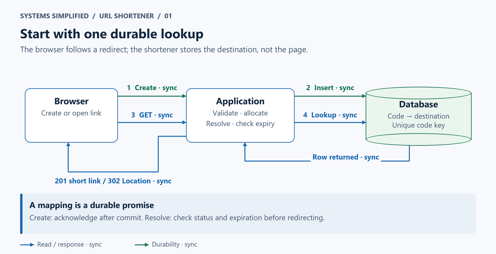
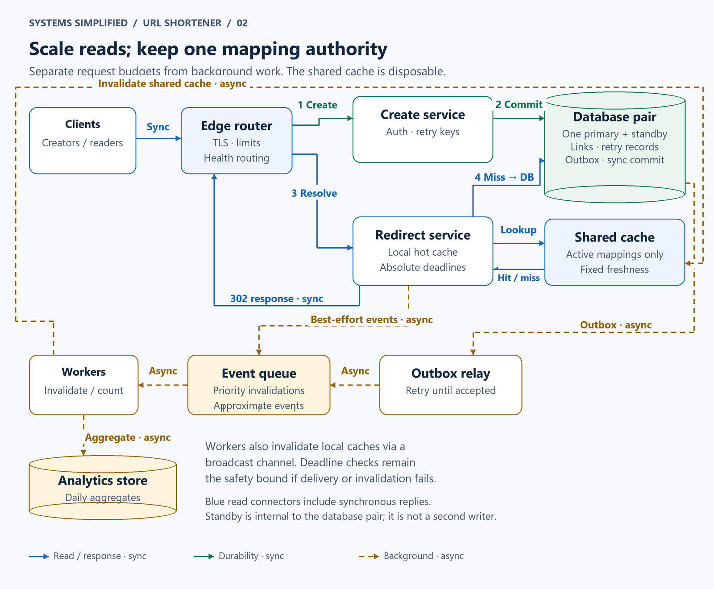
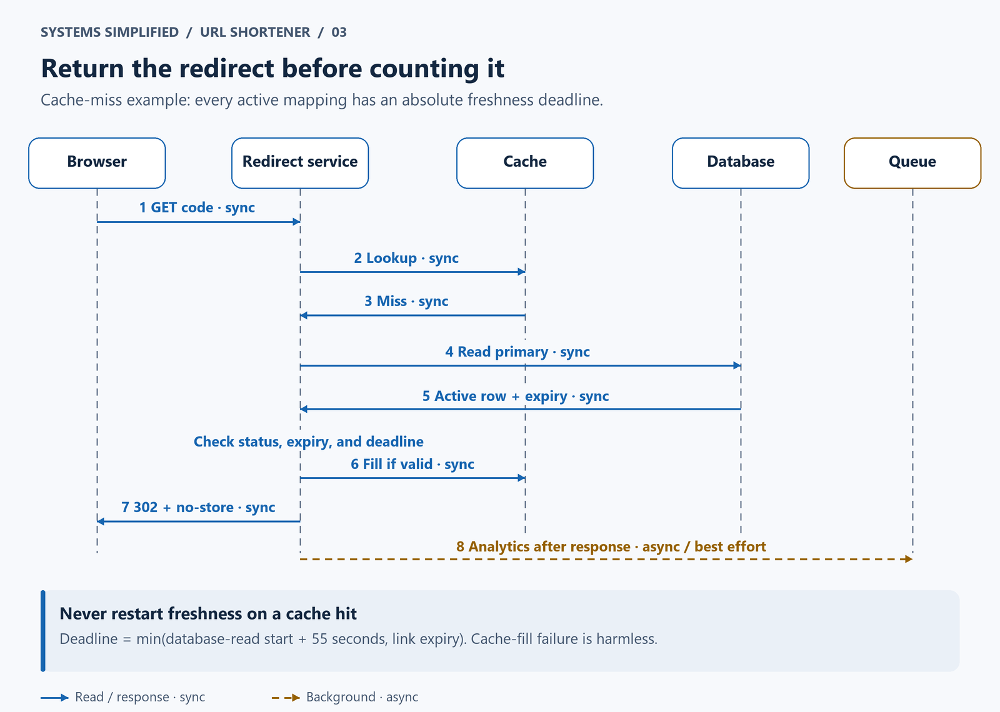
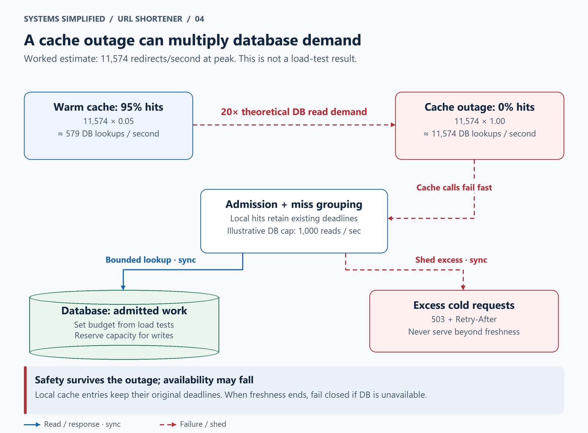

# Design a URL Shortener

> **In one sentence:** Turn a long web address into a small, shareable link that reliably sends readers to the right destination.

You share a concert page in a message. Its tracking parameters swallow half the screen. A short link fixes that inconvenience, but the service behind it must remember the destination for years, survive sudden popularity, and stop forwarding people to harmful pages.

Build a URL shortener as a durable mapping from a unique code to a destination URL. Create codes with collision checks, and serve redirects through a cache backed by a database. Scale reads before splitting storage. Keep analytics off the redirect path, and bound cache freshness so expiration and abuse takedowns still work when dependencies fail.

**Level:** Beginner  
**Patterns:** [Caching](#redirect-cache-policy), [unique identifiers](#how-short-codes-are-generated), [replication](#reliability-correctness-and-recovery), [idempotency](#data-model-and-partitioning), [asynchronous work](#component-decisions)  
**Read time:** About 19 minutes  
**Prerequisites:** Basic familiarity with web requests and database tables; distributed-systems terms are explained below.  
**Article facts:** Prepared October 10, 2026; published October 11, 2026. The canonical repository address above identifies this lesson's public location.

## Why this system matters

A URL (Uniform Resource Locator) identifies a web resource. A shortener adds **indirection**: readers use our address first, and we tell their browser where to go next.

That extra hop creates a promise. A shared link should continue working even when the creator is asleep, a server crashes, or the link goes viral. It also creates a safety obligation: hiding a destination can help an attacker disguise phishing.

This is an illustrative design, not a description of any commercial shortener's private architecture. Its original worked example follows the same traffic through a warm cache, an outage, and a takedown window.

## The problem in plain English

Maya submits `https://events.example/concerts/autumn?campaign=community`. The service returns `https://sho.rt/a7Kp2Qm9`. When Arun opens that short link, his browser receives a redirect and then makes a separate request to the concert site. All domains in the examples are illustrative.

```http
POST /v1/links
Authorization: Bearer <creator-token>
Idempotency-Key: concert-share-42
Content-Type: application/json

{"destination_url":"https://events.example/concerts/autumn?campaign=community"}
```

```http
HTTP/1.1 201 Created
Content-Type: application/json

{"code":"a7Kp2Qm9","short_url":"https://sho.rt/a7Kp2Qm9"}
```

```http
GET /a7Kp2Qm9

HTTP/1.1 302 Found
Location: https://events.example/concerts/autumn?campaign=community
Cache-Control: no-store
Referrer-Policy: no-referrer
```

Here, `302` is a temporary redirect, and `Location` names the destination. We choose temporary redirects and prohibit browser/proxy storage to keep each visit subject to our current decision. Hypertext Transfer Protocol (HTTP) defines redirect semantics; its caching standard defines `no-store`. [HTTP semantics](https://www.rfc-editor.org/rfc/rfc9110.html#section-15.4.3), [HTTP caching](https://www.rfc-editor.org/rfc/rfc9111.html#section-5.2.2.5).

> **Mental model:** A short code is a claim ticket for a database record. It is not a compressed copy of the original URL.

## What success looks like

### Functional requirements

- Authenticated creators can create links and optionally set an expiration time.
- Anyone holding a public short link can resolve it while it is active.
- Owners can disable their links; authorized moderators can block abusive ones.
- Creators can see approximate daily redirect counts, updated in the background.
- A repeated create request with the same idempotency key returns the same result during a defined retry window.

### Non-functional requirements

These are **design targets**, not measured results or commitments from a real service.

| Goal | Illustrative target | Why it matters |
| --- | --- | --- |
| Redirect latency | Server processing p95 below 50 ms on warm-cache requests | p95 means 95% of those requests finish within the target; browser-to-service travel and destination loading are excluded |
| Redirect availability | 99.9% successful eligible resolutions per month | Roughly 43 minutes of equivalent unavailability in a 30-day month; monitor outage duration separately from request success |
| Creation latency | Server processing p95 below 300 ms | A durable write can take longer than a cached lookup |
| Creation durability | Acknowledge only after local commit and one synchronous standby acknowledgment | Protects acknowledged mappings against a primary-only failure when the acknowledged standby is promoted |
| Disable freshness | Stop serving a previously cached active mapping within 60 seconds of committed disable, under the stated clock bound | Bounds unsafe forwarding even if cache invalidation fails |
| Expiry | Reject at or after the stored expiration, subject to clock accuracy | Cleanup delays must not extend a link's lifetime |
| Analytics | Eventual, approximate daily counts | A redirect remains useful even if its analytics event is lost |

### Out of scope

- Custom aliases/domains, editable destinations, and private password-protected links.
- Fetching previews or guaranteeing that a destination is safe forever.
- Exact billing-grade click counts, globally writable regions, and a runnable implementation.

Public links are bearer-style references: possession permits resolution. Random-looking codes do not turn them into private documents.

## Assumptions and scale

No traffic data was supplied. These deliberately rounded **estimates** size a fictional service. Decimal GB/TB are used; a year means 365 days here.

| Input | Assumption | Derivation / note |
| --- | --- | --- |
| New links | 1 million/day | About `1,000,000 / 86,400 = 11.6` creates/second on average |
| Redirects | 100 million/day | About `100,000,000 / 86,400 = 1,157` redirects/second; a 100:1 read/write ratio |
| Peak traffic | 10× the average | About 116 creates/second and 11,574 redirects/second; validate actual burst distributions |
| Mapping footprint | 1 KB/link, including a rough index allowance | Average URL and metadata budget; enforce an 8 KB destination limit and measure the real row-size distribution |
| Annual mapping growth | 365 million links | `365 million × 1 KB ≈ 365 GB/year` for one copy, before backups and engine overhead |
| Three-year retained mappings | About 1.095 billion links | About 1.095 TB for one copy, or 2.19 TB for primary plus standby; expiry can reduce live data |
| Hot working set | 5 million mappings at 500 bytes/cache entry | About 2.5 GB of payload; provision more for allocator, key, replication, and operational headroom |
| Expected cache hit ratio | 95%, an assumption | At peak, `11,574 × 0.05 ≈ 579` database lookups/second if this ratio holds |
| Cache outage load | 0% hits | About 11,574 peak lookups/second: **20×** the assumed normal database read load |
| Analytics volume | 100 bytes/event at all redirects | About 10 GB/day before transport and storage overhead; aggregate and retain briefly |

> **Key implication:** Reads dominate, but the most dangerous read load may arrive when the cache disappears. Capacity for 579 lookups/second does not imply capacity for 11,574.

## Version 1 — the simplest credible design



The same application handles creation and resolution. Green arrows represent synchronous writes; blue arrows represent synchronous reads and responses. The browser follows a redirect independently; the application does not download the destination.

1. Validate the creator and destination, generate a code, and insert the mapping into a relational database. Return a short link only after commit.
2. For `GET /{code}`, look up the code, check status and expiration, and return the destination in a `302` response.
3. Return `404` for an unknown code and `410 Gone` for a known expired or disabled link. A temporary dependency failure returns `503`, not `404`.

| Component | Why it exists | What it does not solve yet |
| --- | --- | --- |
| One application | Validation, code allocation, and redirect decisions | Server failure interrupts the whole service |
| One database | Durable mappings, unique codes, and atomic creation | Primary failure, concentrated read load, and regional disaster |

### How short codes are generated

Choose eight characters uniformly from **Base62**, the digits `0–9`, uppercase `A–Z`, and lowercase `a–z`. Use a cryptographically secure random generator with unbiased sampling. Codes are case-sensitive; preserve case at the edge and in storage. Reserve administrative route names before allocation.

The namespace has `62^8 = 218,340,105,584,896` possible codes. With one billion occupied codes, the probability that the next independent draw collides is approximately `1 billion / 62^8 ≈ 0.00000458`, or 0.000458%. That small per-insert chance **does not mean collisions never occur**: across one billion initial draws, the expected number of colliding pairs is roughly `n(n−1)/(2 × 62^8) ≈ 2,290`.

Enforce a unique key on `code`, attempt the insert, and retry with a new random code on a code conflict. Bound retries, for example at five attempts, and alert if exhaustion occurs. A database constraint arbitrates concurrent inserts; checking for absence before inserting is racy. PostgreSQL documents how [unique constraints enforce uniqueness](https://www.postgresql.org/docs/current/ddl-constraints.html#DDL-CONSTRAINTS-UNIQUE-CONSTRAINTS).

> **Trade-off:** A sequence encoded in Base62 avoids random collisions but is guessable and requires coordinated allocation. Random allocation avoids a central sequence and conceals allocation order, while still requiring database uniqueness. Neither option is authorization.

## Where Version 1 breaks

| Pressure | What fails | Observable symptom | Direction of the fix |
| --- | --- | --- | --- |
| A viral code | Repeated reads compete with durable writes | Database latency and connection queues grow | Cache active mappings and collapse simultaneous misses |
| Application failure | All traffic depends on one process | Requests time out | Stateless instances behind a health-aware router |
| Database failure | The only durable serving copy is unavailable | Both create and resolve fail | Standby replication, fencing, and tested failover |
| Per-request counter update | A popular mapping becomes a write hotspot | Redirects wait on analytics locks | Emit approximate analytics asynchronously |
| Malicious destinations | A valid mapping forwards users into abuse | Reports and reputation damage | Moderation, bounded cache freshness, and creation limits |
| Three years of retention | Index/storage maintenance becomes expensive | Backups, restores, and vacuum work exceed budgets | Measure first; partition only when demonstrated limits demand it |

## Version 2 — production-scale architecture



The numbered synchronous paths create and resolve links. The database pair is one logical writer with a standby, not two independent writers. The lower dashed amber lane delivers cache invalidations and analytics outside the request path; they have different delivery guarantees, explained below.

### End-to-end flow

1. An edge router terminates Transport Layer Security (TLS), limits abusive traffic, and routes creation requests separately from redirects. TLS encrypts transport; the router still needs access controls.
2. The create service checks authentication, validates input, and commits the link, retry record, and an **outbox** event in one transaction. An outbox is a table of durable work to deliver after commit.
3. The redirect service queries its local cache, then the shared cache. On a miss, it uses a bounded database lookup, checks status/expiry, and caches an active mapping with an absolute freshness deadline. It responds without waiting for analytics.
4. A relay forwards outbox events to a durable queue. Workers delete shared entries, broadcast invalidations to local-cache instances, and aggregate redirect events. The broadcast is a best-effort fan-out channel, not a guarantee that every instance received the change. Redirect events enter through a bounded, best-effort producer buffer; losing that buffer may lose counts, not mappings.



This sequence isolates the important ordering: a redirect is based on an active, unexpired mapping; cache fill is optional, and analytics cannot delay the response. The browser's destination request is separate from the shortener's database work.

### Component decisions

| Component | Responsibility | Why this choice | Main trade-off |
| --- | --- | --- | --- |
| Edge router | TLS, health routing, traffic limits | Gives stateless instances a stable entrance | Needs redundancy; coarse limits may inconvenience legitimate bursts |
| Create service | Authenticated writes and retry handling | Independent scaling and database budgets | More deployment surfaces than one application |
| Redirect service | Fast read and freshness decisions | Read-heavy workload has different failure priorities | Must handle hot codes and bound fallback work |
| Local + shared cache | Disposable active mappings; local copies absorb viral codes | Reduces network and database work | Memory, invalidation races, and freshness complexity |
| Database primary + standby | Links, idempotency records, and outbox; replicated commit | One write authority preserves uniqueness | Synchronous standby waits reduce write availability |
| Outbox relay | Publish committed change events until acknowledged | Avoids a database/queue dual-write gap | Polling, backlog management, and duplicate delivery |
| Event queue | Durable invalidations; accepted analytics batches | Smooths worker outages | Storage quotas and delivery lag; separate priority lanes |
| Workers | Invalidation and event deduplication/aggregation | Removes slow work from redirects | Retries and poison events need operational handling |
| Analytics store | Daily aggregate counts | Smaller and cheaper than indefinite raw-event retention | Counts cannot reconstruct every visit |

> **Why it exists:** Without the outbox, a disable could commit just before the service crashes while publishing its invalidation. Writing both changes in one database transaction gives the relay work it can resume. The [Debezium outbox documentation](https://debezium.io/documentation/reference/stable/transformations/outbox-event-router.html) describes this pattern; a small deployment can use a polling relay instead of that tool.

### Redirect cache policy

Cache **active mappings only**. A cached value includes `destination_url`, `expires_at`, `version`, and `fresh_until`. Use short, primary database reads with a new statement snapshot, not a long-lived transaction snapshot. Its deadline is derived from the database-read start time, not cache-fill time: `fresh_until = min(read_start + 55 seconds, expires_at)` when an expiry exists. Delayed reads therefore cannot create a fresh 55-second stale window after a disable has committed. Recheck deadlines immediately before emitting the response; do not return a mapping whose freshness expired while the request waited.

All service clocks must stay within an assumed ±2 seconds of real time; monitor synchronization and bypass/reject cached reads when this bound is uncertain. Use a 55-second internal time to live (TTL) to leave margin for up to four seconds of relative clock skew against the 60-second disable target. Every local-cache promotion preserves the existing absolute deadline. Never reset it on a shared-cache hit. Redis can [evict cache entries under memory pressure](https://redis.io/docs/latest/develop/reference/eviction/); an entry's presence is not a durability guarantee.

Disable commits update the row and its version and insert an outbox event atomically. Invalidation normally improves freshness, but it is not the safety bound: a racing cache fill can occur after an invalidation. The preserved deadline still caps that stale entry. Each read checks both the cache deadline and link expiration; freshness expiration triggers an authoritative lookup, whereas link expiration returns `410`.

Do not cache unknown-code results in this version: a freshly created link should not inherit a negative cache entry. Bound random-code misses using admission control. Do not cache redirect responses at a content delivery network (CDN), a geographically distributed proxy cache, or in the browser. An internal mapping cache is distinct from an HTTP response cache. `no-store` directs compliant HTTP caches not to store the response; it cannot recall a redirect already followed or control malicious clients. [HTTP cache directives](https://www.rfc-editor.org/rfc/rfc9111.html#section-5.2.2.5).

> **Failure mode:** If the cache is unavailable and the database budget is exhausted, return `503` with `Retry-After`. Do not extend expired cache deadlines just to make the availability chart look better.

## Data model and partitioning

| Data | Source of truth | Access pattern | Partition / replication strategy |
| --- | --- | --- | --- |
| `links(code, destination_url, owner_id, created_at, expires_at, status, version)` | Database | Point read by case-sensitive `code`; authorized disable | Primary key on `code`; one primary and one synchronous standby initially |
| `create_requests(owner_id, idempotency_key, request_hash, code, expires_at)` | Same database | Retry lookup scoped to creator | Unique `(owner_id, idempotency_key)`; keep for 24 hours |
| `outbox(event_id, code, version, event_type, created_at, delivered_at)` | Same database | Relay scans bounded undelivered batches | Index undelivered work; prune delivered entries after a recovery window |
| `daily_counts(code, day, count)` and recent processed event IDs | Analytics store | Owner reads aggregates; workers add counts | Partition by day; raw events and deduplication history expire after seven days |

An **idempotent** operation has the same intended effect when repeated. Within 24 hours, a repeated key with the same payload returns the original code; reuse with a different payload returns `409 Conflict`. Store the mapping and retry record in the same transaction. Concurrent requests compete on the retry-record unique key: the losing transaction rolls back, then reads the committed winner. Retry lookup must precede code generation. After the retry window, another link may be created.

Do not deduplicate solely by destination URL. Two creators sharing the same page may need different ownership, expiry, and analytics. Keep destinations immutable so stale mapping values cannot send readers to an old edited URL.

Start with one adequately provisioned database pair and benchmark with representative indexes, storage, and cold-cache traffic. If storage or sustained write/maintenance limits justify sharding, assign `hash(code)` to logical buckets with a routing table. **Sharding** splits data across independent stores; it does not distribute repeated requests for the same hot code.

On resharding, designate one writer for each bucket and use a versioned routing epoch to reject writes through old routes. Copy data, catch up changes, switch routing, and retain a temporary read fallback. A global owner listing needs a secondary access path. Cross-shard creation also needs deliberate transaction handling for idempotency and outbox data; do not treat the single-database transaction above as automatically preserved. Those costs are reasons to defer sharding.

## Reliability, correctness, and recovery



The visual compares the same assumed peak with and without a cache. The sample database-read admission limit of 1,000/second is illustrative, **not a benchmark**. Set the real limit from load tests, reserving capacity for writes and recovery. Local hot entries help until their fixed freshness deadlines expire.

| Scenario | Design response | Remaining risk |
| --- | --- | --- |
| One application instance fails | Edge health checks reroute; drain unhealthy instances and retry safe reads | Detection delay and in-flight requests can still fail |
| Shared cache disappears | Continue valid local hits; circuit-break cache calls, collapse duplicate lookups, cap database concurrency and read rate | When the budget fills, some cold requests receive `503` |
| Many instances miss one hot code | Each instance groups concurrent misses into one lookup; jitter expirations earlier than the maximum deadline | Per-instance grouping is not a cluster-wide lock; database admission remains necessary |
| Primary fails | Fence the old primary so it cannot accept writes, then promote the acknowledged standby | Detection/promotion interrupts cold reads and writes; choosing an unacknowledged replica can lose data |
| Standby cannot acknowledge | Keep acknowledged data safe by pausing new create/disable commits; active cache hits may continue | Availability is sacrificed for this durability policy |
| Cache invalidation is lost or reordered | Relay retries; workers delete entries idempotently; absolute deadlines limit stale active mappings | A disabled link can still resolve during the bounded stale window |
| Queue/worker outage | Outbox retains change events; prioritize invalidations, alert on oldest undelivered age | Outbox growth consumes database space; redirect analytics buffers may drop events |
| Response lost after commit | Retry with the same creator-scoped key; inspect the existing retry record before allocating | A timeout is an unknown outcome, not proof of rollback; retries after retention can create another link |
| Duplicate analytics events | Stable event IDs plus deduplication and aggregate update in one analytics-store transaction | Events lost before acceptance remain lost; replay beyond dedup retention can overcount |
| Regional disaster or accidental deletion | Restore tested backups and replay retained database logs in a standby region | Illustrative recovery goals: restore within four hours, lose at most 15 minutes if log shipping remains healthy; test these targets |

**Replication** maintains another copy of data; a standby is a replica eligible to take over. For this design, configure synchronous commit to wait for durable log flush on the selected standby before acknowledging mapping writes. Serve cache-miss reads from the primary to avoid replica-lag surprises for newly created links. Synchronous replication trades latency and availability for a narrower loss window; asynchronous regional copies still have a loss window. [PostgreSQL replication modes](https://www.postgresql.org/docs/current/warm-standby.html#SYNCHRONOUS-REPLICATION).

**Operations and cost:** Track redirect success and latency, local/shared cache hit rates, database saturation, replication health, oldest outbox age, analytics drops, and clock offset. Alert separately on budget-driven `503`s and unknown-code `404`s. Run synthetic create-then-resolve and disable-then-resolve checks. Compare cache memory/network cost with avoided database work; shard count is not a proxy for efficiency. Test a cold restart, standby loss, queue backlog, and backup restore before claiming the targets are met.

> **At scale:** The 95% hit ratio is a hypothesis. Measure the hit ratio by request and the concentration of popular codes. A small number of viral links and a flood of random misses require different defenses.

## Security and abuse resistance

- Require authentication for creation and verify ownership on every disable/analytics request. Use a separate moderator role and an audit trail. Do not accept an `owner_id` supplied as proof of ownership.
- Parse destinations with a standard URL parser. Allow only `http` and `https`, require a hostname, reject embedded credentials and control characters, and enforce length limits before writing a `Location` header. Preserve meaningful path and query bytes instead of aggressively normalizing them.
- Apply creator/account quotas and edge limits; monitor enumeration, phishing reports, and suspicious creation bursts. Scheme validation alone does not make a destination safe. Maintain a documented takedown path with the freshness bound above.
- Avoid server-side destination fetching in the initial design. If previews or scanners are added, isolate fetch workers and restrict outbound access: reject loopback/private/link-local destinations, check DNS results and every redirect hop, limit bytes/time, and protect against DNS rebinding. Otherwise an attacker can turn the fetcher into **server-side request forgery (SSRF)**, making requests to internal services. [OWASP SSRF prevention guidance](https://cheatsheetseries.owasp.org/cheatsheets/Server_Side_Request_Forgery_Prevention_Cheat_Sheet.html).
- Encrypt stored mappings/backups and restrict database access. URLs can contain sensitive tokens, so redact queries in logs and avoid collecting IP addresses or full referrers for aggregate counts. Seven-day raw-event retention and creator account deletion need explicit enforcement, including backup-retention limits.
- Never recycle a disabled or expired code to a new owner. A years-old message must not suddenly point to someone else's page. A compact tombstone can preserve the reservation after destination data is purged.

## The trade-offs that matter

| Decision | We optimize for | We give up | Prefer an alternative when… |
| --- | --- | --- | --- |
| Eight random Base62 characters | Compact links and decentralized candidate generation | Collision retries and no privacy guarantee | Longer codes improve resistance to guessing; a sequence suits coordinated internal allocation |
| `302` with `no-store` | Rechecking expiry and disable on each visit | Browser/CDN redirect caching savings | Truly immutable public links can use permanent redirects if revocation expectations explicitly change |
| 55-second maximum internal freshness | Bounded stale active mappings | More origin reads than long TTLs | Stricter takedowns justify shorter TTLs or an authoritative deny decision on every visit |
| Primary reads on cache miss | Immediate visibility after successful creation | Extra primary load | Read replicas fit workloads with an explicit lag tolerance and a new-link fallback |
| Synchronous in-region mapping commits | Protection against a primary-only failure | Write stalls when the required standby is unavailable | Asynchronous commits fit an explicitly accepted loss window |
| Best-effort redirect event production | Fast redirects during analytics trouble | Exact counts | Financial reporting requires a durable event contract and reconciliation design |

## How the design evolves next

| Trigger | Next change | Why not add it on day one? |
| --- | --- | --- |
| Sustained distant-user latency | Regional read services and caches with an explicit replication-lag policy | Immediate visibility and disable bounds become cross-region problems |
| Storage/maintenance benchmark fails | Bucket-based sharding plus routed creation and recovery | Cross-shard idempotency, migrations, and backups are operationally expensive |
| Sub-second takedown requirement | Shorter freshness or an authoritative deny check, with fail-closed outage behavior | Every redirect gains latency, read load, or a new critical dependency |
| Custom aliases | Atomic reservation and a separate alias namespace | User-selected collisions, squatting, and naming disputes need policy |
| Accurate billable analytics | Durable acceptance, retention-aware deduplication, and reconciliation | More latency, storage, privacy handling, and operational coupling |

## Key takeaways

- A shortener stores a durable mapping; it does not reconstruct the original URL from the code.
- Random candidates still need a unique constraint and a bounded collision retry.
- Cache freshness is part of the safety contract. An invalidation message alone cannot guarantee prompt takedown.
- Read-heavy systems must budget for missing caches and hot codes, not just average traffic.
- Separate the durable link promise from approximate analytics, and name exactly which failures each mechanism covers.

> **Remember:** A cache can speed up a decision, but it cannot make old information current. Freshness deadlines and overload limits are part of the design, not tuning details.

## Quick check

1. Why is “check whether the code exists, then insert it” unsafe under concurrent creation?
2. With the assumed peak, how does database demand change when cache hits fall from 95% to 90%? What happens at 0%?
3. If a local cache restarts its 55-second TTL whenever it reads the shared cache, which safety guarantee breaks?

<details>
<summary>Suggested answers</summary>

1. Two writers can both observe absence. A unique constraint arbitrates the insert, and the loser retries.
2. Demand rises from about 579 to 1,157 lookups/second, then to 11,574 with no hits. Even a five-point hit-ratio drop doubles origin read demand.
3. It can extend the stale active mapping beyond the disable deadline. Preserve the original absolute freshness deadline through every cache layer.

</details>

## Related lessons

This is the repository's first case study; no other published lesson exists to link yet. Use this lesson's [cache policy](#redirect-cache-policy) and [data model](#data-model-and-partitioning) as starting points. Pastebin is next in the series: it keeps short-code lookup but adds a separate storage lifecycle for text content.

## Frequently asked questions

### Is a short URL a compressed long URL?

No. Its code identifies a stored record. The database must retain the destination, because the same short code cannot independently reproduce arbitrary URL text.

### Should a URL shortener use 301 or 302 redirects?

Use `302` with explicit `no-store` for this design's revocable links. Permanent redirects can be appropriate for truly immutable links, but cached responses reduce the service's ability to recheck expiry and disable decisions. HTTP status alone does not define the full cache policy.

### How do we prevent duplicate short codes?

Use unbiased random generation, a database unique key, and retry on a code conflict. The large namespace makes each retry unlikely; the unique key is what prevents two successful mappings from claiming the same code.

### Does sharding solve a viral link?

No. All reads for one code still land on its assigned shard. Local caching, grouped misses, and admission limits protect that hotspot. Sharding distributes different keys and storage, not identical-key traffic.

### Can the service promise immediate takedowns and uninterrupted redirects during an outage?

Not with only cached mappings. This design accepts a bounded stale window and returns errors once freshness expires and authoritative data is unavailable. Immediate takedowns require a stronger online authority or a fail-closed policy, both of which change availability and latency.

## Glossary

| Term | Meaning in this design |
| --- | --- |
| Cache | A disposable faster copy of mapping data |
| TTL | Time to live: the maximum period a cached copy may remain fresh |
| Idempotency key | A creator-scoped retry identifier that avoids repeated creation within its retention window |
| Outbox | Database rows recording background work in the same transaction as the business change |
| At-least-once delivery | Accepted work may be delivered more than once; consumers must handle duplicates |
| Fencing | Preventing an old primary from writing after failover |
| Tombstone | A retained code reservation without its original destination data |

## Sources and further reading

The workload, targets, namespace calculations, cache deadlines, and topology are original illustrative choices. These primary sources support the protocol semantics and mechanisms; they do not validate the estimated performance:

- [RFC 9110: 302 Found and HTTP redirect semantics](https://www.rfc-editor.org/rfc/rfc9110.html#section-15.4.3).
- [RFC 9111: the response `no-store` cache directive](https://www.rfc-editor.org/rfc/rfc9111.html#section-5.2.2.5).
- [PostgreSQL: unique constraints](https://www.postgresql.org/docs/current/ddl-constraints.html#DDL-CONSTRAINTS-UNIQUE-CONSTRAINTS).
- [PostgreSQL: standby servers and synchronous replication](https://www.postgresql.org/docs/current/warm-standby.html#SYNCHRONOUS-REPLICATION).
- [Redis: key eviction and memory limits](https://redis.io/docs/latest/develop/reference/eviction/).
- [Debezium: transactional outbox event routing](https://debezium.io/documentation/reference/stable/transformations/outbox-event-router.html).
- [OWASP: server-side request forgery prevention](https://cheatsheetseries.owasp.org/cheatsheets/Server_Side_Request_Forgery_Prevention_Cheat_Sheet.html).

Revisit the protocol and database links when their specifications or implementation guidance changes. Revisit this architecture when the workload, privacy policy, or disable-freshness requirement changes.
