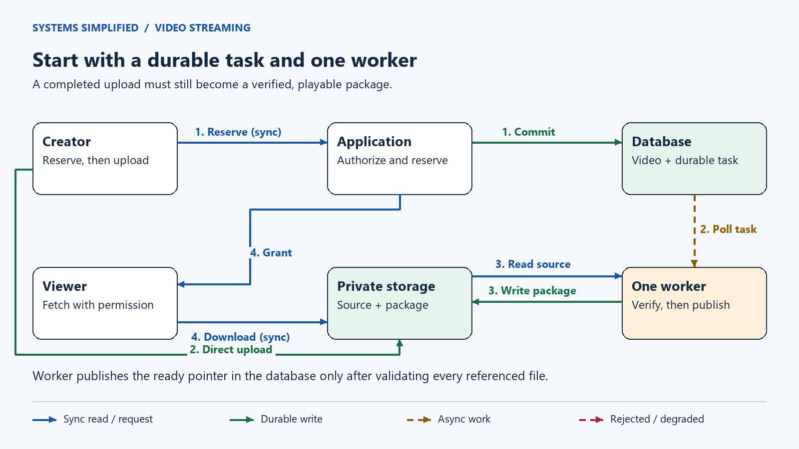
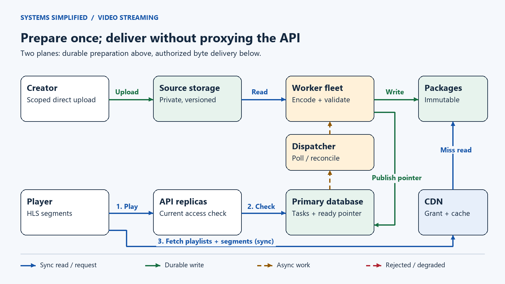
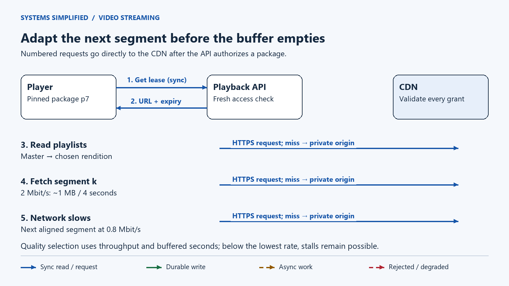
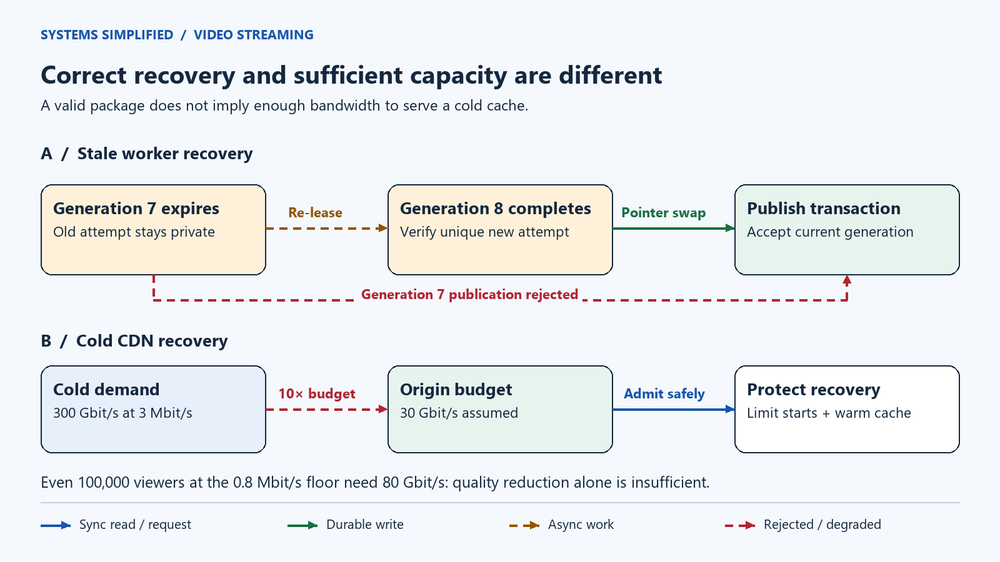

# Design Video Streaming

> **In one sentence:** Let a creator upload a recording once and let many viewers watch it smoothly across changing network conditions.

Maya uploads a ten-minute tutorial. A viewer starts watching on Wi-Fi, walks outside, and switches to a slower mobile connection. The video should become less sharp before it stops. Meanwhile, a failed encoder must never turn Maya's public video into a playlist of missing files.

Design recorded video streaming by separating upload processing from playback. Store originals privately, transcode into aligned quality renditions, and publish only a validated immutable package. Players fetch playlists and short segments through a content delivery network, adapting quality to throughput and buffer health. Authorize playback separately; signed access expires, but downloaded video cannot be recalled.

**Level:** Intermediate  
**Patterns:** [Durable processing](#end-to-end-flow), [atomic publication](#how-does-a-video-become-playable), [adaptive playback](#how-does-the-player-change-quality), [private caching](#security-and-abuse-resistance), [overload recovery](#reliability-correctness-and-recovery)  
**Read time:** About 20 minutes  
**Prerequisites:** Basic web requests and database rows. Streaming terms are defined below.  
**Article facts:** Prepared and published October 26, 2026; human review pending. This is an illustrative recorded-video service, not a description of YouTube's or Netflix's private implementation. All workloads, retention periods, and performance targets are hypothetical. Initial revision: safe package publication and playback capacity under cache failure.

## Why this system matters

Streaming combines a slow preparation job with an interactive experience. Encoding may take minutes, but the viewer expects playback in seconds. A viral video adds enormous byte traffic while adding very few metadata writes.

A **content delivery network (CDN)** caches files near viewers. An **origin** is the authoritative storage behind those caches. An **encoder** converts a source recording into a chosen compression format and quality. Keeping these roles separate allows each part to scale for its own pressure.

## The problem in plain English

The creator reserves an upload, sends the file directly to private storage, and sees `processing` until the system verifies and publishes a playable package. The viewer requests permission to play, downloads a small playlist, and fetches successive pieces of video.

```http
POST /v1/videos
Idempotency-Key: maya-tutorial-19
Content-Type: application/json

{"title":"Repair a bicycle tyre","expected_bytes":600000000}
```

```json
{"video_id":"v19","state":"awaiting_upload","upload_session":"u19","status_url":"/v1/videos/v19"}
```

The returned upload session includes separately scoped, expiring upload credentials. Repeating the same creation key and payload returns the same video; a different payload with that key is rejected. The status endpoint lets the client recover after losing a response.

> **Mental model:** Prepare a sealed box of interchangeable video pieces; publish the address only after checking every piece in that box.

## What success looks like

### Functional requirements

- Resume interrupted uploads within a bounded session lifetime; report upload, processing, ready, failed, and deleted states.
- Watch, pause, seek, and change quality without restarting the recording.
- Support creator ownership, public or restricted access, captions, thumbnails, and deletion.
- Keep a previous playable revision available while a replacement package is being prepared, unless the creator deletes the video.

### Non-functional requirements

These are design targets to validate with device and load tests, not measured results.

| Goal | Target | Why it matters |
| --- | --- | --- |
| Start time | First decoded frame within 2 seconds at p95 on a named broadband test profile | An API latency alone does not measure watching |
| Playback health | Rebuffer duration under 1% of watch time on that profile | Track mobile and poor-network cohorts separately |
| Playback authorization | 99.9% monthly successful eligible requests | Measure permission service separately from byte delivery |
| Publication correctness | Never intentionally expose a package with unverified referenced objects | A fast `ready` response is useless if playback fails |
| Access changes | Stop issuing new grants after an authoritative denial; existing grants expire within their lease | Honest revocation semantics |
| Durability | Multi-zone storage, database backups, tested restore | Regional recovery has an explicit data-loss window |

### Out of scope

Live broadcasts, video calls, recommendations, ads, subscription billing, studio-grade digital rights management (DRM), and offline downloads. This lesson covers **video on demand (VOD)**: recordings available before playback starts. The later Netflix lesson can add catalog, licensing, and entitlement concerns without duplicating this delivery foundation.

## Assumptions and scale

Use decimal bytes: 1 MB = one million bytes, 1 TB = one trillion bytes. Bitrate is bits per second; divide by eight for bytes. Ignore protocol overhead, replication, and retries until explicitly included.

| Input | Assumption | Derivation / note |
| --- | --- | --- |
| Uploads | 10,000/day, averaging 10 minutes | 100,000 source minutes/day |
| Original bitrate | 8 Mbit/s | 600 s × 8 Mbit/s ÷ 8 = 600 MB/upload |
| Output ladder | Three muxed audio/video renditions at 0.8, 2, and 5 Mbit/s | 7.8 Mbit/s total stored output; illustrative, not a codec prescription |
| Encoded bytes | 5.85 TB/day | 10,000 × 600 × 7.8 million ÷ 8 |
| Working retention | 30 days of originals and output | (6 + 5.85) × 30 = 355.5 TB logical bytes; excludes metadata and overhead |
| Watch volume | 1 million sessions/day, 12 minutes/session | Includes replays; not constrained by the mean upload length |
| Delivered bitrate | 3 Mbit/s average across viewers | 1 million × 720 × 3 million ÷ 8 = 270 TB/day |
| Average concurrency | About 8,333 viewers | 1 million × 720 ÷ 86,400 |
| Peak concurrency | 100,000 viewers | Assumed correlated demand; 300 Gbit/s delivered at the assumed bitrate |
| Segment duration | Nominal 4 seconds | About 25,000 segment requests/s at peak; startup and seek bursts add work |
| Warm origin traffic | 15 Gbit/s at peak | Assumed 95% **byte** offload: 300 × 0.05 |
| Cold origin exposure | Up to 300 Gbit/s | Same demand, zero offload: 20× warm origin bytes |
| Processing capacity | 140 source minutes/minute sustained for the whole ladder | Assumed fleet result to benchmark; arrival average is 100,000 ÷ 1,440 ≈ 69.4 |

The retention window describes a rolling tutorial workload, not a service promise to remove customers' videos after 30 days. A permanent catalog requires lifetime growth and deletion assumptions instead. Captions, thumbnails, packaging overhead, multipart remnants, object versions, replicas, and backups add storage.

> **At scale:** Peak delivery is about 300 Gbit/s, while new uploads average only 0.116 videos/s. Byte delivery and upload request counts demand different scaling decisions. A byte offload ratio does not imply the same request hit ratio.

## Version 1 — the simplest credible design



At small scale, one application and a database own the video record; private object storage owns the large files. A durable database task table and one worker are enough. There is no separate message broker yet.

1. The application commits the upload reservation and task before returning scoped upload permission.
2. The creator uploads directly to storage. A worker polls the task, confirms completion, and encodes a complete package.
3. The worker verifies the package, then updates the database pointer to make it ready.
4. The application checks viewer access and returns short-lived direct-storage download permission. This baseline has no CDN.

| Component | Why it exists | What it does not solve yet |
| --- | --- | --- |
| Application and database | Ownership, upload state, durable tasks, ready pointer | A single application or database failure can interrupt control requests |
| Private object storage | Originals and encoded files without loading them into database rows | Long-distance repeated downloads remain expensive |
| One background worker | Keep encoding outside request deadlines | Slow uploads or long recordings can block other jobs |

## Where Version 1 breaks

| Pressure | What fails | Observable symptom | Direction of the fix |
| --- | --- | --- | --- |
| Viral recording | Repeated origin transfers | Origin load and viewer stalls rise | Cache immutable packages at a CDN |
| Encoding backlog | One worker cannot keep up | Upload-to-ready latency increases | Parallel bounded work with leases |
| Lost completion callback | Task never notices completed upload promptly | Video remains in processing | Persist state and reconcile storage |
| Partial package | Worker dies between object writes | Some playlists lead to missing segments | Private attempt paths and verified publication |
| Mobile network slows | Fixed high-bitrate file outruns network | Playback buffer empties | Aligned renditions and adaptive selection |

## Version 2 — production-scale architecture



The upper path prepares media, and the lower path delivers it. Solid blue arrows are synchronous requests or reads; solid green arrows write durable state; dashed amber arrows represent background work. The database stores tasks and leases; it is not in the segment delivery path. The worker box represents a fleet, including a publication coordinator. Captions and thumbnails travel inside the same verified package.

### End-to-end flow

1. **Reserve:** Authenticate the creator through the application programming interface (API). Commit a video row, upload session, and durable task in one database transaction. Grant writes only to that upload's source location, with byte and lifetime limits.
2. **Confirm:** The client finishes its multipart upload. A callback is a wake-up hint; a database task remains until a reconciler confirms the expected object version, size, and integrity. A lost callback therefore delays work rather than losing it. An unfinished session expires after an illustrative 24 hours and its parts are cleaned up.
3. **Prepare:** Workers lease tasks, probe the source in an isolated process, and create the complete rendition ladder under a unique attempt prefix. A rendition is one quality version of the same recording. Retry expensive encoding with bounded attempts; quarantine repeatedly invalid inputs.
4. **Validate and publish:** Verify all playlists and referenced media, then commit a ready pointer under a generation check. Workers never write over a published path. The next section defines the commit boundary.
5. **Authorize:** A viewer requests `POST /v1/videos/v19/playback`. The API reads current access and ready state from the primary database and issues a short lease scoped to that exact package prefix. Return its master playlist URL and lease expiry; do not cache the personalized response publicly.
6. **Deliver:** The player requests the master playlist, one rendition playlist, then segments over the CDN. Validate permission on every protected request, including cache hits. A miss fetches from the private origin using the CDN's service identity.
7. **Observe:** The player reports startup, stalls, selected bitrate, failures, and coarse device/network cohort. Export operational metrics outside the critical delivery path; telemetry failure must not stop playback.

### Component decisions

| Component | Responsibility | Why this choice | Main trade-off |
| --- | --- | --- | --- |
| Creator and player clients | Resumable upload; buffer-aware playback | Moves byte transfer away from application servers | Device and browser compatibility testing |
| Stateless API replicas | Ownership, idempotency, task creation, playback grants | Scale small control requests independently | Depend on the authoritative database |
| Primary database and multi-zone standby | Metadata, durable tasks, leases, publication pointer | Transactions serialize state changes | Failover, backups, and hot-row contention need care |
| Source object storage | Private, version-pinned input | Restartable jobs use the same source bytes | Lifecycle and multipart cleanup costs |
| Task dispatcher and reconciler | Poll runnable tasks, detect expired leases and missing callbacks | Database tasks remain the source of truth | Polling load; partition work by due time and shard |
| Encoder/packager fleet | Transcode, segment, validate, publish | Bound concurrency by codec, memory, and tenant budget | High compute cost and duplicate work on retries |
| Package object storage | Immutable attempts and published media | Stable cache keys; no multi-file overwrite race | Many small objects and orphan cleanup |
| CDN | Validate grants and cache media | Reduce repeated origin traffic | Cold-cache exposure, invalidation, and egress charges |

> **Why it exists:** The publication pointer is a tiny switch from “preparing” to “playable.” It turns a many-object upload into one database visibility decision. Object storage alone does not provide an atomic transaction across all files [S2].

### How does a video become playable?

Keep user visibility separate from package-building state. The video has `deleted_at`, `access_policy`, and nullable `current_package_id`. A package attempt has its own `building → verified → published → retired → deleting` lifecycle. Failed or abandoned builds never become current. A re-encode can fail while the existing current package stays playable.

A worker receives an increasing **generation**, a number that identifies the current lease owner. It writes to a unique staging prefix, using create-only objects and no shared mutable names. Finalize all upload parts before validation. The publication coordinator copies the selected, version-pinned objects into a fresh `v19/package-<unique-id>/` prefix. Encoders have no write or delete permission in this namespace. Only the coordinator can create its files; it uses create-only writes and never reuses a prefix. Its validator checks checksums, durations, decode samples, matching timelines, required audio and captions, and every referenced URI in this final prefix. Playlists may reference only that package's relative paths. Copying and validation can be retried, but nothing is published until the final package is complete. This extra copy isolates a verified package from encoders that resume late; include its bandwidth and temporary bytes in the processing budget.

The coordinator locks the video and task rows in a consistent order, checks that the video is not deleted, the lease is current and unexpired, and the expected generation matches. It then records the verified package, swaps `current_package_id`, and completes the task in one transaction. Row locks serialize conflicting writers [S3]. Deletion uses the same video lock. A late worker cannot undo a committed deletion or replace a newer package. This prevents stale **publication**, not wasted encoding work or writes to an abandoned prefix.

Only the pointer makes a package discoverable to new playback sessions. A process crash after writing files but before the transaction leaves an orphan, not a public half-video. A lost transaction response is resolved by reading task and pointer state, not by blindly publishing again. Generic at-least-once task delivery also requires this discipline; duplicate delivery is a documented property of systems such as Amazon SQS [S4]. No separate queue is required in this design.

Retired packages stay readable for at least the maximum playback-session lifetime plus an in-flight request grace period. Assume a two-hour session cap and ten-minute cleanup grace; longer viewing requires a new session pinned to the current package. A grant cannot outlive its session. Cleanup first marks the package `deleting` under a database lock and proves it is neither current nor protected by retention, then deletes its objects asynchronously. Publication cannot choose a deleting attempt. Never put an indiscriminate age-based lifecycle rule on active package objects.

### How does the player change quality?

Use **HTTP Live Streaming (HLS)** for this example. A master playlist lists variants. Each media playlist lists time-ordered segment URLs. RFC 8216 specifies HLS; it is an informational protocol document, not an availability guarantee [S1]. The quality ladder uses the same timeline and segment boundaries, with independently decodable starts at the chosen switching points. Validate these properties rather than assuming equal filenames imply alignment.



The viewer first gets authorization, then fetches media directly from the CDN. The repeated path is segment delivery; it does not call the API once per segment. Authorization renewals are separate control requests.

Suppose a four-second segment at 2 Mbit/s is roughly 1 MB. At 4 Mbit/s measured throughput it downloads in about two seconds, adding buffer. At 1 Mbit/s it takes eight seconds, consuming buffer faster than it refills. Switching to 0.8 Mbit/s makes a segment about 0.4 MB, taking 3.2 seconds at that slower throughput. These examples ignore overhead and variable bitrate; actual decisions need a margin.

The player starts conservatively, estimates throughput from recent downloads, and watches buffered seconds. It drops quality quickly when the buffer shrinks, raises it cautiously after sustained headroom, and avoids downloading renditions the device cannot decode. It switches at aligned media times, not by blindly substituting equal sequence numbers. Seeking fetches the segment around the requested time and decodes from a valid boundary. No algorithm can avoid stalls when the link remains below the lowest rendition's rate.

Four seconds is a design choice, not an HLS requirement. Shorter segments can respond faster but increase request volume and packaging overhead; longer ones amortize requests but adapt more slowly. A complete VOD playlist is immutable and includes an end marker. HLS rules for variant timelines and playlist behavior come from [S1]; this lesson's ladder and adaptation policy are illustrative.

## Data model and partitioning

| Data | Source of truth | Access pattern | Partition / replication strategy |
| --- | --- | --- | --- |
| `video(id, owner, access_policy, deleted_at, current_package_id, revision)` | Database | Read by video ID; serialize publication, deletion, and policy mutation | Begin on one multi-zone primary; later hash video ID |
| `creation(owner, idempotency_key, payload_hash, video_id)` | Database | Unique owner/key lookup | Same shard as owner's creation routing; retain retry records 7 days in this example |
| `upload(session_id, video_id, source_key, source_version, expires_at)` | Database plus private source object | Resume/confirm an exact source version | Route by video; bound abandoned-session lifetime |
| `task(video_id, generation, state, lease_until, next_run_at, attempt_id)` | Database | Indexed runnable tasks; conditional lease updates | Poll bounded batches by due time; one active generation per video |
| `package(id, video_id, prefix, validation_digest, state, retired_at)` | Database plus immutable objects | Current-pointer lookup and retention-safe cleanup | Colocate with video transaction; objects use unique prefixes |
| Playlists, segments, captions, thumbnails | Package storage | Sequential/range reads via CDN | Private multi-zone storage; CDN copies are disposable |

At the assumed upload rate, database sharding is premature. If sharding becomes necessary, keep video, task, and publication rows colocated so the correctness transaction remains local. Creation routing must preserve global idempotency for an owner's key; random routing on retry would defeat it. CDN demand for a viral video does not require thousands of database reads per second for its segments.

Keep primary reads for permission and publication decisions. Read replicas may serve browse results that tolerate staleness, but their `ready` label is not permission to play. A playback request rechecks current state. Existing sessions pin a specific package, so a new encoding revision does not mix old and new segments.

## Reliability, correctness, and recovery



The first lane shows correctness recovery: a new generation replaces an expired lease, and only that generation can publish. The second shows capacity recovery: cold-cache demand can exceed origin capacity even though every file is durable. Dashed red arrows mark rejected or degraded work.

| Scenario | Design response | Remaining risk |
| --- | --- | --- |
| Duplicate task or expired worker | Lease generation, unique attempt prefixes, conditional publication | Duplicate compute and orphan objects remain possible |
| Encoder crashes halfway | Retry from source or verified checkpoints; publish only a whole validated package | Time-to-ready rises; checkpoints must also identify input and encoding profile |
| Storage callback disappears | Reconciler inspects durable awaiting-upload tasks and exact source versions | Polling introduces delay; incomplete uploads eventually expire |
| Metadata primary unavailable | Deny new grants and publication until authority recovers | Valid existing grants can continue against CDN/origin until expiry |
| Zone loss | Managed multi-zone storage and tested database standby promotion | Acknowledge only under chosen synchronous durability policy; availability can fall while it is unavailable |
| Region loss | Restore metadata and copied objects into a prepared recovery region; verify packages before routing | Asynchronous copies can lag; fence old writers and accept a declared recovery point |
| Current package corruption | Stop new grants to bad package; repair or switch to a separately verified package | Old sessions may fail until renewed; integrity alerts must reach operators |
| CDN cache cold or origin overloaded | Collapse concurrent misses where supported, use a shield cache, stage prewarming, limit origin work | No cache creates bandwidth; some viewers must receive lower quality, retry, or admission failure |
| Access removed | Deny grant renewal, expire existing grants, optionally invalidate content | Downloaded bytes and in-flight transfers cannot be recalled |

Assume 140 source minutes/minute of processing capacity and 69.4 incoming minutes/minute. A one-hour encoding outage leaves about 4,167 source minutes queued. With no new surge, spare throughput is 70.6, so ideal catch-up is about 59 minutes. Provision using measured codec/device profiles and job-size distributions; average throughput hides a single two-hour upload. Monitor **oldest task age**, not just queue length. Reserve capacity per tenant and use bounded retries with jitter to avoid one corrupt source monopolizing the fleet.

Cold-cache protection needs a byte budget. If the origin can sustain 30 Gbit/s, it supports warm traffic with headroom but cannot instantly replace 300 Gbit/s of cached delivery. Even forcing everyone to the 0.8 Mbit/s floor would require 80 Gbit/s for 100,000 viewers when cold. At that rate, 30 Gbit/s serves at most 37,500 viewers before overhead. Quality reduction alone is insufficient; preserve buffered sessions where possible, throttle new starts, and cap origin concurrency while caches warm. Returning endless retries only amplifies the outage.

Watch startup latency, stall ratio, video-not-ready age, object 404s, rendition-specific decode errors, grant failures, CDN byte offload, origin saturation, and orphan bytes. Alert on user-visible symptoms alongside resource metrics. Periodically restore a database backup and play sample packages from recovered storage; a successful backup job does not prove a playable restore.

## Security and abuse resistance

- Authenticate creators; authorize reservation, update, and delete operations by owner. Apply per-account upload size, duration, concurrent job, and daily compute quotas before accepting expensive work.
- Treat media as hostile. Probe and encode in sandboxed workers without general network access; constrain CPU time, memory, decoded dimensions, frame count, and output size. Do not trust a file extension or client content type. Follow upload validation and isolation guidance [S7]. Never fetch arbitrary source URLs from a privileged worker.
- Keep source and package buckets private. Restrict source writes to upload sessions and output writes to attempt-specific worker identities. Viewer grants must never cover unverified attempt directories. CDN origin access control, such as CloudFront OAC, restricts bucket reads to the intended distribution [S6].
- For browser HLS playback, a custom-policy signed cookie can cover all files under one package prefix, avoiding a new signature per segment [S5]. Use HTTPS, narrow cookie scope, secure cookie attributes, and compatible cross-origin credentials settings. Native clients without cookie support can use signed URLs or headers with equivalent checks. Keep authentication validation separate from the shared cache key so eligible viewers reuse identical bytes.
- Protect the master playlist, rendition playlists, segments, captions, and thumbnails. Test missing, expired, and wrong-package grants on both cache hits and misses, plus direct-origin denial. A hard-to-guess URL is not access control.
- Use an illustrative 60-second grant anchored to the start of the authoritative permission read. Reject issuance after that deadline, enforce a bounded clock skew operationally, and renew only after a fresh check. A slow response must not restart the lease. Immediate revocation would require an additional edge policy check or denylist with its own propagation and failure contract.
- A lease bounds new request admission, not playback already buffered or saved. CloudFront checks expiry when the request starts; a transfer started before expiry can finish later [S5]. This design offers no exact “all viewing stops in 60 seconds” claim. DRM adds license and device controls but still cannot promise universal recall.
- Encrypt storage and transport, rotate signing keys with overlap, minimize viewer telemetry identifiers, and define deletion and backup retention. Stop grants immediately on logical deletion; physical object removal, versions, CDN copies, and backups follow separate documented schedules. Keep reports and moderation workflows capable of disabling access without waiting for re-encoding.

> **Failure mode:** A public playlist that references protected segments still leaks titles, durations, and paths. Apply the access boundary to the entire package, not just its largest files.

## The trade-offs that matter

| Decision | We optimize for | We give up | Prefer an alternative when… |
| --- | --- | --- | --- |
| Prepare the complete ladder before publishing | Predictable playback and simple validation | Faster first availability | Progressive publication is worth a more complex, explicitly versioned readiness model |
| Pre-encode three renditions | Low playback latency and reusable cache objects | Compute and storage for rarely watched videos | Demand-driven encoding saves enough to justify first-view latency and single-flight job coordination |
| Four-second HLS segments | Practical adaptation and seeking | More requests than a single file | Tiny recordings and controlled clients are adequately served by progressive download |
| Immutable package paths | Cache safety and coherent sessions | Retained old packages and orphan cleanup | Mutable content has a well-defined short freshness contract |
| Short playback leases | Bound continued request admission after policy changes | Renewal load and expiry failures | Public media needs no per-viewer authorization, or stricter revocation warrants edge state |
| One authoritative metadata region | Simple ordering and fencing | New sessions depend on that region | Geographic requirements justify explicit multi-region conflict and failover protocols |

> **Trade-off:** Better compression reduces CDN bytes but increases encoding cost and device compatibility work. Compare total watched minutes and client support before adding a new codec; do not optimize only the upload bill.

## How the design evolves next

| Trigger | Next change | Why not add it on day one? |
| --- | --- | --- |
| High viewing volume on a small hot catalog | Content-aware encoding ladders and measured prewarming | Requires enough watch data to beat simple profiles |
| Regional origin bottlenecks | Shield caches, regional copies, then measured multi-CDN routing | Routing, cost, and permission behavior must remain consistent |
| Database task scans contend | Partition tasks; optionally add a queue as a wake-up layer | Durable tasks already solve the assumed arrival rate; dual-write gaps need an outbox or reconciliation |
| High entitlement/renewal demand | Separate policy service and explicit consistency contract | Caching denials/permissions casually changes revocation behavior |
| Longer videos or uneven encoding times | Split validated work by time range and profile, then verify assembly | Keyframe boundaries, audio alignment, and retries become harder |
| Accessibility gaps | Caption review/editor, audio description tracks, accessible player audits | Captions are already supported; improving quality requires product operations as well as storage |

## Key takeaways

- Upload completion, processing completion, and publication are separate facts.
- Publish one verified pointer to immutable media; stale workers may waste compute but must not change visibility.
- Adaptive playback needs compatible timelines and buffer-aware choices, not merely three files at different resolutions.
- Size delivery in bits, storage in bytes, and processing in source minutes under a measured encoding profile.
- Warm-cache capacity is insufficient evidence for cold-cache survival.
- A signed media lease controls future fetches; it cannot recall downloaded bytes.

## Quick check

1. An encoder wrote 149 of 150 segments and crashed. Which object can safely make the video ready?
2. Why does 95% CDN byte offload say little about playlist request rate or database traffic?
3. At a 30 Gbit/s cold origin budget, why can lowering all viewers to 0.8 Mbit/s still fail?

**Answer guide:** (1) None yet: verify the complete package, then atomically publish its database pointer. (2) Byte sizes differ, and segment delivery bypasses the API; authorization has its own rate. (3) 100,000 × 0.8 Mbit/s is 80 Gbit/s, so admission and origin limits remain necessary.

## Related lessons

- [File Storage: resumable uploads and durable object metadata](../file-storage/README.md).
- [Instagram: media publication and bounded privacy changes](../instagram/README.md).
- [Rate Limiter: budgets and overload decisions](../rate-limiter/README.md).
- [Notification System: retries and asynchronous delivery](../notification-system/README.md).

## Frequently asked questions

### Is streaming just downloading a video file?

It still transfers bytes over HTTP. Segmented adaptive streaming adds playlists and interchangeable renditions so the player can seek and adjust quality. Progressive downloading of one file is simpler and can be appropriate for small recordings, but it does not provide this rendition-switching model.

### Should videos be stored in a database?

Keep ownership, access policy, tasks, and the published pointer in a transactional database. Put large originals and packaged media in private object storage. This keeps database transactions small while allowing byte delivery to scale independently.

### Can a queue guarantee exactly-once encoding?

Do not rely on that guarantee. A worker can crash after writing output but before acknowledging work. Use unique attempts, generation checks, and one conditional publication transaction. Duplicate execution remains possible; duplicate or stale publication is prevented by the application protocol.

### Does a CDN make private video public?

It need not. Validate scoped grants on every protected request and keep the origin inaccessible to viewers. Shared caching can reuse identical bytes across authorized viewers. Signed access still has expiry, credential-sharing, and already-downloaded-byte limits.

### Why not encode only when someone presses play?

That can reduce wasted encoding for a large rarely watched catalog. It also places job scheduling, cold starts, and encoding latency in the first viewer's path. This design pre-encodes to favor predictable playback; measured catalog economics may justify a hybrid later.

## Glossary

| Term | Meaning here |
| --- | --- |
| Rendition | One encoded quality version of the recording |
| Ladder | The set of renditions offered to a player |
| Segment | A short playable time slice fetched over HTTP |
| Playlist / manifest | Text describing variants or the sequence of media pieces |
| Packaging | Arranging encoded media, timing, and playlists for delivery |
| Buffer | Already downloaded media available for future playback |
| Generation fence | A database check that rejects state changes from an outdated worker |
| Origin shield | An intermediate cache that can reduce repeated misses reaching storage |
| Lease | Permission valid only until a defined deadline |

## Sources and further reading

Sources checked October 26, 2026. The architecture, diagrams, examples, and estimates are original illustrative design choices. These sources support specific protocol, service, and security facts; they do not establish this service's performance targets.

- **[S1]** [RFC 8216: HTTP Live Streaming](https://www.rfc-editor.org/rfc/rfc8216.txt), especially sections 4.3, 6.2.1, 6.2.4, and 6.3: playlists, VOD behavior, variant consistency, and client responsibilities. This lesson covers recorded HLS, not all later HLS extensions.
- **[S2]** [Amazon S3 consistency model](https://docs.aws.amazon.com/AmazonS3/latest/userguide/Welcome.html): strong object read-after-write behavior and limits of atomic updates across keys. S3 is one possible object-store implementation.
- **[S3]** [PostgreSQL explicit locking](https://www.postgresql.org/docs/current/explicit-locking.html): row locks serialize conflicting updates; deadlocks require consistent lock ordering and retry handling.
- **[S4]** [Amazon SQS at-least-once delivery](https://docs.aws.amazon.com/AWSSimpleQueueService/latest/SQSDeveloperGuide/standard-queues-at-least-once-delivery.html): duplicate delivery and idempotent consumers. The recommended design uses database tasks; this source explains why adding a broker would not remove duplicate-work handling.
- **[S5]** [CloudFront signed cookies](https://docs.aws.amazon.com/AmazonCloudFront/latest/DeveloperGuide/private-content-signed-cookies.html): policies spanning files, expiration checks, and downloads that continue past expiry.
- **[S6]** [Restricting access to an S3 origin](https://docs.aws.amazon.com/AmazonCloudFront/latest/DeveloperGuide/private-content-restricting-access-to-s3.html): authenticated CDN-to-origin access and distribution-scoped bucket policy.
- **[S7]** [OWASP File Upload Cheat Sheet](https://cheatsheetseries.owasp.org/cheatsheets/File_Upload_Cheat_Sheet.html): validation, isolation, authorization, and resource limits for hostile uploads.
