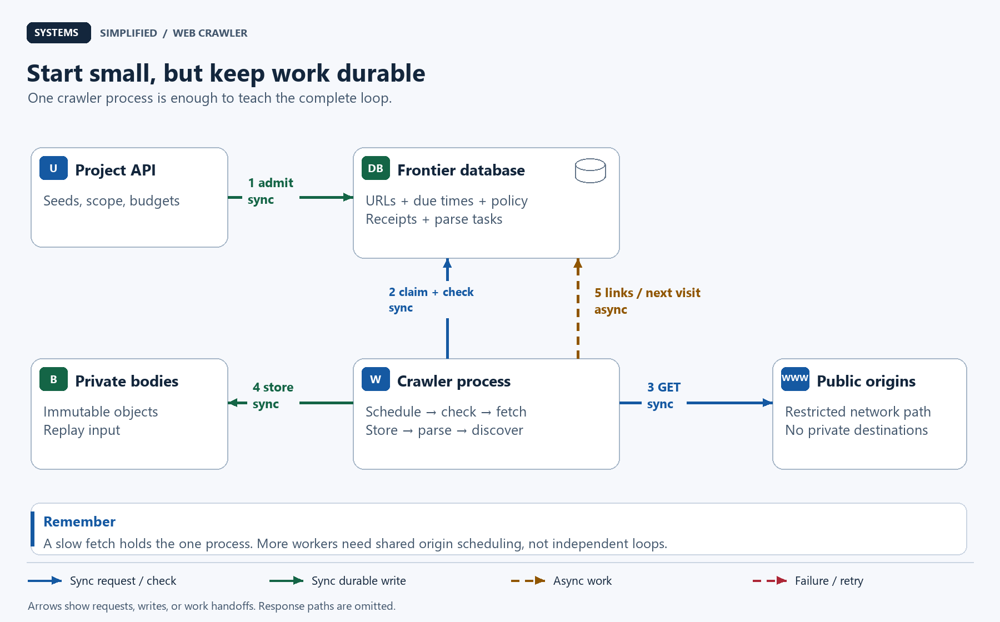
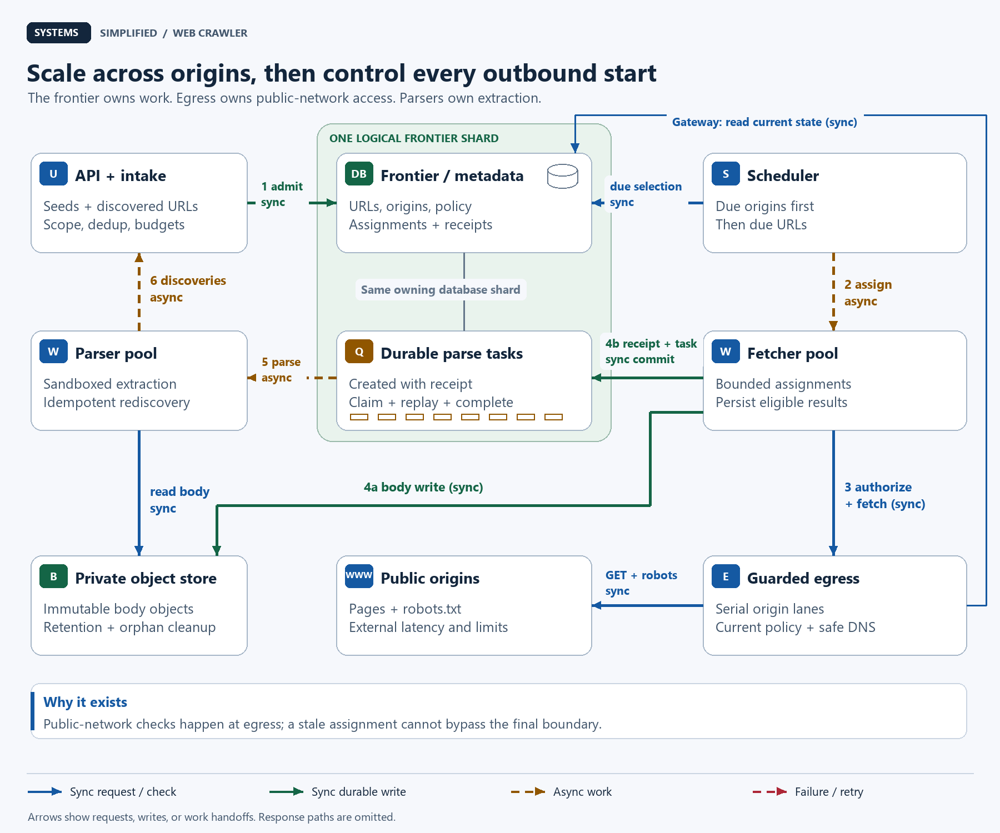
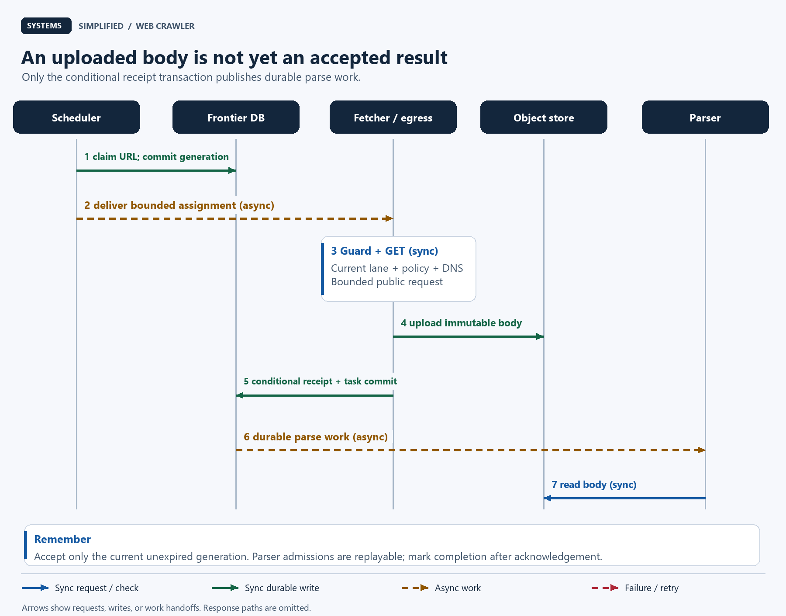
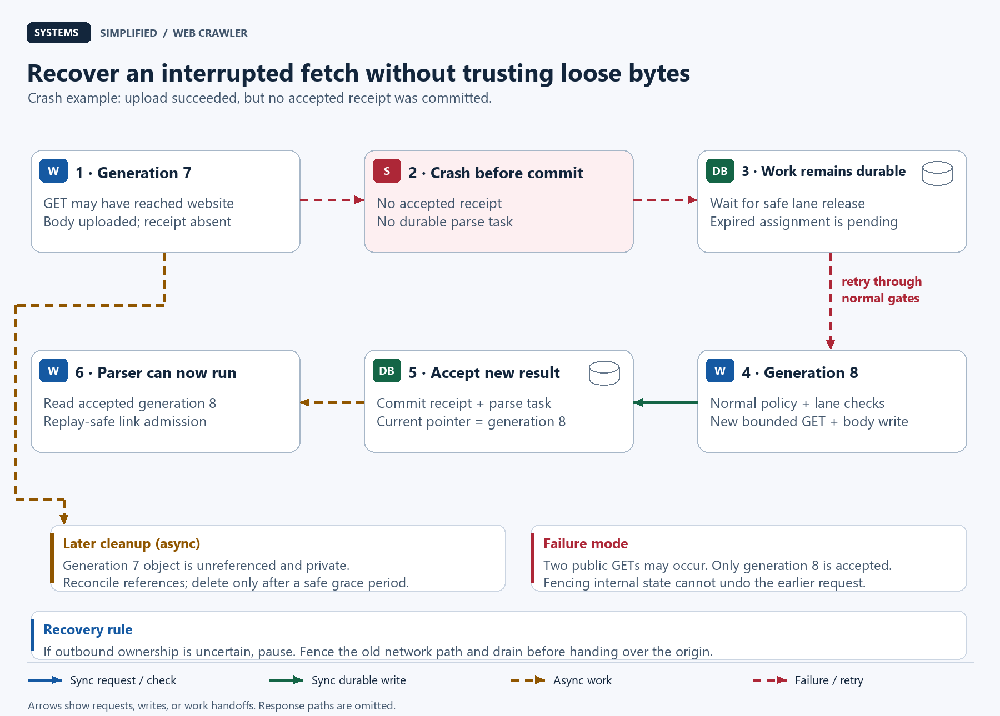

# Design a Web Crawler

> **In one sentence:** Discover and refresh public web pages without overwhelming their owners or letting an untrusted link reach your private network.

Maya builds a directory of public research articles. She supplies a few web addresses (URLs, or Uniform Resource Locators), and a crawler follows their links to find more. Soon one site generates millions of calendar URLs, another takes ten seconds to respond, and a worker crashes after downloading a page. Fetching is easy; deciding what to fetch next, safely and fairly, is the real system.

Design a web crawler around a durable frontier of URLs, a scheduler that controls requests per origin, and isolated fetchers that validate every destination. Store accepted responses before publishing parse work, deduplicate discoveries, and revisit pages by policy. Scale across independent origins; treat retries as potentially repeated fetches, and pause uncertain ownership rather than promise exactly-once crawling.

**Level:** Intermediate  
**Patterns:** [Durable scheduling](#the-frontier-is-a-schedule-not-just-a-queue), [partitioning](#data-model-and-partitioning), [politeness](#how-do-we-schedule-politely), [deduplication](#which-duplicates-should-we-remove), [recovery](#reliability-correctness-and-recovery)  
**Read time:** About 30 minutes  
**Prerequisites:** Basic web requests; unfamiliar scheduling and distributed-systems terms are explained below.  
**Article facts:** Prepared and published October 14, 2026; human review pending. This is an illustrative public-web crawler, not a description of a search company's private implementation. Workloads, budgets, and service targets are hypothetical.

## Why this system matters

A **web crawler** is an automated client that downloads pages and discovers links. Search engines, public archives, and link-checking services use variations of this design. A **search index**, which organizes content for answering queries, is a separate downstream product; finding a page does not determine how it should rank.

The important tension is that our throughput comes from other people's servers. More workers can increase total coverage, but they cannot make one small site able or willing to serve us faster. An effective crawler spends its budget on useful pages and makes its limits visible to operators and website owners.

This lesson's original worked examples show why a large frontier does not imply large safe throughput, how URL discovery can grow nine times faster than consumption, and how a crash between object storage and metadata becomes recoverable work rather than a lost page.

## The problem in plain English

Maya submits starting URLs, called **seeds**, through an authenticated application programming interface (API). The crawler accepts eligible URLs, fetches them, extracts links, and repeats within a bounded project budget. It later checks important pages again to keep the directory fresh.

```http
POST /v1/crawl-projects
Content-Type: application/json

{"seeds":["https://research.example/articles"],"max_pages":100000}
```

```json
{"project_id":"research-42","state":"accepted"}
```

“Accepted” means the project and its seed records were committed, not that every linked page will be retrieved. A project status endpoint reports discovered, fetched, blocked, failed, and budget-excluded counts. `.example` addresses here are illustrative, not live crawl targets.

> **Mental model:** The frontier is a library's appointment book. Each website has its own visiting hours and waiting line; one long line must not block appointments elsewhere.

An **origin** is the combination of scheme, hostname, and effective port, such as `https://research.example:443`. It is our primary scheduling and robots-policy key. Different origins may belong to one owner or share infrastructure; an origin limit alone cannot guarantee a site-wide or IP-wide limit.

## What success looks like

### Functional requirements

- Accept seeds and discoveries for public HTTP (Hypertext Transfer Protocol) and HTTPS pages; HTTPS protects the connection with Transport Layer Security (TLS).
- Respect applicable `robots.txt` rules, project scope, removal requests, and per-origin request budgets before fetching.
- Fetch bounded HTML (Hypertext Markup Language) documents, preserve response metadata, and extract eligible links.
- Track each URL's attempts and next visit time; support conditional refreshes and bounded retries.
- Deduplicate repeated discoveries and repeated processing while preserving distinct URLs when equivalence is uncertain.
- Expose project progress and let operators pause a project, origin, or the entire fleet.

### Non-functional requirements

These are design targets, not measured benchmarks.

| Goal | Target | Why it matters |
| --- | --- | --- |
| Crawl volume | 10 million page attempts/day, including retries and refreshes | Count actual work rather than only successful unique pages |
| Peak fleet rate | Evaluate capacity for 5 times average | Absorb due-work bursts without increasing an origin's allowance |
| Ordinary politeness | One active request per origin; at least 1 second between starts | Slow origins are not punished with extra concurrency |
| Freshness | Revisit selected high-value pages within 24 hours when eligible and reachable | A conditional target, not a guarantee for every discovered page |
| Fetch limits | 20-second total request deadline; 2 MiB decoded HTML limit | Bound occupied sockets and parser memory |
| Work recovery | Committed frontier work survives a worker crash under the chosen database durability policy | Queues and workers are not the source of truth |
| Failure behavior | Pause affected origin partitions when safe outbound ownership cannot be established | Coverage can wait; unsafe duplicate traffic should not continue |
| Operability | Measure coverage, due-work age, origin throttling, failures, and pipeline backlog | A full queue is not proof of useful crawling |

### Out of scope

- Login sessions, paywalls, CAPTCHA bypass, form submission, and non-public resources.
- Executing JavaScript, downloading images/video, or rendering arbitrary pages in a browser.
- Search ranking, an internet-wide completeness claim, or instant freshness.
- An exactly-once request guarantee to independent websites.
- Active multi-region fetching of the same origins; one region owns outbound work initially.

## Assumptions and scale

Assume one region and a deliberately bounded public-HTML workload. Decimal KB/GB/TB below use powers of 1,000; MiB uses powers of 1,024.

| Input | Assumption | Derivation / note |
| --- | --- | --- |
| Page attempts/day | 10 million | Includes failures, repeats, redirects fetched as separate attempts, and refreshes |
| Average page-attempt rate | About 115.7/second | `10,000,000 / 86,400` |
| Peak factor and rate | 5 times; about 578.7/second | `115.741 × 5`; robots requests are additional |
| Mean occupied fetch time | 2 seconds | Illustrative measurement to replace with a real latency distribution |
| Mean concurrent page requests at peak | About 1,158 | `578.704 × 2`, using Little's Law: concurrency = throughput × mean duration |
| Initial fetch capacity to evaluate | 1,600 concurrent slots | Hypothetical headroom; tune with processor, memory, socket, and network tests |
| Eligible origins in a healthy peak | At least 2,000, with varied URL backlogs | Necessary workload diversity, not a promise inferred from frontier size |
| Accepted response bodies/day | 8 million | Assumed outcome of the 10 million attempts |
| Mean retained compressed body | 100 KB | Measure on the target corpus; not the decoded parser limit |
| New raw-body volume/day | 800 GB | `8,000,000 × 100,000`; before exact-body reuse |
| Raw-body retention | 7 days; about 5.6 TB logical | `800 GB × 7`; excludes replicas, versions, extracted text, and overhead |
| Average retained-body ingress | About 9.26 MB/second | `800 GB / 86,400`; about 46.3 MB/second at 5 times average |
| Frontier size and record budget | 100 million URLs; 500 bytes each | About 50 GB logical, before indexes, replicas, and database overhead |
| Accepted new links per processed body | 10 on average | Assumed *after* URL deduplication and initial scope checks |
| Potential frontier additions/day | 80 million | `8 million × 10`; larger than the 10 million attempt budget |

If each attempt removed one unique waiting URL, additions would still exceed consumption by **70 million URLs/day**. Retries and refreshes consume attempts without removing new URLs, so the actual growth can be worse. Admission quotas, per-origin budgets, and project limits are necessary even with unlimited worker capacity.

With one active request per origin and a 1-second start gap, an origin with mean request duration `L` has a healthy upper rate near `1 / max(1 second, L)`. At `L = 2 seconds`, 2,000 eligible origins can supply roughly 1,000 attempts/second before other constraints. Twenty such origins supply only about 10/second, regardless of how many workers we launch. Variability and unavailable origins reduce this estimate.

Robots fetches, retries, and redirects consume the same outbound origin lane as page requests. Include them in actual capacity and politeness metrics. A socket is a network connection handle. Retained-body ingress understates total network traffic: rejected or failed responses can still transfer bytes.

> **Key implication:** Scale across independent, eligible origins. A billion URLs from one site cannot justify a billion concurrent visits.

## Version 1 — the simplest credible design



The baseline already has durable scheduling and safe outbound access. Its limitation is that one process performs fetching and parsing; a slow response delays useful work elsewhere. Blue arrows show synchronous requests, green arrows show durable writes, and amber dashed arrows show work scheduled for later.

1. Store seeds in PostgreSQL, a relational database. A unique URL identity prevents repeated seed submissions from creating repeated frontier rows.
2. Select a due URL whose origin is eligible; check current robots rules, scope, and destination safety. Missing policy triggers a robots request first.
3. Fetch one bounded response. Persist an accepted body in private object storage, then commit its metadata and parse task.
4. Parse stored HTML without executing it. Insert admitted links into the frontier and mark the parse task complete.
5. Set the URL's next visit time or terminal outcome, then repeat. A terminal outcome ends automatic attempts for now, not forever.

| Component | Why it exists | What it does not solve yet |
| --- | --- | --- |
| Authenticated project API | Records seeds, budgets, and progress | Does not make all discovered URLs eligible |
| PostgreSQL frontier and metadata | Persists due times, deduplication, outcomes, and parse tasks | A database by itself does not enforce safe network behavior |
| Single crawler process | Applies policy, fetches, and parses | Slow sockets and parser work share one bottleneck |
| Private object storage | Holds bodies without inflating scheduling rows | Cannot atomically commit a database transaction with an upload |
| Restricted outbound network | Blocks private destinations and unsupported schemes | Does not replace application checks or origin scheduling |

Do not hold a database transaction open across the public-network request. Claim work briefly, release locks, then perform the slow operation. This creates recovery cases; hiding those cases behind a long lock creates a different outage.

## Where Version 1 breaks

| Pressure | What fails | Observable symptom | Direction of the fix |
| --- | --- | --- | --- |
| Slow origins | One fetch monopolizes the process | Due work for unrelated origins ages | Separate scheduling, bounded concurrent fetching, and parsing |
| Many workers added casually | Workers visit the same origin together | Request bursts and owner complaints | One authoritative origin lane and guarded outbound starts |
| Calendar and query traps | Discovery exceeds crawl capacity | Frontier size and due-work age grow indefinitely | Admission budgets, pattern limits, and per-origin fair scheduling |
| Worker crash after upload | Stored bytes have no committed receipt | Orphan objects or missing parse work | Immutable objects, conditional metadata commit, durable parse tasks |
| Parser saturation | Downloading outruns extraction | Stored bodies accumulate unread | Backpressure from parser backlog into fetch admission |
| One giant origin | Its queue dominates selection | Smaller sites receive little coverage | Schedule origins first, URLs second |
| Frontier database failure | Ownership and due times become uncertain | Unsafe retries or stalled work | Pause admission and recover authoritative state |

## Version 2 — production-scale architecture



The frontier is the source of truth. Fetchers receive temporary assignments; the guarded egress tier is the only path to public websites. Parsers consume committed tasks and return discoveries through the same intake policy as seeds. Solid blue paths are synchronous checks or requests, solid green paths are durable writes, and amber dashed paths are asynchronous assignments or processing. Logical partitions can initially share one database deployment. `GET` is HTTP's read method; the gray connection groups metadata and parse tasks in the same owning database.

### End-to-end flow

1. **Discover and admit.** Intake resolves relative links, normalizes conservatively, applies project and URL budgets, and inserts or updates the owning frontier shard. A shard is one partition of the workload. Newly eligible work appears in the scheduler's due-origin view.
2. **Assign.** The scheduler selects an eligible origin, claims one due URL, increments its generation, and issues a short-lived assignment. A **generation** is a monotonically increasing attempt number used to reject stale results. Durable state stores the assignment; a bounded work queue is a delivery aid.
3. **Authorize outbound work.** The fetcher submits that assignment to the origin's egress gateway. The gateway verifies current assignment, policy, and single-use admission; resolves and validates the actual destination; then starts a bounded request through its serial origin lane. It handles robots requests in that same lane.
4. **Record.** The fetcher writes an immutable body object for an accepted response. In one database transaction it conditionally accepts the result for the current generation, records outcome and validators, updates due time, and creates a parse task. A failed condition leaves an unreferenced object for cleanup.
5. **Parse and rediscover.** A parser claims the task, reads the object, extracts bounded text and links, and sends discoveries to intake. It marks completion only after admissions are acknowledged. Replays are safe because destination intake deduplicates and enforces budgets atomically.
6. **Refresh or retry.** Subsequent attempts must re-enter scheduling and outbound checks. No worker follows a redirect or retries invisibly outside the origin budget.

### Component decisions

| Component | Responsibility | Why this choice | Main trade-off |
| --- | --- | --- | --- |
| Project API and discovery intake | Authenticated seeds, normalization, scope, budget enforcement | One admission boundary for seeds and extracted links | Rejecting excess links reduces completeness |
| Origin-partitioned frontier / metadata | URL identity, due work, policy, attempts, result receipts, parse tasks | Keeps origin state with its URLs and supports conditional commits | A popular origin stays a hot partition |
| Scheduler | Fair selection of due origins and URLs | Stops one huge queue from dominating the fleet | Priority and fairness need explicit policy |
| Fetcher pool | Executes bounded assignments and persists responses | Scales occupied sockets independently of parsing | Extra workers help only when eligible origins exist |
| Guarded egress gateways | Serial origin lanes, current policy checks, validated network destinations | Concentrates politeness and network safety at the actual outbound boundary | Failover requires fencing old outbound access |
| Public origins | External pages and robots policy | They supply the content and impose real limits | We control neither latency nor availability |
| Private object storage | Immutable response bodies and manifests | Cheap replay input independent of worker memory | Cross-store commit and retention need recovery |
| Durable parse tasks | Committed handoff from accepted fetch to parser | No accepted result depends on a best-effort enqueue | Polling, indexes, and cleanup add database work |
| Parser pool | Sandboxed extraction and idempotent rediscovery | Processor-heavy parsing scales separately | Replay can repeat admissions and body reads |

> **Why it exists:** The egress gateway makes “this URL passed an earlier check” insufficient. A changed DNS answer, stale assignment, or redirected destination must not bypass the last safety boundary.

### The frontier is a schedule, not just a queue

Each origin has a queue of URL candidates and a next eligible time. Maintain a due-origin index and, within each origin, a due-URL index. Select an origin with useful work, then select one URL within its project allocation. Rotate among due origins; use bounded priority classes so urgent refreshes do not permanently starve discoveries.

A sleeping origin should not occupy an active fetch slot or block a global first-in, first-out queue. A work-delivery timeout does not delete its durable URL record. Expired assignments can be reconsidered after the outbound lane has been safely released.

On PostgreSQL, short transactions can use `FOR UPDATE SKIP LOCKED` to let consumers claim different due rows without waiting on each other. It gives an incomplete view and is suitable for queue-like selection, not a proof that work is globally ordered or fair. Use explicit ordering plus starvation monitoring. See the [PostgreSQL locking-clause documentation](https://www.postgresql.org/docs/current/sql-select.html#SQL-FOR-UPDATE-SHARE).

### How do we schedule politely?

Use three independent gates: **scope allows this URL**, **current robots policy allows it**, and **the origin lane may start now**. An assignment is not permission to bypass any gate.

In healthy operation, one gateway lane per origin permits at most one active HTTP request. After an actual start at time `s`, the next start must satisfy `next_start >= s + delay` and the previous request must have ended. Increase `delay` when responses slow down or the owner requests it. Use the gateway's monotonic clock for local spacing; persisted wall-clock times support restart recovery conservatively, not exact clock-based guarantees.

Example with a 1-second gap:

| Actual event | Earliest next page start | Reason |
| --- | --- | --- |
| Page A starts at `0.0 s`, finishes at `0.4 s` | `1.0 s` | Minimum start spacing dominates |
| Page B starts at `1.0 s`, finishes at `3.2 s` | `3.2 s` | Single concurrency dominates |
| Page C returns a retry time of `10.0 s` | At or after `10.0 s`, also satisfying spacing and completion | Origin cooldown dominates |

HTTP `429` indicates too many requests; `Retry-After` provides wait advice as a delay or HTTP date. Apply a valid value as an origin cooldown, add jitter, and do not restart before it. With missing or malformed advice, use bounded exponential backoff. An excessive wait pauses the origin for operator review rather than being capped downward into an early retry. See [RFC 6585, section 4](https://www.rfc-editor.org/rfc/rfc6585.html#section-4) and [RFC 9110, Retry-After](https://www.rfc-editor.org/rfc/rfc9110.html#section-10.2.3).

**Robots policy:** Fetch `/robots.txt` for the original origin and evaluate our identified bot's group with a standards-tested parser. Follow parseable rules and the most specific matching path. RFC 9309 recommends following at least five robots redirects and normally refreshing cached rules within 24 hours. Unreachable robots policy means disallow; a `4xx` response may permit crawling. This design is stricter for `401`, `403`, and `429`: pause and investigate. Unsafe redirects also pause. `Crawl-delay` is not standardized there; supported extensions are explicit local policy. Rules are guidance, not access authorization. See [RFC 9309, sections 2–3](https://www.rfc-editor.org/rfc/rfc9309.html#section-2).

Cross-origin robots redirects still pass destination safety and the destination's request lane; the retrieved rules apply to the *initial* origin. Ordinary page redirects become new frontier candidates and undergo the target origin's robots check. Disable the HTTP library's automatic redirect following; detect loops and bound page redirect chains to five hops.

> **Trade-off:** We pause when robots access or outbound ownership is uncertain. That sacrifices coverage and freshness to avoid treating uncertainty as permission.

## Data model and partitioning

Partition by a stable hash of `origin_id`, with the mapping version controlled by the system. Changing a hash modulus during expansion without migration would move origin ownership unpredictably. Store that origin's URLs, attempts, receipts, and policy together; route discoveries for other origins to their owning shards through intake.

| Data | Source of truth | Access pattern | Partition / replication strategy |
| --- | --- | --- | --- |
| Project | Database | Seeds, scope, global budget, progress | By project ID; authoritative atomic budget reservations before URL admission |
| Origin | Owning frontier shard | Robots version/expiry, delay, cooldown, outbound lane state | By origin hash; primary with replicas under chosen durability policy |
| URL | Owning frontier shard | Normalized URL, generation, state, `next_fetch_at`, validators, current receipt | By origin; unique normalized URL identity and due-work indexes |
| Project–URL membership | Database | Project priority, depth, attribution, admission token | Unique `(project_id, url_id)`; idempotent membership insertion |
| Fetch receipt | Owning shard | Status, timestamps, final destination, object pointer, content hash | Unique `(url_id, generation)`; accepted generations update current pointer |
| Response object | Private object storage | Read for parsing/replay; lifecycle cleanup | Key by URL ID and generation; immutable, retention controlled |
| Parse task | Owning shard | Claim, retry, parser version, completion | Unique `(receipt_id, parser_version)`; bounded lease and replay |

For a project budget that spans shards, reserve an admission token from the authoritative project service before inserting a new membership. Retries use the same token, and tokens are bound to a specific project–URL membership. Uncertain reservations remain charged: reclaim capacity only after reconciliation proves that the membership is absent and no late insertion can use the old token. This favors under-admission over exceeding the cap. Do not increment a project count independently on every shard and call it a hard global cap. Origin quotas are enforced atomically on the origin shard. User progress can be eventually consistent: counts may lag without granting extra fetch authority. The project page budget bounds distinct admitted URLs; refresh and retry attempts also consume the separate fleet attempt budget. Apply scope and link-depth rules per membership: sharing a fetched URL must not widen another project's scope.

### Which duplicates should we remove?

**URL identity** avoids repeated scheduling of the same address. Resolve relative references, remove fragments for this non-JavaScript crawler, lowercase scheme and hostname, remove default ports, and normalize dot segments with a standards-tested parser. Preserve path case and query order; do not strip arbitrary query parameters or decode reserved characters. These can select different resources. Store the full normalized URL alongside any hash to resolve collisions. See [RFC 3986, reference resolution and normalization](https://www.rfc-editor.org/rfc/rfc3986.html#section-6).

**Content identity** is different. Two distinct URLs may return identical bytes. Compute a cryptographic body hash to identify exact matches; retain both URLs' provenance, status, and validators. A near-duplicate detector for slightly different pages is a later, probabilistic optimization. A site's canonical-link hint is not permission to merge identities blindly.

A **Bloom filter** is a compact membership hint that can report “probably seen” for a new URL. Use it to reduce database lookups only when a positive answer is confirmed before permanently excluding a URL. The database uniqueness constraint remains authoritative. Otherwise a false positive becomes a coverage hole.

### What happens on a refresh?

Keep the server's `ETag` response validator and send `If-None-Match` on the same URL and controlled request representation. A `304 Not Modified` response contains no body; retain the previous body pointer and update the successful-check timestamp. Keep request headers consistent and respect `Vary`, which identifies representation-selection headers. If the referenced body has expired, retry later without that validator to recover a full body. `Last-Modified`/`If-Modified-Since` is a fallback when available. See [RFC 9110, conditional requests](https://www.rfc-editor.org/rfc/rfc9110.html#section-13.1).

Conditional requests save transfer and parsing, but still consume an origin request slot. Choose revisit intervals from project importance and observed change frequency, within explicit minimum/maximum limits. Keep `last_checked_at` distinct from `last_changed_at`: an unchanged page is still a freshly checked page.

> **Remember:** A fresh check is different from a changed document. Count request cost even when no new body arrives.

## Reliability, correctness, and recovery



The numbered sequence separates external fetching from internal publication. Uploading bytes does not make a response current. Only a successful database transaction publishes its receipt and parse task. The website request and object write are synchronous to their callers; parsing and rediscovery happen asynchronously later.

### The commit boundary

Write the object at an immutable `(url_id, generation)` key and include a manifest with the content hash and response metadata. An object store with conditional creation can reject a second overwrite; on an ambiguous upload result, read and verify the existing object's manifest before using it. Amazon S3 documents [conditional writes](https://docs.aws.amazon.com/AmazonS3/latest/userguide/conditional-writes.html) and [strong read-after-write consistency](https://docs.aws.amazon.com/AmazonS3/latest/userguide/Welcome.html#ConsistencyModel). These do not make an object write atomic with PostgreSQL.

Then transact on the owning shard:

```text
if assignment is still current, unexpired, and generation matches:
    insert receipt for (url_id, generation), or return its existing result
    update URL outcome and next_fetch_at
    insert parse task if this accepted body needs parsing
    mark assignment complete
else:
    reject stale result; do not change the current URL pointer
```

An expired assignment is not revived by a late body. A parse task can run more than once. If a parser crashes after admissions but before completion, replay its discoveries using stable admission keys. Re-extraction of an accepted receipt should not grow project counts or consume new admission tokens for already-known memberships.

### What fails, and what remains true?

| Scenario | Design response | Remaining risk |
| --- | --- | --- |
| Fetch worker dies before starting | Reconsider durable URL when its assignment expires; gateway must reject expired starts | Scheduling delay |
| Worker dies after public request began | Gateway bounds and closes request; recover after lane release and assignment expiry | Website may already have received the request; a retry can repeat it |
| Object upload succeeds, receipt commit fails | Keep URL recoverable; retry current-generation commit only while eligible, otherwise clean orphan later | Temporary object cost; a later generation may refetch |
| Receipt commits, worker misses acknowledgement | Read receipt by unique attempt identity; parse task already exists | Repeated internal reads, not a missing handoff |
| Old generation finishes after a new claim | Conditional transaction rejects its metadata publication | Fencing protects our state, not the website from an earlier request |
| Parser crashes midway | Lease expiry and replay; intake deduplicates acknowledged links | Repeated parsing and cross-shard requests |
| Frontier primary fails | Stop affected admission; restore/promote under durability policy and fence old primary | Asynchronous replication can lose recent acknowledged writes |
| Egress owner becomes unreachable | Pause its origins; revoke old outbound access, drain bounded in-flight requests, then resume conservatively | Lower availability; network requests already sent cannot be undone |
| Object storage unavailable | Stop new fetch admissions when results cannot be persisted; keep work pending | Freshness falls; bounded in-flight downloads may be discarded |
| Parser backlog exceeds threshold | Reduce fetch admission; stop new discoveries before filling storage | Less coverage until parsing recovers |

PostgreSQL distinguishes asynchronous replication, where recent commits may be lost on failover, from synchronous commit configurations that wait for a selected standby. Choose and test a zone failure policy; do not infer zero data loss from the existence of a replica. See [PostgreSQL standby and replication guidance](https://www.postgresql.org/docs/current/warm-standby.html#SYNCHRONOUS-REPLICATION).

### Why a lease alone cannot guarantee politeness

A **lease** gives a worker time-limited ownership of a task. A **fencing token**, such as a generation number, lets a store reject a stale worker's writes. Neither can retract an HTTP request already sent to an independent website.

The egress tier therefore needs exclusive outbound ownership during healthy operation and during failover. Before replacing an uncertain owner, the controller revokes its network path, confirms fencing, and waits for the bounded active-request drain. If it cannot confirm that, the affected shard remains paused. The new owner rebuilds lane state from the authoritative database and starts no sooner than recovery time plus the configured origin delay or later cooldown. Database failover also requires the old write primary to be fenced.

The controller and network controls are part of the egress operational design. Test them with a partitioned, paused, and later-resumed old owner. A mere expired timestamp is insufficient. Even with this design, external retries can repeat reads, and requests to different origin aliases can converge on one server. The healthy per-origin target is a defined scheduling behavior, not an internet-wide exactly-once guarantee.



The red dashed path marks a crash before metadata acceptance. Recovery produces a new generation only after the old outbound lane is safely released. The orphan body is private and is never sent to a parser as an accepted result. Green arrows mark the new accepted publication; amber dashed arrows mark later parsing and cleanup.

> **Failure mode:** Exactly-once metadata acceptance does not mean exactly-once fetching. A timeout cannot tell us whether the remote server saw our request.

### Backpressure, retry limits, and operations

**Backpressure** means slowing upstream work when a downstream stage cannot keep up. Cap assigned work, active sockets, unparsed body bytes, and outstanding discovery admissions. For example, a hypothetical 4-hour parser backlog threshold corresponds to about `800 GB × 4/24 = 133 GB` at the assumed daily body volume. Count bytes as well as tasks: ten huge pages are not equivalent to ten tiny ones. A hard storage threshold stops admission immediately.

For transient page errors, use at most five automatic attempts per scheduled visit, each through the normal lane, with exponential backoff and jitter. Repeated `404` or `410` results end that visit and lengthen or stop refresh by policy; they are not a reason to retry rapidly. Redirect chains, robots requests, and network fallback attempts are separately counted and remain bounded. Start-time delays and cooldowns always override an eager retry.

Monitor attempted and accepted pages, unique origins visited, age of due work, exclusions by reason, bytes per useful document, request latency, retry amplification, parse-task age, and orphan cleanup volume. Use bounded origin samples rather than unlimited per-URL metric labels. Alert on private-network denials, policy-expiry failures, simultaneous ownership, and missing receipts. A global kill switch must block new egress starts, not merely stop the API from accepting seeds.

Retain raw bodies for seven days by default; keep referenced replay inputs long enough for the supported recovery window. Reconcile references before deleting orphans with a conservative grace period, such as 24 hours, longer than the maximum commit/retry window. Lifecycle deletion is cleanup, not immediate removal enforcement. A removal tombstone blocks future fetches, parsing, and downstream serving first; a tombstone is a durable record of a deletion decision. Retain it across restoration so backups do not resurrect removed content. Document deletion windows for object versions, derived data, and backups.

## Security and abuse resistance

- **Treat every URL as hostile input.** Server-side request forgery (SSRF) occurs when an attacker makes a server fetch an unintended destination. Permit only HTTP/HTTPS on approved ports, reject embedded credentials and malformed hostnames, and block loopback, private, link-local, multicast, reserved, metadata-service, and organization-internal destinations in both IPv4 and IPv6. A seed that passed validation can discover an unsafe child.
- **Validate at connection time.** DNS (Domain Name System) maps names to addresses. Resolve through the controlled egress path, validate addresses, and bind the connection to a validated address while preserving the original hostname for HTTP and TLS verification. Reject ambiguous mixed public/private answers conservatively. Revalidate redirects, retries, and fallback connections; never allow an unchecked second resolution to substitute another address. This follows the defense boundary in the [OWASP SSRF prevention guidance](https://cheatsheetseries.owasp.org/cheatsheets/Server_Side_Request_Forgery_Prevention_Cheat_Sheet.html).
- **Isolate network access.** Fetchers cannot connect directly to arbitrary destinations; network policy forces public requests through the guarded gateway. Internal object/database access uses separate authenticated endpoints. Parsers have no outbound web access and run with processor, memory, time, and file-access limits.
- **Bound untrusted bytes.** Check content types, cap compressed and decoded bytes, decompression ratio, header size, extracted links, nesting, and parsing time. Do not trust `Content-Length` as the only size check. Keep TLS certificate verification enabled. Never execute fetched HTML in an operator's browser without safe text rendering or a sandbox.
- **Control crawl traps.** Cap depth, unique URLs per origin, query variants per path family, and project admissions. Flag exploding calendar paths or session identifiers. Conservative exclusions are visible outcomes, not claims that the crawler discovered the whole web.
- **Identify the crawler and handle complaints.** Send a stable descriptive user agent with an owner/contact page when deployed. Honor origin/project pauses and removals. Do not interpret publicly reachable text, `robots.txt`, or a sitemap as blanket permission to retain or republish it.
- **Minimize retained sensitive data.** Use no login cookies, redact credentials and sensitive query values from logs, encrypt private stored responses, restrict body access, and set explicit retention. Public pages can still contain personal information. Scope and content-use decisions remain project responsibilities.

## The trade-offs that matter

| Decision | We optimize for | We give up | Prefer an alternative when… |
| --- | --- | --- | --- |
| Partition by origin | Local politeness state and fair selection | A large origin cannot spread arbitrarily across fetch owners | One approved owner explicitly permits higher shared concurrency |
| Database-backed frontier and parse tasks | Inspectable durable state and transactional handoff | Write/index cost at large discovery volume | Measured database limits justify a specialized scheduler plus durable log |
| Conservative URL normalization | Avoid accidentally merging distinct pages | More duplicate addresses and fetches | Corpus-specific equivalence rules are tested and reversible |
| Plain HTTP fetch, no JavaScript | Lower resource cost and attack surface | Client-rendered content may be missed | Essential approved pages require a separately budgeted browser tier |
| Store body before metadata acceptance | Replayable accepted content | Temporary orphan objects | A small bounded corpus can store body and metadata together |
| Pause uncertain robots/ownership | Predictable external behavior | Lower coverage during outages | An explicit policy permits a weaker guarantee and its consequences |
| Per-origin lanes with supplementary network caps | Bounded traffic per named endpoint | No automatic site-wide identity guarantee | Owners provide a shared domain budget or shared-IP abuse calls for extra caps |
| Seven-day raw retention | Bounded storage and recovery window | Older bodies cannot be replayed | An authorized archival use case justifies longer retention and cost |

> **At scale:** More fetch slots are useful only while there are enough eligible origins and downstream capacity. First measure whether the constraint is politeness, sockets, parsing, admission, database writes, or storage.

## How the design evolves next

| Trigger | Next change | Why not add it on day one? |
| --- | --- | --- |
| Frontier indexes exceed measured safe capacity | Move stable origin ranges into independent database shards | Routing and cross-shard budget recovery add operational cost |
| Owners complain across related origins | Add verified owner/domain budgets and conservative IP caps | Domain grouping is imperfect; shared hosting can penalize unrelated sites |
| Many near-identical documents waste parsing | Add near-duplicate signatures and corpus-specific canonical hints | Probabilistic merges can discard useful differences |
| Freshness misses despite spare capacity | Learn change-rate schedules with bounded importance tiers | Incorrect learned priority can starve smaller sites |
| JavaScript is necessary for approved coverage | Add sandboxed browser workers with separate quotas and the same egress checks | Browsers are far more expensive and expand the attack surface |
| Regional recovery becomes a requirement | Cold standby plus tested origin-ownership transfer | Active multi-region fetching makes politeness and state recovery harder |
| Operators cannot explain exclusions | Add sampled provenance and reason trails | Detailed logs can increase privacy exposure and storage cost |

## Key takeaways

- A frontier is durable scheduled work; queue length does not measure useful coverage.
- Select origins before URLs so one huge site cannot monopolize visits.
- An origin's request budget, not worker count, determines its safe throughput.
- URL deduplication, content deduplication, and idempotent processing solve different problems.
- Commit accepted metadata and parse work together after storing the body; recover orphans explicitly.
- Fencing protects internal state. Safe outbound failover also needs network ownership controls.
- Conditional refresh saves bytes, while budgets, backpressure, and destination validation keep the system bounded.

## Quick check

1. Your frontier contains 50 million URLs on twenty origins with 2-second responses. Can 1,600 slots produce 579 requests/second under this lesson's policy?
2. A worker uploads a body but crashes before receipt commit. Which durable records prove that a parser may use it?
3. Why does rejecting an old generation's database write fail to prove that the website received only one request?

**Suggested answers:** (1) No: those origins supply about 10/second with one active request each. Find more eligible origins or accept lower throughput. (2) An accepted receipt and its transactional parse task; the object alone is insufficient. (3) The old worker or gateway may have sent a request before losing ownership. A later retry can repeat it even if only one result becomes current.

## Related lessons

- [Design a Rate Limiter: burst budgets and outage policies](../rate-limiter/README.md) — compare admission quotas with this crawler's serial origin lanes.
- [Design Pastebin: cross-store creation and deletion recovery](../pastebin/README.md) — revisit immutable bytes, mutable eligibility, and cleanup.
- [Design a URL Shortener: HTTP redirects and cache pressure](../url-shortener/README.md) — understand the redirects the crawler must treat as new checked destinations.

## Frequently asked questions

### Why not use one global queue?

It mixes immediately eligible URLs with origins that are sleeping, blocked, or slow. Schedule eligible origins first, then choose URLs within them. A delivery queue can carry claimed assignments, but due times, ownership, and retry state belong in the durable frontier.

### Does robots.txt make a page safe or authorized to crawl?

No. It communicates crawler guidance, not access authorization or destination safety. Apply project scope, owner restrictions, network validation, and retention rules separately. An unreachable robots policy pauses this design instead of being treated as permission.

### Can a crawler fetch every URL exactly once?

No such guarantee follows from a work queue or database lease. Workers can time out after a request reached the website. Deduplicate scheduling and internal publication, fence stale results, and admit that external fetching may repeat. Refreshing pages intentionally repeats it too.

### Should URLs be partitioned by their full hash?

Not for this primary scheduler. A full-URL hash scatters one origin across owners and requires extra shared coordination for politeness. Partition by origin, then index its URLs locally. A hot origin is constrained by its budget; moving it to a dedicated shard improves isolation rather than granting more traffic.

### How do we stop an infinite calendar or query trap?

Bound depth, origin URL counts, path/query variants, and project budgets before admission. Detect rapid growth and expose exclusions for review. A bigger worker fleet does not solve unbounded discovery, and aggressive normalization can silently collapse real pages.

## Glossary

| Term | Meaning in this lesson |
| --- | --- |
| Frontier | Durable set of discovered URLs with eligibility, priority, ownership, and next visit times |
| Origin | Scheme, hostname, and effective port; primary politeness and robots-policy key |
| Politeness | Respecting owner policy and bounded external request timing/concurrency |
| Lease | Time-limited assignment that can expire and be reconsidered |
| Generation / fencing token | Attempt version checked before accepting a result; does not cancel a sent network request |
| Idempotency | Repeating an internal operation produces the same accepted state instead of extra side effects |
| Backpressure | Downstream congestion reduces upstream admission |
| Egress | The controlled outbound network path from our system to websites |
| Validator | Server metadata such as an ETag used to check whether a representation changed |
| Tombstone | Durable removal record that prevents later processing or restoration from resurrecting content |

## Sources and further reading

These primary sources support protocol, storage, and security claims. The proposed architecture and sizing are illustrative choices, not production benchmarks. Consulted October 14, 2026.

1. [RFC 9309: Robots Exclusion Protocol](https://www.rfc-editor.org/rfc/rfc9309.html) — robots rules, redirects, failures, and caching.
2. [RFC 9110: HTTP Semantics](https://www.rfc-editor.org/rfc/rfc9110.html) — conditional requests, validators, redirects, and retry advice.
3. [RFC 6585: Additional HTTP Status Codes](https://www.rfc-editor.org/rfc/rfc6585.html) — `429 Too Many Requests`.
4. [RFC 3986: URI Generic Syntax](https://www.rfc-editor.org/rfc/rfc3986.html) — reference resolution and conservative normalization.
5. [PostgreSQL SELECT locking clauses](https://www.postgresql.org/docs/current/sql-select.html#SQL-FOR-UPDATE-SHARE) — concurrent queue-like work selection and its limits.
6. [PostgreSQL standby and replication documentation](https://www.postgresql.org/docs/current/warm-standby.html#SYNCHRONOUS-REPLICATION) — failover and durability trade-offs.
7. [Amazon S3 consistency model](https://docs.aws.amazon.com/AmazonS3/latest/userguide/Welcome.html#ConsistencyModel) — visibility of successful object writes.
8. [Amazon S3 conditional writes](https://docs.aws.amazon.com/AmazonS3/latest/userguide/conditional-writes.html) — protecting immutable object keys.
9. [OWASP SSRF Prevention Cheat Sheet](https://cheatsheetseries.owasp.org/cheatsheets/Server_Side_Request_Forgery_Prevention_Cheat_Sheet.html) — URL, network, DNS, and redirect boundaries.

**Revision note:** Initial design, October 14, 2026. Revisit assumptions when corpus size, latency distribution, origin policies, retention, browser requirements, or ownership/failover mechanisms change.
